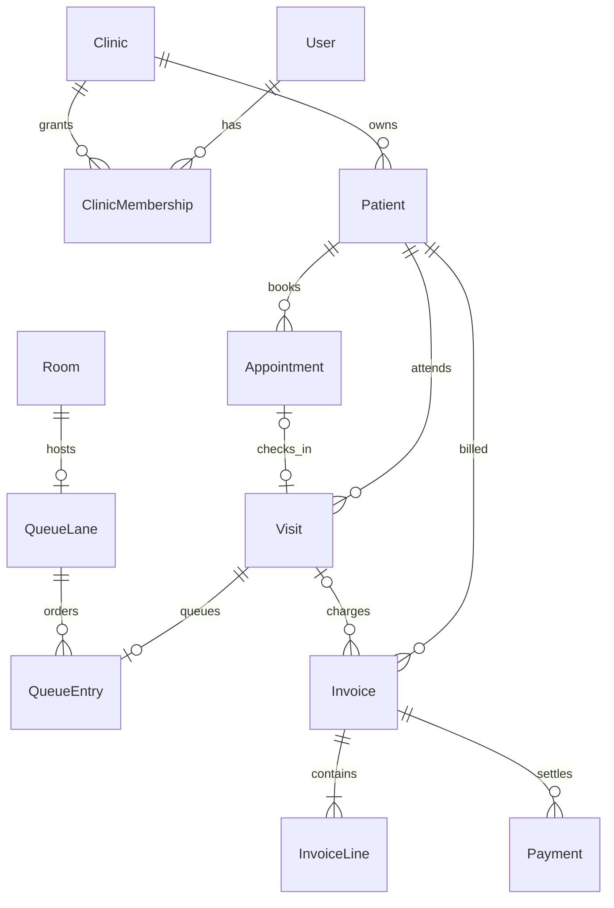

# Lamssa architecture

Phase 2, Steps 2.1–2.5 — current implementation, 2026-10-28.

**Current status:** authenticated administrative patients, clinic resources, services,
appointment scheduling, visits, live queues, invoices, payments, centralized immutable audit logs,
encrypted backups, TOTP Multi-Factor Authentication (MFA), hashed recovery codes, server-enforced
step-up authorization, active session device management, privacy rights requests (Access, Correction,
Restriction, Export, Erasure), formula injection sanitization, export revocation, versioned
retention policies with dry-run verification, structured JSON logging with IP and PII redaction,
in-memory rolling operational metrics with Prometheus exposition, decoupled error tracking and SHA-256
fingerprinting, actionable alerting with 15-minute deduplication, and Arabic RTL frontend error boundaries
now persist per clinic through mandatory tenant transactions, RBAC, PostgreSQL FORCE RLS, and security hardening.
Arabic RTL directory and appointment calendar screens use the protected API, as do reception/doctor queue, billing,
audit, privacy, observability, deployment and security workspaces. Dashboard metrics and explicitly selected legacy workflows
retain browser demo data. The original queue remains an explicitly separate optional demo. No clinical records,
photographs or automatic demo import are implemented.

## Step 2.5: deployment and production verification

The deployment unit remains a simple modular monolith: an unprivileged static web
container, a non-root NestJS container, one PostgreSQL 16 database and a private asset
volume behind Caddy TLS termination. PostgreSQL has no public network attachment.
Runtime and migration identities are separate; the runtime role remains a non-owner
without `BYPASSRLS`. Migrations run as an explicit one-shot release operation before
application traffic, never automatically inside each API replica.

Environment validation fails production startup without strong CSRF, MFA and monitoring
secrets, HTTPS origins, an absolute persistent asset directory, an explicit Host allowlist
and exactly one trusted proxy hop. Caddy rejects operational endpoints publicly and
routes only the API prefix and static web application. Platform subdomain wildcarding is
limited to the configured base domain; verified custom names require a separate reviewed
routing/TLS activation and never become tenant authorization.

Global observability has a distinct authorization boundary. `/metrics` accepts only a
dedicated machine credential and is intended for the internal monitoring network.
Diagnostics and active alerts require an active global `PLATFORM_ADMIN`. Clinic owner
or admin membership alone always fails. Operational output remains global and has no
clinic-scoped variant in this phase.

PostgreSQL and assets have paired but separate encrypted recovery paths. The asset
archive validates UUID keys, refuses links, hashes every file and restores to a new
volume. Off-site object storage, immutable retention and key management are operator
gates. See [deployment](deployment.md) and the
[production checklist](production-readiness-checklist.md).

## Step 2.4: monitoring, error tracking & reliability

Phase 2, Step 2.4 establishes production-grade observability and reliability:

1. **Zero-Dependency & Zero-Cost Telemetry**:
   - Native Node.js `crypto`, in-memory ring buffers, and NestJS services provide comprehensive observability without external subscriptions or recurring SaaS costs.
   - Prometheus metrics exposition (`GET /api/v1/metrics`) with `# TYPE`, `# HELP`, and custom quantiles ($p50$, $p95$, $p99$, $max$).
   - Multi-tenant data isolation: operational metrics omit patient identifiers, clinic names, and financial amounts. Metrics require a private machine key; diagnostics/alerts require an active `PLATFORM_ADMIN`. Clinic roles have no global telemetry access.

2. **Structured JSON Logging & Automated PII/PHI Redaction**:
   - Single-line JSON logging format for seamless log aggregation (Vector, Fluentbit, Loki).
   - Network IP masking: IPv4 addresses masked to `/24`, IPv6 addresses masked to `/48`, localhost mapped to `127.0.0.0/24`.
   - Recursive redaction of sensitive credentials, payment cards, national IDs, and medical notes (`[REDACTED]`).
   - Header sanitization: `[REDACTED_AUTHORIZATION]`, `[REDACTED_COOKIE]`, `[REDACTED_CSRF_TOKEN]`, `[REDACTED_HEADER]`.
   - Correlation ID propagation (`X-Request-Id` / `X-Correlation-Id`) across middleware, filters, and client responses.

3. **Decoupled Error Tracking & Deterministic Fingerprinting**:
   - `ErrorTrackerService` computes 64-character SHA-256 fingerprints normalizing UUIDs, numbers, and timestamps.
   - Error grouping aggregates identical failure root causes into frequency-ranked records.
   - Pluggable provider interface (`ErrorReportingProvider`) allows future zero-touch integration with Sentry, Datadog, or AWS CloudWatch.

4. **Actionable Alerting Engine**:
   - `AlertingService` continuously evaluates operational health rules:
     - `DATABASE_DOWN` (critical): PostgreSQL unreachable or connection pool exhausted.
     - `HIGH_5XX_ERROR_RATE` (critical): $\ge 10$ internal server errors.
     - `BACKUP_STALE` (warning): Last successful encrypted backup $> 24$ hours old.
     - `BACKUP_FAILED` (critical): Last backup or restore drill failed.
     - `AUTH_BRUTE_FORCE_SPIKE` (warning): $\ge 30$ failed login/MFA attempts.
   - Built-in 15-minute deduplication cooldown prevents alert fatigue.

5. **Arabic RTL Frontend Error Boundary**:
   - React Error Boundary with native Arabic RTL typography and design matching the Lamssa design system.
   - Incident tracking correlation IDs (`ERR-XXXXXX`) displayed for user technical support.
   - Safe user recovery actions: "إعادة المحاولة" (retry tree) and "العودة للرئيسية" (safe home navigation).

For detailed specifications, runbooks, and Prometheus scraping instructions, see [monitoring-reliability.md](file:///mnt/samsungSSD/Downloads/aesthetic-clinic/docs/monitoring-reliability.md).

## Step 2.3: privacy, data retention & data governance

Phase 2, Step 2.3 establishes formal privacy engineering and governance:

1. **Data Inventory & 6-Tier Classification**:
   - `AUTH_SECRET`, `FINANCIAL`, `SENSITIVE_PERSONAL`, `PERSONAL`, `INTERNAL`, `PUBLIC`.
   - Distinct boundaries separating current administrative patient data from future clinical data.

2. **Data Minimization & Formula Injection Sanitization**:
   - Neutralizes CSV/Excel formula injection risks by prefixing `=, +, -, @, \t, \r` with single quotes (`'`).
   - Anonymous public queue board display and SSE feed without patient identity leakage.
   - Recursive metadata sanitization stripping credentials and sensitive keys from `AuditEvent`.

3. **Retention Policy & Dry-Run Framework**:
   - Versioned per-clinic `RetentionPolicy` enforcing platform minimums (Audit $\ge 90$d, Backups $\ge 30$d, Patients $\ge 180$d, Appointments $\ge 90$d, Exports $\ge 1$d).
   - `dryRunOnly` permanently enforced (`CHECK (dry_run_only = TRUE)`); NO automated deletion.
   - Simulation engine via locked search-path security definer function `lamssa_security.retention_dry_run`.

4. **Privacy Rights Lifecycle (Access, Correction, Restriction, Export, Erasure)**:
   - Atomic review and decision tracking with documented justification, legal hold flags, and optimistic concurrency versioning.
   - Scoped permissions: `privacy.requests.read`, `privacy.requests.manage`, `privacy.export`.

5. **Secure Patient Data Export**:
   - Protected by `@RequireStepUp(15)`.
   - Single-use/expiring 256-bit download tokens verified via SHA-256 hashes (`PatientExport.tokenHash`).
   - Bounded download counts (max 3), 24-hour expiration, `0600` disk file permissions, and instant revocation.

6. **Legal & Compliance Boundary with Cryptographic Chains**:
   - Cryptographic financial ledger hash chains and append-only audit trails take statutory precedence over erasure requests.
   - Historical point-in-time encrypted backup archives remain immutable.

For detailed specifications, see [privacy-data-governance.md](file:///mnt/samsungSSD/Downloads/aesthetic-clinic/docs/privacy-data-governance.md).

## Step 2.2: security hardening, multi-factor authentication (MFA) & step-up authorization

Multi-factor authentication (MFA) and step-up authorization provide defense-in-depth across global security
and clinic tenant boundaries:

1. **TOTP Core Engine (RFC 6238 & RFC 4648)**:
   - Built with native Node.js `crypto` primitives: HMAC-SHA1 with 30-second steps and 6-digit zero-padded decimal codes.
   - Bounded clock drift tolerance: $\pm 1$ step window ($\pm 30$ seconds) handles minor client clock skew while rejecting larger disparities.
   - Replay protection: `UserMfa.lastReplayStep` prevents replay attacks within the same or prior time steps.
   - Timing-attack resistance: constant-time comparison via `timingSafeEqual`.
   - Setup verification: requires current password reauthentication before generating pending enrollment secret; enrollment remains in `PENDING` status until an OTP is verified.
   - Encryption at rest: TOTP secret encrypted using AES-256-GCM with 12-byte random IVs and 16-byte authentication tags. Keys derived via HKDF-SHA256 from `MFA_ENCRYPTION_KEY` or `AUTH_CSRF_SECRET`. Secrets are never stored plaintext, never logged, never exposed via API after setup, and never saved in browser localStorage.

2. **Single-Use Recovery Codes**:
   - Generates 8 cryptographically secure Base32 recovery codes.
   - Shown once to the user upon setup or password-authenticated regeneration.
   - Verifiers stored only as SHA-256 hashes (`MfaRecoveryCode.codeHash`).
   - Constant-time verification; each code is single-use and immediately marked with `usedAt = now()`.
   - Regeneration revokes all previously issued recovery codes.

3. **MFA Policy & Clinic Membership Governance**:
   - Platform administrators and clinic owners are strictly required to have active MFA.
   - Clinic-level configurable policy stored in `Clinic.mfaPolicy` (`OWNER_ONLY`, `ADMINS_AND_OWNER`, `ALL_STAFF`).
   - Evaluated dynamically against user memberships and active clinic context. Users cannot bypass MFA by changing clinics or roles.

4. **Server-Enforced Step-Up Authorization**:
   - `@RequireStepUp(15)` decorator in `AccessGuard` enforces a 15-minute re-authentication window (`Session.mfaVerifiedAt`) on high-risk operations:
     - Staff role escalation: `PATCH /api/v1/clinics/:clinicId/identity/members/:membershipId`
     - Custom domain verification: `POST /api/v1/clinics/:clinicId/identity/domains/:domainId/verify`
     - Financial reversals and refunds: `POST /api/v1/clinics/:clinicId/billing/invoices/:invoiceId/payments/:paymentId/reversals`
     - Financial invoice voiding: `POST /api/v1/clinics/:clinicId/billing/invoices/:invoiceId/void`
     - Recovery code regeneration: `POST /api/v1/auth/mfa/recovery-codes/regenerate`
   - When required and missing/expired, returns HTTP 403 `MFA_STEP_UP_REQUIRED`. Frontend displays an in-context step-up modal without logging out.

5. **Session Management & Device Privacy**:
   - `GET /api/v1/auth/sessions`: Lists active sessions with masked IP addresses (`192.168.***.***` or `2001:db8:****`), Arabic localized device summaries (e.g. `Chrome على Linux`), creation and last active timestamps.
   - `DELETE /api/v1/auth/sessions/:id`: Revokes specific device session.
   - `DELETE /api/v1/auth/sessions`: Revokes all other sessions.

6. **HTTP Security Headers**:
   - Content-Security-Policy: `default-src 'self'; frame-ancestors 'none';`
   - X-Frame-Options: `DENY`
   - X-Content-Type-Options: `nosniff`
   - Referrer-Policy: `no-referrer`
   - Anti-caching: `Cache-Control: no-store, no-cache, must-revalidate, proxy-revalidate`, `Pragma: no-cache`
   - Strict-Transport-Security: `max-age=31536000` (production; no blanket subdomain/preload assertion on custom clinic domains)
   - CORS methods: explicit allowlist including `GET, POST, PATCH, DELETE, OPTIONS, HEAD`.

## Step 2.1: centralized immutable audit logging, secure backups & disaster recovery

Centralized immutable audit trail (`AuditEvent`) and encrypted disaster recovery subsystem:
- Immutable append-only audit trail protected by PostgreSQL trigger `reject_audit_mutation()` and FORCE RLS.
- Dedicated `lamssa_security.record_audit_event(...)` `SECURITY DEFINER` function for out-of-band security logging.
- AES-256-GCM encrypted database backups (`pg_dump -Fc --enable-row-security`) with mode `0600` filesystem permissions.
- Non-destructive archive verification drill (`npm run db:backup:drill`) and isolated genuine restore (`npm run db:restore`).

## Step 1.9: clinic identity administration

Clinic settings, branding publication and staff management extend the existing
tenant transaction boundary. Four new tenant-owned tables are ENABLE/FORCE RLS:
ClinicAsset, ClinicSlugReservation, ClinicIdentityState and ClinicIdentityAuditEvent.
Clinic remains tenant-root metadata; User/Session/LoginBucket remain global security.
Root/branding/domain/membership fields gain explicit versions, nullable private
business details, managed assets and hashed expiring domain proof metadata.

Every tenant transaction takes a shared transaction-local identity advisory lock;
validated administration writes take it exclusively. Currency/timezone changes
require acknowledgment and are locked after relevant records exist. SQL triggers
additionally reject unsafe changes and serialize last-owner checks. No issued
invoice snapshot is rewritten; future issuance captures current legal identity,
approved typography and a stable managed logo URL. Finance permissions stay separate.

Audited writes use one repository, enforced by the expanded AST boundary checker.
Narrow fixed-path trigger definers publish owned assets, validate role transitions,
allocate audit sequences and revoke affected sessions; runtime cannot execute these
functions directly or manufacture audit records. Read helpers expose only allowed
branding, published derivative metadata and administrative boolean lock flags.
Actor/configuration hash chains provide application-level tamper evidence; privileged
maintenance remains an explicitly trusted, separate boundary.

Image signatures/decoder/size/dimension checks and Sharp re-encoding produce immutable
PNG/WebP derivatives. AssetStore supports a private local development directory and
future object storage; private drafts require authorization, public publication is
explicit. New immutable URLs invalidate caches on replacement; retained published
assets preserve historical print identity. No binary database storage or arbitrary
uploaded SVG/HTML/external asset URL is accepted. Legacy logo URLs are preserved.

Platform subdomains retain former reservations against takeover. Custom domains use
one-time hashed TXT proof and accurate pending/failed/verified ownership states;
routingActive is always false. Host allowlists do not authorize clinic membership.
DNS routing/TLS/production redirects and domain dispute/release flows are deferred.
Staff administration cannot delete global accounts, remove the last owner or let an
admin grant owner/admin/finance authority. Electronic invitations remain deferred.
The separate PLATFORM_ADMIN-only interface is read-only: lifecycle commands need
MFA, scoped operations and global audit before implementation, with no clinic bypass.

Arabic settings/preview, branded login by explicit slug, refreshed app/public board,
favicon cleanup, print snapshots and stale-request protection are implemented. There
is no new browser persistence. See [clinic identity contracts and limits](clinic-identity.md)
and [actual verification](development.md).

## Step 1.8: persistent financial records

Seven new clinic-owned tables: Invoice, InvoiceLine, Payment, PaymentReversal,
FinancialAuditEvent, ClinicInvoiceCounter and ClinicBillingProfile. All use FORCE RLS,
restricted grants and same-clinic RESTRICT foreign keys. An optional Visit reference
also matches the invoice recipient via `(clinicId,id,patientId)`. Global identity,
sessions and the anonymous waiting-board path are unchanged.

Money is stored/calculated in integer minor units with BigInt; API money is string
encoded. Currency scale is explicit and retained per invoice/payment. Bounded quantities,
fixed line discounts and per-line half-up taxes have one documented arithmetic policy.
Issued recipient/business/branding/line snapshots and original payments are immutable.
Refunds and reversals append records, rather than rewrite amounts or erase history.
Clinic counters serialize issuance, payment balance checks and hash-chained audit events.
Deferred SQL checks reconcile line/ledger totals and require an invoice-version audit
record at commit. Summary aggregates use a repeatable-read tenant transaction.

Finance-specific roles are separate from operational administration: owner/accountant
can manage finance; receptionist can draft, issue and record receipts; doctor and clinic
admin are denied. Minimal billing recipient/visit lookups let accountants identify an
invoice without granting general patient/queue/scheduling access. The fixed-path invoker
`finance_allows` helper additionally checks finance roles in SQL policies. Reception
cannot write reversals/profile settings or transition an invoice to VOID under runtime SQL.
Audit INSERT binds the actor to the current membership; runtime audit/payment records
are append-only. New migration files are additive; prior applied history is preserved.

The Arabic RTL invoice directory, editor, payment/correction forms, business settings,
financial summaries and A4 invoice/receipt layouts replace the default local invoice UI.
A dedicated body-level print root avoids modal/hidden-app pagination. Clinic switching
aborts/ignores stale reads and writes. The old invoice demo remains explicitly separate
and its storage key/data are not imported, rewritten or deleted by API activity.

See [billing contracts, RLS, lifecycle, arithmetic and residual risks](billing.md).
The hash chain is application-level tamper evidence, not protection against privileged
full-history rewrites. External checkpoints, immutable asset/PDF archival, tax/e-invoice
compliance, accounting reconciliation, MFA and deployment controls remain future work.

## Step 1.7: persistent visits and live queues

The clean `main` branch contained merge `d957aa8` and scheduling completion `f35c13f`.
The completion diff added documentation, calendar unit tests and additional raw SQL
constraint assertions; no queue backend existed. Baseline independently passed:
32 unit tests, 81 database tests and the 11 existing browser assertions. Those browser
assertions exercised patient APIs and legacy scheduling/queue demos, not a full
persistent appointment booking journey. Step 1.7 was subsequently committed as `e291522` and merged into `main`; old feature branches were removed. Step 1.8 works directly on `main` by owner request.

Five new tenant-owned tables are protected with ENABLE/FORCE RLS: `Visit`,
`QueueTicket`, `QueueCounter`, `QueueConfiguration`, `QueueCommand`. Identity/security
(`User`, `Session`, `LoginBucket`) remain global; `Clinic` remains the separately
protected tenant root. All protected feature operations use `TenantDatabaseService`.
Fresh trusted context includes the authenticated membership ID, enabling a doctor
restriction to their own linked `BookableResource`; a supplied doctor ID cannot
broaden that access. Platform administration still has no automatic bypass.

`SchedulingState` now serializes queue and appointment writes in the same clinic
transaction, preserving a single lock order. The daily counter allocates numbers
transactionally; partial unique indexes independently prevent simultaneous CALLED
or IN_SERVICE claims for one doctor or one non-null room, across all dates.
Composite FKs enforce clinic identity and resource kind. Deferred invoker constraint
triggers check appointment/visit/ticket consistency at commit. Call-next has a durable,
immutable request-key ledger, including empty results; replay never calls a second
patient. Ticket and visit versions guard stale actions. There is no runtime DELETE.

Normal check-in changes appointment → ARRIVED and creates visit + ticket atomically.
An existing ARRIVED appointment without a visit requires explicit per-appointment
reconciliation; migrations do not backfill attendance. Completion, cancellation and
absence synchronize all linked states in the same transaction. The existing ARRIVED
appointment completion API now requires an IN_SERVICE ticket; UI completion occurs
in the queue. Early/late appointment check-in is an explicit staff action: the ticket
uses the actual check-in day in the clinic timezone, not the scheduled day.

Private SSE publishes revision invalidations only. Each two-second poll uses a short
fresh authorized tenant transaction; it neither holds a transaction open nor renews
session activity. Logout, expiry, selection rotation or membership/clinic changes
terminate the subscription. REST resynchronizes after reconnect, with a 15-second UI
fallback. Only opaque invalidations, never patient identities, travel over SSE.
The public board is disabled by default and exposes a bounded opt-in fixed projection
through one hardened SECURITY DEFINER function, `public_queue(text)`. Public streams
fingerprint only that approved projection; private scheduling revisions are not public.
See [queue contracts and policies](queue.md) for state rules, permissions, privacy,
numbering, migration extension instructions and operational limitations.

## Step 1.6: appointments and clinic resources

### Scheduling models and constraints

Step 1.6 introduces six persistent models under mandatory tenant isolation:

| Model | Purpose / constraints |
| --- | --- |
| `ClinicService` | Administrative service definition. `durationMinutes` between 5 and 480. `requiresRoom` boolean flag. `active` boolean flag. `version` for optimistic locking. Compound unique `(clinicId, id)`. |
| `BookableResource` | Clinician or Room resource. `kind` is `DOCTOR` or `ROOM`. `label` 2–100 chars. For doctors, `doctorMembershipId` references `ClinicMembership(clinicId, id)` with unique `(clinicId, doctorMembershipId)`; for rooms, `doctorMembershipId` must be null. `active` boolean flag. `version` counter. Compound unique `(clinicId, id)` and `(clinicId, id, kind)`. |
| `ResourceAvailability` | Weekly recurring operating intervals. `weekday` 1–7 (Saturday is 6, Sunday 7, Monday 1). `startMinute` / `endMinute` within 0–1440. GiST exclusion constraint `weekly_no_overlap` on `(clinicId, resourceId, weekday, int4range)`. |
| `ResourceTimeOff` | Specific time-off interval exceptions. UTC `startAt` and `endAt`. Checked `startAt < endAt` and max duration 366 days. `active` flag and `version`. |
| `SchedulingState` | Clinic-level row with monotonic `revision` BIGINT. Used for atomic serialization locking during booking transactions. |
| `Appointment` | Authoritative clinic appointment. References `Patient(clinicId, id)`, `ClinicService(clinicId, id)`, and `BookableResource(clinicId, id, kind)`. Half-open UTC intervals `[startAt, endAt)` truncated to minute. `bookingKey` UUID and `requestHash` SHA-256 for request idempotency. `status` lifecycle enum (`SCHEDULED`, `CONFIRMED`, `ARRIVED`, `COMPLETED`, `CANCELLED`, `NO_SHOW`). `cancellationReason` (`PATIENT_REQUEST`, `SCHEDULE_CHANGE`, `OTHER`). |

### PostgreSQL GiST exclusion constraints and database extension

The native PostgreSQL `btree_gist` extension is enabled in `public` schema without requiring superuser privileges.
Double-booking prevention is enforced authoritatively at the database engine level via exclusion constraints:

```sql
ALTER TABLE public."Appointment" ADD CONSTRAINT appointment_doctor_no_overlap EXCLUDE USING gist (
  "clinicId" WITH =, "doctorResourceId" WITH =, tstzrange("startAt", "endAt", '[)') WITH &&
) WHERE (status NOT IN ('CANCELLED', 'NO_SHOW'));

ALTER TABLE public."Appointment" ADD CONSTRAINT appointment_room_no_overlap EXCLUDE USING gist (
  "clinicId" WITH =, "roomResourceId" WITH =, tstzrange("startAt", "endAt", '[)') WITH &&
) WHERE ("roomResourceId" IS NOT NULL AND status NOT IN ('CANCELLED', 'NO_SHOW'));
```

Half-open intervals `[)` permit back-to-back bookings (e.g. 09:00–09:30 and 09:30–10:00).
Terminal appointments (`CANCELLED`, `NO_SHOW`) release their resource occupancy, allowing the slot to be immediately rebooked while retaining historical audit records. `COMPLETED` appointments retain slot occupancy.

### State machine trigger and immutability rules

A database trigger `lamssa_security.scheduling_guard()` enforces invariant state transitions and field immutability:
- Initial appointments must be inserted with status `SCHEDULED`.
- Allowed transitions: `SCHEDULED` → `CONFIRMED` / `ARRIVED` / `CANCELLED` / `NO_SHOW`; `CONFIRMED` → `ARRIVED` / `CANCELLED` / `NO_SHOW`; `CONFIRMED` → `SCHEDULED` (on valid rescheduling); `ARRIVED` → `COMPLETED` (Step 1.7 also permits CANCELLED/NO_SHOW through the synchronized queue workflow).
- Terminal states (`COMPLETED`, `CANCELLED`, `NO_SHOW`) cannot transition or reopen.
- Arrived appointments cannot be rescheduled.
- Clinic ownership (`clinicId`), patient identity (`patientId`), and booking idempotency tokens (`bookingKey`, `requestHash`) are strictly immutable.
- Optimistic locking requires `version = old.version + 1` on every update.

### Timezone and DST handling

All timestamps are stored in UTC TIMESTAMPTZ. Local clinic conversion utilizes `@js-temporal/polyfill` with the clinic's configured IANA timezone (e.g. `Asia/Aden`).
- Clocks springing forward over a DST gap are strictly rejected (`INVALID_LOCAL_TIME`).
- Clocks falling back over repeated hours require explicit client disambiguation (`EARLIER` vs `LATER`); ambiguous requests are rejected with `AMBIGUOUS_LOCAL_TIME`.
- Range and date filtering accurately spans 23-hour or 25-hour DST transition days.

### Row-Level Security and runtime privileges

All six scheduling tables have Row-Level Security enabled and forced (`FORCE ROW LEVEL SECURITY`).
Restricted runtime roles (`lamssa_dev_app`, `lamssa_test_app`) possess:
- `SELECT, INSERT, UPDATE` on `ClinicService`, `BookableResource`, `ResourceAvailability`, `ResourceTimeOff`, `SchedulingState`, and `Appointment`.
- `DELETE` granted exclusively on `ResourceAvailability` (for updating weekly hours).
- Hard deletion on `Appointment`, `ClinicService`, `BookableResource`, and `ResourceTimeOff` is strictly prohibited.

### Frontend Arabic RTL Calendar

- **Views**: Daily lane view grouped by doctor, 7-day weekly view, and 14-day list view.
- **Controls**: Clinic-timezone date picker, period navigation, and doctor/status/patient filters.
- **Advisory availability**: Real-time slot calculation excluding non-working hours, breaks, and existing commitments.
- **Resource configuration**: Modal for managing administrative services, doctor memberships, rooms, weekly working intervals, and time-off exceptions.
- **Request scopes**: Request scopes cancel stale in-flight queries upon filter change, date change, or clinic switching.
- **Demo data preservation**: Existing demo appointments, queue, and billing remain untouched in localStorage.

## Step 1.5: administrative patients

### Stored fields and ownership

| Field | Purpose / rules |
| --- | --- |
| id | Server-generated UUID; immutable primary identity |
| clinicId | Required RESTRICT FK to Clinic; immutable tenant ownership |
| patientNumber | Server-issued `P-000001`, minimum six digits, grows to ten; unique **within** clinic |
| fullName | Required, 2–150 characters, NFC, trimmed/collapsed whitespace; preserves Arabic spelling and accents |
| searchName | Internal derived search key, bounded to 150 UTF-16 units; never returned or browser-writable |
| phone | Optional nullable contact; Arabic/Persian digits normalized, formatting removed, leading `00` becomes `+`; 7–15 digits, no country inferred |
| email | Optional nullable administrative contact; validated, trimmed/lowercased, max 254 |
| dateOfBirth | Optional PostgreSQL DATE, exact valid `YYYY-MM-DD`, no future dates; identification when supplied, not a timestamp |
| gender | Optional self-reported FEMALE/MALE/OTHER/UNDISCLOSED; null means unspecified; no inferred gender/clinical sex |
| status | ACTIVE/INACTIVE; created ACTIVE; dedicated authorized status workflow |
| version | Positive optimistic-lock integer, starts at 1; required expectedVersion for edits/status |
| createdAt / updatedAt | Server-managed UTC instants |

No address, national ID, administrative free text, clinical notes, diagnoses,
treatment, photos, allergies or history is stored. The legacy demo's notes remain
browser-only. Optional birth date/gender are never required to register; collect
only when justified. Names/phones/emails are not globally or clinic-uniquely
identifying; duplicates are accepted. The same number in different clinics does
not link people. Clinic has many Patients and at most one PatientCounter. Composite
`(clinicId,id)` uniqueness is ready for future **same-clinic compound foreign keys**.
Indexes cover clinic/status/createdAt/id pagination and name/phone/number prefixes.
Extra SQL pattern-operator indexes and check/trigger/RLS definitions must be retained
when reviewing Prisma-generated migrations.

`PatientCounter(clinicId PK/FK, lastNumber)` is tenant-owned infrastructure, never
an API resource. Registration upserts/increments its row and inserts the patient in
one `TenantDatabaseService.withClinicContext` interactive transaction. PostgreSQL
locks the unique counter row until commit, including concurrent first registrations;
a rollback undoes allocation and insertion together. It is not `MAX()+1`, a browser
counter or a global sequence. Runtime cannot delete/rewind/reassign a counter;
updates must advance by exactly one. The Int allocator fails closed at exhaustion
(2,147,483,647); it never wraps/reuses numbers. Owner maintenance is privileged and
must not manually renumber/reseed operational patients.

### API contracts and access

All paths below are under `/api/v1/clinics/:clinicId` and require a verified cookie
session, selected clinic, active user/clinic/membership and server permissions.
The guard checks access; PatientRepository repeats authorization in its tenant
transaction. No unrestricted Prisma client is exposed to the patient controller.

| Method / path | Permission | Contract |
| --- | --- | --- |
| GET patients | patients.read | `q` (max 60), `status=ACTIVE/INACTIVE/ALL` (default ACTIVE), `pageSize` (default 20, max 50), optional UUID `cursor` |
| GET patients/:patientId | patients.read | Includes inactive records; foreign/missing patient IDs have identical safe 404 responses |
| POST patients | patients.create | fullName plus optional phone/email/dateOfBirth/gender; 201 with projected record |
| PATCH patients/:patientId | patients.update | At least one of the five editable fields plus numeric expectedVersion |
| PATCH patients/:patientId/status | patients.update | Only status and expectedVersion; preserves historical identity; no hard deletion |

Create/update DTOs reject unknown fields: clinicId, ID, patientNumber, timestamps,
version, roles, notes and general-update status are not writable. Explicit null
clears optional fields; blank phone/email also become null. fullName cannot be null.
Every response projects only id, patientNumber, fullName, phone, email, dateOfBirth,
gender, status, version, createdAt and updatedAt. Internal clinicId/searchName/counter
are omitted. Lists return `{items,pageSize,hasMore,nextCursor}`, without unbounded
results or global counts. Ordering is stable `(createdAt DESC,id DESC)` with a
clinic-scoped cursor anchor. Concurrent new inserts appear when refreshing page one;
this is seek pagination, not a frozen snapshot. Query/status changes reset pagination.

Search is a **literal prefix**, not substring/fuzzy matching: name, patient number
(case-insensitive ASCII prefix), or normalized phone prefix. Search keys use NFKC,
lowercase, Arabic/Persian digits, remove tatweel/Arabic combining marks and fold
Alef variants and alef maqsura; displayed NFC names retain these distinctions.
SQL LIKE `%`, `_` and backslash are escaped; no raw request SQL is built. A phone
without country code is not silently made equivalent to an international number.
Searches may match multiple people; this is not deduplication. Only matching
clinic rows within the bounded page are returned.

PATCH atomically matches `(clinicId,id,version)`, increments version and returns a
fresh projection. Stale edits/status return safe 409; the form requires reload/review
rather than silently replacing another operator's changes. Patient numbers remain
unique; duplicate-identifier errors are sanitized to 409. The client disables
concurrent submissions, but POST has no durable idempotency key yet. After an
ambiguous network failure, search before explicitly retrying; there is no automatic
POST retry. Durable idempotency/change auditing remain follow-up work.

The existing least-privilege matrix is unchanged: owner/admin/receptionist read,
create, update; doctor read/update; accountant has no patient permissions. These
permissions cover administrative identity/contact only, not future clinical data.
Status changes use patients.update. No staff/invoice/clinical CRUD was introduced.
All mutations retain exact-Origin + session-CSRF enforcement; CORS now allows PATCH.

### Patient RLS and trusted access

Additive migration `20261024000400_patients` creates Patient and PatientCounter,
enables **and forces** RLS, installs explicit command policies and grants only
SELECT/INSERT/UPDATE to existing restricted runtime grantees. DELETE policy is false
and DELETE/TRUNCATE are not granted. SELECT/INSERT/UPDATE use the existing
`context_allows(clinicId)` selected-live-session/active-membership predicate, including
UPDATE USING and WITH CHECK. Missing/invalid/foreign context denies access. Counter
INSERT additionally requires lastNumber=1. Invoker triggers prevent changes to
patient id/clinicId/patientNumber and prevent counter rewind/reassignment.

Both tables have the explicit maintenance-owner policy needed for controlled
migrations/fictional fixture cleanup. No new SECURITY DEFINER function is added;
the existing three fixed identity/branding/policy helpers are unchanged. Two new
invoker trigger functions have fixed search_path and no PUBLIC execution. Runtime
owner/admin misconfiguration checks now include the new tables. The grant allowlist
is explicit; no access to future tables is implied. Tests exercise real runtime
credentials, not only maintenance access.

RLS enforces tenant rows, **not application permissions, field validation or audit**.
Only the server can issue recognized principals and decide repository permissions.
Custom GUCs remain noncryptographic. Compromised trusted code/runtime SQL or leaked
maintenance credentials remain outside the containment claim; earlier residual
risks below still apply. Future module repositories must use this same boundary
and require same-clinic references (especially appointments → Patient).

### Frontend and demo separation

PatientDirectory holds API data only in component memory and uses the cookie client
with no-store, session CSRF, per-request AbortSignal/timeouts and a generation gate.
Clinic change unmounts the keyed App, aborts all patient operations and discards
state; a late response is ignored even if the transport ignores abort. Profile,
mutation and directory requests have independent cancellation gates. Cross-tab
session checks lock the app if the account/selected clinic changes. UI permission
hiding is advisory; the API always reauthorizes.

Arabic RTL labels, branded colors, loading/empty/error/conflict states, profile
editing and active/inactive filters remain responsive. Dialogs trap keyboard focus,
close with Escape and restore focus. The old browser patient form/directory is
explicitly labeled **legacy demo** and remains accessible for the old workflows.
Appointments, queue, invoices and dashboard show a demo-only banner; they reference
only original demo patient IDs. Registering an API patient never changes those
arrays, imports records or writes identifiable API data into localStorage or
sessionStorage. Existing stored JSON is not even reformatted on an API-only visit;
only deliberate legacy demo operations save demo changes. Use the same browser
origin to retain prior browser records.

See [development.md](development.md#step-15-patient-setup-and-verification) for
commands and executed verification. Number allocation follows [PostgreSQL ON CONFLICT
atomicity](https://www.postgresql.org/docs/16/sql-insert.html); all work remains in
[Prisma interactive transactions](https://www.prisma.io/docs/orm/v7/prisma-client/queries/transactions).

The following sections preserve earlier-step context. The Step 1.5 description
above supersedes historical statements that all workflows are browser-only.

## Step 1.4: mandatory tenant database boundary

### Audit and classification

The pre-change audit confirmed two applied migrations in each database, seven
application tables, no policies/functions/views, and no RLS. Development/test
runtime roles had DML on all seven tables. They were already non-owner,
NOSUPERUSER, NOBYPASSRLS, NOCREATEROLE and NOCREATEDB; their distinct migration
owners own their respective tables. Runtime cannot assume its owner's role.
Existing FK/unique/partial-index constraints remain intact.

| Table | Classification | Runtime boundary |
| --- | --- | --- |
| User | Global identity | Auth-only repository SELECT; no runtime writes |
| Session | Global security | Auth-only repository DML, verifier/identity filters |
| LoginBucket | Global security | Auth-only repository DML, hashed counter keys |
| Clinic | Tenant-root metadata | FORCE RLS scoped SELECT; no runtime writes; narrow bootstrap functions |
| ClinicBranding | Tenant resource, PK/FK clinicId | FORCE RLS scoped SELECT/INSERT/UPDATE/DELETE |
| ClinicDomain | Tenant resource, indexed clinicId | FORCE RLS scoped SELECT/INSERT/UPDATE/DELETE, global hostname uniqueness retained |
| ClinicMembership | Tenant resource + identity bridge | FORCE RLS scoped SELECT; runtime writes denied; narrow identity snapshot function |
| _prisma_migrations | Migration infrastructure | Maintenance owner only |

Runtime branding/domain DML supports the tested tenant transaction foundation;
there are still no HTTP mutation endpoints for these resources. Membership,
clinic-root and user writes are maintenance-only until dedicated reviewed admin
commands/services are implemented. No runtime TRUNCATE, REFERENCES/grant options,
schema creation, policy ownership, role membership or BYPASSRLS are granted.

### Trusted context flow

The global access guard verifies the session, user and authorization fingerprint.
Only authentication may issue an immutable, process-local `VerifiedPrincipal`;
a WeakMap holds its server identity. JSON, clinic IDs, role headers and TypeScript
casts cannot construct a recognized principal. A build/test architecture check
restricts raw Prisma/pg imports and SQL to `src/prisma`, identity access to auth,
and principal minting to AuthService. PrismaModule does not export PrismaService.

`TenantDatabaseService.withClinicContext(principal, clinicId, permissions, work)`:

1. Rejects unrecognized principals, invalid IDs and empty required permissions.
2. Opens an interactive Prisma transaction on the runtime pool and rejects
   owner/superuser/BYPASSRLS/administrative connection roles.
3. Reloads the session, user and fixed membership snapshot on that transaction.
   Checks expiry/idle/revocation, active status and authorization fingerprint.
4. Requires an active membership in an active clinic, the centralized permissions,
   and **session.selectedClinicId matching the requested clinic**.
5. Parameterizes transaction-local `set_config(..., true)` for `lamssa.clinic_id`,
   `lamssa.user_id` and `lamssa.session_id`, using verified database identity.
6. Runs the callback on delegates from that same transaction; exposes tenant
   delegates only, with no global identity/raw-SQL client. Commit/rollback releases
   context; callbacks/transactions cannot be carried across HTTP requests.

This is deliberately stricter than Step 1.3: an authorized dual member must select
B before using B's private context/settings. Before selection, `/auth/clinics` and
POST `/auth/clinic` retain fixed identity/public-branding bootstrap paths. Their
responses grant no operational resource access. The frontend already selects a
clinic before private reads and preserves its previous Arabic demo behavior.
A supported context request for an inaccessible clinic returns 404; a member
requesting an unselected clinic or missing permission receives 403.

ClinicRepository performs both context and settings reads through this service;
settings are reauthorized inside their own transaction after the guard. Future
feature repositories must do the same, specify nonempty server-owned permissions,
filter clinicId explicitly, use validated relationship IDs, and project allowed
fields. Never pass browser-supplied query/include/role/permission definitions into
callbacks. Nested relations to global identity require separate field/permission
review; tenant isolation alone is not field-level medical authorization.

### Policies and privileged exceptions

Migration `20261024000300_tenant_rls` enables and forces RLS on the four tables above.
Each has explicit SELECT/INSERT/UPDATE/DELETE policies. Runtime predicates bind the
row's clinic to the transaction context and a live, nonrevoked session selected
for that clinic, plus active user/membership/clinic. Missing, empty, malformed,
unknown or mismatched context returns no rows and rejects inserts. UPDATE has
both USING and WITH CHECK; cross-clinic UPDATE/DELETE filters out foreign rows.
Clinic/membership mutation policies additionally deny runtime writes.
Triggers reject clinicId reassignment on all three child resources, including
maintenance-owner changes. Existing normalized identity, domain and FK checks
are preserved.

The separate maintenance owner has an explicit ALL policy for migrations and
controlled seed/account provisioning. FORCE RLS does not make this owner a restricted
request identity: the owner can alter its own policies. Owner-role credential
misconfiguration fails closed in TenantDatabaseService. Production API processes
must never receive maintenance URLs; local development tooling currently loads
those private URLs in its own commands. Separate OS/deployment secrets remain a
hardening task, not a guarantee supplied by this repository.

`lamssa_security` is owner-controlled, with no PUBLIC USAGE/EXECUTE and no runtime
CREATE. Every function has a fixed `pg_catalog, pg_temp` search_path and qualified
application tables. The three SECURITY DEFINER functions are:

- `context_allows(uuid)`: returns only a boolean; checks scoped session/member
  state. It has no bypass flag or dynamic SQL.
- `identity_memberships(uuid)`: fixed membership/status/clinic-name projection for
  one server-verified identity. Inactive rows are needed for fingerprint revocation;
  no arbitrary user-ID lookup route exposes it. Credential lookup itself uses the
  global user repository; the snapshot follows password/session verification.
- `public_branding(text)`: exact slug, active clinic only; fixed public name/logo/
  colors. An internal hasBranding flag is removed by the API projection. No private
  settings, domains, user, legal-name or patient fields are returned.

`context_uuid(text)` is an invoker parser that returns null for malformed UUIDs;
`reject_clinic_reassignment()` is an invoker trigger. PUBLIC function execution is
revoked and default function privileges hardened. No views or arbitrary privileged
query functions are installed. Owner-only policy branches are explicitly CASE
short-circuited before calling the helper, avoiding recursive Clinic/Membership
policy evaluation in definer queries. Catalog/role tests audit this inventory.

The seed and development provisioning command now require matching, explicit local
maintenance credentials; seed refuses nonlocal/wrong-environment targets. They
cannot silently fall back to runtime writes. Provisioning still requires supplied
passwords and explicit updates; no default accounts are introduced.

### UTC connections and residual risks

A real test exposed the installed pg adapter's datetime serialization behavior:
its input formatting omits an offset and output normalization replaces the offset.
With the server default Asia/Aden, a requested one-hour expiry was already expired
in PostgreSQL while the ORM displayed the requested instant. All Prisma pools now
use startup `options: '-c timezone=UTC'`, including maintenance/test factories.
The system/database timezone and existing timestamps were not rewritten. Regression
checks compare the Prisma instant with native pg and PostgreSQL's expiry decision.
This is fixed connection configuration, **not session-global tenant SET**.

Custom GUCs are not cryptographic authentication. A runtime SQL credential or
compromised application can read global identity/session infrastructure and set
custom settings; RLS is defense against missing filters/context, not containment
of arbitrary trusted-runtime SQL or owner compromise. Source checks are engineering
guardrails, not a sandbox for malicious code. These definer projections remain
privileged infrastructure and need review when modified. Foreign-key/unique errors
can reveal existence through raw SQL; safe API errors must remain projected.
Future caches/jobs/storage must carry scoped identity separately. Granular clinical
permissions, audit/security-event retention, invitation/recovery/MFA, production
TLS/secret separation, backup restore and medical privacy review remain required.

Implementation uses [PostgreSQL 16 RLS](https://www.postgresql.org/docs/16/ddl-rowsecurity.html),
[hardened definer functions](https://www.postgresql.org/docs/16/sql-createfunction.html),
[transaction-local settings](https://www.postgresql.org/docs/16/functions-admin.html),
and [Prisma 7 interactive transactions](https://www.prisma.io/docs/orm/v7/prisma-client/queries/transactions).
Connection options follow the [pg client API](https://node-postgres.com/apis/client).
The sections below preserve prior-step history; this section governs current access.

## Step 1.3: authentication and clinic authorization

`AuthModule` contains login, CSRF, persistent throttling, sessions and the global
access guard. Every route must declare `@PublicRoute`, `@Authenticated` or
`@ClinicPermissions(...)`; missing metadata denies access. Clinic policies require
nonempty permissions. Only health, active public branding and pre-login CSRF/login
are public. No patient, invoice or staff CRUD is exposed.

| Endpoint under `/api/v1` | Access and response |
| --- | --- |
| `GET auth/csrf` | Public signed pre-login CSRF token + HttpOnly preauth cookie |
| `POST auth/login` | Origin + signed pre-login CSRF, persistent rate limit, email/password; creates fresh session |
| `POST auth/logout` | Verified session + Origin + session CSRF; revokes database row, clears cookie |
| `GET auth/me` | Verified session; safe user ID/name/email, selectedClinicId, CSRF token and absolute expiry |
| `GET auth/clinics` | Verified session; only active memberships in active clinics, safe branding and role/permissions |
| `POST auth/clinic` | Verified session + CSRF; `{clinicId}` must pass a fresh active membership check; rotates session |
| `POST auth/rotate` | Verified session + CSRF; atomically replaces/revokes previous verifier |
| `GET clinics/:clinicId/me` | Active user/clinic/membership + `clinic.branding.read`; projected clinic context |
| `GET clinics/:clinicId/settings` | Active user/clinic/membership + `clinic.settings.read`; display name, timezone, currency only |

Account creation is an explicit **local development CLI** (`npm run auth:provision`),
not public registration. It requires supplied credentials (interactive hidden
password or secure environment), 15–128 character passwords, explicit existing
clinic memberships and a local `_dev` database in development mode. Existing
accounts require `--update-existing`; updates increment authVersion and revoke all
sessions. It cannot provision platform administrators. No account/password is
seeded. Invitations, recovery, MFA and production identity administration are deferred.

Passwords use Argon2id (64 MiB, 3 iterations, parallelism 1, library-generated salt).
Login verifies a dummy hash for unknown users and returns the same failure for wrong
passwords, unknown users and suspended users. PostgreSQL `LoginBucket` upserts count
normalized account and server-derived IP attempts in fixed 15-minute windows
(default 5/account, 30/IP, including successful attempts). Buckets store SHA-256 keys,
counts and expiry, not submitted passwords. Multiple API processes share the limit.
This basic limit needs deployment abuse/lockout review and edge protection.

Sessions use 32 cryptographically random bytes encoded base64url. Only a SHA-256
verifier is persisted, never the raw secret. Cookies are HttpOnly, SameSite=Lax,
host-only and expire with the session. Development uses `/api/v1`; production uses
Secure `__Host-` cookies with path `/` and requires HTTPS for auth/private routes.
Absolute expiry defaults to eight hours, idle expiry to 30 minutes. The active UI
checks `/auth/me` every minute and on focus; these successful requests count as
activity. Revocation/expiry is enforced on every server request, independently of
UI polling. Logout, login replacement and clinic selection revoke previous browser
sessions transactionally; explicit rotation preserves absolute expiry.

Every authenticated request reloads the user and all memberships/clinic statuses.
A fingerprint of password hash, authVersion, platform role, user status, membership
IDs/roles/statuses and clinic statuses is compared with the login snapshot. Changes
invalidate **all** user sessions and require reauthentication with a fresh secret;
there is no silent privilege escalation. CSRF-secret changes also invalidate older
sessions on use. No application role claims are accepted from browser input.

CSRF uses both an exact Origin allowlist (also rejecting cross-site Fetch Metadata)
and a token: signed, time-bounded double-submit before login; session-bound HMAC
returned by `/auth/me` after login, with only its hash in the session row. Unsafe
requests require `X-CSRF-Token`. SameSite alone is insufficient. CSRF values live
only in React memory; session secrets never enter JavaScript or localStorage.
Cookie-bearing responses are `no-store`; exceptions expose static Arabic messages,
never stacks, SQL, cookies or passwords. Login accepts bounded, validated fields and
rejects role/clinic mass assignment. The API body limit is 16 KiB.

The browser uses a same-origin `/api/v1` proxy in Vite development/preview; production
must route web and API under one HTTPS origin. `TRUST_PROXY_HOPS=0` is the default.
Set 1 only behind a single trusted, network-restricted TLS proxy that overwrites
forwarded headers. Unrestricted proxy trust could spoof client IP or HTTPS status.

### Enforced clinic boundary

Session identity → freshly active user → `(userId, clinicId)` active membership →
active clinic → centralized permission check → request clinic context. Selection is a prerequisite for protected resource access in Step 1.4; **each**
clinic request still reauthorizes its URL clinicId. Wrong-clinic
requests return 404, insufficient permissions 403, invalid sessions 401. Slug,
hostname, selected clinic, query parameters and headers cannot grant authority.
Global PLATFORM_ADMIN has no clinic bypass, and no cross-clinic admin endpoint
exists. Future operations require explicit scoped/audited platform authorization.

### Current permission matrix

Source of truth: `apps/api/src/auth/permissions.ts`. `r/c/u/m` means read/create/
update/manage; `—` denies. Each comma-separated action is a separate permission.

| Module | CLINIC_OWNER | CLINIC_ADMIN | DOCTOR | RECEPTIONIST | ACCOUNTANT |
| --- | --- | --- | --- | --- | --- |
| clinic.settings | r,u | r,u | — | — | — |
| clinic.branding | r,u | r,u | r | r | r |
| staff | r,m | r,m | — | — | — |
| patients | r,c,u | r,c,u | r,u | r,c,u | — |
| appointments | r,c,u | r,c,u | r,u | r,c,u | — |
| queue | r,m | r,m | r,m (own resource) | r,m | — |
| queue.checkin / queue.transfer | yes | yes | — | yes | — |
| queue.complete (begin/complete) | yes | yes | own resource | — | — |
| invoices | r,c,m | — | — | r,c | r,c,m |
| reports | r | — | — | — | r |

`patients.*` is reserved for administrative patient identity/contact operations;
it grants no clinical notes, charts, images or unrestricted clinical-record access.
Those require separate sensitive permissions and patient/encounter policies later.
Financial permissions are independent; clinic administration and doctor roles do
not automatically receive them. Unknown roles/permissions default deny. The owner
is explicitly granted commercial permissions, not future medical permissions.
Permission arrays returned to the UI are advisory; guards use the server matrix.
Future staff-management handlers must also restrict which roles the actor may
assign: `staff.manage` alone must never allow granting ownership, platform authority
or permissions the actor cannot delegate. Clinical reporting requires its own
explicit policy; `reports.read` does not grant access to clinical charts.
All five existing workflow tabs remain usable with fictional local demo data for
any authenticated clinic member; this does not authorize future server records.

### Added persistence

`User.authVersion` supports identity invalidation. Global identity infrastructure
`Session` belongs to one user and optionally references a selected clinic (RESTRICT
FKs); it stores tokenHash (unique), csrfHash, authorizationHash, created/lastSeen/
expires/revoked timestamps. Indexes support `(userId,revokedAt)` and expiry.
`LoginBucket` stores a unique hashed key, positive attempt count and indexed expiry.
Session expiry must follow creation. These tables grant no clinic access by
existence. Migration `20261024000200_auth_sessions` adds only these structures and
authVersion; both databases use their existing migration owners and restricted DML
runtime credentials. The explicit grant allowlist now covers seven tables only.
Revoked/expired session retention and scheduled cleanup are deployment work;
expired rate buckets are removed during login requests.

The design follows [OWASP password storage guidance](https://cheatsheetseries.owasp.org/cheatsheets/Password_Storage_Cheat_Sheet.html),
[session guidance](https://cheatsheetseries.owasp.org/cheatsheets/Session_Management_Cheat_Sheet.html),
and [CSRF guidance](https://cheatsheetseries.owasp.org/cheatsheets/Cross-Site_Request_Forgery_Prevention_Cheat_Sheet.html).
It uses [node-argon2](https://github.com/ranisalt/node-argon2) and
[Nest guards](https://docs.nestjs.com/guards). This is a development foundation,
not a production-readiness or clinical compliance claim. RLS, audit, MFA, recovery,
TLS deployment, backups, privacy review and operational abuse controls remain gates.

The following Step 1.1/1.2 inspection and verification sections retain historical
context; current behavior is specified above and in [development.md](development.md).

## Step 1.2.1: native database foundation verified

Native PostgreSQL 16.15 now runs on loopback with separate development and test
migration owners/runtime logins. Both databases have the initial migration applied
and report up-to-date schemas. Runtime roles are non-owner, non-administrative,
DML-only, cannot modify migration history and cannot connect to the other
environment's database. The fictional clinic seed was run twice without duplicates;
Ward and Nour retain distinct branding, and no user accounts were seeded. Live
constraint/privilege tests, database-backed public branding and HTTP readiness all
pass. Test fixtures roll back. See [development.md](development.md) for the exact
commands/results and native start/stop/troubleshooting instructions.

This completed the database prerequisite for Step 1.3; the later authentication
implementation is described above. Per-clinic RLS and production safeguards remain pending.

## Step 1.2: implemented foundation

The user's expanded Step 1.2 scope supersedes the original split between workspace,
API and database steps. Step 1.3 is implemented above; Step 1.4 will deepen tenant isolation.

```text
.
├── package.json / package-lock.json     # One npm workspace install/lockfile
├── .env.example / .nvmrc / compose.yaml
├── apps/
│   ├── web/                            # All previous web source/config, moved intact
│   └── api/
│       ├── src/{config,common,prisma,health,clinics}
│       ├── prisma.config.ts
│       ├── prisma/{schema.prisma,seed.ts,migrations}
│       └── test/{config,http,database}.test.ts
└── docs/
```

No `packages/shared` exists yet. Small auth transport interfaces currently live in
the web feature and API projections; the browser does not depend on Prisma. A shared
contract package can be extracted as operational features grow, with contract tests. Root dev/preview commands delegate to
Vite; root build builds both apps. The web's dependencies are pinned to their
previous lockfile versions so moving it does not upgrade its runtime.

The API uses NestJS 12.2.0, configuration 12.0.1, Prisma 7.10.1 and pg 8.23.1 on
Node 24 LTS. It compiles as native ESM with decorator metadata. Prisma generates
TypeScript into an ignored server-only directory with `moduleFormat = "esm"`;
its CLI URL is configured in `prisma.config.ts`, and runtime connections use
`PrismaPg`. Configuration validates required database URL, exact CORS origins,
host, port and mode without logging secret values. Request validation rejects
unknown writable fields; a global exception filter returns generic Arabic errors
and stable codes, without exception messages or stacks. Shutdown hooks disconnect
the lazy database pool. Logging is intentionally minimal; audited and redacted
operational logging remains future work.

| Public route | Contract / boundary |
| --- | --- |
| `GET /api/v1/health` | Liveness only, `{"status":"ok"}`; no database/version/environment details |
| `GET /api/v1/health/ready` | Constant `SELECT 1`; ready or generic 503; does not verify migrations |
| `GET /api/v1/public/clinics/:slug/branding` | Active clinic only; exactly slug, displayName, and nullable logo/color fields |

Public branding uses a validated slug and selects branding through that clinic's
relation. Its response projection excludes legal name, IDs, private settings,
domains, users, emails and membership/password fields. This is an intentionally
public identification lookup, not an authorization path. There are no patient, appointment, queue, invoice or user-management CRUD routes.
Step 1.3 adds the protected clinic-context routes above. Demo workflow records keep
their original localStorage key/shape and Arabic UI.

### Current database entities

| Entity | Ownership / constraints |
| --- | --- |
| `Clinic` | UUID tenant root; legal/display names, globally unique normalized slug, status, timezone, three-letter currency, timestamps |
| `ClinicBranding` | Optional one-to-one clinic configuration keyed by clinicId; nullable HTTPS logo URL, primary/secondary/optional accent hex colors, timestamps |
| `ClinicDomain` | Clinic-owned UUID, globally unique normalized hostname, verification status, primary flag, timestamps; `(clinicId,id)` unique for future compound references |
| `User` | Global identity, unique normalized email, nullable password hash, status, optional global platformRole, timestamps |
| `ClinicMembership` | Clinic/user foreign keys, one role and status per pair, timestamps; unique `(clinicId,userId)` and `(clinicId,id)` |

`PLATFORM_ADMIN` belongs only to `User.platformRole`. Clinic roles are
`CLINIC_OWNER`, `CLINIC_ADMIN`, `DOCTOR`, `RECEPTIONIST`, `ACCOUNTANT`; platform
authority never implicitly grants access to patient/clinic records. One user can
have distinct roles in multiple clinics. Memberships default to invited status,
and no accounts/passwords are seeded. All clinic/user child deletions and ownership
key updates use `RESTRICT`; archive/status transitions are preferred to deletion.

Indexes support clinic status, domain verification, and active membership lookups
by user/clinic/role. Reviewed SQL adds normalized identity/currency and color/logo
checks, plus at most one primary domain per clinic and a requirement that primary
domains be verified. Prisma cannot express all these SQL rules; future migrations
must retain them. No DNS verification handler is implemented, so no public caller
can set verification status. Clinic timezone validation against IANA identifiers
and currency configuration policy belong to the later clinic settings service.

Compose is development-only: PostgreSQL 17.11, environment-provided credentials,
loopback host port and named persistent volume. Its initialization user is
privileged; separate production request/migration credentials and RLS are still
required. The seed creates two fictional Arabic identities with distinct themes,
timezones/currencies and pending `.example` domains, preserving existing fixture
customization on rerun. It never imports browser data.

### Tenant isolation gate for subsequent work

Step 1.3 derives private clinic context from authenticated, active user + active
membership + active clinic, then checks the role's permission. The public route
allowlist and protected auth/context routes are listed in the Step 1.3 section.
A requested clinic ID selects a candidate membership, never proves access. A slug,
subdomain, custom hostname, forwarded host header or verified domain only identifies
a clinic; none establishes user authority. Never connect clinic records by an
unscoped ID, or allow writable clinicId reassignment.

Repository methods for clinic-owned reads/writes must require verified tenant
context; nested writes and future child references must include clinicId in
compound keys. Public branding's deliberately limited bootstrap lookup must stay
separate from private repositories. RLS and transaction-local tenant settings,
least-privileged request roles, tenant-keyed caches/jobs and sensitive-access audit
are production gates. Test users with memberships in one clinic and in both,
different roles, suspended memberships/clinics, valid foreign-clinic IDs, swapped
headers/hostnames and absent context. Database constraints prove ownership integrity and uniqueness; authenticated
authorization additionally depends on the Step 1.3 server guard and services.

Custom DNS ownership verification, subdomain routing, TLS provisioning, media
storage, themed invoices and messaging are deferred. Future branding changes must
be clinic-authorized and validated before their public fields are published.
See [development.md](development.md) for reproducible setup and verification.

## 1. Historical Step 1.1 inspection

This section records the frontend-only state before Step 1.2. Paths are relative
to the old web root (now `apps/web`); backend absences below describe that snapshot.

The inspection covered `package.json`, the lockfile, `tsconfig.json`,
`vite.config.ts`, `README.md`, `index.html`, every source file, and Git status.
Initially there were only three source files: `App.tsx` (160 compressed lines),
`main.tsx`, and `style.css`. There were no backend files, tests, lint configuration,
workspace definitions, environment configuration, or route definitions.

Git initially had no commits; all prototype files and 2,457 dependency files under
`node_modules` were staged. At the user's subsequent request, a baseline commit
was created after adding `.gitignore` and removing dependency files from the
index only. Dependencies remained on disk. Step 1.1 was subsequently committed as
`dbb529c`; Step 1.2 is not committed automatically.

### Technologies and entry points

| Area | Actual implementation |
| --- | --- |
| Runtime dependencies | React and React DOM only; declared `^19.1.0`, installed/locked `19.3.1` |
| Tooling | Vite declared `^6.3.5`, installed/locked `6.4.5`; TypeScript `~5.9.2`, installed/locked `5.9.3`; React Vite plugin `4.7.0` |
| Type checking | Strict TypeScript, ES2022, bundler module resolution, `react-jsx`, unused-symbol checks, no emitted TS output |
| Startup | `index.html` → `src/main.tsx` → React StrictMode → `App` |
| Styling | Custom responsive CSS; Cairo loaded from Google Fonts with local font fallbacks; no UI framework |
| Arabic/RTL | Root HTML has `lang="ar" dir="rtl"`; Arabic labels/statuses; intentional LTR phone/time fields |
| Formatting | Browser-local date helpers; `ar-YE` date/currency formatting, hard-coded Yemeni rial suffix, whole-number money display |
| Scripts | `dev`, `build` (`tsc -b && vite build`), `preview`; no test or lint scripts |

There is no router. All navigation occurs at the same URL through a React
`Section` union: `overview`, `patients`, `appointments`, `queue`, `invoices`.
Reload returns navigation to the dashboard; browser history/deep links are absent.
The displayed clinic selector and avatar are decorative, not tenant switching or
an authenticated identity.

### State, models, and persistence

`App` owns `data`, `section`, `search`, `modal`, and `notice` using `useState`.
Forms own their input state. Dashboard appointment filtering uses `useMemo`;
other totals, lookups, filtering, and sorting are derived during rendering.
State transitions still live in `App`, including check-in, call-next, finish-visit,
invoice payment, and demo reset. No state-management or data-fetching library exists.

The following are the exact browser model fields, not a proposed database schema:

| Model | Fields / relationships |
| --- | --- |
| `Patient` | `id`, `name`, `phone`, `notes`, `createdAt` (local date string) |
| `Appointment` | `id`, `patientId`, free-text `service`, free-text `doctor`, `date`, `time`, `status` |
| `AppointmentStatus` | `مجدول`, `حضر`, `مكتمل`, `ملغي`; no cancel workflow is exposed |
| `QueueEntry` | `id`, `patientId`, optional `appointmentId`, `number`, `status`, `arrivedAt` (ISO timestamp) |
| `QueueStatus` | `انتظار`, `داخل الغرفة`, `انتهى` |
| `Invoice` | `id`, `patientId`, `description`, numeric `amount`, boolean `paid`, `createdAt` (local date string) |
| `Data` | Arrays named `patients`, `appointments`, `queue`, `invoices` |

Relationships are plain string IDs. There are no foreign keys or `clinicId`
fields, and doctors/services are not entities. New IDs use `crypto.randomUUID()`
when available, with a timestamp/random fallback. Seed IDs are short fixed strings.

The entire `Data` object is read from `localStorage` key
**`lamssa-clinic-demo-v1`** by a lazy state initializer. Loading only checks that
the top-level properties are arrays; element types, status values, references,
and dates are not validated. Missing, invalid, or unreadable storage falls back
to the built-in seed (four patients, four appointments, one waiting entry, two
invoices). A React effect writes the entire object after state changes, including
initial mount. Thus the existing fallback can overwrite malformed stored data;
write/quota failures are uncaught. No new fallback or cleanup is introduced here.
The existing reset action confirms before restoring the in-memory seed. It has
not been invoked against any user browser data during this work.

### Current feature flows

| Section / action | Behavior |
| --- | --- |
| Dashboard | Counts today's appointments (all statuses), all patients, all waiting entries, and all paid invoices across all dates; shows the first five matching appointments in array order |
| Patients | Create name/phone/optional administrative notes; search name or phone; no edit, delete, detail page, or clinical chart |
| Appointments | Create for an existing patient using service/doctor text, date and time; list sorted by date/time; search patient/service/doctor |
| Check-in | Reject completed/cancelled appointments and any existing queue entry for the appointment; mark it `حضر` and append a waiting ticket |
| Queue | One active entry for the entire demo; call the lowest-numbered waiting entry; finishing marks the entry `انتهى` and its linked appointment `مكتمل`; completed entries remain stored |
| Billing | Create one description/amount invoice, optionally already paid; search patient/description/internal ID; mark an unpaid invoice paid once; show total/paid/unpaid sums |

Forms have HTML `required`, length limits, trimming, disabled-submit checks,
and positive finite numeric validation for amounts (integer step/minimum in HTML).
There is no authoritative validation of patient references, phone formats,
duplicate patients, appointment overlaps, past bookings, or allowed transitions.
Invoices are independent of appointments/visits and have no lines, payment
ledger, immutable invoice number, tax, refund, or partial-payment model.

### Risks found in the actual code

| Risk | Consequence / required target |
| --- | --- |
| Browser-only storage | Origin/browser-specific, readable by same-origin scripts, no controlled backup, access audit, retention, or shared source of truth; never use for real patient data or session secrets |
| Mixed responsibilities | Rendering, persistence, and business transitions remain coupled in `App`; extraction below creates seams but is not a service layer |
| No backend/authentication | Anyone opening the prototype can view/mutate its local records; no RBAC, trustworthy identity, or server authorization |
| No tenant boundary | One storage key and no clinic ownership; cosmetic clinic name provides no isolation |
| Weak runtime validation | Syntactically valid stored arrays can still crash rendering or contain inconsistent records; browser controls can be bypassed |
| Queue concurrency | Check-before-write and `max + 1` numbering are not atomic across tabs/devices; whole-object writes can lose updates; there is no `storage` event listener, lock, idempotency, or push synchronization |
| Date/queue scope | `today` is computed at module load and becomes stale across midnight; tickets use UTC date slices while appointments use local dates; waiting/active lists include previous days; repeating daily numbers can affect order |
| Unstable invoice labels | `INV-...` uses the filtered row index and total array length, so filtering or insertion changes displayed labels; labels are not stored identifiers |
| Money | JavaScript number plus a paid flag cannot express an accountable payment ledger; currency is fixed and formatting rounds to whole numbers |
| Medical-data safeguards | No secure clinical notes, consent, attachment protection, read auditing, recovery, or lifecycle controls; administrative fields must not be used as medical records |
| Operational maturity | No existing automated tests, lint, CI, environment separation, or production deployment policy; Vite commands currently bind to `0.0.0.0` |
| External font | Cairo requires an external Google Fonts request; decide self-hosting/CSP and deployment privacy requirements before production |

These issues are documented rather than silently corrected during a
behavior-preserving architecture step.

## 2. Frontend boundaries established in Step 1.1

```text
src/
├── App.tsx                          # Shell, five views, state and transitions
├── main.tsx                         # Existing entry point, unchanged
├── style.css                        # Existing styling, unchanged
├── components/ui.tsx                # Stat, PanelHeading, Status, Empty, Modal
├── features/
│   ├── patients/PatientForm.tsx
│   ├── appointments/AppointmentForm.tsx
│   └── billing/InvoiceForm.tsx
├── lib/demo.ts                      # Existing seed, load, IDs/date/money helpers
└── types/clinic.ts                   # Existing demo types, not API contracts
```

Definitions were moved with imports/exports only. `App`'s body, JSX, event
handlers, storage key/shape, seed, and helper/form logic are preserved. The CSS,
root HTML, dependency manifests, compiler, and Vite settings are unchanged.
Keep demo storage explicit; split general formatting helpers from it when an
API-backed feature actually needs them. Avoid introducing abstractions for
services or screens that have not yet been migrated.

## 3. Target monorepo and architecture decision

Use an npm-workspace monorepo with a **modular NestJS REST API**, PostgreSQL, and
Prisma. Start with one deployable API and one shared database; do not introduce
microservices. No workspaces, backend folders, schema, database client, or backend
dependencies are created in Step 1.1.

```text
lamssa/                             # Future layout, not today's tree
├── package.json                    # Workspace definitions and root commands
├── package-lock.json
├── apps/
│   ├── web/                        # Move the existing Vite app intact
│   │   ├── package.json
│   │   ├── index.html
│   │   ├── vite.config.ts
│   │   ├── tsconfig.json
│   │   └── src/{components,features,lib,types,...}
│   └── api/                        # Future NestJS REST service
│       ├── src/{modules,common,...}
│       └── prisma/{schema.prisma,migrations,...}
├── packages/
│   └── shared/                     # Future transport types + validation contracts
└── docs/
    ├── architecture.md
    └── implementation-roadmap.md
```

The move to `apps/web` and initial API/database identity foundation are now
implemented in Step 1.2; the tree above includes additional future modules/packages.
The single-database choice simplifies initial operations but makes missing tenant
filters especially dangerous and shares capacity/failure impact across clinics.
Tenant-aware constraints, repositories, isolation tests, and resource limits are
therefore mandatory design work. Database-per-clinic remains a possible later
option if contractual or deployment requirements demand it.

Dependency direction: `web` → `shared`, `api` → `shared`, `api` → Prisma/PostgreSQL.
`shared` must not depend on either app, React, Nest, Prisma, or generated database
models. Define transport DTOs, stable machine status codes, pagination, errors,
and runtime validation contracts there; select validation tooling in a later
implementation step. Share contracts rather than internal persistence models or
secrets. Continue mapping statuses and validation errors to Arabic UI labels.

## 4. Target API modules and roles

Controllers handle transport and input parsing, policies/guards verify identity,
membership and permissions, services own business transitions/transactions, and
repositories require validated tenant context. Feature modules do not expose
unrestricted Prisma access to controllers. Use versioned REST contracts (proposed
`/api/v1`), bounded pagination, stable error codes, and documented idempotent actions.

| Module | Responsibility |
| --- | --- |
| Platform/configuration | Validated server configuration, health checks, redacted logging, request IDs, database lifecycle |
| Identity/access | Users, login/session lifecycle, clinic memberships, permission policies |
| Clinics | Clinic provisioning/status, settings, timezone, currency, membership administration |
| Patients | Administrative identity/contact data, clinic chart numbers, search, permitted updates |
| Catalog/resources | Clinic services, clinician profiles, rooms, queue lanes and schedules |
| Appointments | Booking/rescheduling/cancellation, availability and overlap rules |
| Visits/queue | Check-in, visit lifecycle, ticket allocation, call-next and completion |
| Billing | Invoice issue/lines, payment ledger, reversals and financial reporting |
| Audit | Restricted, append-only access/change/security events with retention policy |
| Clinical records (later) | Encounters, consents and protected media after requirements/security review |

Clinic roles belong to a **clinic membership**. The separate global platform role
does not grant clinic permissions. Initially one role per membership is sufficient;
explicit permissions define permitted actions.

| Role | Proposed access boundary |
| --- | --- |
| Platform administrator | Provision/suspend clinics and operate the platform; no automatic access to clinic patient/clinical data; exceptional support access must be scoped, time-limited and audited |
| Clinic owner | Own-clinic ownership, membership and commercial administration; clinical permissions remain explicit |
| Clinic administrator | Manage own clinic settings, memberships and operational permissions; clinical access requires an explicit clinical permission |
| Receptionist | Manage administrative patient details, appointments and check-in/queue; collect payments only if granted; no clinical notes/photos |
| Clinician | Access authorized patient visits, assigned schedule, clinical workflows and permitted queue transitions; no membership management or financial reversals by default |
| Accountant | Billing, payment/reversal permissions and minimal necessary patient identification; no clinical notes/photos |

UI visibility improves usability but never grants authority. Membership suspension
and role changes must affect server access promptly, including existing sessions.

## 5. Target entities, ownership, and relationships

The five clinic identity models plus Session and LoginBucket currently exist.
Patients, scheduling, visits, queue, billing, audit and clinical entities below
remain future work. The current global platform role is separate from membership.

All clinic-owned entities carry a non-null `clinicId`. `User` is global identity;
`Clinic` is the tenant root. Neither is an excuse for global access to clinic rows.
Use server-generated UUIDs, timestamps, actor IDs where appropriate, and explicit
archival/lifecycle rules. No automatic destructive cascades on patient/clinic deletion.

| Entity | Main relationships and purpose |
| --- | --- |
| `Clinic` | Owns memberships and operational data; timezone, currency, status/settings |
| `User` / `ClinicMembership` | User has memberships in multiple clinics; membership links `(clinicId, userId)` to role and active status |
| `Patient` | Belongs to one clinic, has a clinic chart number, contacts, administrative notes; the same person may have separate records in unrelated clinics |
| `ClinicianProfile`, `Service`, `Room` | Clinic resources; clinician optionally linked to a membership in the same clinic; service has duration/pricing defaults |
| `Appointment` | References same-clinic patient, clinician, service and optional room; `startsAt`/`endsAt`, status, version; UTC instants with clinic timezone for local business dates |
| `Visit` | References same-clinic patient and optional appointment; clinical/operational visit lifecycle; one visit per appointment initially, with walk-ins supported by nullable appointment |
| `QueueLane` / `QueueEntry` | Lane is tied to a room (one lane per room initially); entry references a visit/lane, service day, ticket number, status, arrival/start/completion timestamps and version |
| `Invoice` / `InvoiceLine` | Invoice references patient and optional visit; immutable issued number/currency and line price/description snapshots; totals computed by server |
| `Payment` | References same-clinic invoice; amount/method/reference/status/idempotency; reversals are new auditable entries, not a boolean toggle |
| `AuditEvent` | Clinic, actor, action, resource identity, outcome, time/request ID; no raw notes, photos, credentials or unnecessary patient content |



### Tenant-aware constraints and indexes (design only)

Use a global UUID primary key plus `UNIQUE (clinicId, id)` on clinic-owned parent
tables that are referenced by compound foreign keys. Child relationships such as
`Appointment(clinicId, patientId)` must reference `Patient(clinicId, id)`, not
`Patient(id)` alone. Apply this to resource, visit, queue, membership and billing
relations, including nested writes. Service rules must also enforce consistency
between redundant relationships (e.g. invoice patient and linked visit patient).

| Table / purpose | Planned constraint or index |
| --- | --- |
| Membership | Unique `(clinicId, userId)`; index `(userId, status)` for authorized clinic selection |
| Patient | Unique `(clinicId, chartNumber)`; indexes `(clinicId, createdAt, id)` and `(clinicId, normalizedPhone)`; phone is not unique because families can share a number |
| Appointment | Indexes `(clinicId, startsAt, id)`, `(clinicId, clinicianId, startsAt)`, `(clinicId, patientId, startsAt)`; check `endsAt > startsAt` |
| Visit / check-in | Unique `(clinicId, appointmentId)` when non-null; nullable appointment allows walk-ins |
| Queue lane | Unique `(clinicId, roomId)` for initial one-lane-per-room policy |
| Queue entry | Unique `(clinicId, visitId)`; unique `(clinicId, laneId, serviceDay, ticketNumber)`; index `(clinicId, laneId, serviceDay, status, ticketNumber)` |
| Room occupancy | Partial unique index `(clinicId, laneId)` where queue status is `SERVING`; deliberately excludes service day so an unfinished visit cannot be bypassed at midnight |
| Invoice | Unique `(clinicId, invoiceNumber)` once issued; indexes `(clinicId, patientId, issuedAt)` and `(clinicId, status, issuedAt)` |
| Payment | Unique `(clinicId, idempotencyKey)`; index `(clinicId, invoiceId, createdAt)`; composite foreign key to invoice |
| Audit | Index `(clinicId, occurredAt, id)`; restricted access and approved retention |

Prisma supports compound unique identifiers for lookups and relation operations;
the intended mapping is documented by [Prisma's compound constraint guide](https://www.prisma.io/docs/orm/v7/prisma-client/special-fields-and-types/working-with-composite-ids-and-constraints).
PostgreSQL [partial unique indexes](https://www.postgresql.org/docs/current/indexes-partial.html)
can enforce conditional uniqueness. Review selected Prisma-version support during
schema implementation; retain reviewed SQL migrations for database-specific rules.
An exact-start-time unique constraint does not prevent overlapping appointment
intervals: design interval exclusion constraints or a resource-serialized booking
transaction, with concurrency tests for both clinician and room scheduling.

## 6. Tenant isolation and security principles

The chosen request flow is authenticated identity → active membership check →
immutable request tenant context → permission check → tenant-scoped service and
repository. Treat any URL/header/body `clinicId` as a selection request, never as
proof of access. This follows [OWASP's tenant-context guidance](https://cheatsheetseries.owasp.org/cheatsheets/Multi_Tenant_Security_Cheat_Sheet.html).
Reject absent/invalid tenant context; create ownership from the verified context
and prevent tenant reassignment through updates. Object IDs alone grant nothing.

The project policy is to apply the verified `clinicId` to every list, detail,
count, search, export, mutation, relation connection, bulk action and transaction.
Required-tenant repository methods must fail closed; raw/global Prisma access
belongs only to reviewed infrastructure paths. Authorize background jobs and
include tenant identity in cache keys, storage paths, notifications and events.
Return a consistent not-found response for inaccessible clinic records.
Automated negative tests must attempt reads/writes and relationship injection
using another clinic's valid IDs, not just nonexistent IDs.

Use PostgreSQL row-level security as a planned additional boundary before real
clinic rollout. Its [documented role bypass behavior](https://www.postgresql.org/docs/current/ddl-rowsecurity.html)
means the request role must not be a superuser, table owner, or `BYPASSRLS` role.
Use separate migration credentials and transaction-local tenant context on the
same connection as the protected queries; test pooled-connection reuse and missing
context. RLS complements explicit server scoping and compound foreign keys; Step 1.4 implements RLS for current clinic resources; future tables need reviewed
policies as they are introduced.

Authentication implementation must choose a session strategy explicitly. Proposed
browser deployment is web and API behind one HTTPS origin using secure, HttpOnly,
SameSite cookies with CSRF protection for writes, session rotation/revocation,
rate-limited login and strong password hashing. Never store auth tokens in demo
localStorage. Keep secrets server-side; `VITE_*` variables are public browser
configuration. Authorize both transport endpoints and sensitive service actions;
[NestJS authorization documentation](https://docs.nestjs.com/security/authorization)
provides framework mechanisms, while Lamssa must define its own clinic policies.

Validate request shape, lengths, enums, finite amounts, relationships and allowed
state transitions on the server; reject unknown writable fields and mass-assigned
ownership/roles. Use parameterized database access, bounded searches/pagination,
permission-specific response fields and Arabic validation messages in the web app.
Represent money as fixed-precision database values or integer minor units with a
currency policy; transport exact values without floating-point arithmetic.

Before real medical data is accepted, require TLS, encrypted managed storage and
backups, restricted credentials, restore exercises, audit of sensitive reads and
writes, log redaction, incident response, retention/deletion rules, and separate
development/staging/production datasets. Future clinical photos need private object
storage and authorized, short-lived download access; clinical notes and consent
records need stricter permissions than administrative patient data. Jurisdiction,
hosting region, retention and consent obligations remain requirements to resolve;
this architecture does not claim regulatory compliance.

### Queue and booking consistency

The future server owns ordering and timestamps. Check-in must atomically validate
the appointment, create/reuse its visit, allocate a ticket for the lane's clinic
business date and enqueue it, using unique constraints and an idempotent command.
Do not port browser `max + 1` to the server. Allocate through an atomic counter
keyed by `(clinicId, laneId, serviceDay)` under a transaction.

For call-next, lock the same-clinic lane row first, verify it has no active entry
(including previous days), select the eligible waiting entry, conditionally change
its status/version and commit. The partial active-entry constraint is the final
backstop. Finish-visit updates the queue, visit and appointment in one transaction.
Use consistent lock ordering and bounded retry/conflict responses, based on
[PostgreSQL transaction/row locking](https://www.postgresql.org/docs/current/explicit-locking.html).
Define carry-over/close-of-day policy before exposing multi-day queues. Initial
scope is one lane/room; multiple rooms and clinician occupancy require explicit
additional resource constraints. Start with polling/versioned responses, adding
authorized events after authoritative transactional behavior works.

## 7. Incremental migration and verification

1. **This step:** record the actual baseline, extract existing frontend definitions,
   preserve Arabic/RTL and storage compatibility; add no backend dependencies.
2. **Workspace foundation:** move the working app to `apps/web`, retain root dev/build
   commands, verify lockfile and paths; only then establish shared/API packages in
   explicitly scoped follow-up steps.
3. **Backend/database/access foundation:** implement Nest configuration, PostgreSQL
   and Prisma migrations, then auth, membership policies and tenant isolation with
   two-clinic tests before patient endpoints are connected.
4. **Vertical feature slices:** migrate patients → appointments → visits/queue →
   billing. Add a transport boundary per feature; avoid mixing authoritative API
   records and demo arrays in one user session. Use explicit demo/API modes and
   synthetic fixtures until the isolation/security gates pass.
5. **Production readiness:** validate concurrency, backups/restores, auditing, Arabic
   RTL behavior, accessibility, retention and deployment requirements. Medical
   records/media remain a later separately reviewed scope.

Moving the Vite root need not change demo storage if the browser origin remains
identical (scheme/host/port). Changing origin creates a separate localStorage
namespace; do not silently copy, clear or import it. Local demo data must never
auto-import into a clinic database. Any later import is an explicit, validated,
clinic-authorized process. Keep this storage key/shape until a separately planned
demo migration is needed.

### Step 1.1 verification results

| Check | Result |
| --- | --- |
| `npm run build`, before and after extraction | Passed: strict TypeScript build and Vite production bundle, using already installed dependencies |
| `npm run` / script inspection | Only dev/build/preview exist; no existing test or lint command to run |
| TypeScript parser comparison against baseline `309aa26` | All 26 original top-level definitions match exactly except added exports, including the entire App body/JSX |
| Entry/style/configuration comparison | `main.tsx`, CSS, HTML, package manifest/lockfile, TS and Vite configuration unchanged |
| Isolated headless Chrome against production preview | Before/after smoke checks passed: Arabic RTL, all five sections at desktop/mobile widths, all three creation forms, patient search, check-in/duplicate prevention, queue call/finish/single-room guard, invoice payment, reload persistence; no runtime exceptions observed |
| Screenshot comparison | All 13 PNGs matched byte-for-byte: ten section views (1440px/390px) and three desktop forms |
| `git diff --check` | Passed |

Browser checks used temporary, separate Chrome profiles and synthetic data only;
the user's browser storage was not accessed. Date/time were fixed to the same
instant in `Asia/Aden`, and external Google Fonts requests were blocked in both
runs for reproducible fallback-font rendering. External font delivery was not
tested. The temporary comparison/smoke scripts and screenshots live outside the
repository; no test dependencies or permanent test harness were added. These
checks cover the exercised prototype flows, not production security or concurrent
multi-device correctness. See the roadmap for future acceptance gates.

## 8. Step 2.1: Centralized Audit Logging, Backups & Disaster Recovery

### Centralized Audit Architecture
- **Append-Only Immutability**: All tenant audit events are stored in `AuditEvent` with `FORCE ROW LEVEL SECURITY`. Updates and deletes are rejected at the database level by the `reject_audit_mutation()` trigger function.
- **Tenant Context**: Reads and writes evaluate `lamssa_security.context_allows("clinicId")`. Only `CLINIC_OWNER` and `CLINIC_ADMIN` with `audit.read` permission can query clinic logs.
- **Out-of-Band Security Auditing**: `lamssa_security.record_audit_event(...)` is a `SECURITY DEFINER` function with fixed `search_path = pg_catalog, pg_temp` used by exception filters to log 401/403/429 rejections even when request transactions abort.
- **PII / PHI Redaction**: Pre-persistence sanitization (`sanitizeAuditMetadata`) redacts passwords, tokens, session cookies, payment cards, national IDs, and clinical notes.

### Encrypted Backups & Disaster Recovery
- **AES-256-GCM + scrypt KDF**: `scripts/backup-database.mjs` executes `pg_dump -Fc --enable-row-security`, deriving a 256-bit key using scrypt (32-byte salt). Ciphertext and metadata are written with `0600` permissions.
- **Integrity Validation**: SHA-256 checksum and AES-GCM 16-byte authentication tags are verified before decryption. Tampered or corrupt files fail closed.
- **Safe Drills**: `scripts/restore-database.mjs --drill` validates TOC and schema integrity in temporary schemas without overwriting live data.
- **Safety Guards**: Active databases (`lamssa_dev`, `lamssa_test`) are blocked from accidental overwrite without `--force-destructive-overwrite` and `--confirm=<db>`.
- **Systemd Automation**: Systemd unit and timer files in `deploy/systemd/` provide scheduled, sandboxed execution.
