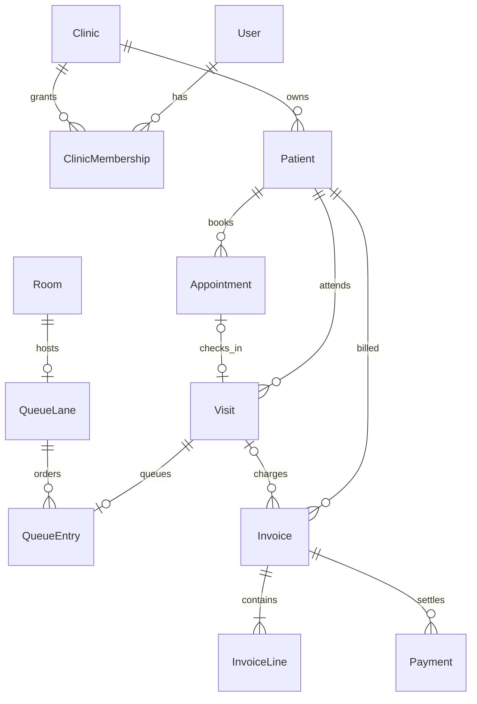

# Lamssa architecture

Phase 1, Steps 1.1–1.2 — architecture and backend identity foundation, 2026-10-24.

**Current status:** npm workspaces contain the unchanged demo frontend in
`apps/web` and a NestJS API in `apps/api`. PostgreSQL/Prisma configuration, an
initial identity migration and an optional two-clinic seed exist. Authentication,
RBAC, private clinic endpoints and RLS are **not implemented**; tenant isolation
is not production-secure. Prototype records remain demo-only and are not uploaded.

## Step 1.2: implemented foundation

The user's expanded Step 1.2 scope supersedes the original split between workspace,
API and database steps. The next step is now **1.3 — Authentication and RBAC**.

```text
.
├── package.json / package-lock.json     # One npm workspace install/lockfile
├── .env.example / .nvmrc / compose.yaml
├── apps/
│   ├── web/                            # All previous web source/config, moved intact
│   └── api/
│       ├── src/{config,common,prisma,health,clinics}
│       ├── prisma.config.ts
│       ├── prisma/{schema.prisma,seed.ts,migrations}
│       └── test/{config,http,database}.test.ts
└── docs/
```

No `packages/shared` exists yet: there is no frontend/API contract consumer, and
the browser does not depend on Prisma. Add a shared package when an authenticated
feature actually crosses that boundary. Root dev/preview commands delegate to
Vite; root build builds both apps. The web's dependencies are pinned to their
previous lockfile versions so moving it does not upgrade its runtime.

The API uses NestJS 12.2.0, configuration 12.0.1, Prisma 7.10.1 and pg 8.23.1 on
Node 24 LTS. It compiles as native ESM with decorator metadata. Prisma generates
TypeScript into an ignored server-only directory with `moduleFormat = "esm"`;
its CLI URL is configured in `prisma.config.ts`, and runtime connections use
`PrismaPg`. Configuration validates required database URL, exact CORS origins,
host, port and mode without logging secret values. Request validation rejects
unknown writable fields; a global exception filter returns generic Arabic errors
and stable codes, without exception messages or stacks. Shutdown hooks disconnect
the lazy database pool. Logging is intentionally minimal; audited and redacted
operational logging remains future work.

| Public route | Contract / boundary |
| --- | --- |
| `GET /api/v1/health` | Liveness only, `{"status":"ok"}`; no database/version/environment details |
| `GET /api/v1/health/ready` | Constant `SELECT 1`; ready or generic 503; does not verify migrations |
| `GET /api/v1/public/clinics/:slug/branding` | Active clinic only; exactly slug, displayName, and nullable logo/color fields |

Public branding uses a validated slug and selects branding through that clinic's
relation. Its response projection excludes legal name, IDs, private settings,
domains, users, emails and membership/password fields. This is an intentionally
public identification lookup, not an authorization path. There are no patient,
appointment, queue, invoice, user-management or private clinic API routes. The
frontend continues using only its original localStorage key/shape and Arabic UI.

### Current database entities

| Entity | Ownership / constraints |
| --- | --- |
| `Clinic` | UUID tenant root; legal/display names, globally unique normalized slug, status, timezone, three-letter currency, timestamps |
| `ClinicBranding` | Optional one-to-one clinic configuration keyed by clinicId; nullable HTTPS logo URL, primary/secondary/optional accent hex colors, timestamps |
| `ClinicDomain` | Clinic-owned UUID, globally unique normalized hostname, verification status, primary flag, timestamps; `(clinicId,id)` unique for future compound references |
| `User` | Global identity, unique normalized email, nullable password hash, status, optional global platformRole, timestamps |
| `ClinicMembership` | Clinic/user foreign keys, one role and status per pair, timestamps; unique `(clinicId,userId)` and `(clinicId,id)` |

`PLATFORM_ADMIN` belongs only to `User.platformRole`. Clinic roles are
`CLINIC_OWNER`, `CLINIC_ADMIN`, `DOCTOR`, `RECEPTIONIST`, `ACCOUNTANT`; platform
authority never implicitly grants access to patient/clinic records. One user can
have distinct roles in multiple clinics. Memberships default to invited status,
and no accounts/passwords are seeded. All clinic/user child deletions and ownership
key updates use `RESTRICT`; archive/status transitions are preferred to deletion.

Indexes support clinic status, domain verification, and active membership lookups
by user/clinic/role. Reviewed SQL adds normalized identity/currency and color/logo
checks, plus at most one primary domain per clinic and a requirement that primary
domains be verified. Prisma cannot express all these SQL rules; future migrations
must retain them. No DNS verification handler is implemented, so no public caller
can set verification status. Clinic timezone validation against IANA identifiers
and currency configuration policy belong to the later clinic settings service.

Compose is development-only: PostgreSQL 17.11, environment-provided credentials,
loopback host port and named persistent volume. Its initialization user is
privileged; separate production request/migration credentials and RLS are still
required. The seed creates two fictional Arabic identities with distinct themes,
timezones/currencies and pending `.example` domains, preserving existing fixture
customization on rerun. It never imports browser data.

### Tenant isolation gate for Step 1.3 and subsequent work

Until authentication exists, only the three deliberately public routes above are
registered. Future private access must derive tenant context from authenticated,
active user + active membership + active clinic, then check the role's permission.
A requested clinic ID selects a candidate membership, never proves access. A slug,
subdomain, custom hostname, forwarded host header or verified domain only identifies
a clinic; none establishes user authority. Never connect clinic records by an
unscoped ID, or allow writable clinicId reassignment.

Repository methods for clinic-owned reads/writes must require verified tenant
context; nested writes and future child references must include clinicId in
compound keys. Public branding's deliberately limited bootstrap lookup must stay
separate from private repositories. RLS and transaction-local tenant settings,
least-privileged request roles, tenant-keyed caches/jobs and sensitive-access audit
are production gates. Test users with memberships in one clinic and in both,
different roles, suspended memberships/clinics, valid foreign-clinic IDs, swapped
headers/hostnames and absent context. Current database constraints prove ownership
integrity and uniqueness only, not authenticated authorization.

Custom DNS ownership verification, subdomain routing, TLS provisioning, media
storage, themed invoices and messaging are deferred. Future branding changes must
be clinic-authorized and validated before their public fields are published.
See [development.md](development.md) for reproducible setup and verification.

## 1. Historical Step 1.1 inspection

This section records the frontend-only state before Step 1.2. Paths are relative
to the old web root (now `apps/web`); backend absences below describe that snapshot.

The inspection covered `package.json`, the lockfile, `tsconfig.json`,
`vite.config.ts`, `README.md`, `index.html`, every source file, and Git status.
Initially there were only three source files: `App.tsx` (160 compressed lines),
`main.tsx`, and `style.css`. There were no backend files, tests, lint configuration,
workspace definitions, environment configuration, or route definitions.

Git initially had no commits; all prototype files and 2,457 dependency files under
`node_modules` were staged. At the user's subsequent request, a baseline commit
was created after adding `.gitignore` and removing dependency files from the
index only. Dependencies remained on disk. Step 1.1 was subsequently committed as
`dbb529c`; Step 1.2 is not committed automatically.

### Technologies and entry points

| Area | Actual implementation |
| --- | --- |
| Runtime dependencies | React and React DOM only; declared `^19.1.0`, installed/locked `19.3.1` |
| Tooling | Vite declared `^6.3.5`, installed/locked `6.4.5`; TypeScript `~5.9.2`, installed/locked `5.9.3`; React Vite plugin `4.7.0` |
| Type checking | Strict TypeScript, ES2022, bundler module resolution, `react-jsx`, unused-symbol checks, no emitted TS output |
| Startup | `index.html` → `src/main.tsx` → React StrictMode → `App` |
| Styling | Custom responsive CSS; Cairo loaded from Google Fonts with local font fallbacks; no UI framework |
| Arabic/RTL | Root HTML has `lang="ar" dir="rtl"`; Arabic labels/statuses; intentional LTR phone/time fields |
| Formatting | Browser-local date helpers; `ar-YE` date/currency formatting, hard-coded Yemeni rial suffix, whole-number money display |
| Scripts | `dev`, `build` (`tsc -b && vite build`), `preview`; no test or lint scripts |

There is no router. All navigation occurs at the same URL through a React
`Section` union: `overview`, `patients`, `appointments`, `queue`, `invoices`.
Reload returns navigation to the dashboard; browser history/deep links are absent.
The displayed clinic selector and avatar are decorative, not tenant switching or
an authenticated identity.

### State, models, and persistence

`App` owns `data`, `section`, `search`, `modal`, and `notice` using `useState`.
Forms own their input state. Dashboard appointment filtering uses `useMemo`;
other totals, lookups, filtering, and sorting are derived during rendering.
State transitions still live in `App`, including check-in, call-next, finish-visit,
invoice payment, and demo reset. No state-management or data-fetching library exists.

The following are the exact browser model fields, not a proposed database schema:

| Model | Fields / relationships |
| --- | --- |
| `Patient` | `id`, `name`, `phone`, `notes`, `createdAt` (local date string) |
| `Appointment` | `id`, `patientId`, free-text `service`, free-text `doctor`, `date`, `time`, `status` |
| `AppointmentStatus` | `مجدول`, `حضر`, `مكتمل`, `ملغي`; no cancel workflow is exposed |
| `QueueEntry` | `id`, `patientId`, optional `appointmentId`, `number`, `status`, `arrivedAt` (ISO timestamp) |
| `QueueStatus` | `انتظار`, `داخل الغرفة`, `انتهى` |
| `Invoice` | `id`, `patientId`, `description`, numeric `amount`, boolean `paid`, `createdAt` (local date string) |
| `Data` | Arrays named `patients`, `appointments`, `queue`, `invoices` |

Relationships are plain string IDs. There are no foreign keys or `clinicId`
fields, and doctors/services are not entities. New IDs use `crypto.randomUUID()`
when available, with a timestamp/random fallback. Seed IDs are short fixed strings.

The entire `Data` object is read from `localStorage` key
**`lamssa-clinic-demo-v1`** by a lazy state initializer. Loading only checks that
the top-level properties are arrays; element types, status values, references,
and dates are not validated. Missing, invalid, or unreadable storage falls back
to the built-in seed (four patients, four appointments, one waiting entry, two
invoices). A React effect writes the entire object after state changes, including
initial mount. Thus the existing fallback can overwrite malformed stored data;
write/quota failures are uncaught. No new fallback or cleanup is introduced here.
The existing reset action confirms before restoring the in-memory seed. It has
not been invoked against any user browser data during this work.

### Current feature flows

| Section / action | Behavior |
| --- | --- |
| Dashboard | Counts today's appointments (all statuses), all patients, all waiting entries, and all paid invoices across all dates; shows the first five matching appointments in array order |
| Patients | Create name/phone/optional administrative notes; search name or phone; no edit, delete, detail page, or clinical chart |
| Appointments | Create for an existing patient using service/doctor text, date and time; list sorted by date/time; search patient/service/doctor |
| Check-in | Reject completed/cancelled appointments and any existing queue entry for the appointment; mark it `حضر` and append a waiting ticket |
| Queue | One active entry for the entire demo; call the lowest-numbered waiting entry; finishing marks the entry `انتهى` and its linked appointment `مكتمل`; completed entries remain stored |
| Billing | Create one description/amount invoice, optionally already paid; search patient/description/internal ID; mark an unpaid invoice paid once; show total/paid/unpaid sums |

Forms have HTML `required`, length limits, trimming, disabled-submit checks,
and positive finite numeric validation for amounts (integer step/minimum in HTML).
There is no authoritative validation of patient references, phone formats,
duplicate patients, appointment overlaps, past bookings, or allowed transitions.
Invoices are independent of appointments/visits and have no lines, payment
ledger, immutable invoice number, tax, refund, or partial-payment model.

### Risks found in the actual code

| Risk | Consequence / required target |
| --- | --- |
| Browser-only storage | Origin/browser-specific, readable by same-origin scripts, no controlled backup, access audit, retention, or shared source of truth; never use for real patient data or session secrets |
| Mixed responsibilities | Rendering, persistence, and business transitions remain coupled in `App`; extraction below creates seams but is not a service layer |
| No backend/authentication | Anyone opening the prototype can view/mutate its local records; no RBAC, trustworthy identity, or server authorization |
| No tenant boundary | One storage key and no clinic ownership; cosmetic clinic name provides no isolation |
| Weak runtime validation | Syntactically valid stored arrays can still crash rendering or contain inconsistent records; browser controls can be bypassed |
| Queue concurrency | Check-before-write and `max + 1` numbering are not atomic across tabs/devices; whole-object writes can lose updates; there is no `storage` event listener, lock, idempotency, or push synchronization |
| Date/queue scope | `today` is computed at module load and becomes stale across midnight; tickets use UTC date slices while appointments use local dates; waiting/active lists include previous days; repeating daily numbers can affect order |
| Unstable invoice labels | `INV-...` uses the filtered row index and total array length, so filtering or insertion changes displayed labels; labels are not stored identifiers |
| Money | JavaScript number plus a paid flag cannot express an accountable payment ledger; currency is fixed and formatting rounds to whole numbers |
| Medical-data safeguards | No secure clinical notes, consent, attachment protection, read auditing, recovery, or lifecycle controls; administrative fields must not be used as medical records |
| Operational maturity | No existing automated tests, lint, CI, environment separation, or production deployment policy; Vite commands currently bind to `0.0.0.0` |
| External font | Cairo requires an external Google Fonts request; decide self-hosting/CSP and deployment privacy requirements before production |

These issues are documented rather than silently corrected during a
behavior-preserving architecture step.

## 2. Frontend boundaries established in Step 1.1

```text
src/
├── App.tsx                          # Shell, five views, state and transitions
├── main.tsx                         # Existing entry point, unchanged
├── style.css                        # Existing styling, unchanged
├── components/ui.tsx                # Stat, PanelHeading, Status, Empty, Modal
├── features/
│   ├── patients/PatientForm.tsx
│   ├── appointments/AppointmentForm.tsx
│   └── billing/InvoiceForm.tsx
├── lib/demo.ts                      # Existing seed, load, IDs/date/money helpers
└── types/clinic.ts                   # Existing demo types, not API contracts
```

Definitions were moved with imports/exports only. `App`'s body, JSX, event
handlers, storage key/shape, seed, and helper/form logic are preserved. The CSS,
root HTML, dependency manifests, compiler, and Vite settings are unchanged.
Keep demo storage explicit; split general formatting helpers from it when an
API-backed feature actually needs them. Avoid introducing abstractions for
services or screens that have not yet been migrated.

## 3. Target monorepo and architecture decision

Use an npm-workspace monorepo with a **modular NestJS REST API**, PostgreSQL, and
Prisma. Start with one deployable API and one shared database; do not introduce
microservices. No workspaces, backend folders, schema, database client, or backend
dependencies are created in Step 1.1.

```text
lamssa/                             # Future layout, not today's tree
├── package.json                    # Workspace definitions and root commands
├── package-lock.json
├── apps/
│   ├── web/                        # Move the existing Vite app intact
│   │   ├── package.json
│   │   ├── index.html
│   │   ├── vite.config.ts
│   │   ├── tsconfig.json
│   │   └── src/{components,features,lib,types,...}
│   └── api/                        # Future NestJS REST service
│       ├── src/{modules,common,...}
│       └── prisma/{schema.prisma,migrations,...}
├── packages/
│   └── shared/                     # Future transport types + validation contracts
└── docs/
    ├── architecture.md
    └── implementation-roadmap.md
```

The move to `apps/web` and initial API/database identity foundation are now
implemented in Step 1.2; the tree above includes additional future modules/packages.
The single-database choice simplifies initial operations but makes missing tenant
filters especially dangerous and shares capacity/failure impact across clinics.
Tenant-aware constraints, repositories, isolation tests, and resource limits are
therefore mandatory design work. Database-per-clinic remains a possible later
option if contractual or deployment requirements demand it.

Dependency direction: `web` → `shared`, `api` → `shared`, `api` → Prisma/PostgreSQL.
`shared` must not depend on either app, React, Nest, Prisma, or generated database
models. Define transport DTOs, stable machine status codes, pagination, errors,
and runtime validation contracts there; select validation tooling in a later
implementation step. Share contracts rather than internal persistence models or
secrets. Continue mapping statuses and validation errors to Arabic UI labels.

## 4. Target API modules and roles

Controllers handle transport and input parsing, policies/guards verify identity,
membership and permissions, services own business transitions/transactions, and
repositories require validated tenant context. Feature modules do not expose
unrestricted Prisma access to controllers. Use versioned REST contracts (proposed
`/api/v1`), bounded pagination, stable error codes, and documented idempotent actions.

| Module | Responsibility |
| --- | --- |
| Platform/configuration | Validated server configuration, health checks, redacted logging, request IDs, database lifecycle |
| Identity/access | Users, login/session lifecycle, clinic memberships, permission policies |
| Clinics | Clinic provisioning/status, settings, timezone, currency, membership administration |
| Patients | Administrative identity/contact data, clinic chart numbers, search, permitted updates |
| Catalog/resources | Clinic services, clinician profiles, rooms, queue lanes and schedules |
| Appointments | Booking/rescheduling/cancellation, availability and overlap rules |
| Visits/queue | Check-in, visit lifecycle, ticket allocation, call-next and completion |
| Billing | Invoice issue/lines, payment ledger, reversals and financial reporting |
| Audit | Restricted, append-only access/change/security events with retention policy |
| Clinical records (later) | Encounters, consents and protected media after requirements/security review |

Clinic roles belong to a **clinic membership**. The separate global platform role
does not grant clinic permissions. Initially one role per membership is sufficient;
explicit permissions define permitted actions.

| Role | Proposed access boundary |
| --- | --- |
| Platform administrator | Provision/suspend clinics and operate the platform; no automatic access to clinic patient/clinical data; exceptional support access must be scoped, time-limited and audited |
| Clinic owner | Own-clinic ownership, membership and commercial administration; clinical permissions remain explicit |
| Clinic administrator | Manage own clinic settings, memberships and operational permissions; clinical access requires an explicit clinical permission |
| Receptionist | Manage administrative patient details, appointments and check-in/queue; collect payments only if granted; no clinical notes/photos |
| Clinician | Access authorized patient visits, assigned schedule, clinical workflows and permitted queue transitions; no membership management or financial reversals by default |
| Accountant | Billing, payment/reversal permissions and minimal necessary patient identification; no clinical notes/photos |

UI visibility improves usability but never grants authority. Membership suspension
and role changes must affect server access promptly, including existing sessions.

## 5. Target entities, ownership, and relationships

Only the five identity models listed in the Step 1.2 section currently exist.
Patients, scheduling, visits, queue, billing, audit and clinical entities below
remain future work. The current global platform role is separate from membership.

All clinic-owned entities carry a non-null `clinicId`. `User` is global identity;
`Clinic` is the tenant root. Neither is an excuse for global access to clinic rows.
Use server-generated UUIDs, timestamps, actor IDs where appropriate, and explicit
archival/lifecycle rules. No automatic destructive cascades on patient/clinic deletion.

| Entity | Main relationships and purpose |
| --- | --- |
| `Clinic` | Owns memberships and operational data; timezone, currency, status/settings |
| `User` / `ClinicMembership` | User has memberships in multiple clinics; membership links `(clinicId, userId)` to role and active status |
| `Patient` | Belongs to one clinic, has a clinic chart number, contacts, administrative notes; the same person may have separate records in unrelated clinics |
| `ClinicianProfile`, `Service`, `Room` | Clinic resources; clinician optionally linked to a membership in the same clinic; service has duration/pricing defaults |
| `Appointment` | References same-clinic patient, clinician, service and optional room; `startsAt`/`endsAt`, status, version; UTC instants with clinic timezone for local business dates |
| `Visit` | References same-clinic patient and optional appointment; clinical/operational visit lifecycle; one visit per appointment initially, with walk-ins supported by nullable appointment |
| `QueueLane` / `QueueEntry` | Lane is tied to a room (one lane per room initially); entry references a visit/lane, service day, ticket number, status, arrival/start/completion timestamps and version |
| `Invoice` / `InvoiceLine` | Invoice references patient and optional visit; immutable issued number/currency and line price/description snapshots; totals computed by server |
| `Payment` | References same-clinic invoice; amount/method/reference/status/idempotency; reversals are new auditable entries, not a boolean toggle |
| `AuditEvent` | Clinic, actor, action, resource identity, outcome, time/request ID; no raw notes, photos, credentials or unnecessary patient content |



### Tenant-aware constraints and indexes (design only)

Use a global UUID primary key plus `UNIQUE (clinicId, id)` on clinic-owned parent
tables that are referenced by compound foreign keys. Child relationships such as
`Appointment(clinicId, patientId)` must reference `Patient(clinicId, id)`, not
`Patient(id)` alone. Apply this to resource, visit, queue, membership and billing
relations, including nested writes. Service rules must also enforce consistency
between redundant relationships (e.g. invoice patient and linked visit patient).

| Table / purpose | Planned constraint or index |
| --- | --- |
| Membership | Unique `(clinicId, userId)`; index `(userId, status)` for authorized clinic selection |
| Patient | Unique `(clinicId, chartNumber)`; indexes `(clinicId, createdAt, id)` and `(clinicId, normalizedPhone)`; phone is not unique because families can share a number |
| Appointment | Indexes `(clinicId, startsAt, id)`, `(clinicId, clinicianId, startsAt)`, `(clinicId, patientId, startsAt)`; check `endsAt > startsAt` |
| Visit / check-in | Unique `(clinicId, appointmentId)` when non-null; nullable appointment allows walk-ins |
| Queue lane | Unique `(clinicId, roomId)` for initial one-lane-per-room policy |
| Queue entry | Unique `(clinicId, visitId)`; unique `(clinicId, laneId, serviceDay, ticketNumber)`; index `(clinicId, laneId, serviceDay, status, ticketNumber)` |
| Room occupancy | Partial unique index `(clinicId, laneId)` where queue status is `SERVING`; deliberately excludes service day so an unfinished visit cannot be bypassed at midnight |
| Invoice | Unique `(clinicId, invoiceNumber)` once issued; indexes `(clinicId, patientId, issuedAt)` and `(clinicId, status, issuedAt)` |
| Payment | Unique `(clinicId, idempotencyKey)`; index `(clinicId, invoiceId, createdAt)`; composite foreign key to invoice |
| Audit | Index `(clinicId, occurredAt, id)`; restricted access and approved retention |

Prisma supports compound unique identifiers for lookups and relation operations;
the intended mapping is documented by [Prisma's compound constraint guide](https://www.prisma.io/docs/orm/v7/prisma-client/special-fields-and-types/working-with-composite-ids-and-constraints).
PostgreSQL [partial unique indexes](https://www.postgresql.org/docs/current/indexes-partial.html)
can enforce conditional uniqueness. Review selected Prisma-version support during
schema implementation; retain reviewed SQL migrations for database-specific rules.
An exact-start-time unique constraint does not prevent overlapping appointment
intervals: design interval exclusion constraints or a resource-serialized booking
transaction, with concurrency tests for both clinician and room scheduling.

## 6. Tenant isolation and security principles

The chosen request flow is authenticated identity → active membership check →
immutable request tenant context → permission check → tenant-scoped service and
repository. Treat any URL/header/body `clinicId` as a selection request, never as
proof of access. This follows [OWASP's tenant-context guidance](https://cheatsheetseries.owasp.org/cheatsheets/Multi_Tenant_Security_Cheat_Sheet.html).
Reject absent/invalid tenant context; create ownership from the verified context
and prevent tenant reassignment through updates. Object IDs alone grant nothing.

The project policy is to apply the verified `clinicId` to every list, detail,
count, search, export, mutation, relation connection, bulk action and transaction.
Required-tenant repository methods must fail closed; raw/global Prisma access
belongs only to reviewed infrastructure paths. Authorize background jobs and
include tenant identity in cache keys, storage paths, notifications and events.
Return a consistent not-found response for inaccessible clinic records.
Automated negative tests must attempt reads/writes and relationship injection
using another clinic's valid IDs, not just nonexistent IDs.

Use PostgreSQL row-level security as a planned additional boundary before real
clinic rollout. Its [documented role bypass behavior](https://www.postgresql.org/docs/current/ddl-rowsecurity.html)
means the request role must not be a superuser, table owner, or `BYPASSRLS` role.
Use separate migration credentials and transaction-local tenant context on the
same connection as the protected queries; test pooled-connection reuse and missing
context. RLS complements explicit server scoping and compound foreign keys; no
RLS protection exists in the current prototype.

Authentication implementation must choose a session strategy explicitly. Proposed
browser deployment is web and API behind one HTTPS origin using secure, HttpOnly,
SameSite cookies with CSRF protection for writes, session rotation/revocation,
rate-limited login and strong password hashing. Never store auth tokens in demo
localStorage. Keep secrets server-side; `VITE_*` variables are public browser
configuration. Authorize both transport endpoints and sensitive service actions;
[NestJS authorization documentation](https://docs.nestjs.com/security/authorization)
provides framework mechanisms, while Lamssa must define its own clinic policies.

Validate request shape, lengths, enums, finite amounts, relationships and allowed
state transitions on the server; reject unknown writable fields and mass-assigned
ownership/roles. Use parameterized database access, bounded searches/pagination,
permission-specific response fields and Arabic validation messages in the web app.
Represent money as fixed-precision database values or integer minor units with a
currency policy; transport exact values without floating-point arithmetic.

Before real medical data is accepted, require TLS, encrypted managed storage and
backups, restricted credentials, restore exercises, audit of sensitive reads and
writes, log redaction, incident response, retention/deletion rules, and separate
development/staging/production datasets. Future clinical photos need private object
storage and authorized, short-lived download access; clinical notes and consent
records need stricter permissions than administrative patient data. Jurisdiction,
hosting region, retention and consent obligations remain requirements to resolve;
this architecture does not claim regulatory compliance.

### Queue and booking consistency

The future server owns ordering and timestamps. Check-in must atomically validate
the appointment, create/reuse its visit, allocate a ticket for the lane's clinic
business date and enqueue it, using unique constraints and an idempotent command.
Do not port browser `max + 1` to the server. Allocate through an atomic counter
keyed by `(clinicId, laneId, serviceDay)` under a transaction.

For call-next, lock the same-clinic lane row first, verify it has no active entry
(including previous days), select the eligible waiting entry, conditionally change
its status/version and commit. The partial active-entry constraint is the final
backstop. Finish-visit updates the queue, visit and appointment in one transaction.
Use consistent lock ordering and bounded retry/conflict responses, based on
[PostgreSQL transaction/row locking](https://www.postgresql.org/docs/current/explicit-locking.html).
Define carry-over/close-of-day policy before exposing multi-day queues. Initial
scope is one lane/room; multiple rooms and clinician occupancy require explicit
additional resource constraints. Start with polling/versioned responses, adding
authorized events after authoritative transactional behavior works.

## 7. Incremental migration and verification

1. **This step:** record the actual baseline, extract existing frontend definitions,
   preserve Arabic/RTL and storage compatibility; add no backend dependencies.
2. **Workspace foundation:** move the working app to `apps/web`, retain root dev/build
   commands, verify lockfile and paths; only then establish shared/API packages in
   explicitly scoped follow-up steps.
3. **Backend/database/access foundation:** implement Nest configuration, PostgreSQL
   and Prisma migrations, then auth, membership policies and tenant isolation with
   two-clinic tests before patient endpoints are connected.
4. **Vertical feature slices:** migrate patients → appointments → visits/queue →
   billing. Add a transport boundary per feature; avoid mixing authoritative API
   records and demo arrays in one user session. Use explicit demo/API modes and
   synthetic fixtures until the isolation/security gates pass.
5. **Production readiness:** validate concurrency, backups/restores, auditing, Arabic
   RTL behavior, accessibility, retention and deployment requirements. Medical
   records/media remain a later separately reviewed scope.

Moving the Vite root need not change demo storage if the browser origin remains
identical (scheme/host/port). Changing origin creates a separate localStorage
namespace; do not silently copy, clear or import it. Local demo data must never
auto-import into a clinic database. Any later import is an explicit, validated,
clinic-authorized process. Keep this storage key/shape until a separately planned
demo migration is needed.

### Step 1.1 verification results

| Check | Result |
| --- | --- |
| `npm run build`, before and after extraction | Passed: strict TypeScript build and Vite production bundle, using already installed dependencies |
| `npm run` / script inspection | Only dev/build/preview exist; no existing test or lint command to run |
| TypeScript parser comparison against baseline `309aa26` | All 26 original top-level definitions match exactly except added exports, including the entire App body/JSX |
| Entry/style/configuration comparison | `main.tsx`, CSS, HTML, package manifest/lockfile, TS and Vite configuration unchanged |
| Isolated headless Chrome against production preview | Before/after smoke checks passed: Arabic RTL, all five sections at desktop/mobile widths, all three creation forms, patient search, check-in/duplicate prevention, queue call/finish/single-room guard, invoice payment, reload persistence; no runtime exceptions observed |
| Screenshot comparison | All 13 PNGs matched byte-for-byte: ten section views (1440px/390px) and three desktop forms |
| `git diff --check` | Passed |

Browser checks used temporary, separate Chrome profiles and synthetic data only;
the user's browser storage was not accessed. Date/time were fixed to the same
instant in `Asia/Aden`, and external Google Fonts requests were blocked in both
runs for reproducible fallback-font rendering. External font delivery was not
tested. The temporary comparison/smoke scripts and screenshots live outside the
repository; no test dependencies or permanent test harness were added. These
checks cover the exercised prototype flows, not production security or concurrent
multi-device correctness. See the roadmap for future acceptance gates.
