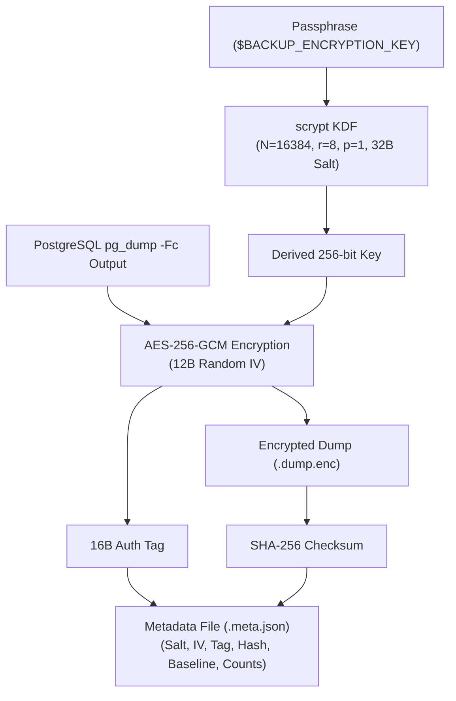

# Secure Database Backup & Disaster Recovery Architecture

## 1. Overview & Resilience Strategy

Lamssa provides encrypted local backups and separate archive-verification and database-restoration workflows. Production data residency, retention, custody and recovery objectives require explicit operational approval.

### Key Objectives
- **Encrypted Backup Confidentiality**: Backups are encrypted at rest using AES-256-GCM authenticated encryption before touching secondary storage or transfer channels.
- **Complete Multi-Clinic Data Capture**: Table-level FORCE ROW LEVEL SECURITY and `--enable-row-security` ensure all clinic data, global identity, migration history, functions, triggers, and RLS policies are completely dumped by the authorized maintenance/migrator role.
- **Fail-Closed Tamper Resistance**: Restores cryptographically verify SHA-256 digests and AES-GCM authentication tags before decrypting or restoring any data. Corrupt, truncated, or tampered archives abort immediately.
- **Distinct Verification Modes**:
  1. **Archive Verification Drill (`--drill`)**: Validates cryptographic authenticity, SHA-256 checksum, GCM tag, and Table of Contents (TOC) structure without modifying or creating database structures.
  2. **Genuine Restoration (`db:restore`)**: Executes real `pg_restore` into a target database (such as an isolated staging/temporary database or recovery target), verifying all tables, row counts, RLS enforcement, constraints, functions, triggers, and runtime access isolation.
- **Destructive Overwrite Protection**: Existing databases, including `lamssa_dev`, `lamssa_test`, and configured runtime targets, cannot be overwritten without explicit double confirmation (`--force-destructive-overwrite` and `--confirm=<database_name>`).
- **RTO & RPO Tracking**: Every restore and drill measures Recovery Time Objective (RTO) and Recovery Point Objective (RPO) and outputs actionable reliability metrics.

---

## 2. Row-Level Security (RLS) & Backup Completeness

### Why `--enable-row-security` is Required
PostgreSQL tables in Lamssa enforce `FORCE ROW LEVEL SECURITY`. By default, `pg_dump` attempts to disable row security (`SET row_security = off;`). When a table has `FORCE ROW LEVEL SECURITY` and the database user lacks cluster-wide `BYPASSRLS` privileges, PostgreSQL intentionally aborts `COPY ... TO stdout` with:
```
ERROR: query would be affected by row-level security policy for table "..."
HINT: To disable the policy for the table's owner, use ALTER TABLE NO FORCE ROW LEVEL SECURITY.
```
Passing `--enable-row-security` instructs `pg_dump` to execute with `row_security = on`.

### Why Backups Capture All Clinics Completely
All 32 current tenant-isolated tables in Lamssa define a permissive table-owner maintenance policy:
```sql
CREATE POLICY maintenance_owner ON public.<table_name> FOR ALL TO <owner_name> USING (true) WITH CHECK (true);
```
Because PostgreSQL evaluates multiple permissive policies using boolean `OR`, queries executed by the maintenance/migrator role evaluate `USING (true OR false) -> true`. The owner role sees 100% of rows across all clinics.

### Runtime Application User Rejection
Application runtime users (`lamssa_dev_app`, `lamssa_test_app`) have `NOSUPERUSER NOBYPASSRLS` and no ownership over tables. Furthermore, because runtime roles rely on validated transaction-local clinic, user and session context to evaluate `lamssa_security.context_allows()`, dumping as an application role would produce 0 rows for tenant tables.

`scripts/backup-database.mjs` enforces an explicit security guard at startup:
```javascript
const unprivilegedAppRoles = ['lamssa_dev_app', 'lamssa_test_app'];
if (unprivilegedAppRoles.includes(currentUser)) {
  throw new Error(
    `[Backup Security Abort] Runtime application role '${currentUser}' cannot be used for database backups. ` +
    `Backups must run as the maintenance/migrator owner role (e.g. MIGRATION_DATABASE_URL).`
  );
}
```

### Pre-Encryption Table-of-Contents (TOC) Verification
Before encrypting and storing any backup archive, `scripts/backup-database.mjs` executes an in-memory inspection of the `pg_dump` Table of Contents via `pg_restore -l`. It verifies:
- `TABLE DATA` exists for all public tables (39 at final verification).
- RLS `POLICY` definitions are present (151 policies at final verification).
- Extensions, triggers, functions, and `_prisma_migrations` are fully represented.
- If any table or structural artifact is omitted, the backup fails immediately and no files are written.

---

## 3. Cryptographic Architecture

Backup encryption and decryption are handled by `scripts/backup-crypto.mjs` and typed by `scripts/backup-crypto.d.ts`.



### Specifications
| Component | Algorithm / Specification |
|---|---|
| **Cipher** | AES-256-GCM (Authenticated Symmetric Encryption) |
| **Key Derivation** | `scrypt` with `N=16384`, `r=8`, `p=1`, 32-byte cryptographically secure random salt |
| **Initialization Vector** | 12-byte random IV per backup archive |
| **Integrity Tag** | 16-byte AES-GCM authentication tag |
| **Envelope Checksum** | SHA-256 digest of ciphertext written to `.meta.json` |
| **File Permissions** | Output files created with mode `0600` (rw-------); directory mode `0700` |
| **Atomic Writes** | Backups are written to `.tmp.<uuid>` files and atomically renamed only after full encryption and TOC verification |

---

## 4. Key Custody, Retention & Asset Boundaries

### Key Custody & Loss-of-Key Behavior
- **Zero Backdoors**: AES-256-GCM is mathematically unrecoverable without the encryption passphrase. If `BACKUP_ENCRYPTION_KEY` is lost, backup archives **cannot be decrypted or recovered** under any circumstances.
- **Custody Hierarchy**:
  - In production, `BACKUP_ENCRYPTION_KEY` must never be stored in plain text files within repository checkouts.
  - Recommended custody: AWS Secrets Manager, HashiCorp Vault, or GCP Secret Manager with restricted IAM access, automated rotation alerts, and multi-person quorum approval for recovery keys.
  - For systemd-managed deployments, keys reside in `/etc/lamssa/backup.env` (permissions `0600`, owned by root/service user).

### Off-Site Backup Strategy
- The database backup script writes local archives to `var/backups/`.
- Production deployment scripts must synchronize `var/backups/*.dump.enc` and `*.meta.json` to an off-site S3-compatible bucket (e.g. AWS S3, Cloudflare R2, MinIO).
- Object Storage configuration must enforce:
  - **Bucket Versioning**: Enabled to prevent accidental overwrites.
  - **S3 Object Lock (WORM - Write Once, Read Many)**: Default 30-day compliance retention to protect against ransomware or rogue administrative deletion.
  - **Server-Side Encryption (SSE-KMS)**: Additional layer of encryption at the cloud storage tier.

### Database vs. Clinic Asset Backup Boundary
- **What Database Backups Contain**: All implemented administrative clinic data, appointments, visits, invoices, audit trails, user accounts, and database-level metadata.
- **What Database Backups Do NOT Contain**: Uploaded clinic assets, logos, and stamps stored on the filesystem under `var/clinic-assets/` (PNG/WebP derivatives referenced by `ClinicAsset.storageKey`).
- **Asset Backup Implementation**: `npm run assets:backup` creates a separate AES-256-GCM archive with a hash-verified manifest. It accepts regular UUID-keyed PNG/WebP derivatives only, rejects symlinks, and keeps paths and bytes inside the encrypted payload. `npm run assets:restore -- --file=...` verifies by default; add `--restore=true --target=/new/non-existing/path` for a real restore into a new volume. Pair and copy database and asset archives off-site together.
- **Current Limit**: the local adapter bundles at most 1 GiB in memory. It is suitable and tested for the initial deployment; streaming object-storage replication, off-site transfer and WORM retention remain deployment operations.

---

## 5. CLI Commands & Workflow

All backup and restore commands are exposed through npm workspace scripts:

### Create Encrypted Backup
```bash
BACKUP_ENCRYPTION_KEY="your-secure-passphrase" npm run db:backup
```
- Dumps database using `pg_dump -Fc --enable-row-security`.
- Verifies TOC contains all 33 public tables and 145 RLS policies.
- Encrypts via AES-256-GCM and writes atomic `0600` files in `var/backups/`.
- Enforces retention (default: 30 days / configurable via `BACKUP_RETENTION_DAYS`).

### Execute Archive Verification Drill (No DB Mutation)
```bash
BACKUP_ENCRYPTION_KEY="your-secure-passphrase" npm run db:backup:drill
```
- Verifies ciphertext SHA-256 and AES-256-GCM authentication tag.
- Inspects decrypted archive Table of Contents (`pg_restore -l`).
- Checks that the decrypted archive has a readable TOC. It does not verify a restored database, migration state or live RLS.
- **Does not touch, create, or alter any database.**
- Measured RTO: ~100ms.

### Execute Genuine Database Restoration
```bash
# Genuine restore into an isolated staging/temporary database
BACKUP_ENCRYPTION_KEY="your-secure-passphrase" npm run db:restore -- \
  --target-db=lamssa_restore_tmp

# Restore with automatic cleanup after verification
BACKUP_ENCRYPTION_KEY="your-secure-passphrase" npm run db:restore -- \
  --target-db=lamssa_restore_tmp \
  --drop-after

# Deliberate overwrite of active database (Requires double confirmation)
BACKUP_ENCRYPTION_KEY="your-secure-passphrase" npm run db:restore -- \
  --target-db=lamssa_dev \
  --force-destructive-overwrite \
  --confirm=lamssa_dev
```

---

## 6. Verification evidence

The earlier Step 2.1 recovery timing table is superseded. Its runtime verifier could
mistake a failed connection for successful isolation, so those old success claims are
not accepted as final recovery evidence. Use the dated independent Docker exercise
below. Native restoration now reports an explicit skip when CREATEDB is unavailable.

## Phase 2 final recovery verification — 2026-10-29

The reviewed restore now refuses every existing target without explicit overwrite
authorization, validates identifiers and sidecar inventories, restores transactionally,
checks the exact expected FORCE-RLS table set and verifies the actual recovery endpoint.
Runtime verification must successfully connect with a restricted, non-owner role and
query zero patients without tenant context. A denied connection or failed query is
reported as blocked verification. Archive-only drills explicitly report that migrations
were not verified in a restored database. Restore does not grant role privileges.

A paired database/assets restore completed in a separate unpublished Docker environment:
39 tables, 122 rows, 32 FORCE-RLS tables, 151 policies and one logo. Paired restore time
was 1.243 seconds on the synthetic local snapshot; this excludes infrastructure boot
and production cutover. MFA, relationships, financial hashes, logo bytes and 16 recovered
application checks passed. Wrong keys, corrupt ciphertext, missing assets and existing
target overwrite attempts failed safely. The native NOCREATEDB test is one explicit skip,
not successful recovery evidence. Full procedure and limitations are recorded in
[deployment.md](deployment.md#paired-recovery-result-and-procedure).
