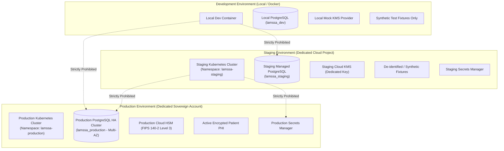

# Lamssa — Environment Isolation & Multi-Tier Deployment Architecture

**Status:** Official Environment Governance Specification (Step 9.2 Deliverable)
**Date:** 2026-11-20
**Classification:** Confidential / Platform Security

---

## 1. Principles of Hermetic Environment Isolation

Lamssa enforces strict physical, logical, and cryptographic boundaries between its environments. Under no circumstances may development, staging, and production environments share cloud accounts, databases, cryptographic keys, network subnets, or live patient data.

---

## 2. Environment Comparison Matrix

| Environment Attribute | Development (`development`) | Staging (`staging`) | Production (`production`) |
| :--- | :--- | :--- | :--- |
| **Cloud Account / Project** | Local host / Ephemeral CI runner | Dedicated Staging Project (`lamssa-staging-project`) | Dedicated Production Account (`lamssa-prod-account`) |
| **Network CIDR Block** | `127.0.0.1` / Docker Bridge | `10.100.0.0/16` (Isolated VPC) | `10.200.0.0/16` (Dedicated Multi-AZ VPC) |
| **Database Instance** | Containerized PostgreSQL 16 | Managed DB (Single AZ / Multi-AZ test) | Multi-AZ Primary + Synchronous Standby + Async DR |
| **Database Credentials** | Local test passwords (`ci-runtime`) | Dedicated Staging Secrets Manager | Dedicated Production Secrets Manager |
| **KMS Provider** | `local` (dev fallback) | `external` (Dedicated Staging Cloud KMS Key) | `external` / Cloud HSM (FIPS 140-2 Level 3) |
| **Master Key Material** | In-memory synthetic derivation | Cloud-managed staging KEK | Hardware-backed non-exportable production KEK |
| **Data Policy** | Synthetic fictional patients only | Synthetically generated load fixtures | Live real-world clinical records & invoices |
| **Ingress Access** | Local port binding (`127.0.0.1:3000`) | Restricted VPN / Allowlisted Staging DNS | Sovereign Public Edge with Cloud WAF & DDoS Shield |
| **Deployment Gate** | Developer local build | Automated CI deployment to staging | Manual dual-approval change gate (DevSecOps + Security Lead) |

---

## 3. Cross-Environment Safeguards & Leakage Prevention

### 3.1 Network Boundary Enforcement
- Cloud VPCs for Staging and Production have no VPC peering or shared transit gateways between them.
- Production database subnets have **zero route to the public internet** (no NAT Gateway, no public IPs), ensuring they can only be reached from production application pods within the same VPC.

### 3.2 Secret & Credential Segregation
- Staging application pods cannot assume production IAM roles. Workload identity OIDC bindings are scoped strictly to the respective namespace (`lamssa-staging` vs `lamssa-production`).
- The validator script `scripts/check-infrastructure.mjs` enforces that staging configuration never references production KMS keys or database endpoints.

### 3.3 Synthetic Data Governance
- Production database dumps or backups must **never be copied to staging or development**.
- Staging load tests and DR drills run strictly with synthetically generated patient records and simulated medical consultations.
