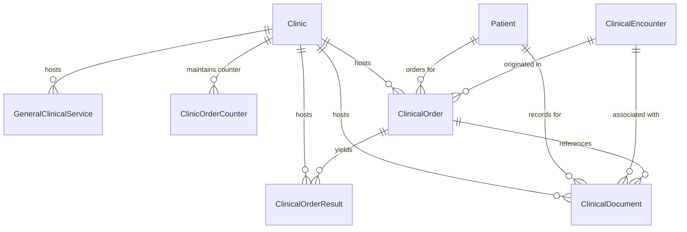
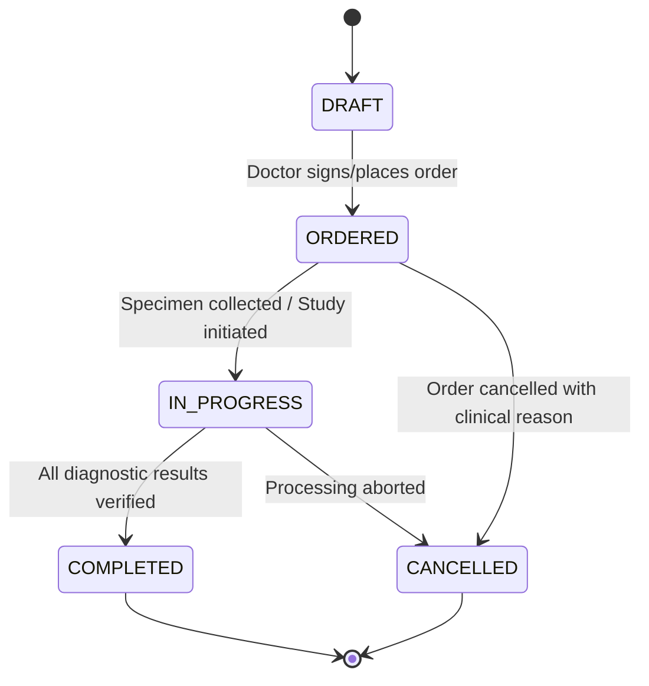
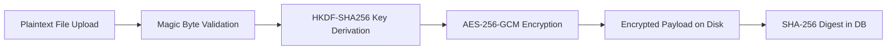

# Lamssa — General Clinical Services, Diagnostic Orders, Results & Secure Documents

**Version:** 1.0.0 (Phase 6, Step 6.4 Specification)  
**Date:** 2026-11-13  
**Status:** Implemented & Verified  
**Language:** English (Technical Documentation) / Arabic-first RTL (UI Experience)  
**Target Migration:** `20261113000300_general_clinical_services_orders`

---

## 1. Executive Summary & Architecture Objectives

In Phase 6, Step 6.4, Lamssa extends its multi-specialty clinical foundation to support outpatient general medical consultations, laboratory and diagnostic imaging orders, structured diagnostic results, and client-side AES-256-GCM encrypted medical document storage.

### Core Architectural Invariant: Zero Aesthetic Contamination
The primary objective of Step 6.4 is to guarantee that **a general medical consultation, clinical ordering, results recording/verification, secure document archiving, and billing can be completed end-to-end without creating any records in `TreatmentPlan` or `ProcedureExecution` tables**. Aesthetic workflows remain fully operational for aesthetic clinics, while medical clinics operate via specialty-neutral consultation and diagnostic pipelines.

Key capabilities introduced in Step 6.4:
1. **Specialty-Neutral General Clinical Service Catalog (`GeneralClinicalService`):** Dual-track service catalog alongside legacy aesthetic services, categorizing outpatient medical services (`GENERAL_CONSULTATION`, `SPECIALIST_CONSULTATION`, `LABORATORY_TEST`, `DIAGNOSTIC_IMAGING`, etc.).
2. **Clinical Diagnostic Orders Engine (`ClinicalOrder`):** Atomic tenant-scoped order numbering (`ORD-000001`), priority classification (`ROUTINE`, `URGENT`, `STAT`), strict state machine lifecycle (`DRAFT` → `ORDERED` → `IN_PROGRESS` → `COMPLETED` / `CANCELLED`), and immutability trigger guards.
3. **Structured Diagnostic Results & Critical Value Protocol (`ClinicalOrderResult`):** Multi-component quantitative and qualitative result recording, reference range flags, mandatory critical result acknowledgment workflow, and physician-controlled patient portal release.
4. **Encrypted Medical Document Repository (`ClinicalDocument`):** Zero-plaintext document storage using AES-256-GCM authenticated encryption at rest, HKDF-SHA256 key derivation, magic byte validation, SHA-256 payload digests, and legal hold immutability protection.
5. **Doctor-Only Clinical Privacy & Financial Separation:** Strict RBAC assigning all `clinical.*` permissions exclusively to licensed physicians (`DOCTOR`), with billing delegation to administrative staff for invoice generation.
6. **Arabic-First RTL Clinical Workspaces:** Intuitive Arabic interfaces for general consultations, diagnostic orders, lab/imaging results review, and encrypted document management.

---

## 2. Entity Model & Relational Architecture

The diagnostic and general services architecture is backed by 5 relational tables introduced in migration `20261113000300_general_clinical_services_orders`:



### Table Specifications

| Table | Scope | Primary Key / Unique Keys | Security Invariants | Immutability & Concurrency |
| :--- | :--- | :--- | :--- | :--- |
| `GeneralClinicalService` | Tenant Scoped | `id` (UUID), `(clinicId, id)` UNIQUE, `(clinicId, code)` UNIQUE | `FORCE ROW LEVEL SECURITY`; `immutable_clinic` trigger | Active/inactive status; price and taxonomy categorization |
| `ClinicOrderCounter` | Tenant Scoped | `clinicId` (UUID PK) | `FORCE ROW LEVEL SECURITY`; restricted runtime access | Atomic increment counter generating sequential order numbers (`ORD-000001`) |
| `ClinicalOrder` | Tenant Scoped | `id` (UUID), `(clinicId, id)` UNIQUE, `(clinicId, orderNumber)` UNIQUE | `FORCE ROW LEVEL SECURITY`; `clinical_order_guard()` trigger | Terminal states `COMPLETED` and `CANCELLED` prevent further mutation |
| `ClinicalOrderResult` | Tenant Scoped | `id` (UUID), `(clinicId, id)` UNIQUE | `FORCE ROW LEVEL SECURITY`; `clinical_order_result_guard()` trigger | `clinical_order_result_guard` prevents edits to verified results or un-acknowledging critical results |
| `ClinicalDocument` | Tenant Scoped | `id` (UUID), `(clinicId, id)` UNIQUE | `FORCE ROW LEVEL SECURITY`; `clinical_document_guard()` trigger | Legal hold enforcement (`isLegalHold`); blocks deletion and metadata mutation |

---

## 3. General Clinical Service Catalog

The general clinical service catalog provides standardized outpatient service items decoupled from aesthetic treatment plans:

- **Categories (`ClinicalServiceCategory`):**
  - `GENERAL_CONSULTATION`: Routine general practitioner consultations.
  - `SPECIALIST_CONSULTATION`: Referral and specialty consultations.
  - `FOLLOW_UP_CONSULTATION`: Post-treatment review and follow-up.
  - `LABORATORY_TEST`: Diagnostic in-house or external laboratory panels.
  - `DIAGNOSTIC_IMAGING`: Radiology, ultrasound, X-ray, and imaging.
  - `REFERRAL`: Outpatient cross-specialty or external hospital referrals.
  - `MINOR_PROCEDURE`: Minor outpatient surgical or clinical procedures.
  - `OTHER_OUTPATIENT_SERVICE`: Ancillary outpatient services.

- **Financial Linkage:**
  Each general clinical service defines base pricing (`Numeric(12,2)`), taxability flags, and specialty associations. When invoiced, draft invoice lines are created with `serviceName` (Arabic name) and `description` (English name), fully integrating with Lamssa's existing financial ledger without creating aesthetic procedure executions.

---

## 4. Clinical Orders & Diagnostic Workflows

### Sequential Numbering Engine
Orders are assigned a human-readable, deterministic identifier formatted as `ORD-XXXXXX` (e.g. `ORD-000001`). This is generated atomically inside a PostgreSQL transaction using the tenant-scoped `ClinicOrderCounter`:
```sql
INSERT INTO "ClinicOrderCounter" ("clinicId", "lastNumber", "updatedAt")
VALUES (clinic_id, 1, CURRENT_TIMESTAMP)
ON CONFLICT ("clinicId") DO UPDATE
SET "lastNumber" = "ClinicOrderCounter"."lastNumber" + 1,
    "updatedAt" = CURRENT_TIMESTAMP
RETURNING "lastNumber";
```

### State Machine Lifecycle


### Order Types and Priority
- **Order Types (`ClinicalOrderType`):** `LABORATORY`, `IMAGING`, `REFERRAL`, `PROCEDURE`, `CONSULTATION`.
- **Order Priorities (`OrderPriority`):** `ROUTINE`, `URGENT`, `STAT` (immediate emergency).

---

## 5. Diagnostic Results & Critical Values Protocol

1. **Structured Measurements:** Results capture parameter names, quantitative values, reference ranges, abnormal flags, qualitative impressions, and structured JSON payloads.
2. **Critical Value Safety Invariant:** When a result is flagged with `isCritical: true`:
   - System records mandatory `criticalAcknowledgedAt` and `criticalAcknowledgedBy`.
   - The result cannot be released to the patient portal or marked verified until explicitly acknowledged by a licensed clinician.
   - Database trigger `clinical_order_result_guard()` forbids clearing critical flags or critical acknowledgment once set.
3. **Patient Portal Release Gate:** Diagnostic results are kept strictly internal until explicitly reviewed and released via `releasedToPatientPortalAt` and `releasedBy`.

---

## 6. Secure Clinical Documents & Cryptography

### Zero-Plaintext Storage Architecture
All diagnostic attachments, external lab reports, imaging files, and clinical letters are encrypted before writing to disk and decrypted only in-memory upon authorized request.



- **Algorithm:** AES-256-GCM (Authenticated Encryption with Associated Data).
- **Key Derivation:** HKDF-SHA256 using master secret, tenant salt (`clinicId`), and info context `lamssa-clinical-document-encryption-v1`.
- **Nonce:** Unique 12-byte cryptographically secure IV per document.
- **Disk Storage Layout:** `${STORAGE_PATH}/${clinicId}/docs/${documentId}.enc`. Plaintext files are never written to disk.
- **Magic Byte Validation:** Enforces strict header checks preventing executable injection:
  - PDF: `%PDF-` (`0x25, 0x50, 0x44, 0x46`)
  - PNG: `\x89PNG\r\n\x1a\n`
  - JPEG: `\xFF\xD8\xFF`
  - WebP: `RIFF....WEBP`
  - DICOM: `DICM` at offset 128
  - JSON & Text: Valid UTF-8 validation
- **Legal Hold Immutability:** Documents under legal hold (`isLegalHold = true`) cannot be deleted or have their metadata altered, enforced by the `clinical_document_guard()` trigger.

---

## 7. Role-Based Access Control & Clinical Privacy

Lamssa enforces strict doctor-only clinical isolation:
- All permissions starting with `clinical.*` are restricted to the `DOCTOR` role.
- Administrative roles (`CLINIC_OWNER`, `CLINIC_ADMIN`, `RECEPTIONIST`, `ACCOUNTANT`) are denied `clinical.*` permissions, preventing non-medical personnel from viewing raw clinical orders, diagnostic results, or medical document contents.
- Invoicing for medical services is separated by design: the doctor issues the consultation/order, and administrative billing staff generates the draft invoice using `invoices.create`.

---

## 8. Verification & Test Evidence

| Test Suite | Scope | Result |
| :--- | :--- | :--- |
| `clinical-orders-policy.test.ts` | Unit tests: DTO validation, AES-256-GCM roundtrip, tampering detection, magic byte checking, DOCTOR-only RBAC | ✅ 24/24 Passed |
| `clinical-orders.integration.test.ts` | Database integration tests: multi-tenant isolation, sequential numbering, state transitions, critical result workflows, document encryption, draft billing, zero aesthetic records proof | ✅ 9/9 Passed |
| `rls.integration.test.ts` | Row-Level Security verification: 110 FORCE RLS tables, 93 security functions, 35 migrations | ✅ Passed |
| `backup-restore.test.ts` | Database schema & migration consistency: 35 migrations, latest migration verified | ✅ Passed |
| `npm run test:db` | Full database integration test suite across all modules (333 tests) | ✅ 332 Passed, 1 Skipped, 0 Failed |
| `npm test` | Full repository unit & web test suites (227 tests) | ✅ 227 Passed, 0 Failed |
| `npm run check:boundaries` | Architectural boundary enforcement | ✅ Passed |
| `npm run check:deployment` | Production deployment invariant validation | ✅ Passed |
