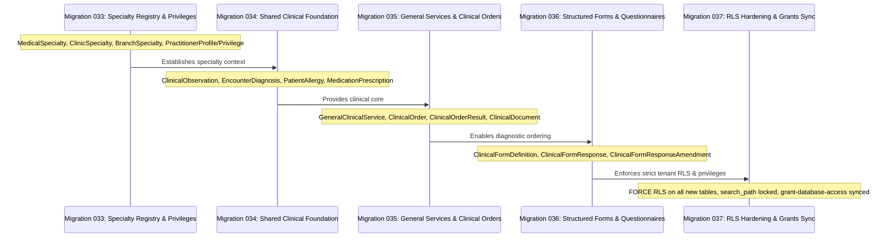

# Lamssa — General Medical Migration & Backward-Compatibility Blueprint

**Version:** 1.0.0 (Phase 6, Step 6.1 Blueprint)
**Date:** 2026-11-13
**Status:** Implementation Blueprint (Zero-Data-Loss Invariant)
**Language:** English (Technical Specification)
**Target Platform:** PostgreSQL 16 + Prisma ORM + NestJS

---

## 1. Executive Summary & Migration Principles

The transition of Lamssa from an aesthetic-specialized EMR into a comprehensive multi-specialty clinical platform requires introducing general clinical domains (vital signs, diagnoses, allergies, prescriptions, diagnostic orders, and structured forms) without disrupting operational clinics or corrupting five phases of historical medical and financial data.

### Core Migration Principles
1. **Strictly Additive Schema Evolution:** All database migrations in Phase 6 are strictly forward-only and additive. No existing table, column, index, trigger, or constraint will be dropped or renamed in-place.
2. **Zero Historical Data Loss:** Every signed clinical note, approved treatment revision, photographic vault asset, procedure execution record, and financial audit entry must retain its exact relational integrity and cryptographic hash chains.
3. **Dual-Track Coexistence (Approach B):** The existing aesthetic catalog and procedure execution pipelines will co-exist alongside the new general clinical foundation, connected via a unified service abstraction layer.
4. **Isolated Stepwise Milestones:** Migrations are partitioned into isolated milestones, verified independently on synthetic test databases before production staging.
5. **No Existing Migration File Mutation:** Applied migrations `001` through `032` remain 100% immutable. All new tables and constraints will be introduced starting from migration `033`.

---

## 2. Comprehensive Dependency Map of Existing Aesthetic Models

The existing aesthetic domain is deeply interwoven across 10+ core database entities, financial ledgers, inventory costing layers, and cryptographic consent chains. The table below documents every dependent model, its current relationships, and the architectural risk of in-place modification:

| Existing Aesthetic Model | Linked Tables & Foreign Keys | Functional Role in Lamssa | Risk of In-Place Renaming / Modification |
| :--- | :--- | :--- | :--- |
| **`AestheticProcedureCatalog`** | `TreatmentPlanItem` (FK)<br/>`ConsentTemplate` (FK)<br/>`PatientConsent` (FK)<br/>`TreatmentPackageItem` (FK)<br/>`PatientPackageEntitlement` (FK)<br/>`PractitionerCommissionRule` (FK)<br/>`ClinicService` (Optional FK) | Clinic catalog defining procedure names (Ar/En), duration, category, and requirements. | **CRITICAL RISK:** 6 distinct operational tables maintain direct foreign keys to this model. Renaming the table or modifying columns would require extensive foreign key rewrites, drop-and-recreate constraints, table-level locks, and breaking API regressions across existing aesthetic clinics. |
| **`TreatmentPlan`** | `ClinicalEncounter` (FK)<br/>`Patient` (FK)<br/>`ClinicMembership` (FK)<br/>`TreatmentPlanRevision` (Child)<br/>`PatientConsent` (Child)<br/>`ClinicalPhotoSession` (Child)<br/>`ClinicalFollowUp` (Child)<br/>`TreatmentOutcome` (Child) | Root container for multi-session treatment regimens. | **HIGH RISK:** Contains workflow-specific revision counters and child collections designed for aesthetic staging. Coercing single-visit general practice consultations into a `TreatmentPlan` introduces unnecessary complexity and potential null-reference bugs. |
| **`TreatmentPlanRevision`** | `TreatmentPlan` (FK)<br/>`TreatmentPlanItem` (Child)<br/>`ClinicMembership` (Author & Approver) | Immutable versioned clinical plan revisions (`DRAFT` ➔ `APPROVED`). | **MODERATE RISK:** Captures clinical indications, aftercare, and preparation instructions. Renaming would break revision immutability triggers. |
| **`TreatmentPlanItem`** | `TreatmentPlanRevision` (FK)<br/>`AestheticProcedureCatalog` (FK)<br/>`ProcedureExecution` (Child)<br/>`PatientConsent` (Child)<br/>`ClinicalPhotoSession` (Child) | Discrete planned session item within a treatment revision. | **HIGH RISK:** Contains session ordering and expected duration. In-place modification threatens consent verification checks. |
| **`ProcedureExecution`** | `TreatmentPlanItem` (FK)<br/>`ClinicalEncounter` (Optional FK)<br/>`InventoryClinicalConsumption` (Child)<br/>`PackageRedemption` (Child)<br/>`PractitionerCommissionAccrual` (Child)<br/>`AdverseEvent` (Child)<br/>`ClinicalPhotoSession` (Child)<br/>`ClinicalFollowUp` (Child) | Records physical procedure performance, batch lots, and metadata snapshots. | **CRITICAL RISK:** Acts as the primary transactional bridge between clinical execution, physical inventory lot consumption (`InventoryClinicalConsumption`), financial package redemptions (`PackageRedemption`), and commissions (`PractitionerCommissionAccrual`). Modifying this table directly would jeopardize financial and inventory accounting integrity. |
| **`TreatmentPackage` & Items** | `TreatmentPackageItem` (Child)<br/>`PatientPackage` (Child)<br/>`AestheticProcedureCatalog` (FK) | Multi-session prepaid procedure packages sold via invoicing. | **HIGH RISK:** Directly linked to `InvoiceLine` billing. Modifying this structure threatens deferred revenue and package balance reconciliation. |
| **`PatientPackageEntitlement`** | `PatientPackage` (FK)<br/>`AestheticProcedureCatalog` (FK)<br/>`PackageRedemption` (Child) | Tracks remaining paid procedure sessions per patient. | **CRITICAL RISK:** Financial ledger dependent. Renaming breaks balance validation and redemption audit trails. |
| **`ConsentTemplate` & `PatientConsent`** | `AestheticProcedureCatalog` (Optional FK)<br/>`TreatmentPlan` (Optional FK)<br/>`ConsentSignatureEvidence` (Child)<br/>`ConsentWithdrawal` (Child) | Legal informed consent with SHA-256 evidence digests. | **CRITICAL RISK:** `ConsentEligibilityService` fails closed by checking exact `procedureCatalogId` matching. Renaming fields invalidates historical digital signatures. |
| **`InventoryClinicalConsumption`** | `ProcedureExecution` (FK)<br/>`InventoryProduct` (FK)<br/>`InventoryBatch` (FK)<br/>`InventoryCostMovement` (Child) | Physical lot-level consumption attributed to clinical acts. | **CRITICAL RISK:** Tied to FIFO cost layers and inventory landed costing. Foreign key changes risk ledger balance corruption. |
| **`PractitionerCommissionRule`** | `AestheticProcedureCatalog` (Optional FK)<br/>`PractitionerCommissionPlan` (FK)<br/>`PractitionerCommissionAccrual` (Child) | Calculates doctor commissions based on procedure completion. | **CRITICAL RISK:** Modifying procedure catalog references causes historical settlement recalculation discrepancies. |

---

## 3. Comparative Evaluation: Approach A vs Approach B

### 3.1 Approach A: Rename & Generalize Existing Aesthetic Tables
Under Approach A, `AestheticProcedureCatalog` is renamed to `ClinicalProcedureCatalog`, `TreatmentPlan` is renamed to `ClinicalPlan`, and `ProcedureExecution` is expanded to represent general consultations, vaccinations, and lab collections.

#### Failure Modes of Approach A:
1. **Severe Database Locking:** Renaming tables and modifying foreign keys across 10 tables requires exclusive `ACCESS EXCLUSIVE` table locks in PostgreSQL. On active databases with large tables, this induces lock queues, blocked transactions, and operational downtime.
2. **Prisma Client Invalidation:** Prisma schema renames alter generated model names across the entire TypeScript workspace, requiring breaking rewrites of dozens of existing services, controllers, and tests simultaneously.
3. **Historical Audit Digest Corruption:** Historical signed clinical notes, consent evidence digests, and financial audit hashes store metadata containing original model identifiers and procedure references. Renaming tables compromises cryptographic provenance verification.
4. **Semantics Mismatch:** A routine general medical consultation (e.g., diagnosing pharyngitis and prescribing amoxicillin) does not follow a multi-revision treatment plan or generate before/after split-slider photo comparison sessions. Forcing general practice into aesthetic models creates an unnatural, error-prone clinical user experience.

### 3.2 Approach B: Dual-Track Coexistence with Clinical Procedure Abstraction
Under Approach B:
1. **Existing Tables Remain Unchanged:** `AestheticProcedureCatalog`, `TreatmentPlan`, `ProcedureExecution`, and all linked tables retain their current names, schemas, indexes, and triggers.
2. **Additive General Clinical Entities:** Layer B models (`GeneralClinicalService`, `ClinicalCarePlan`, `ClinicalOrder`, `MedicationPrescription`) are introduced cleanly in new additive migrations.
3. **Unified Resolution Layer:** A shared domain service (`ClinicalProcedureAdapterService`) provides a polymorphic interface for billing, scheduling, and inventory consumption:
   ```typescript
   export type ServiceResolvable =
     | { type: 'AESTHETIC_PROCEDURE'; procedureCatalogId: string }
     | { type: 'GENERAL_SERVICE'; generalServiceId: string };
   ```
4. **Zero Downtime & Zero Regression:** Aesthetic clinics continue operating without touching a single database record. New multi-specialty clinics configure general medical services without encountering aesthetic constraints.

**Blueprint Decision:** Approach B is formally adopted as the architectural migration standard for Phase 6.

---

## 4. Milestone Migration Sequence (Phase 6 Implementation Roadmap)

All Phase 6 schema changes will be partitioned across five strictly additive PostgreSQL migrations:



---

### Milestone 1: Specialty Registry & Practitioner Privileging (Migration `033`)
**Target File:** `apps/api/prisma/migrations/20261113000100_specialty_registry_privileges/migration.sql`

#### Tables Introduced:
1. `MedicalSpecialty`: System master catalog of specialties.
2. `ClinicSpecialty`: Tenant specialty enablement with composite key `("clinicId", "specialtyCode")`.
3. `BranchSpecialty`: Branch availability with composite key `("clinicId", "branchId", "specialtyCode")`.
4. `PractitionerProfile`: Professional credentials attached to `ClinicMembership` `("clinicId", "membershipId")`.
5. `PractitionerSpecialty`: Practitioner specialty qualifications and verification status.
6. `PractitionerClinicalPrivilege`: Granular clinical action privileges granted by Medical Directors.

#### Backward Compatibility & Backfill Strategy:
- **Default Aesthetic Backfill:** An idempotent migration script automatically inserts `'AESTHETICS'` into `ClinicSpecialty` for all existing clinics:
  ```sql
  INSERT INTO public."ClinicSpecialty" ("id", "clinicId", "specialtyCode", "status", "enabledAt")
  SELECT gen_random_uuid(), c.id, 'AESTHETICS', 'ACTIVE', c."createdAt"
  FROM public."Clinic" c
  ON CONFLICT ("clinicId", "specialtyCode") DO NOTHING;
  ```
- **Default Branch Backfill:** Maps `'AESTHETICS'` to all existing active branches in `BranchSpecialty`.
- **Practitioner Profile Backfill:** Automatically creates a `PractitionerProfile` for all existing `ClinicMembership` rows with role `'DOCTOR'`.

---

### Milestone 2: Shared Clinical Data Foundation (Migration `034`)
**Target File:** `apps/api/prisma/migrations/20261114000100_shared_clinical_foundation/migration.sql`

#### Tables Introduced:
1. `ClinicalObservation`: Vitals and measurements with numerical/string values, units, reference ranges, and abnormal flags.
2. `EncounterDiagnosis`: Diagnostic problem lists supporting ICD-10 coding and primary/differential classifications.
3. `PatientAllergy`: Patient safety register tracking allergen substances, severity, and clinical status.
4. `MedicationRecord`: Longitudinal home and chronic medication reconciliation.
5. `MedicationPrescription` & `MedicationPrescriptionItem`: Legally binding outpatient prescription orders with SHA-256 digital signature hashes.

#### Relational Contracts:
- All tables enforce composite tenant foreign keys:
  ```sql
  CONSTRAINT "ClinicalObservation_clinic_patient_fkey"
    FOREIGN KEY ("clinicId", "patientId") REFERENCES public."Patient"("clinicId", "id")
    ON DELETE RESTRICT ON UPDATE RESTRICT
  ```
- All tables enforce `ALTER TABLE public.<name> FORCE ROW LEVEL SECURITY;`.

---

### Milestone 3: General Clinical Services, Orders & Diagnostic Results (Migration `035`)
**Target File:** `apps/api/prisma/migrations/20261115000100_general_services_orders/migration.sql`

#### Tables Introduced:
1. `GeneralClinicalService`: Reusable catalog of non-aesthetic outpatient clinical services (consultations, immunizations, diagnostic tests, minor surgical procedures). Linked to billing `ClinicService`.
2. `ClinicalOrder`: Diagnostic orders (laboratory, radiology, pathology, external referrals).
3. `ClinicalOrderResult`: Diagnostic results, structured lab panels (JSONB), and verification signatures.
4. `ClinicalDocument`: Encrypted attachments and clinical summaries (referral letters, diagnostic scans).

#### Polymorphic Service Resolution Contract:
- `ClinicService` (the billing catalog) is enhanced with an optional, mutually exclusive foreign key:
  - `aestheticProcedureId` (UUID, Nullable, existing).
  - `generalClinicalServiceId` (UUID, Nullable, new).
  - Database check constraint enforces:
    ```sql
    CONSTRAINT clinic_service_target_check
      CHECK (NOT ("aestheticProcedureId" IS NOT NULL AND "generalClinicalServiceId" IS NOT NULL))
    ```

---

### Milestone 4: Versioned Structured Clinical Forms (Migration `036`)
**Target File:** `apps/api/prisma/migrations/20261116000100_structured_clinical_forms/migration.sql`

#### Tables Introduced:
1. `ClinicalFormDefinition`: Versioned JSON Schema (Draft-07) form templates with Arabic-first field labels and specialty applicability tags.
2. `ClinicalFormResponse`: Completed form submissions linked to `(clinicId, patientId, encounterId)`. Stores `responsePayload` (JSONB) and `responseHashSha256` (VARCHAR(64)).
3. `ClinicalFormResponseAmendment`: Attributable correction log preserving original responses upon amendment.

#### Integrity Triggers:
- A PostgreSQL database trigger (`guard_form_response_immutability`) prevents in-place SQL updates on finalized form responses, requiring amendment inserts.

---

### Milestone 5: Database Security Normalization & Grant Synchronization (Migration `037`)
**Target File:** `apps/api/prisma/migrations/20261117000100_general_medical_security_hardening/migration.sql`

#### Actions:
1. Standardizes the 5-policy RLS pattern across all 15 new Layer B tables:
   - `maintenance_owner`: `FOR ALL TO <migration_owner> USING (true) WITH CHECK (true)`
   - `tenant_select`: `FOR SELECT USING (lamssa_security.context_allows("clinicId"))`
   - `tenant_insert`: `FOR INSERT WITH CHECK (lamssa_security.context_allows("clinicId"))`
   - `tenant_update`: `FOR UPDATE USING (lamssa_security.context_allows("clinicId")) WITH CHECK (lamssa_security.context_allows("clinicId"))`
   - `tenant_delete`: `FOR DELETE USING (false)`
2. Updates `scripts/grant-database-access.mjs` to grant restricted runtime privileges (`SELECT, INSERT, UPDATE`) to the application role.
3. Locks all helper functions with `SECURITY DEFINER` and `SET search_path = pg_catalog, pg_temp`.
4. Revokes all execution rights from `PUBLIC` (`REVOKE ALL ON FUNCTION ... FROM PUBLIC`).

---

## 5. Rollback & Roll-Forward Safeguards

### 5.1 Roll-Forward Procedure
1. Verify migration prerequisites on test database (`npm run db:status:test`).
2. Run database migration under maintenance owner role (`npm run db:migrate:deploy`).
3. Apply updated runtime role grants (`npm run db:grant`).
4. Execute boundary checks and test suites (`npm run check:boundaries && npm test && npm run test:db`).

### 5.2 Rollback Safeguards
Because all Phase 6 migrations are strictly additive:
- If a deployment issue occurs during an intermediate milestone, no existing Phase 1–5 tables are in an altered state.
- In-flight transactions roll back atomically via PostgreSQL DDL transaction support.
- If a newly introduced table requires structural correction, the fix is deployed as a subsequent additive migration (e.g., adding a nullable column or revising a check constraint) rather than rolling back applied migration files.

---

## 6. Synthetic Staging Verification & Pre-Release Checklist

Before any Phase 6 code is considered ready for local merge into `main`:
1. **Pre-Migration Snapshot:** Execute an encrypted database backup (`npm run db:backup`) capturing the 32-migration baseline.
2. **Automated Migration Upgrade Test:** Apply the new migration against a synthetic copy of the development database and verify `prisma migrate status` reports zero drift.
3. **Aesthetic Regression Test:** Execute the full aesthetic treatment, clinical photo, and package redemption test suite (`test/treatment.integration.test.ts`, `test/clinical-photo.integration.test.ts`) to prove zero regressions.
4. **General Medicine End-to-End Test:** Execute a complete general medical consultation workflow (patient intake ➔ vitals observation ➔ ICD-10 diagnosis ➔ prescription issuance ➔ checkout billing) proving independence from aesthetic catalogs.
5. **Full Regression Execution:** 100% pass rate across unit tests, database tests, and browser smoke checks.
