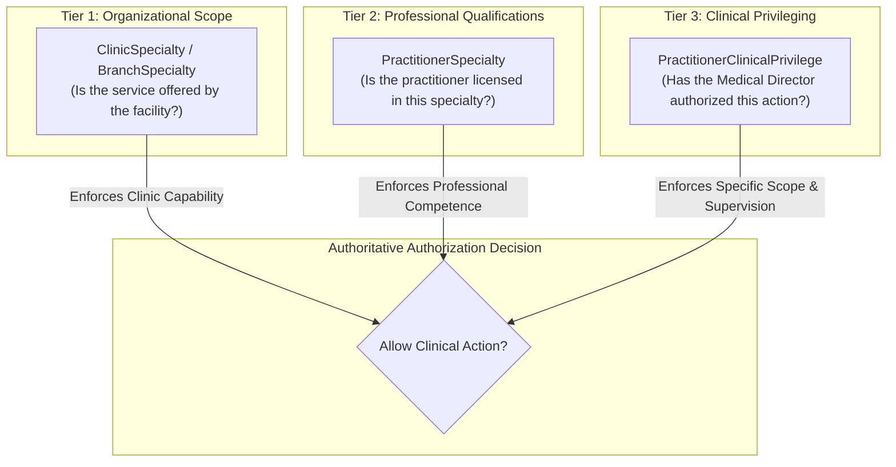
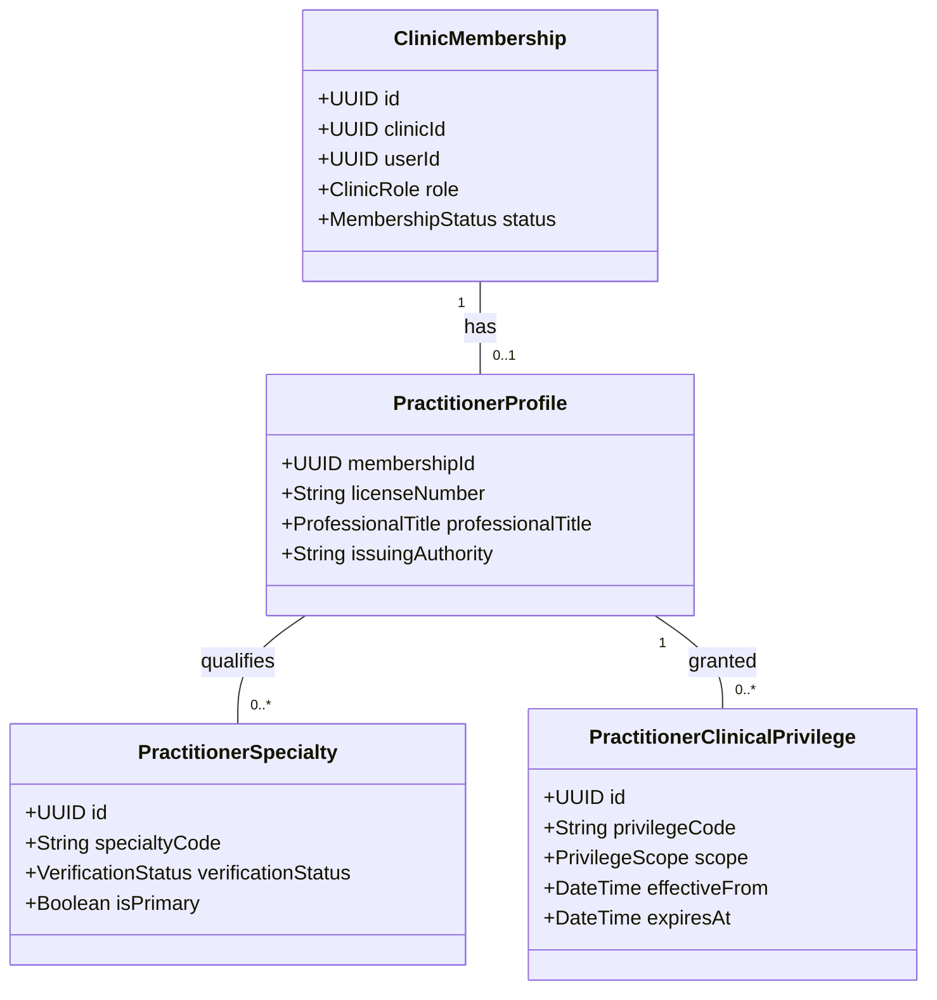

# Lamssa — General Medical Platform Architecture & Specialty-Neutral Contracts

**Version:** 1.0.0 (Phase 6, Step 6.1 Design Specification)
**Date:** 2026-11-13
**Status:** Architecture Blueprint (Implementation-Ready)
**Language:** English (Technical Architecture) | Arabic RTL (Application Experience)
**Classification:** Enterprise Multi-Tenant Outpatient Healthcare Platform

---

## 1. Executive Summary & Strategic Mission

Lamssa is evolving from a specialized aesthetic clinic management solution into an enterprise-grade, Arabic-first, multi-tenant medical clinic management platform. The target platform supports comprehensive outpatient care across a diverse spectrum of medical specialties—including General Practice (Family Medicine), Dermatology, Pediatrics, Obstetrics and Gynecology (Ob/Gyn), Ophthalmology, Dentistry, Orthopedics, Ear, Nose & Throat (ENT), and Physiotherapy & Rehabilitation—while fully preserving existing aesthetic medicine workflows, clinical records, historical financial chains, and inventory costing layers.

This document establishes the architectural foundation, domain boundaries, data models, role-based and privilege-based authorization rules, structured clinical form protocols, and interoperability contracts required for this transformation.

---

## 2. Three-Layer Modular Architecture

The platform preserves the existing **modular monolith** pattern (NestJS backend, React/TypeScript RTL frontend, PostgreSQL 16 database, Prisma ORM, and database-enforced `FORCE ROW LEVEL SECURITY`). The architecture is structured into three distinct conceptual and operational layers:

```mermaid
graph TD
    subgraph LayerC ["Layer C: Specialty Capabilities (Extensible Workspaces)"]
        Aesthetics["Aesthetic Sessions & Photography"]
        Dentistry["Dental Charting & Odontogram"]
        Pediatrics["Pediatric Growth & Vaccines"]
        ObGyn["Obstetric Episodes & Antenatal"]
        Ophthalmology["Ophthalmic Refraction & Acuity"]
        Physiotherapy["Rehabilitation & ROM Assessments"]
    end

    subgraph LayerB ["Layer B: Shared Clinical Foundation (Neutral Medical Core)"]
        Encounters["Clinical Encounters & Visits"]
        MedHistory["Longitudinal Medical History"]
        VitalsObs["Observations & Vital Signs"]
        Diagnoses["Diagnoses & Problem Lists (ICD-10)"]
        Allergies["Allergies & Adverse Reactions"]
        Medications["Medications & e-Prescriptions"]
        Orders["Clinical Orders & Lab/Imaging Results"]
        CarePlans["Care Plans & General Procedures"]
        NotesDocs["Clinical Notes, Amendments & Documents"]
        Consents["Informed Consents & Signatures"]
        FollowUps["Follow-ups, Outcomes & Triage"]
    end

    subgraph LayerA ["Layer A: Shared Operational Core (Tenant Infrastructure)"]
        ClinicsBranches["Clinic & Multi-Branch Hierarchy"]
        IdentityAuth["User & Practitioner Identity (RBAC)"]
        Patients["Patient Master Identity & Demographics"]
        SchedulingQueue["Temporal Scheduling & Live Queues"]
        BillingFinance["Invoicing, Payments & Landed Costing"]
        Inventory["Procurement, Batches & FIFO Valuation"]
        SecurityAudit["FORCE RLS, Hash Chains & Audit Trails"]
        PatientPortal["Branded Patient Self-Service Portal"]
    end

    LayerC --> LayerB
    LayerB --> LayerA
```



### 2.1 Layer A — Shared Operational Core
Contains horizontal clinic infrastructure independent of any medical specialty:
- **Tenancy & Branch Administration:** `Clinic`, `ClinicBranch`, `BranchMembership`, `ClinicBranding`, `ClinicDomain`.
- **Identity & Access Management:** `User`, `ClinicMembership`, `Session`, `UserMfa`, granular permission evaluation.
- **Patient Master Index:** `Patient`, `PatientCounter`, demographic normalization, Arabic naming search, identity proofing.
- **Scheduling & Real-Time Queue:** `Temporal` scheduling engine, `Appointment` (with GiST room/practitioner exclusion), `Visit`, `QueueTicket`, `QueueCounter`.
- **Billing & Payment Orchestration:** `Invoice`, `InvoiceLine`, `Payment`, `PaymentReversal`, `FinancialAuditEvent`, `PaymentIntent`, `PaymentSettlement`.
- **Inventory & FIFO Costing:** `InventoryProduct`, `InventoryBatch`, `InventoryStockMovement`, `InventoryCostLayer`, `InventoryLandedCost`, `InventoryValuationSnapshot`.
- **Governance & Privacy:** Centralized immutable `AuditEvent`, `PrivacyRequest`, `RetentionPolicy`, AES-256-GCM backups.
- **Patient Engagement:** `PatientAccount`, `PatientSession`, self-service booking, Arabic RTL patient portal.

### 2.2 Layer B — Shared Clinical Foundation
Provides specialty-neutral clinical building blocks that model outpatient healthcare encounters:
- Reusable encounters (`ClinicalEncounter`) capturing the clinician-patient interaction context.
- Longitudinal problem lists and encounter diagnoses (`EncounterDiagnosis`) with ICD-10 readiness.
- Standardized vital signs and observations (`ClinicalObservation`).
- Patient allergy tracking with severe reaction flags (`PatientAllergy`).
- Active medication history and e-prescriptions (`MedicationRecord`, `MedicationPrescription`).
- Clinical diagnostic and laboratory orders with incoming results (`ClinicalOrder`, `ClinicalOrderResult`).
- Structured clinical documentation, signed notes, and attributable amendments (`ClinicalNote`, `ClinicalNoteAmendment`, `ClinicalDocument`).
- Versioned informed consents with SHA-256 signature evidence binding (`ConsentTemplate`, `PatientConsent`).
- Care plans, clinical goal tracking, and general medical procedures.
- Post-care follow-up tracking, patient-reported outcomes (PROMs), and clinical escalation.

### 2.3 Layer C — Specialty Capabilities
Extensible clinical modules tailored to specific medical disciplines. Specialty modules consume Layer B clinical constructs and Layer A operational resources without duplicating core entities:
- **Aesthetics & Cosmetic Dermatology:** Multi-session aesthetic treatment plans (`TreatmentPlan`), high-resolution before/after photography vaults (`ClinicalPhotoSession`), and packaging/redemptions (`TreatmentPackage`).
- **Dentistry (Phase 8+):** Universal tooth numbering, graphical odontogram charting, periodontal probing depth tracking.
- **Pediatrics (Phase 8+):** WHO percentile growth curves (height, weight, head circumference), pediatric immunization schedules.
- **Obstetrics & Gynecology (Phase 8+):** Gestational age calculators, antenatal flowsheets, ultrasound biometry metrics.
- **Ophthalmology (Phase 8+):** Visual acuity (Snellen/LogMAR), refraction measurements (sphere, cylinder, axis), intraocular pressure.
- **Physiotherapy & Rehabilitation (Phase 8+):** Range of Motion (ROM) charting, muscle strength grading (MRC scale), functional rehab plans.

---

## 3. Medical Specialty Configuration & Privilege Engine

To accommodate diverse medical practices without multiplying global RBAC roles, Lamssa introduces a **Specialty Configuration & Clinical Privilege Engine**.

### 3.1 Distinct Authorization Tiers
The system strictly decouples three independent architectural concepts:
1. **Clinic Specialty Offering (`ClinicSpecialty`):** Does the clinic (and branch) legally and operationally offer this clinical service?
2. **Practitioner Specialty Qualification (`PractitionerSpecialty`):** Is the clinician licensed, accredited, and verified to practice in this specialty?
3. **Practitioner Clinical Privilege (`PractitionerClinicalPrivilege`):** Has the clinic Medical Director granted this specific clinician the privilege to execute this specific clinical action within this clinic tenancy?



### 3.2 Specialty Registry Domain Models

#### Model: `MedicalSpecialty` (System Master Catalog)
Global system-level catalog of recognized medical and surgical specialties.
- `code` (VARCHAR(32), Primary Key): Stable identifier (`GENERAL_MEDICINE`, `DERMATOLOGY`, `AESTHETICS`, `PEDIATRICS`, `OBSTETRICS_GYNECOLOGY`, `DENTISTRY`, `OPHTHALMOLOGY`, `ORTHOPEDICS`, `ENT`, `PHYSIOTHERAPY`).
- `nameAr` (VARCHAR(150)): Arabic display name (e.g., `'الطب العام / طب الأسرة'`).
- `nameEn` (VARCHAR(150)): English display name (e.g., `'General Medicine / Family Practice'`).
- `category` (VARCHAR(50)): Classification (`PRIMARY_CARE`, `SPECIALTY_CARE`, `SURGICAL`, `ALLIED_HEALTH`, `DENTAL`).
- `isAesthetic` (BOOLEAN): Flag indicating aesthetic capabilities (enables photo comparisons and package redemptions).
- `active` (BOOLEAN): Master availability flag.

#### Model: `ClinicSpecialty` (Tenant Enablement)
Represents a specialty active within a clinic organization.
- `id` (UUID, Primary Key).
- `clinicId` (UUID, FK to `Clinic.id`): Tenant isolation key.
- `specialtyCode` (VARCHAR(32), FK to `MedicalSpecialty.code`).
- `status` (ENUM: `ACTIVE`, `SUSPENDED`, `INACTIVE`).
- `settings` (JSONB): Specialty-specific operational configurations (e.g., default appointment durations, required intake forms).
- `enabledAt` (TIMESTAMPTZ), `enabledByMembershipId` (UUID).
- Constraints: `UNIQUE ("clinicId", "specialtyCode")`, `FORCE ROW LEVEL SECURITY`.

#### Model: `BranchSpecialty` (Physical Location Capability)
Maps specialty availability to physical clinic branches.
- `id` (UUID, Primary Key).
- `clinicId` (UUID), `branchId` (UUID, FK to `ClinicBranch.id`).
- `specialtyCode` (VARCHAR(32)).
- `status` (ENUM: `ACTIVE`, `INACTIVE`).
- Constraints: `UNIQUE ("clinicId", "branchId", "specialtyCode")`, `FORCE ROW LEVEL SECURITY`.

#### Model: `PractitionerProfile` & `PractitionerSpecialty`
Captures professional licenses and verified specialty qualifications.
- `PractitionerProfile`: Attached to `ClinicMembership` (`(clinicId, membershipId)`). Stores regulatory license number (e.g., SCFHS / DHA / MOH registration), national provider identifier, qualification degrees, and primary professional title (`titleAr`, `titleEn`).
- `PractitionerSpecialty`: Maps a practitioner to their qualified specialties. Includes `boardCertification`, `licenseExpiryDate`, `verificationStatus` (`VERIFIED`, `PENDING_REVIEW`, `EXPIRED`), `verifiedByMembershipId`, and `isPrimarySpecialty`.

#### Model: `PractitionerClinicalPrivilege`
Defines granular medical authorizations granted by the Medical Director:
- `id` (UUID, Primary Key).
- `clinicId` (UUID), `membershipId` (UUID).
- `specialtyCode` (VARCHAR(32)).
- `privilegeCode` (VARCHAR(64)): Action code (e.g., `'PRESCRIBE_CONTROLLED_MEDICATION'`, `'PERFORM_INVASIVE_PROCEDURE'`, `'ORDER_SPECIALIZED_IMAGING'`, `'DISPENSE_BOTULINUM_TOXIN'`).
- `scope` (ENUM: `INDEPENDENT`, `UNDER_SUPERVISION`, `DENIED`).
- `supervisorMembershipId` (UUID, Nullable): Designated supervising clinician when scope is `UNDER_SUPERVISION`.
- `effectiveFrom` (TIMESTAMPTZ), `expiresAt` (TIMESTAMPTZ, Nullable).
- `grantedByMembershipId` (UUID): Must be a verified Medical Director or Chief of Staff (`CLINIC_OWNER` or designated clinical director).
- Constraints: `FORCE ROW LEVEL SECURITY`, immutable audit logging upon grant/revocation.

---

## 4. Shared Clinical Data Foundation Architecture

Layer B introduces foundational medical data models that support any outpatient consultation. All Layer B entities enforce composite tenant foreign keys `(clinicId, id)` and PostgreSQL `FORCE ROW LEVEL SECURITY`.

### 4.1 Summary of Foundation Models

| Model | Purpose | Tenant Scope | Linkage | Immutability / Lifecycle | Privacy / Consent Classification |
| :--- | :--- | :--- | :--- | :--- | :--- |
| **`ClinicalObservation`** | Objective patient measurements (blood pressure, pulse, SpO2, BMI, glucose, visual acuity) | `clinicId` | Patient + Encounter (optional) | `RECORDED` ➔ `AMENDED` (append-only correction trail with reason) | Sensitive Medical Data (`CLINICAL_READ`) |
| **`EncounterDiagnosis`** | Coded & narrative diagnoses (provisional, differential, confirmed, resolved) | `clinicId` | Patient + Encounter | `PROVISIONAL` ➔ `CONFIRMED` ➔ `RESOLVED` / `RULED_OUT` | Sensitive Medical Data (`CLINICAL_READ`) |
| **`PatientAllergy`** | Known allergies, adverse drug reactions, food/environmental triggers | `clinicId` | Patient Master Record | `ACTIVE` ➔ `RESOLVED` / `REFUTED` (never hard-deleted) | Critical Safety Data (Displayed in encounter header) |
| **`MedicationRecord`** | Current & past home/chronic medications (reconciliation) | `clinicId` | Patient Master Record | `ACTIVE` ➔ `DISCONTINUED` ➔ `HISTORICAL` | Sensitive Medical Data (`CLINICAL_READ`) |
| **`MedicationPrescription`** | Outpatient prescription orders issued by clinicians | `clinicId` | Patient + Encounter + Clinician | `DRAFT` ➔ `SIGNED` (immutable SHA-256 signature) ➔ `DISPENSED` / `CANCELLED` | Controlled Legal Document (`PRESCRIPTION_MANAGE`) |
| **`ClinicalOrder`** | Diagnostic requests (laboratory tests, imaging, pathology, referrals) | `clinicId` | Patient + Encounter + Clinician | `ORDERED` ➔ `COLLECTED` ➔ `IN_PROGRESS` ➔ `COMPLETED` / `CANCELLED` | Sensitive Medical Data (`CLINICAL_ORDERS`) |
| **`ClinicalOrderResult`** | Diagnostic findings, lab values, radiology reports | `clinicId` | ClinicalOrder + Patient | `PRELIMINARY` ➔ `FINAL_VERIFIED` (immutable) ➔ `CORRECTED` | Sensitive Medical Data (`CLINICAL_ORDERS`) |
| **`ClinicalDocument`** | Uploaded or generated clinical documents (referral letters, discharge summaries) | `clinicId` | Patient + Encounter (optional) | Encrypted storage (AES-256-GCM), immutable once finalized | Confidential Health Record (`CLINICAL_DOCS`) |
| **`ClinicalFormDefinition`** | Versioned structured form schema (intake, review of systems, specialty flowsheets) | `clinicId` (or system template) | Master Clinic Catalog | `DRAFT` ➔ `PUBLISHED` (immutable) ➔ `ARCHIVED` | Administrative Specification (`CLINIC_ADMIN`) |
| **`ClinicalFormResponse`** | Completed clinical form submissions containing structured answers | `clinicId` | Patient + Encounter + FormDef | `DRAFT` ➔ `COMPLETED` ➔ `AMENDED` (immutable response hash) | Sensitive Medical Data (`CLINICAL_READ`) |

---

### 4.2 Detailed Specifications of Core Clinical Entities

#### 1. `ClinicalObservation` (Vital Signs & Clinical Measurements)
- **Clinical Purpose:** Records quantitative and qualitative observations captured during triage or consultation.
- **Attributes:**
  - `id` (UUID), `clinicId` (UUID), `patientId` (UUID), `encounterId` (UUID, Nullable).
  - `observationType` (VARCHAR(50)): e.g., `'BLOOD_PRESSURE'`, `'HEART_RATE'`, `'RESPIRATORY_RATE'`, `'OXYGEN_SATURATION'`, `'BODY_TEMPERATURE'`, `'BODY_WEIGHT'`, `'HEIGHT'`, `'BMI'`, `'BLOOD_GLUCOSE'`.
  - `valueNumeric` (DECIMAL(10,3), Nullable): Numerical value for scalar metrics.
  - `unit` (VARCHAR(20)): Metric unit (e.g., `'mmHg'`, `'bpm'`, `'%'`, `'C'`, `'kg'`, `'cm'`).
  - `valueString` (VARCHAR(200), Nullable): Textual or compound value (e.g., `'120/80'` for BP).
  - `referenceRangeLow` / `referenceRangeHigh` (DECIMAL(10,3), Nullable).
  - `abnormalFlag` (BOOLEAN): Auto-flagged if out of reference range.
  - `recordedAt` (TIMESTAMPTZ), `recordedByMembershipId` (UUID).
  - `amendmentReason` (VARCHAR(500), Nullable), `originalObservationId` (UUID, Nullable).
- **Constraints & Indexes:** `FORCE ROW LEVEL SECURITY`, `INDEX ("clinicId", "patientId", "observationType", "recordedAt")`.

#### 2. `EncounterDiagnosis` (Clinical Diagnoses & Problem List)
- **Clinical Purpose:** Records medical problems identified or addressed during an encounter, forming the patient's ongoing medical record.
- **Attributes:**
  - `id` (UUID), `clinicId` (UUID), `patientId` (UUID), `encounterId` (UUID).
  - `codingSystem` (VARCHAR(30)): e.g., `'ICD-10-AM'`, `'ICD-10-CM'`, `'INTERNAL'`.
  - `diagnosisCode` (VARCHAR(30)): e.g., `'J00'` (Acute nasopharyngitis), `'E11.9'` (Type 2 diabetes).
  - `diagnosisDescriptionAr` (VARCHAR(250)), `diagnosisDescriptionEn` (VARCHAR(250)).
  - `type` (ENUM: `PRIMARY`, `SECONDARY`, `DIFFERENTIAL`, `PROVISIONAL`).
  - `clinicalStatus` (ENUM: `ACTIVE`, `RECURRENCE`, `RELAPSE`, `REMISSION`, `RESOLVED`).
  - `verificationStatus` (ENUM: `SUSPECTED`, `PROBABLE`, `CONFIRMED`, `REFUTED`).
  - `onsetDate` (DATE, Nullable), `resolvedDate` (DATE, Nullable).
  - `diagnosedByMembershipId` (UUID), `diagnosedAt` (TIMESTAMPTZ).
  - `isChronicProblem` (BOOLEAN @default(false)): Elevates diagnosis to the longitudinal Problem List.
- **Constraints & Indexes:** `FORCE ROW LEVEL SECURITY`, `INDEX ("clinicId", "patientId", "isChronicProblem", "clinicalStatus")`.

#### 3. `PatientAllergy` (Allergies & Adverse Drug Reactions)
- **Clinical Purpose:** Critical patient safety register displayed prominently during prescribing, procedure execution, and triage.
- **Attributes:**
  - `id` (UUID), `clinicId` (UUID), `patientId` (UUID).
  - `allergenType` (ENUM: `MEDICATION`, `FOOD`, `ENVIRONMENTAL`, `BIOLOGICAL`, `LATEX`, `OTHER`).
  - `allergenSubstance` (VARCHAR(150)): Name of substance (e.g., `'Penicillin'`, `'Lidocaine'`, `'Ibuprofen'`).
  - `severity` (ENUM: `MILD`, `MODERATE`, `SEVERE`, `LIFE_THREATENING_ANAPHYLAXIS`).
  - `reactionManifestation` (VARCHAR(250)): e.g., `'Urticaria and facial angioedema'`.
  - `status` (ENUM: `ACTIVE`, `INACTIVE`, `RESOLVED`, `REFUTED`).
  - `identifiedAt` (DATE, Nullable), `recordedByMembershipId` (UUID), `verifiedAt` (TIMESTAMPTZ).
- **Constraints & Indexes:** `FORCE ROW LEVEL SECURITY`, `UNIQUE ("clinicId", "patientId", "allergenSubstance")` where status is active.

#### 4. `MedicationPrescription` & `MedicationPrescriptionItem`
- **Clinical Purpose:** Legal outpatient prescription orders issued by licensed clinicians.
- **Attributes (`MedicationPrescription`):**
  - `id` (UUID), `clinicId` (UUID), `patientId` (UUID), `encounterId` (UUID).
  - `prescriptionNumber` (VARCHAR(32)): Sequential clinic prescription identifier (e.g., `'RX-2026-000123'`).
  - `prescriberMembershipId` (UUID).
  - `status` (ENUM: `DRAFT`, `SIGNED`, `DISPENSED`, `CANCELLED`, `EXPIRED`).
  - `digitalSignatureHash` (VARCHAR(64), Nullable): SHA-256 signature digest computed upon clinician signing.
  - `signedAt` (TIMESTAMPTZ, Nullable).
  - `notes` (VARCHAR(1000), Nullable).
- **Attributes (`MedicationPrescriptionItem`):**
  - `id` (UUID), `clinicId` (UUID), `prescriptionId` (UUID).
  - `medicationName` (VARCHAR(200)): Generic or brand name.
  - `form` (VARCHAR(50)): e.g., `'TABLET'`, `'SYRUP'`, `'CREAM'`, `'INJECTION'`.
  - `dosage` (VARCHAR(50)): e.g., `'500 mg'`.
  - `route` (VARCHAR(50)): e.g., `'ORAL'`, `'TOPICAL'`, `'INTRAMUSCULAR'`.
  - `frequency` (VARCHAR(50)): e.g., `'EVERY_8_HOURS'`, `'ONCE_DAILY'`, `'AS_NEEDED'`.
  - `durationDays` (INT).
  - `dispenseQuantity` (INT), `refillsAllowed` (INT @default(0)).
  - `instructionsAr` (VARCHAR(500)), `instructionsEn` (VARCHAR(500), Nullable).
  - `substitutionPermitted` (BOOLEAN @default(true)).

#### 5. `ClinicalOrder` & `ClinicalOrderResult` (Diagnostics & Lab/Imaging)
- **Clinical Purpose:** Manages the full lifecycle of diagnostic requests (blood panels, biopsies, X-rays, MRIs, ultrasounds, specialized tests) and resulting reports.
- **Attributes (`ClinicalOrder`):**
  - `id` (UUID), `clinicId` (UUID), `patientId` (UUID), `encounterId` (UUID).
  - `orderNumber` (VARCHAR(32)): Sequential order code.
  - `orderType` (ENUM: `LABORATORY`, `RADIOLOGY`, `PATHOLOGY`, `PROCEDURE`, `CONSULTATION_REFERRAL`).
  - `orderedTestName` (VARCHAR(200)), `testCode` (VARCHAR(50), Nullable).
  - `priority` (ENUM: `ROUTINE`, `URGENT`, `STAT_EMERGENCY`).
  - `clinicalIndication` (VARCHAR(500)).
  - `status` (ENUM: `DRAFT`, `ORDERED`, `SPECIMEN_COLLECTED`, `IN_PROGRESS`, `COMPLETED`, `CANCELLED`).
  - `orderedByMembershipId` (UUID), `orderedAt` (TIMESTAMPTZ).
- **Attributes (`ClinicalOrderResult`):**
  - `id` (UUID), `clinicId` (UUID), `orderId` (UUID).
  - `resultStatus` (ENUM: `PRELIMINARY`, `FINAL`, `AMENDED`).
  - `narrativeSummary` (VARCHAR(4000), Nullable).
  - `structuredResults` (JSONB, Nullable): Standardized key-value lab panels (analyte, value, unit, flags).
  - `attachedDocumentId` (UUID, Nullable, FK to `ClinicalDocument`).
  - `verifiedByMembershipId` (UUID, Nullable), `verifiedAt` (TIMESTAMPTZ, Nullable).
  - `amendmentReason` (VARCHAR(500), Nullable).

---

## 5. Existing Aesthetic Workflow Compatibility

### 5.1 Analysis of Approach A vs Approach B

| Evaluation Dimension | Approach A: Rename & Generalize Existing Tables | Approach B: Dual-Track Coexistence with Clinical Procedure Abstraction |
| :--- | :--- | :--- |
| **Architectural Concept** | Rename `AestheticProcedureCatalog` ➔ `ClinicalProcedureCatalog`; mutate `TreatmentPlan` and `ProcedureExecution` to serve all specialties. | Introduce specialty-neutral Layer B models (`GeneralClinicalService`, `ClinicalCarePlan`, `ClinicalProcedureExecution`) while maintaining the existing aesthetic catalog and linking them via a unified interface. |
| **Database Migration Risk** | **HIGH**: Alters 10+ core tables across 6 foreign-key relationships. High risk of locking, table rewrites, index recreation, and transaction timeouts. | **ZERO BREAKING RISK**: 100% additive migrations. Existing aesthetic tables, columns, indexes, and triggers remain undisturbed. |
| **Historical Data Integrity** | **RISKY**: Historical aesthetic revisions, package entitlements, and signed consent templates must be rewritten or coerced into generic schemas. | **PERFECT FIDELITY**: All 5 historical phases of aesthetic treatment data, photos, and packages retain exact database references without schema mutations. |
| **API & Client Compatibility** | **BREAKING**: Requires simultaneous breaking changes across existing frontend workspaces, patient portal DTOs, and reporting controllers. | **STABLE & BACKWARD COMPATIBLE**: Existing `/api/v1/clinical/procedure-catalog` and `/treatment-plans` endpoints continue operating without disruption. |
| **Financial & Inventory Provenance** | **HIGH RISK**: `InventoryClinicalConsumption`, `PackageRedemption`, and `PractitionerCommissionRule` foreign keys must be modified. | **PRESERVED**: Existing financial audit triggers, commissions, and package redemptions continue pointing to valid historical foreign keys. |
| **Specialty Domain Clarity** | **COMPROMISED**: Blurs the boundary between routine general practice consultations (which don't need revisions or split-slider photos) and multi-session aesthetic treatments. | **EXCELLENT**: General medicine consultations use streamlined encounters and orders, while aesthetic medicine retains its specialized workflows. |

### 5.2 Architectural Recommendation: Approach B (Dual-Track with Compatibility Adapter)
**Approach B is strongly recommended.**
Under Approach B:
1. `AestheticProcedureCatalog`, `TreatmentPlan`, `TreatmentPlanRevision`, `TreatmentPlanItem`, `ProcedureExecution`, `TreatmentPackage`, and `ClinicalPhotoSession` remain **completely intact** with zero table renames.
2. For general medical procedures and diagnostic interventions, the platform introduces `ClinicalServiceCatalog` and `CarePlan` in Layer B.
3. A shared database view or unified repository layer (`ClinicalProcedureAdapterService`) allows scheduling, billing (`ClinicService`), and inventory consumption to reference either specialty procedures or general clinical services seamlessly via polymorphic resolution.
4. Existing clinics offering aesthetic medicine experience zero regressions, while new clinics offering General Medicine or Pediatrics operate without encountering aesthetic-only requirements.

---

## 6. Practitioner Identity & Multi-Role Authorization Architecture

### 6.1 Role Taxonomy & Decoupling
The platform maintains the 5 foundational organizational roles (`CLINIC_OWNER`, `CLINIC_ADMIN`, `DOCTOR`, `RECEPTIONIST`, `ACCOUNTANT`) and expands clinical capabilities through **Professional Titles**, **Specialty Qualifications**, and **Clinical Privileges** rather than polluting the global RBAC table with 50 specialty roles.



### 6.2 Healthcare Role Expansion
To support multidisciplinary outpatient teams, two new organizational roles are introduced alongside `DOCTOR`:
- `NURSE`: Authorized for patient intake, vital signs recording (`ClinicalObservation`), clinical triage, order execution (specimen collection), and administering prescribed medications. Strictly prohibited from signing clinical notes, issuing prescriptions, or finalizing diagnostic orders.
- `ALLIED_HEALTH`: Authorized for specialized non-physician therapies (e.g., physiotherapists, optometrists, dental hygienists). Bound by specialty scope restrictions.

### 6.3 Principle of Least Privilege: Separation of Administration & Clinical Data
A foundational healthcare security invariant is enforced:
> **Clinic Ownership (`CLINIC_OWNER` / `CLINIC_ADMIN`) confers organizational, financial, and staffing authority, but DOES NOT confer unconsented access to confidential patient medical records.**

- A `CLINIC_OWNER` who is not a licensed clinician (`isPractitioner = false` or lacks an active `PractitionerProfile`) has **zero permission** to view psychiatric notes, clinical consultation details, before/after photography, or sensitive diagnostic results.
- Administrative roles can view operational metadata (appointment status, billing invoices, assigned practitioner name, queue times), but clinical bodies are protected by dedicated clinical permissions (`clinical.notes.read`, `clinical.records.read`, `clinical.prescriptions.read`).
- Direct clinical record access requires:
  1. An active clinical role (`DOCTOR`, `NURSE`, `ALLIED_HEALTH`).
  2. Active assignment to the clinic branch where the encounter occurs.
  3. Direct care-team relationship (the clinician is the primary assigned practitioner or a designated consulting specialist for that encounter).

---

## 7. Structured Clinical Forms Architecture

Different medical specialties require specialized intake questionnaires, review-of-systems flowsheets, and clinical assessment tools.

### 7.1 Hybrid Relational + JSON Schema Design
The platform rejects a pure "EAV" (Entity-Attribute-Value) anti-pattern and rejects an unstructured arbitrary JSON approach. Instead, a **Hybrid Schema-Validated Architecture** is adopted:

1. **Safety-Critical Core (Relational):** Vitals, diagnoses, allergies, medications, and laboratory values are stored in strictly typed, indexed relational tables (`ClinicalObservation`, `EncounterDiagnosis`, `PatientAllergy`, `MedicationPrescription`) to enable real-time safety alerts, drug-allergy interaction checking, and clinical reporting.
2. **Specialty Assessments (Structured JSON Schema):** Specialty-specific questionnaires (e.g., pediatric developmental milestones, dental odontogram snapshots, dermatology lesion scorecards) are stored in `ClinicalFormResponse` validated against versioned `ClinicalFormDefinition` JSON schemas.

### 7.2 Clinical Form Protocol
- **Form Schema Definition (`ClinicalFormDefinition`):**
  - Stored in `schema` (JSONB) adhering to JSON Schema Draft-07.
  - Contains strictly typed field descriptors (`number`, `string`, `boolean`, `select`, `multiselect`, `date`).
  - Supports Arabic-first labels (`labelAr`, `placeholderAr`, `validationMessageAr`) and English translations.
  - **Security Gate:** Arbitrary JavaScript expressions, dynamic code evaluation (`eval`), and custom executable scripts inside form schemas are strictly prohibited and rejected by API validators.
- **Form Response Immutability (`ClinicalFormResponse`):**
  - Once signed or finalized by the authoring clinician, the response becomes **read-only**.
  - A cryptographic hash of the submitted responses (`responseHashSha256`) is stored.
  - Corrections or updates require an attributable amendment (`ClinicalFormResponseAmendment`) preserving the original payload and recording the reason for correction.

---

## 8. Clinical Terminology & Interoperability Blueprint

### 8.1 Internal Coding System with External Cross-Walking
To maintain architectural autonomy and avoid licensing or network coupling during core consultations:
- The system stores both **Internal Neutral Identifiers** and **Standardized Terminology Mappings**.
- A clinical diagnosis stores:
  ```json
  {
    "codingSystem": "ICD-10-AM",
    "code": "J06.9",
    "displayAr": "عدوى حادة في الجهاز التنفسي العلوي، غير محددة",
    "displayEn": "Acute upper respiratory infection, unspecified"
  }
  ```
- If an external coding system is updated or a clinic operates in a jurisdiction using a different terminology (e.g., ICD-10-CM in Saudi Arabia / Seha, versus SNOMED CT in specialized enterprise hospitals), the underlying patient encounter records remain valid because internal record identity does not depend on external terminology servers.

### 8.2 FHIR R4 Compatibility Matrix
All Layer B models are mapped conceptually to HL7 FHIR Release 4 resources to ensure future interoperability with regional health information exchanges (e.g., NPHIES in Saudi Arabia, Malaffi in Abu Dhabi, Nabidh in Dubai):

| Lamssa Domain Model | HL7 FHIR R4 Resource | Mapping Notes |
| :--- | :--- | :--- |
| `Patient` | `Patient` | Identifiers (National ID, Iqama), Arabic name extensions, birthDate, gender. |
| `ClinicalEncounter` | `Encounter` | Status, class (AMB - ambulatory), participant (practitioner), period, serviceProvider. |
| `ClinicalObservation` | `Observation` | Category (vital-signs), code (LOINC), valueQuantity / valueString, referenceRange. |
| `EncounterDiagnosis` | `Condition` | ClinicalStatus, verificationStatus, category (encounter-diagnosis / problem-list), code (ICD-10). |
| `PatientAllergy` | `AllergyIntolerance` | ClinicalStatus, verificationStatus, type, category, criticality, manifestation. |
| `MedicationPrescription` | `MedicationRequest` | Intent (order), status, medicationCodeableConcept, dosageInstruction, dispenseRequest. |
| `ClinicalOrder` | `ServiceRequest` | Intent (order), category (lab/imaging), code, priority, occurrenceDateTime. |
| `ClinicalOrderResult` | `DiagnosticReport` | Status (preliminary/final), code, conclusion, result (Observation references). |
| `ClinicalDocument` | `DocumentReference` | Status, docStatus, type, subject, author, content (attachment / encrypted URI). |

---

## 9. Arabic-First RTL Frontend & UX Architecture

The frontend application (`apps/web`) maintains its uncompromising Arabic-first RTL design, responsive mobile/desktop ergonomics, and keyboard accessibility.

### 9.1 Unified Clinical Navigation Tree
The navigation hierarchy dynamically adapts based on the active clinic's enabled specialties (`ClinicSpecialty`):

```
├── 1. الرئيسية (Dashboard & Operational Metrics)
├── 2. سجلات المرضى (Patient Master Directory & EHR)
│   ├── ملف المريض الشامل (Patient Chart & Demographics)
│   ├── السجل الطبي والتشخيصات (Medical History & Diagnoses)
│   ├── المؤشرات الحيوية والقياسات (Vital Signs & Observations)
│   ├── الحساسية والتفاعلات الدوائية (Allergies & Adverse Reactions)
│   └── الأدوية والوصفات الطبية (Medications & Prescriptions)
├── 3. الاستشارات الطبية والعيادة (Clinical Encounters & EMR)
│   ├── جدول مواعيد الطبيب (Clinician Schedule)
│   ├── جلسات الكشف والتشخيص (Encounter Workspace)
│   ├── النماذج والتقييمات السريرية (Structured Clinical Forms)
│   └── الطلبات المخبرية والفحوصات (Lab & Diagnostic Orders)
├── 4. وحدات التخصصات السريرية (Specialty Workspaces — Configurable)
│   ├── الطب التجميلي والجلدية (Aesthetics & Dermatology)
│   ├── طب الأسنان (Dentistry — Phase 8+)
│   ├── طب الأطفال والنمو (Pediatrics — Phase 8+)
│   └── النساء والولادة (Ob/Gyn — Phase 8+)
├── 5. الاستقبال والانتظار (Front Desk & Live Queue Board)
├── 6. الفواتير والمالية (Billing, Payments & Invoicing)
├── 7. الصيدلية والمخزون (Inventory, Batches & FIFO Costing)
└── 8. إدارة العيادة والفروع (Clinic & Branch Administration)
    ├── إعدادات التخصصات الطبية (Specialty Enablement)
    └── صلاحيات ومؤهلات الكادر الطبي (Practitioner Qualifications)
```

### 9.2 Specialty Activation Matrix
When a clinic administrator enables a specialty in `ClinicSpecialty`:
- **General Medicine Active:** Activates vital signs triage, problem list management, e-prescriptions, and diagnostic lab orders.
- **Aesthetic Medicine Active:** Activates treatment plans, aesthetic procedure executions, before/after photographic vaults, and package redemptions.
- **Unassigned Specialty Workspaces:** Workspaces for un-enabled specialties remain completely hidden from navigation, eliminating UI clutter while strictly enforcing server-side API authorization.

---

## 10. Quality Assurance & Architectural Testing Strategy

Every future step of Phase 6 must adhere to the rigorous verification standard established in Phases 1–5:

1. **Database Boundary & RLS Testing:** Every new clinical table must enforce PostgreSQL `FORCE ROW LEVEL SECURITY`, tenant isolation under restricted runtime credentials (`lamssa_runtime`), composite foreign keys `(clinicId, id)`, and immutability triggers.
2. **Cross-Tenant & Cross-Patient Negative Tests:** Integration tests must prove that runtime SQL callers cannot access records across clinics or across patients within the same clinic.
3. **Clinical Privilege Negative Tests:** Automated API tests must verify that an administrative role (`CLINIC_ADMIN`, `ACCOUNTANT`, `RECEPTIONIST`) or an un-privileged clinician cannot write diagnoses, sign prescriptions, or access confidential notes.
4. **Immutability & Provenance Verification:** Unit and integration tests must confirm that finalized prescriptions, signed clinical notes, and completed form responses cannot be modified in-place or deleted.
5. **Zero-Regression Invariant:** Automated regression suites must continuously verify that all 186 unit tests, 306 database tests, and 43 browser smoke tests pass without failure throughout Phase 6.

---

## 11. Conclusion & Step 6.1 Architectural Assessment

The architecture defined in this document establishes a clean, decoupled, and extensible foundation for Lamssa's expansion into general medical practice. By leveraging the three-layer architecture (Operational Core, Clinical Foundation, Specialty Workspaces), adopting Approach B for aesthetic compatibility, and enforcing multi-tier clinical privileging, Lamssa achieves true multi-specialty healthcare capability while preserving 100% of its existing aesthetic medicine features and clinical integrity.
