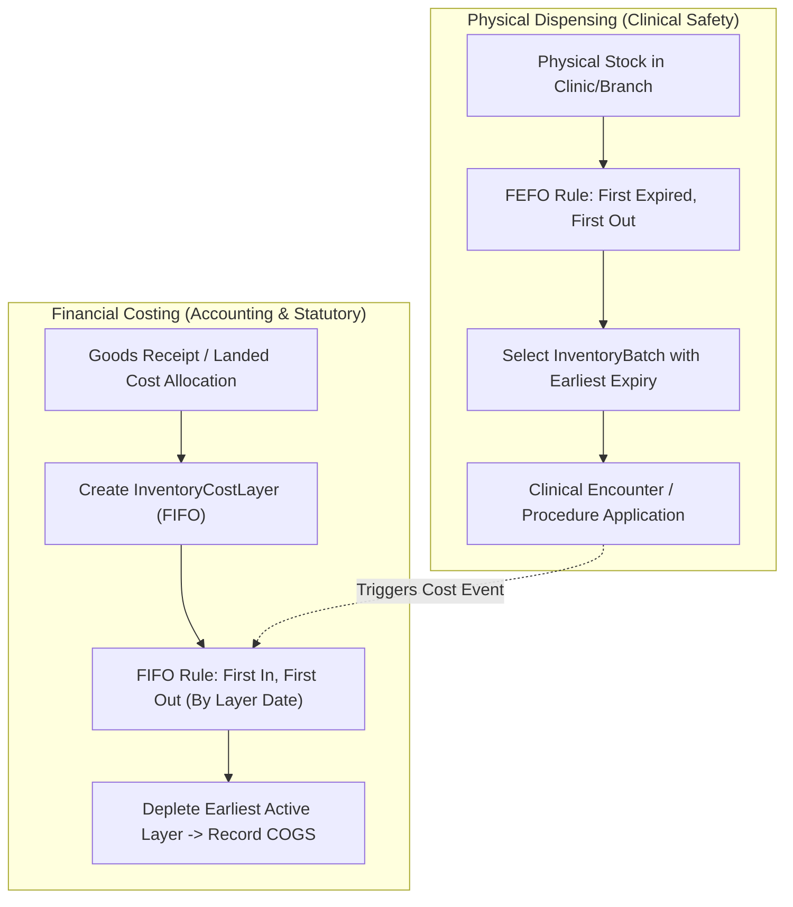

# Advanced Inventory Costing, Landed Cost Allocation & FIFO Valuation

## 1. Overview & Architectural Scope

Lamssa Phase 5 Step 5.4 introduces an enterprise-grade inventory accounting, landed cost allocation, FIFO valuation, and cost-of-goods-sold (COGS) reconciliation engine designed specifically for multi-tenant, multi-branch aesthetic clinics.

Aesthetic clinics face unique inventory challenges:
- High-value perishable biologicals (neurotoxins, hyaluronic acid dermal fillers, mesotherapy cocktails, PDO threads).
- Complex international and regional procurement incurring shipping, customs clearance, cold-chain transport, import duties, and insurance (landed costs).
- Inter-branch transfers between central distribution hubs and satellite clinic branches.
- Clinical consumption tied to patient treatments, alongside mandatory waste and breakage accounting.
- Separation of physical patient safety (FEFO - First Expired, First Out) from statutory financial valuation (FIFO - First In, First Out).

---

## 2. Clinical vs Financial Separation of Concerns

In aesthetic healthcare operations, physical dispensing and financial valuation follow distinct invariants:

1. **Physical Lot Traceability (FEFO)**:
   Clinicians dispense pharmaceuticals based on batch lot numbers, serialization, and expiration dates (`InventoryBatch`). This guarantees patient safety and regulatory compliance.
2. **Financial Cost Valuation (FIFO)**:
   The accounting engine records acquisition cost layers (`InventoryCostLayer`) at the exact unit landed cost. Regardless of which physical lot was selected by the practitioner, the financial deduction follows historical cost flow (FIFO), ensuring accurate balance sheet valuation and income statement COGS matching.

---

## 3. Landed Cost Allocation Engine

Procured aesthetic supplies routinely incur ancillary landed charges: freight, customs tariffs, port handling, temperature-controlled transit, and local delivery.

### 3.1 Allocation Methodology
The costing module allocates total landed cost across goods receipt lines using two deterministic algorithms:

1. **By Value (`BY_VALUE`)**:
   $$\text{Line Landed Share} = \left\lfloor \text{Total Landed Charge} \times \frac{\text{Line Subtotal Value}}{\text{Total Goods Receipt Value}} \right\rfloor$$
2. **By Quantity (`BY_QUANTITY`)**:
   $$\text{Line Landed Share} = \left\lfloor \text{Total Landed Charge} \times \frac{\text{Line Received Quantity}}{\text{Total Received Quantity}} \right\rfloor$$

### 3.2 Exact Minor-Unit Math & Remainder Attribution
To avoid fractional rounding loss (currency drifting):
- All calculations are performed in integer minor units (e.g. cents / fills).
- Rounding remainders:
  $$\text{Remainder} = \text{Total Landed Minor} - \sum_{i=1}^{n-1} \text{Allocated Minor}_i$$
- The remainder is deterministically allocated to the final line item and tracked in `roundingRemainderMinor`.
- Resulting effective unit cost:
  $$\text{Unit Landed Cost} = \frac{\text{Line Base Cost Minor} + \text{Allocated Landed Minor}}{\text{Line Quantity}}$$

---

## 4. Cost Layer Lifecycle & FIFO Consumption Engine

Each receipt, opening balance, or stock adjustment creates an `InventoryCostLayer`:

- `clinicId`: Multi-tenant isolation boundary.
- `branchId`: Branch ownership (nullable for clinic-wide central stores).
- `productId`: Clinic catalog item.
- `batchId`: Associated batch/lot identifier (when known).
- `initialQuantity`: Original received quantity.
- `remainingQuantity`: Units currently available for FIFO depletion.
- `unitPurchaseCost`: Purchase order price per unit.
- `unitLandedCost`: Purchase price + allocated landed cost per unit.
- `costStatus`:
  - `ACTIVE`: Available for consumption.
  - `EXHAUSTED`: `remainingQuantity = 0`.
  - `CANCELLED`: Voided or reversed receipt.
- `verificationStatus`:
  - `VERIFIED`: Standard approved receipt or verified opening balance.
  - `UNVERIFIED_COST`: Legacy opening balance pending segregation-of-duties review.

### 4.1 FIFO Consumption Flow (`allocateFifoConsumption`)
When consumption or transfer occurs:
1. Layers are queried ordered by `layerDate ASC, id ASC`.
2. If a specific `batchId` is provided (e.g. from clinical lot scanning), matching batch layers are prioritized first, falling back to oldest product layers.
3. Quantities are decremented atomically.
4. When a layer's `remainingQuantity` reaches zero, its status transitions to `EXHAUSTED`.
5. An immutable `InventoryCostMovement` is persisted with:
   - `movementType`: `CONSUMPTION`, `TRANSFER_OUT`, `TRANSFER_IN`, `WASTE`, `REVALUATION`, or `OPENING_BALANCE`.
   - `quantityMinor`, `unitCostMinor`, and `totalCostMinor`.

---

## 5. Inter-Branch Stock Transfer Costing

Multi-branch clinic setups transfer stock between branches. The costing engine guarantees:

1. **Valuation Invariance**:
   Units transferred preserve their historical landed cost. Dispatching branch decrements layers via `TRANSFER_OUT`.
2. **In-Transit Conservation**:
   Goods in transit retain valuation without double-counting or loss.
3. **Receiving at Historical Cost**:
   When received at the destination branch, a new `InventoryCostLayer` is created at the destination branch with the exact historical `unitLandedCost` and a `TRANSFER_IN` cost movement.
4. **Transfer Cancellation Restitution**:
   If a transfer is rejected or cancelled prior to receipt, stock movements and cost layers are restored to the origin branch at the exact original unit cost (`TRANSFER_IN` restitution).

---

## 6. Opening Balance Backfill & Segregation of Duties

For existing aesthetic clinics transitioning from legacy systems:
- Uncosted existing physical stock can be backfilled with estimated or documented unit costs.
- Backfilled layers are marked `UNVERIFIED_COST`.
- **Segregation of Duties**:
  - `ACCOUNTANT` or `INVENTORY_CLERK` can record or draft opening balances.
  - Verification requires `CLINIC_OWNER` or `CLINIC_ADMIN` holding `inventory.costing.approve`.
  - Upon formal approval, layers transition to `VERIFIED` and a corresponding `OPENING_BALANCE` cost movement is recorded.

---

## 7. Cost Adjustments & Revaluation

Clinics can adjust inventory carrying values for:
- Lower of cost or market adjustments.
- Supplier post-invoice rebates or discounts.
- Cold-chain spoilage and damaged stock write-offs.

Adjustments require:
- `PENDING` request state drafted by clinic accounting staff.
- Documented clinical and financial rationale (`reason`).
- Dual-control approval by `CLINIC_OWNER` or `CLINIC_ADMIN` before cost layer re-pricing and balance sheet valuation update.

---

## 8. Real-Time Valuation Reports & Snapshots

### 8.1 Real-Time FIFO Valuation
The reporting engine aggregates active cost layers across clinic branches:
- Total Units on Hand.
- Total Landed Valuation (Minor Currency Units).
- Average Landed Cost per Unit.
- Breakdown by branch and product category.

### 8.2 Immutable Valuation Snapshots
Clinics generate immutable snapshots (`InventoryValuationSnapshot`) for month-end and fiscal year-end accounting closing:
- Snapshot Date and Valuation Method (`FIFO_ACTUAL_LANDED_COST`).
- Exact total inventory carrying value and line-item details.
- Protected by PostgreSQL database trigger preventing modification or deletion.

---

## 9. Security, RLS & Database Architecture

All 10 new costing tables implement strict multi-tenant isolation:

1. **Row Level Security (RLS)**:
   - `ALTER TABLE "InventoryCostLayer" ENABLE ROW LEVEL SECURITY;`
   - `ALTER TABLE "InventoryCostLayer" FORCE ROW LEVEL SECURITY;`
   - Enforced across all 10 tables (`InventoryCostLayer`, `InventoryLandedCost`, `InventoryLandedCostAllocationLine`, `InventoryCostMovement`, `InventoryValuationSnapshot`, `InventoryCostAdjustment`, and counters).
2. **Composite Foreign Keys**:
   - `("clinicId", "branchId") REFERENCES "ClinicBranch"("clinicId", "id")`
   - `("clinicId", "productId") REFERENCES "InventoryProduct"("clinicId", "id")`
3. **Database Immutability Triggers**:
   - Triggers `trg_prevent_cost_movement_mutation` and `trg_prevent_valuation_snapshot_mutation` raise exceptions on `UPDATE` or `DELETE`, ensuring an unalterable financial audit trail.

---

## 10. Arabic-First RTL User Experience

The web workspace (`CostingWorkspace.tsx`) integrates into the inventory suite with 5 tabs:

1. **تقرير التقييم المحاسبي (Valuation Report)**:
   Real-time metrics for total inventory value, landed charges, active cost layers, and on-demand valuation snapshot generation.
2. **طبقات التكلفة (Cost Layers)**:
   Detailed table showing purchase price, landed cost, remaining balance, verification status, and revaluation adjustment requests.
3. **تكاليف الوصول والشحن (Landed Costs)**:
   Drafting, allocating (`BY_VALUE` / `BY_QUANTITY`), and posting landed costs across goods receipts.
4. **حركات التكلفة و COGS (Cost Movements)**:
   Audit ledger of consumption, waste write-offs, transfers, and opening balance entries.
5. **الأرصدة الافتتاحية والتسويات (Opening Balances & Adjustments)**:
   Segregated workflow for backfilling legacy inventory costs and approving pending revaluation requests.

---

## 11. Final Security & Financial Audit (Step 5.6)

In Step 5.6 final acceptance:
- FIFO landed costing math and minor-unit rounding remainders attribution were audited and verified.
- Separation of physical lot dispensing (FEFO) from financial cost attribution (FIFO) was confirmed preserved.
- Browser smoke test coverage was added in `scripts/patients-browser-smoke.mjs` verifying the FIFO costing and valuation workspace rendering.
- See [docs/phase-5-final-acceptance.md](phase-5-final-acceptance.md).
