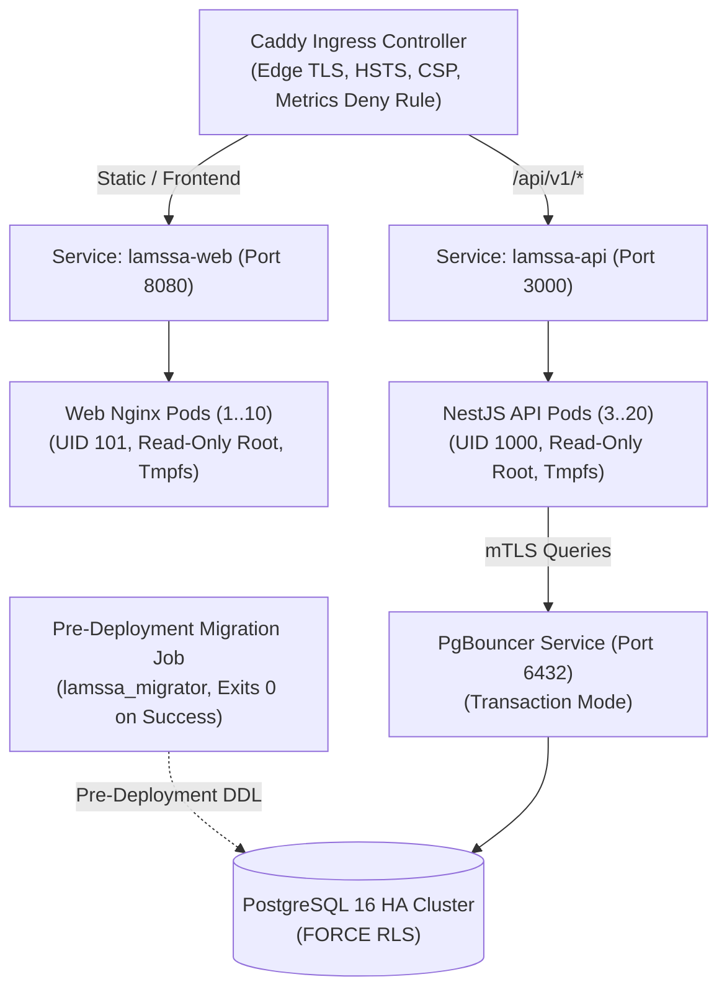

# Lamssa — Kubernetes Production Deployment & Workload Architecture

**Status:** Official Deployment Specification (Step 9.2 Deliverable)
**Date:** 2026-11-20
**Target Platform:** Kubernetes v1.30+ (EKS / GKE)
**Security Profile:** Kubernetes Pod Security Standards — **Restricted**

---

## 1. Overview & Workload Topology

Lamssa production workloads are orchestrated as stateless containerized microservices within Kubernetes. The deployment strictly enforces the **Restricted Pod Security Standard**, zero-downtime rolling updates, and complete decoupling of schema migrations from runtime compute.



---

## 2. Pod Security Standards (Restricted Profile)

Both `lamssa-production` and `lamssa-staging` namespaces enforce the Kubernetes **Restricted** Pod Security Standard via namespace labels:
```yaml
pod-security.kubernetes.io/enforce: restricted
pod-security.kubernetes.io/enforce-version: latest
```

### 2.1 Security Controls Enforced in Pod Specs
- **Non-Root Execution**: Containers run as unprivileged users:
  - `lamssa-api`: UID 1000 (`node`), GID 1000.
  - `lamssa-web`: UID 101 (`nginx`), GID 101.
- **Read-Only Root Filesystem**: `readOnlyRootFilesystem: true` enforced on all containers. Root container disks cannot be modified at runtime.
- **Privilege Escalation Prevention**: `allowPrivilegeEscalation: false` strictly enforced.
- **Capability Dropping**: All default Linux capabilities dropped (`drop: ["ALL"]`). No raw sockets or net-admin capabilities permitted.
- **Seccomp Profile**: Default seccomp profile enforced (`type: RuntimeDefault`).
- **Isolated Memory Temporary Volumes**: Writable storage restricted to in-memory `emptyDir` volumes (`medium: Memory`) with strict size limits:
  - API: `/tmp` (256 MiB limit).
  - Web: `/tmp` (64 MiB), `/var/cache/nginx` (128 MiB), `/var/run` (16 MiB).

---

## 3. Decoupled Pre-Deployment Migration Job (`11-migration-job.yaml`)

To eliminate schema race conditions and avoid granting DDL privileges to runtime pods, migrations **never execute inside API pods on startup**.

### 3.1 Migration Execution Protocol
1. Prior to rolling out new application pods, the deployment pipeline submits the Kubernetes Job: `lamssa-migrate`.
2. The Job assumes `lamssa-migration-sa`, connects as `lamssa_migrator`, and executes:
   ```bash
   npm run db:migrate && npm run db:grant
   ```
3. The Job validates all 45 migrations, applies any pending schema additions, and applies strict DML-only grants and `FORCE ROW LEVEL SECURITY` to `lamssa_app`.
4. Only upon successful completion (Exit code 0) does the deployment pipeline trigger the rolling update of `lamssa-api` pods.

---

## 4. Ingress & Edge Protection (`08-caddy-ingress.yaml`)

- **Host-Based Routing**:
  - `app.lamssa.sa` & `portal.lamssa.sa`:
    - `/api/v1/*` routes to `lamssa-api` (Port 3000).
    - `/*` routes to `lamssa-web` (Port 8080).
- **Public Edge Telemetry Block**:
  - Direct requests to `/api/v1/metrics` are intercepted at the ingress layer and rejected with HTTP 404:
    ```caddy
    @operational path /api/v1/metrics
    respond @operational 404
    ```

---

## 5. Network Policy Hardening (`05-network-policies.yaml`)

Network policies enforce zero-trust network microsegmentation:
- **Default Deny All**: All incoming and outgoing pod traffic is blocked by default (`default-deny-all`).
- **Allow Web Ingress**: Ingress allowed only from the ingress controller pod on port 8080. Egress restricted to CoreDNS (port 53).
- **Allow API Ingress**: Ingress allowed only from the ingress controller pod on port 3000. Egress allowed only to CoreDNS (port 53), PostgreSQL/PgBouncer (ports 5432, 6432), and HTTPS (port 443) for AWS Private Endpoints.
- **Zero Lateral Movement**: Web pods cannot connect to API pods or Database ports directly.

---

## 6. Auto-Scaling & High-Availability Budgets

- **Horizontal Pod Autoscaling (HPA)**:
  - Minimum replicas: 3 pods (across 3 distinct Availability Zones).
  - Maximum replicas: 20 pods.
  - Scale-up trigger: CPU > 70% or Memory > 75%.
  - Scale-down stabilization: 300 seconds to prevent thrashing.
- **Pod Disruption Budget (PDB)**:
  - `minAvailable: 2` guarantees that during node upgrades, draining, or involuntary disruptions, at least 2 application pods remain actively serving clinical traffic.
