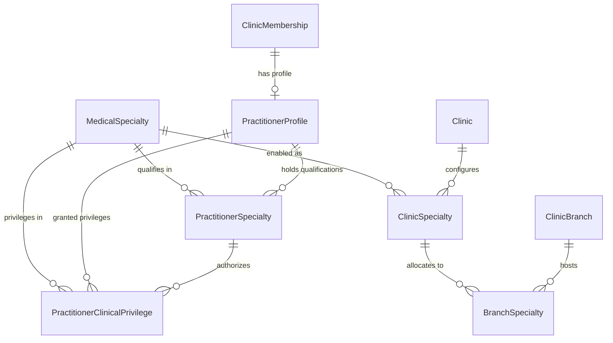

# Lamssa — Medical Specialty Registry, Practitioner Qualifications & Clinical Privilege Engine

**Version:** 1.0.0 (Phase 6, Step 6.2 Specification)  
**Date:** 2026-11-13  
**Status:** Implemented & Verified  
**Language:** English (Technical Documentation) / Arabic-first RTL (UI Experience)  
**Target Migration:** `20261113000100_medical_specialty_registry_privileges`

---

## 1. Architectural Overview & Objectives

In Phase 6, Step 6.2, Lamssa expands from an aesthetic-specialized clinic platform into a multi-specialty outpatient medical platform. The medical specialty and clinical privileging system provides the foundation for:

1. **Global Medical Specialty Reference Catalog (`MedicalSpecialty`):** Standard reference taxonomy seeded with 10 primary specialties, providing Arabic/English clinical naming, international code mappings (SNOMED-CT / OMS), and active status.
2. **Facility Specialty Configuration (`ClinicSpecialty` & `BranchSpecialty`):** Multi-tenant configuration allowing clinics to enable or disable specialties, and branches to offer subsets of the clinic's enabled specialties.
3. **Practitioner Professional Profiles & Qualifications (`PractitionerProfile` & `PractitionerSpecialty`):** Structured tracking of practitioner titles, professional licenses, regulatory jurisdiction, credential verification status, and verified medical qualifications.
4. **Multi-Tier Clinical Privilege Engine (`PractitionerClinicalPrivilege`):** Granular authorization of clinical actions (documenting encounters, signing clinical notes, recording diagnoses, prescribing medications, performing procedures, ordering diagnostics) scoped clinic-wide or branch-specific.
5. **Medical Director Credentialing & Approval Governance:** Strict separation of duties, anti-self-approval enforcement, independent audit logging, and exclusion of clinical privilege approvals from default administrative roles.
6. **Aesthetic Compatibility Policy:** Non-destructive backward compatibility ensuring existing aesthetic practices, encounters, treatment plans, and procedure executions continue functioning seamlessly without operational interruption.

---

## 2. Entity Model & Database Schema

The database model is introduced via migration `20261113000100_medical_specialty_registry_privileges` with strict tenant boundary enforcement, composite keys, and `FORCE ROW LEVEL SECURITY`.



### Table Specifications

| Table | Scope | Primary / Composite Unique Key | RLS Policy | Security Invariants |
| :--- | :--- | :--- | :--- | :--- |
| `MedicalSpecialty` | Global Reference | `id` (UUID), `code` (VARCHAR 64 UNIQUE) | Global Catalog RLS (Public SELECT, restricted maintenance mutations) | Read-only to tenants; seeded with 10 standard specialties |
| `ClinicSpecialty` | Tenant Scoped | `id` (UUID), `(clinicId, specialtyId)` UNIQUE | `FORCE ROW LEVEL SECURITY` via `lamssa_security.context_allows("clinicId")` | Immutable `clinicId` trigger; versioned concurrency |
| `BranchSpecialty` | Branch Scoped | `id` (UUID), `(clinicId, branchId, specialtyId)` UNIQUE | `FORCE ROW LEVEL SECURITY` via `lamssa_security.context_allows("clinicId")` | Branch specialty must be subset of parent clinic specialty |
| `PractitionerProfile` | Tenant Scoped | `id` (UUID), `(clinicId, membershipId)` UNIQUE | `FORCE ROW LEVEL SECURITY` via `lamssa_security.context_allows("clinicId")` | Immutable `clinicId`; hard DELETE denied to runtime role |
| `PractitionerSpecialty` | Tenant Scoped | `id` (UUID), `(practitionerProfileId, specialtyId)` UNIQUE | `FORCE ROW LEVEL SECURITY` via `lamssa_security.context_allows("clinicId")` | Anti-self-approval trigger; verifiedBy membership reference |
| `PractitionerClinicalPrivilege` | Tenant Scoped | `id` (UUID), composite unique indexes | `FORCE ROW LEVEL SECURITY` via `lamssa_security.context_allows("clinicId")` | Requires verified qualification; revocable; anti-self-approval |

---

## 3. Reference Specialty Catalog Seed

The initial migration seeds 10 outpatient medical specialties idempotently:

| Code | Arabic Name (`nameAr`) | English Name (`nameEn`) | Category | Clinical Focus |
| :--- | :--- | :--- | :--- | :--- |
| `AESTHETICS` | الطب التجميلي والعناية بالبشرة | Aesthetic Medicine & Dermatology | SPECIALIZED_SURGICAL | Non-invasive aesthetics, injectables, cosmetic lasers |
| `GENERAL_MEDICINE` | الطب العام وطب الأسرة | General Medicine & Family Practice | PRIMARY_CARE | Primary care, preventive medicine, chronic diseases |
| `DERMATOLOGY` | الأمراض الجلدية والتناسلية | Dermatology & Venereology | MEDICAL | Clinical dermatology, skin biopsies, laser therapies |
| `DENTISTRY` | طب وجراحة الفم والأسنان | Dentistry & Oral Surgery | DENTAL | Restorative, endodontic, cosmetic, and surgical dental care |
| `PEDIATRICS` | طب الأطفال وحديثي الولادة | Pediatrics & Child Health | PRIMARY_CARE | Well-child visits, immunizations, pediatric consultations |
| `OB_GYN` | النساء والتوليد | Obstetrics & Gynecology | SPECIALIZED_SURGICAL | Antenatal care, gynecological exams, reproductive health |
| `OPHTHALMOLOGY` | طب وجراحة العيون | Ophthalmology | SPECIALIZED_SURGICAL | Visual acuity, refraction, diagnostic fundoscopy, eye care |
| `ORTHOPEDICS` | جراحة العظام والمفاصل | Orthopedic Surgery & Musculoskeletal | SURGICAL | Musculoskeletal exams, splinting, joint injections |
| `ENT` | الأنف والأذن والحنجرة | Ear, Nose & Throat (ENT / Otorhinolaryngology) | SURGICAL | Audiometry, endoscopic examinations, minor ENT procedures |
| `PHYSIOTHERAPY` | العلاج الطبيعي والتأهيل الصحي | Physiotherapy & Physical Rehabilitation | ALLIED_HEALTH | Physical rehabilitation, functional assessments, manual therapy |

### Compatibility Backfill

The migration automatically executes a non-destructive compatibility backfill:
1. Links all existing `Clinic` records to `AESTHETICS` (`ClinicSpecialty` with status `ACTIVE`).
2. Links all existing `ClinicBranch` records to `AESTHETICS` (`BranchSpecialty` with status `ACTIVE`).
3. Preserves all existing patient records, encounters, treatment plans, and aesthetic procedure catalogs.

---

## 4. Multi-Tier Clinical Authorization State Machine

The authorization engine evaluates 8 mandatory gates before granting access to clinical actions:

```
[Principal Authenticated & Active Membership]
                     │
                     ▼
        [Role-Based Permission Check]
                     │
                     ▼
         [Branch Assignment Validation]
                     │
                     ▼
    [Facility Specialty Enablement Gate]
                     │
                     ▼
   [Verified Practitioner Qualification]
                     │
                     ▼
   [Active Approved Clinical Privilege]
                     │
                     ▼
  [Encounter / Treating Team Scope Gate]
                     │
                     ▼
[Informed Consent & Safety Verification]
```

### Clinical Privilege Codes

| Privilege Code | Description | Authorized Clinical Scope |
| :--- | :--- | :--- |
| `CLINICAL_ENCOUNTER_DOCUMENT` | Document clinical consultations | Creating and updating encounter notes |
| `CLINICAL_NOTE_SIGN` | Sign clinical notes | Finalizing and digitally locking clinical notes |
| `CLINICAL_DIAGNOSIS_RECORD` | Record medical diagnoses | Assigning ICD-10 and clinical diagnoses |
| `MEDICATION_PRESCRIBE` | Prescribe medications | Authorizing prescriptions and refills |
| `DIAGNOSTIC_LAB_ORDER` | Order diagnostic lab tests | Requesting pathology and laboratory investigations |
| `DIAGNOSTIC_IMAGING_ORDER` | Order medical imaging | Requesting X-rays, ultrasounds, MRI, CT scans |
| `CLINICAL_PROCEDURE_PERFORM` | Perform surgical/invasive procedures | Executing clinical and invasive procedures |
| `MEDICATION_ADMINISTER` | Administer medications | Administering prescribed therapeutic injections |
| `SEDATION_ADMINISTER` | Administer sedation | Procedural sedation and local anesthesia |

---

## 5. Medical Director Governance & Anti-Self-Approval

Section 9 mandates strict administrative and clinical governance:

1. **Isolation from Default Ceiling:** `credentials.verify` and `privileges.approve` are excluded from all default role definitions (`CLINIC_OWNER`, `CLINIC_ADMIN`, `DOCTOR`, `RECEPTIONIST`, `ACCOUNTANT`).
2. **Medical Director Designation:** Only a `CLINIC_OWNER` or authorized clinic leadership can designate a verified medical practitioner as the facility Medical Director (`isMedicalDirector: true`).
3. **Anti-Self-Approval Enforcement:**
   - A Medical Director **cannot** verify their own professional qualifications.
   - A Medical Director **cannot** approve their own clinical privileges.
   - Any attempt to self-approve results in a hard `403 Forbidden` (`Self-approval of credentials is prohibited`).
4. **Qualification Prerequisite:** Clinical privileges cannot be approved unless the practitioner holds a `VERIFIED` qualification in the associated specialty.
5. **Auditing & Revocation:** Every verification, approval, rejection, and revocation generates an immutable `AuditEvent` under the `STAFF` category with full before/after metadata.

---

## 6. Aesthetic Backward-Compatibility Policy

To ensure aesthetic clinics operate without interruption:
1. **Existing Aesthetic Procedures:** In Phase 6.2, executing aesthetic procedures (`AESTHETICS` specialty) by existing licensed doctors remains operational under compatibility rules (`isCompatibility: true`).
2. **General Medical Gating:** In contrast, new medical capabilities (such as prescribing general medications, ordering lab diagnostics, or documenting pediatrics/orthopedics) strictly require active, approved clinical privileges.
3. **Graceful Fallback:** If a doctor lacks formal privilege records but is performing an aesthetic execution within an aesthetic clinic, the authorization engine allows the action while recording a compatibility flag in the audit trail.

---

## 7. Arabic-First RTL Administrative Interface

The specialty administration panel is integrated into Clinic Settings under the tab **التخصصات والاعتماد** (`/clinics/:clinicId/settings`):

1. **دليل التخصصات والعيادة (Clinic Specialties):** Interactive toggle controls enabling/disabling medical specialties at the facility level, displaying specialty codes and clinical descriptions in authentic Arabic.
2. **تخصصات الفروع (Branch Specialties):** Multi-branch selector allowing administrators to activate subsets of the clinic's enabled specialties for each branch.
3. **الملفات المهنية والممارسون (Practitioner Profiles):** Medical staff directory displaying professional titles, license numbers, licensing authority (e.g. SCFHS), expiration dates, and Medical Director badges.
4. **طلبات الاعتماد والامتيازات السريرية (Medical Director Approval Queue):** Dedicated queue for Medical Directors to review pending qualifications and privilege requests with one-click verification and reason-mandatory rejection dialogs.

---

## 8. API Endpoints Reference

| Method | Path | Required Permission | Description |
| :--- | :--- | :--- | :--- |
| `GET` | `/api/v1/clinics/:clinicId/specialties/catalog` | `specialties.read` | List global reference catalog of medical specialties |
| `GET` | `/api/v1/clinics/:clinicId/specialties` | `specialties.read` | List enabled specialties for the clinic |
| `POST` | `/api/v1/clinics/:clinicId/specialties/:code/enable` | `specialties.manage` | Enable a specialty for the clinic |
| `POST` | `/api/v1/clinics/:clinicId/specialties/:code/disable` | `specialties.manage` | Disable a specialty (cascades disable to branches) |
| `GET` | `/api/v1/clinics/:clinicId/branches/:branchId/specialties` | `specialties.read` | List enabled specialties for a branch |
| `POST` | `/api/v1/clinics/:clinicId/branches/:branchId/specialties/:code/enable` | `specialties.manage` | Enable a specialty for a branch |
| `POST` | `/api/v1/clinics/:clinicId/branches/:branchId/specialties/:code/disable` | `specialties.manage` | Disable a specialty for a branch |
| `GET` | `/api/v1/clinics/:clinicId/practitioners/profiles` | `practitioners.profiles.read` | List practitioner profiles |
| `GET` | `/api/v1/clinics/:clinicId/practitioners/:membershipId/profile` | `practitioners.profiles.read` | Get detailed practitioner profile |
| `POST` | `/api/v1/clinics/:clinicId/practitioners/profiles` | `practitioners.profiles.manage` | Create or upsert practitioner profile |
| `PATCH` | `/api/v1/clinics/:clinicId/practitioners/:membershipId/profile` | `practitioners.profiles.manage` | Update practitioner profile |
| `POST` | `/api/v1/clinics/:clinicId/practitioners/:membershipId/designate-director` | `staff.manage` | Designate practitioner as Medical Director |
| `POST` | `/api/v1/clinics/:clinicId/practitioners/:membershipId/qualifications` | `practitioners.profiles.manage` | Add specialty qualification |
| `POST` | `/api/v1/clinics/:clinicId/qualifications/:qualificationId/verify` | `practitioners.profiles.read` (MD only) | Verify qualification (anti-self-approval enforced) |
| `POST` | `/api/v1/clinics/:clinicId/qualifications/:qualificationId/reject` | `practitioners.profiles.read` (MD only) | Reject qualification with reason |
| `POST` | `/api/v1/clinics/:clinicId/practitioners/:membershipId/privileges/request` | `privileges.request` | Request clinical privilege |
| `POST` | `/api/v1/clinics/:clinicId/privileges/:privilegeId/approve` | `privileges.read` (MD only) | Approve clinical privilege (requires verified qualification) |
| `POST` | `/api/v1/clinics/:clinicId/privileges/:privilegeId/revoke` | `privileges.read` (MD only) | Revoke clinical privilege with reason |
| `GET` | `/api/v1/clinics/:clinicId/privileges/approval-queue` | `privileges.read` (MD only) | List pending approval queue |
