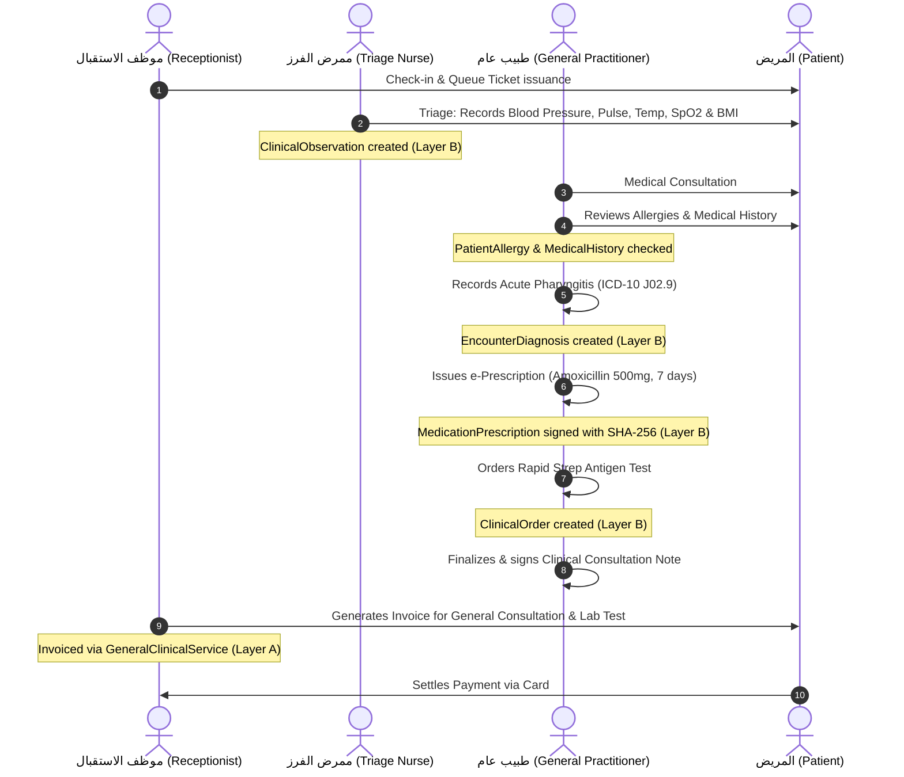

# Lamssa — Medical Specialty Evolution Roadmap (Phase 6 & Beyond)

**Version:** 1.0.0 (Phase 6 Strategic Roadmap)
**Date:** 2026-11-13
**Status:** Architecture Roadmap (Implementation Planning)
**Language:** English (Technical Specification)

---

## 1. Strategic Roadmap Overview

This roadmap defines the multi-phase evolution of Lamssa from an aesthetic-specialized clinic platform into a comprehensive, Arabic-first, multi-tenant outpatient medical platform.

```mermaid
timeline
    title Lamssa Healthcare Platform Evolution
    section Phase 1–5 : Completed Core
        Phase 1 : Workspace, Identity & Access : Core Scheduling & Billing
        Phase 2 : Identity Hardening & Observability : Compliance & Auditing
        Phase 3 : Clinical EMR & Treatment Plans : Aesthetic Photography & Consents
        Phase 4 : Inventory Operations & FIFO Costing : Commissions & Reversals
        Phase 5 : Patient Portal & Multi-Branch : Payment Orchestration & Regulatory
    section Phase 6 : General Medical Platform
        Step 6.1 : Architecture Contracts & Blueprint : (Current Design Step)
        Step 6.2 : Specialty Registry & Privileging : Practitioner Qualifications
        Step 6.3 : Shared Clinical Data Foundation : Vitals, Diagnoses, Allergies, Rx
        Step 6.4 : General Services & Clinical Orders : Labs, Imaging, Diagnostic Results
        Step 6.5 : Structured Clinical Forms : Dynamic Schemas & Specialty Navigation
        Step 6.6 : Security, Compatibility Audit : Final Phase 6 Acceptance
    section Phase 7 : Production Launch
        Phase 7 : Production Hardening : Cloud KMS, ZATCA Certification, DR Drill
    section Phase 8+ : Deep Specialty Modules
        Phase 8 : Dentistry & Periodontics : Odontograms & Tooth Charting
        Phase 9 : Pediatrics & Immunization : WHO Growth Curves & Vaccines
        Phase 10 : Obstetrics & Gynecology : Antenatal Care & Gestational Age
        Phase 11 : Ophthalmology & Allied Health : Refraction & Physical Rehabilitation
```

---

## 2. Phase 6 Detailed Breakdown: General Medical Core

### Step 6.1 — Specialty-Neutral Architecture Contracts & Migration Blueprint (Current Step)
- **Objective:** Establish the three-layer architectural blueprint (Operational Core, Clinical Foundation, Specialty Workspaces), define specialty registry and clinical privilege models, formulate the additive migration strategy (Approach B), and document zero-data-loss contracts.
- **Deliverables:**
  - `docs/general-medical-platform-architecture.md`
  - `docs/general-medical-migration-blueprint.md`
  - `docs/medical-specialty-roadmap.md`
  - `docs/phase-6-step-6-1-assessment.md`
  - Updated `docs/implementation-roadmap.md`
- **Acceptance Criteria:** Comprehensive design documentation reviewed; zero code or migration modifications executed; working tree remains clean on `phase/6-general-medical`.
- **Dependencies:** Merged Phase 5 baseline commit `fe87e2b`.

---

### Step 6.2 — Specialty Registry, Practitioner Qualifications & Clinical Privilege Engine (Implemented)
- **Objective:** Implement tenant-configurable specialty enablement and multi-tier clinical authorization.
- **Key Deliverables:**
  - Additive Migration `20261113000100_medical_specialty_registry_privileges`: `MedicalSpecialty`, `ClinicSpecialty`, `BranchSpecialty`, `PractitionerProfile`, `PractitionerSpecialty`, `PractitionerClinicalPrivilege`.
  - Default backfill: Automatically enabled `'AESTHETICS'` for existing clinics and branches without downtime.
  - NestJS Module: `SpecialtyModule` with `SpecialtyRepository`, `SpecialtyController`, and `SpecialtyPrivilegeGuard`.
  - Access Control Guards: `@RequireSpecialty(code)` and `@RequireClinicalPrivilege(code)` evaluating server-side and database state.
  - Medical Director governance: Anti-self-approval enforcement, independent audit logging, and ceiling exclusion.
  - Frontend Workspace: Clinic Settings ➔ Specialty Enablement & Medical Staff Credentialing (`SpecialtyAdministrationPanel.tsx`).
- **Technical Invariants Verified:**
  - `CLINIC_OWNER` and `CLINIC_ADMIN` cannot access confidential clinical records without an explicit practitioner role.
  - Automated tests prove that enabling a specialty activates corresponding workflows.
  - Tests prove that administrative roles cannot perform medical actions.
  - Tests verify that existing aesthetic clinics retain active operational status without manual reconfiguration.

---

### Step 6.3 — Shared Clinical Data Foundation: Observations, Diagnoses, Allergies & Prescriptions (Implemented)
- **Objective:** Implement the core clinical entities required for any outpatient patient consultation.
- **Key Deliverables:**
  - Additive Migration `20261113000200_shared_clinical_foundation`: `ClinicalObservation`, `EncounterDiagnosis`, `PatientAllergy`, `MedicationRecord`, `MedicationPrescription`, `MedicationPrescriptionItem`, `ClinicPrescriptionCounter`.
  - NestJS Module: `ClinicalFoundationModule` with `ClinicalFoundationRepository`, `ClinicalFoundationController`, and comprehensive DTOs enforcing composite `(clinicId, id)` keys and `FORCE ROW LEVEL SECURITY`.
  - Business Logic Services & Engine:
    - Observations: Scalar and textual vital signs capture, automatic deterministic BMI calculation, physiological validation against standard reference ranges, immutability guard trigger.
    - Diagnoses: ICD-10 coded and narrative diagnosis recording, strict primary vs. secondary designation per encounter, chronic problem list promotion.
    - Allergies: Critical allergy tracking, severity classification, clinician verification status, NKA declaration, active pre-flight prescription conflict detection.
    - Prescriptions: Controlled outpatient prescription drafting, sequential numbering (`RX-000001`), `MEDICATION_PRESCRIBE` privilege check, digital signature digest sealing (SHA-256), immutable finalization enforcers.
    - Decoupled Medication Reconciliation: Chronic and acute regimens tracked without automated inventory consumption.
  - Frontend Workspace: Patient EHR ➔ Unified Medical Summary (Vitals observation panel, ICD-10 diagnosis picker, allergy conflict badges, medication reconciliation tables, prescription signing dialog).
- **Technical Invariants Verified:**
  - 105 FORCE RLS tables and 90 locked `lamssa_security` functions.
  - Unit policy tests (12 tests) and integration tests (7 tests) pass with 100% success.
  - Prescription finalization computes an immutable SHA-256 digest; tampering rejected at database level.
  - Existing aesthetic treatment plans continue to operate with zero regressions.

---

### Step 6.4 — General Clinical Services, Clinical Orders & Diagnostic Results
- **Objective:** Provide general medical service catalogs, diagnostic orders (lab/imaging), and diagnostic report attachments.
- **Key Deliverables:**
  - Additive Migration `035`: `GeneralClinicalService`, `ClinicalOrder`, `ClinicalOrderResult`, `ClinicalDocument`.
  - NestJS Module: `ClinicalOrderModule`.
  - Shared Service Abstraction: `ClinicalProcedureAdapterService` linking billing `ClinicService` polymorphically to either `AestheticProcedureCatalog` or `GeneralClinicalService`.
  - Diagnostic Order Workflow: Order creation ➔ Specimen collection / Radiology dispatch ➔ Result ingestion ➔ Clinician verification signature.
  - Document Vault: AES-256-GCM encrypted storage for diagnostic scans and external referral letters.
  - Frontend Workspace: Clinical Consultation ➔ Orders & Diagnostic Reports Workspace.
- **Technical Risks:** Ensuring mutual exclusivity between aesthetic procedure billing and general clinical service billing on `ClinicService`.
- **Acceptance Criteria:**
  - Invoicing correctly charges for general clinical services alongside or independently of aesthetic procedures.
  - Lab results require clinician verification before becoming visible in the patient portal.
  - Encrypted clinical documents fail closed if an unauthorized practitioner attempts decryption.

---

### Step 6.5 — Configurable Clinical Forms, Dynamic Schemas & Specialty Navigation
- **Objective:** Implement schema-validated structured clinical forms and dynamic Arabic RTL navigation workspaces.
- **Key Deliverables:**
  - Additive Migration `036`: `ClinicalFormDefinition`, `ClinicalFormResponse`, `ClinicalFormResponseAmendment`.
  - Dynamic Form Engine: JSON Schema Draft-07 server-side validator enforcing strict data typing and rejecting unsafe code execution.
  - Standard Medical Form Templates:
    - Adult General Medical Intake & Review of Systems (ROS).
    - Pediatric Well-Child Assessment Intake.
    - Dermatology Lesion & Skin Assessment.
  - Frontend Dynamic Renderer: Native Arabic RTL form rendering with accessible controls, validation tooltips, and digital signature capture.
  - Adaptive Navigation: Frontend navigation tree dynamically displays specialty tabs matching enabled clinic specialties.
- **Technical Risks:** Preventing performance bottlenecks when rendering complex nested JSON schemas.
- **Acceptance Criteria:**
  - Submitting invalid form payloads strictly fails server-side validation with localized Arabic error messages.
  - Finalized form responses cannot be modified without inserting an attributable amendment.
  - Form responses are queryable for clinical audit without exposing un-sanitized inputs.

---

### Step 6.6 — Comprehensive Security Audit, Migration Verification & Final Acceptance
- **Objective:** Execute exhaustive security, regression, and migration compatibility verification across all Phase 6 deliverables.
- **Key Deliverables:**
  - Additive Migration `037`: Final security hardening, search path locking, and runtime role grant synchronization.
  - Verification Evidence: Full test execution across all unit tests, database integration tests, browser smoke tests, and deployment checks.
  - End-to-End General Medicine Journey: Proven complete consultation journey without touching aesthetic catalog models.
  - Documentation Deliverables: `docs/phase-6-final-acceptance.md`.
  - Readiness Determination: Authorize local merge into `main`.
- **Acceptance Gate:** 100% test pass rate, 0 boundary violations, 0 regression in existing aesthetic operations.

---

## 3. Minimal First General Medicine Workflow (Proof of Decoupling)

To conclusively prove that Lamssa has transitioned beyond an aesthetic-only platform, Step 6.4 and 6.6 will validate an end-to-end **General Practice Consultation Workflow**:



### Decoupling Verification Criteria
1. The entire consultation workflow executes without creating or referencing `AestheticProcedureCatalog`, `TreatmentPlan`, `TreatmentPlanRevision`, `TreatmentPlanItem`, `ProcedureExecution`, `TreatmentPackage`, or `ClinicalPhotoSession`.
2. Billing generates an authentic tax invoice referencing `GeneralClinicalService`.
3. Clinical documentation is legally complete, signed, immutable, and fully attributable.

---

## 4. Phase 7: Production Readiness, Regulatory Certification & Operational Deployment

Previously proposed production-readiness work is formally consolidated into **Phase 7**:

1. **Step 7.1 — Cloud KMS & HSM Envelope Encryption:** Transitioning database credentials, payment keys, and patient encryption keys from local environment variables to certified Cloud KMS (AWS KMS / Google Cloud KMS / HashiCorp Vault).
2. **Step 7.2 — Certified Regional Tax E-Invoicing (ZATCA / FTA):** Replacing `SANDBOX_MOCK` adapters with certified cryptographic CSID clearance pipelines for Saudi Arabia ZATCA Fatoora Phase 2 and UAE FTA.
3. **Step 7.3 — Live Merchant Acquirer Underwriting:** Operational onboarding with production payment gateways (Moyasar, Checkout.com) and live webhook HMAC routing.
4. **Step 7.4 — Clinical Safety Directorate Sign-Off:** Formal medical director verification of clinical alert thresholds, drug interaction safeguards, and PROM outcome metrics.
5. **Step 7.5 — Full Disaster Recovery & Failover Drill:** Live out-of-band database restoration drills under simulated network partition with audited RTO (<15 min) and RPO (<1 min).

---

## 5. Future Phases: Deep Medical Specialty Modules (Phase 8+)

Following Phase 7 production certification, Lamssa will introduce specialized clinical workstations:

### Phase 8 — Dentistry & Periodontics (Phase 8)
- Universal and Palmer tooth numbering systems.
- Interactive SVG graphical odontogram (existing condition, planned restorative work, completed restorations).
- Periodontal probing depth charting (6 points per tooth, bleeding on probing, furcation involvement, mobility).
- Dental laboratory order tracking (crowns, bridges, clear aligners).

### Phase 9 — Pediatrics & Immunization Intelligence (Phase 9)
- WHO and regional growth charts with automated percentile calculations (Length/Height-for-age, Weight-for-age, BMI-for-age, Head circumference-for-age).
- National immunization schedule tracking (e.g., Saudi MOH / UAE vaccination schedules) with milestone reminders and batch lot tracking.
- Pediatric dosage calculation assistance based on verified body weight.

### Phase 10 — Obstetrics & Gynecology (Phase 10)
- Obstetric episode management (LMP, EDD calculation via Naegele's rule, ultrasound dating).
- Antenatal flowsheet tracking (gestational age, fundal height, fetal heart rate, presentation, maternal weight, urine protein).
- Gynecological screening tracking (Pap smears, HPV testing, mammography).

### Phase 11 — Ophthalmology, Orthopedics & Outpatient Rehabilitation (Phase 11)
- Ophthalmic visual acuity (Snellen / LogMAR fractions) and refraction charting (Sphere, Cylinder, Axis, Add, Pupillary Distance).
- Intraocular pressure tonometry (Goldmann / Non-contact).
- Orthopedic and Physiotherapy Range of Motion (ROM) goniometric tracking and muscle strength grading.
