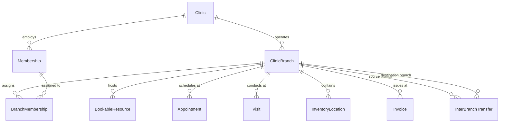

# Multi-Branch Clinic Management

## Overview

Lamssa's multi-branch architecture enables healthcare organizations and aesthetic clinics to operate multiple physical branches under a single isolated tenant identity (`Clinic`).

### Key Design Principles

1. **Single Tenant Identity**:
   - The `Clinic` entity remains the authoritative, isolated tenant boundary.
   - All tenant-isolation primitives, PostgreSQL Row Level Security (RLS) policies, cryptographic salts, and tenant JWT contexts continue to scope to `clinicId`.
   - Multi-branch clinics share a single administrative hierarchy, consolidated patient medical history, catalog, and tenant subscription without duplicating tenant identities.

2. **Physical Operating Units (`ClinicBranch`)**:
   - Each clinic has one or more branches (`ClinicBranch`).
   - Every clinic is automatically provisioned with a default primary branch (`code: 'MAIN'`) via the PostgreSQL `lamssa_security.clinic_default_branch()` trigger.
   - Branches define physical operating parameters: localized timezone, contact numbers, street addresses, active/inactive operating status, and open/close operating schedules.
   - Branch codes are unique per clinic: `@@unique([clinicId, code])`.
   - Branch primary keys are strictly composite-verified: `@@unique([clinicId, id])`.

3. **Staff Branch Assignments (`BranchMembership`)**:
   - Organizational administrators (`CLINIC_OWNER`, `CLINIC_ADMIN`) possess clinic-wide administrative authority across all branches.
   - Operational staff (`DOCTOR`, `RECEPTIONIST`, `ACCOUNTANT`) are explicitly assigned to one or more branches via `BranchMembership`.
   - Each staff member has at most one designated primary branch (`isPrimary: true`).
   - Staff sessions store an active `selectedBranchId`. Branch switching (`POST /api/v1/auth/branch`) validates that the user is either an organization admin or assigned to the target branch.

4. **Practitioner Scheduling & Cross-Branch Conflict Prevention**:
   - Practitioners can be assigned to different branches on different days or shifts.
   - PostgreSQL GiST exclusion constraints (`clinic_practitioner_schedule_excl`) guarantee that no practitioner (`doctorResourceId`) can have overlapping appointments across any branches within the same clinic:
     ```sql
     CONSTRAINT clinic_practitioner_schedule_excl
     EXCLUDE USING gist (
       "clinicId" WITH =,
       "doctorResourceId" WITH =,
       tstzrange("startAt", "endAt") WITH &&
     )
     WHERE ("status" <> 'CANCELLED'::"AppointmentStatus" AND "doctorResourceId" IS NOT NULL);
     ```

5. **Inter-Branch Inventory Transfers (`InterBranchTransfer`)**:
   - Aesthetic clinics manage injectable medications, botulinum toxins, dermal fillers, and consumables across multiple locations.
   - Transfers require a controlled two-step custodial workflow:
     1. **`DISPATCHED`**: Originating branch dispatches quantity from an origin inventory location. Stock balance is deducted from the source location with an audit transaction (`TRANSFER_OUT`).
     2. **`RECEIVED`**: Destination branch confirms receipt. Received quantity and discrepancy notes are recorded. Stock balance is credited to the destination location with an audit transaction (`TRANSFER_IN`).
     3. **`CANCELLED`**: Transfers in `DISPATCHED` state can be cancelled before receipt, reverting the inventory back to the source location.
   - All locations and transfer records enforce composite foreign keys to the owning `clinicId` to eliminate any risk of cross-clinic inventory leakage.

---

## Data Model



### Table Specifications

#### `ClinicBranch`
- `id`: UUID (Primary Key)
- `clinicId`: UUID (Composite Tenant FK)
- `name`: String (Arabic/English branch display name)
- `code`: String (Unique per clinic, e.g. `'MAIN'`, `'NORTH'`, `'OLAYA'`)
- `phone`: String? (Branch direct contact line)
- `email`: String? (Branch email)
- `city`: String (Operating municipality)
- `address`: String? (Physical street address)
- `timezone`: String (IANA timezone, e.g. `'Asia/Riyadh'`)
- `isActive`: Boolean (Operating status)
- `operatingHours`: JSON (Weekly day/hour availability matrices)
- `createdAt`, `updatedAt`: Timestamps

#### `BranchMembership`
- `id`: UUID (Primary Key)
- `clinicId`: UUID (Composite Tenant FK)
- `branchId`: UUID (Branch FK)
- `membershipId`: UUID (Staff Membership FK)
- `isPrimary`: Boolean (Default operating location flag)
- `createdAt`, `updatedAt`: Timestamps
- `@@unique([clinicId, branchId, membershipId])`

#### `InterBranchTransfer`
- `id`: UUID (Primary Key)
- `clinicId`: UUID (Composite Tenant FK)
- `transferNumber`: String (Sequential transfer reference, e.g. `'TRF-202611-0001'`)
- `sourceBranchId`: UUID (Originating branch FK)
- `destinationBranchId`: UUID (Target branch FK)
- `sourceLocationId`: UUID (Originating inventory location FK)
- `destinationLocationId`: UUID (Target inventory location FK)
- `productId`: UUID (Inventory product FK)
- `lotId`: UUID? (Batch / lot tracking FK)
- `quantity`: Decimal (Dispatched quantity)
- `receivedQuantity`: Decimal? (Actual verified received quantity)
- `discrepancyReason`: String? (Audit documentation if quantities differ)
- `status`: Enum (`PENDING`, `DISPATCHED`, `RECEIVED`, `CANCELLED`)
- `dispatchedById`: UUID? (Staff member who dispatched)
- `dispatchedAt`: Timestamp?
- `receivedById`: UUID? (Staff member who received)
- `receivedAt`: Timestamp?
- `notes`: String?
- `createdAt`, `updatedAt`: Timestamps

---

## Security & Row Level Security (RLS)

All multi-branch tables enforce PostgreSQL Row Level Security:
```sql
ALTER TABLE "ClinicBranch" ENABLE ROW LEVEL SECURITY;
ALTER TABLE "ClinicBranch" FORCE ROW LEVEL SECURITY;

ALTER TABLE "BranchMembership" ENABLE ROW LEVEL SECURITY;
ALTER TABLE "BranchMembership" FORCE ROW LEVEL SECURITY;

ALTER TABLE "InterBranchTransfer" ENABLE ROW LEVEL SECURITY;
ALTER TABLE "InterBranchTransfer" FORCE ROW LEVEL SECURITY;
```

### Authorization Model

| Role | Branch Read | Branch Manage | Staff Assignment | Inter-Branch Transfers | Active Branch Switch |
| :--- | :---: | :---: | :---: | :---: | :---: |
| `CLINIC_OWNER` | All Branches | Full | All Staff | Full Dispatch/Receive | Any Branch |
| `CLINIC_ADMIN` | All Branches | Full | All Staff | Full Dispatch/Receive | Any Branch |
| `DOCTOR` | Assigned Branches | None | View Own | None | Assigned Only |
| `RECEPTIONIST` | Assigned Branches | None | View Branch | Receive Inbound | Assigned Only |
| `ACCOUNTANT` | All Branches | Read Only | View All | Read Only Audit | Any Branch |

---

## API Endpoints

- `GET /api/v1/clinics/:clinicId/branches`: List all branches for the clinic.
- `POST /api/v1/clinics/:clinicId/branches`: Create a new branch (Requires `branches.manage`).
- `GET /api/v1/clinics/:clinicId/branches/:branchId`: Retrieve branch details.
- `PATCH /api/v1/clinics/:clinicId/branches/:branchId`: Update branch details, operating hours, status.
- `GET /api/v1/clinics/:clinicId/branches/:branchId/memberships`: List staff assigned to branch.
- `POST /api/v1/clinics/:clinicId/branches/:branchId/memberships`: Assign staff member to branch.
- `PATCH /api/v1/clinics/:clinicId/branches/:branchId/memberships/:membershipId`: Update staff primary branch status.
- `DELETE /api/v1/clinics/:clinicId/branches/:branchId/memberships/:membershipId`: Remove staff branch assignment.
- `POST /api/v1/auth/branch`: Switch active session operating branch.
- `GET /api/v1/clinics/:clinicId/transfers`: List inter-branch inventory transfers.
- `POST /api/v1/clinics/:clinicId/transfers/dispatch`: Dispatch inventory stock to another branch.
- `POST /api/v1/clinics/:clinicId/transfers/:transferId/receive`: Acknowledge and receive transfer.
- `POST /api/v1/clinics/:clinicId/transfers/:transferId/cancel`: Cancel dispatched transfer and revert inventory.

---

## 7. Inter-Branch Costing & Valuation Invariance (Step 5.4)

In Step 5.4, inter-branch inventory transfers (`InterBranchTransfer`) are fully integrated with the FIFO costing engine:
- **Dispatch**: Decrements FIFO cost layers at the origin branch (`TRANSFER_OUT`) while preserving historical unit landed cost in transit.
- **Receipt**: Generates a new `InventoryCostLayer` at the destination branch (`TRANSFER_IN`) at the exact unit landed cost of the dispatched goods.
- **Cancellation Restitution**: If a transfer is cancelled before receipt, the stock and cost layers are restored to the origin branch at the exact acquisition value.
See [inventory-cost-accounting.md](inventory-cost-accounting.md) for full accounting specifications.

---

## 8. Final Security Acceptance (Step 5.6)

In Step 5.6 final acceptance:
- Multi-branch authorization and `selectedBranchId` session scoping were re-verified.
- GiST exclusion constraints preventing practitioner double-booking across branches were verified under concurrency.
- Browser smoke test coverage was added in `scripts/patients-browser-smoke.mjs` verifying multi-branch workspace rendering and default branch display.
- See [docs/phase-5-final-acceptance.md](phase-5-final-acceptance.md).
