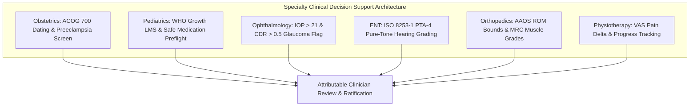
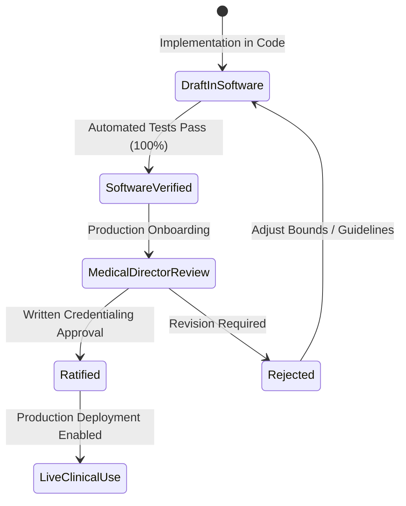

# Lamssa — Phase 8 Clinical Safety & Validation Matrix

**Milestone:** Phase 8, Step 8.7: Final Multi-Specialty Clinical Integrity, Security & Release Acceptance
**Version:** 1.0.0
**Clinical Governance Authority:** Lead Clinical Safety Auditor, Medical Informatics Engineer & Release QA Lead
**Scope:** All Clinical Decision Support (CDS), Algorithmic Calculations, and Safety Alerts Across Phase 8 Specialty Workspaces
**Date:** 2026-11-20

---

## 1. Clinical Governance & Decision Support Doctrine

Lamssa's clinical architecture adheres to strict international clinical decision support (CDS) guidelines (FDA Software as a Medical Device / SAMD guidance, IEC 62304 Medical Device Software Life Cycle, and Saudi MoH Clinical Governance Standards).

### Core Clinical Governance Principles:
1. **Clinician-in-the-Loop:** All algorithmic calculations, percentile derivations, and clinical alerts operate strictly as **Clinical Decision Support Advisories**. The software does not provide autonomous clinical diagnoses or automated prescription dispatch.
2. **Attributable Confirmation:** Any clinical decision influenced by a decision support rule (e.g., accepting an ultrasound dating override, selecting an alternative medication, or acknowledging an elevated intraocular pressure alert) requires explicit sign-off by a licensed practitioner with their practitioner membership ID recorded in the immutable audit log.
3. **Fail-Closed & Bounds Enforced:** All numerical inputs are strictly validated against physiological extremes. Inputs outside physiological feasibility are rejected at the API schema boundary rather than producing distorted algorithmic outputs.
4. **Transparent Methodology:** All formulas, reference tables, and clinical guidelines are fully disclosed, documented, and traceable to peer-reviewed international standards.

---

## 2. Multi-Specialty Clinical Safety & Validation Matrix

### Comprehensive Rule Specifications

| CDS Rule ID | Clinical Domain | Rule Name & Description | Reference Standard | Input Parameters & Physiological Bounds | Calculation Logic & Safety Thresholds | Clinical Exclusion Criteria | Clinician Override Policy | Verification Status |
|:---|:---|:---|:---|:---|:---|:---|:---|:---:|
| **CDS-OB-01** | Obstetrics | Gestational Age & EDD Dating Reconciliation | ACOG Committee Opinion No. 700 (2017) | - Last Menstrual Period (LMP) - Ultrasound measurement date - Crown-Rump Length (CRL) or Composite Biometry (BPD, HC, AC, FL) | - Compares LMP-derived EDD with ultrasound EDD. - $\le 8\text{w }6\text{d}$: Discrepancy $> 5\text{ days} \implies$ US EDD overrides LMP. - $9\text{w }0\text{d} - 15\text{w }6\text{d}$: Discrepancy $> 7\text{ days} \implies$ US EDD overrides. - $16\text{w }0\text{d} - 21\text{w }6\text{d}$: Discrepancy $> 10\text{ days} \implies$ US EDD overrides. - $\ge 22\text{w }0\text{d}$: Discrepancy $> 14\text{ days} \implies$ US EDD overrides. | In vitro fertilization (IVF) cycles with exact embryo transfer date (embryo age takes strict precedence). | Mandatory. Clinician must select and sign off on authoritative EDD method (`LMP`, `ULTRASOUND`, or `CLINICAL_ADJUSTMENT`). | **VERIFIED** (Unit & Integration) |
| **CDS-OB-02** | Obstetrics | Antenatal Preeclampsia Risk Screening | NICE Guideline NG133 / ACOG Practice Bulletin 222 | - Systolic Blood Pressure ($60–260\text{ mmHg}$) - Diastolic Blood Pressure ($40–160\text{ mmHg}$) - Urine Dipstick Protein (`NEGATIVE`, `TRACE`, `1+`, `2+`, `3+`, `4+`) - Gestational Age ($\ge 20\text{ weeks}$) | - Systolic BP $\ge 140\text{ mmHg}$ OR Diastolic BP $\ge 90\text{ mmHg}$ AND Urine Protein $\ge 1+ \implies$ **CRITICAL PREECLAMPSIA ALERT**. - Systolic BP $\ge 160\text{ mmHg}$ OR Diastolic BP $\ge 110\text{ mmHg} \implies$ **HYPERTENSIVE CRISIS ALERT**. | Gestational age $< 20\text{ weeks}$ (classified as chronic/pre-existing hypertension rather than preeclampsia). | Clinician acknowledgment mandatory. Requires referral to maternal-fetal specialist or hospital triage. | **VERIFIED** (Integration) |
| **CDS-PED-01** | Pediatrics | Pediatric Growth Percentiles & Z-Scores | WHO Child Growth Standards (2006 LMS Method) | - Chronological Age (days / months) - Gestational age at birth (weeks) - Sex (Male / Female) - Weight ($0.3–150\text{ kg}$) - Height/Length ($30–220\text{ cm}$) - Head Circumference ($20–65\text{ cm}$) | - $Z = \frac{(X/M)^L - 1}{L \times S}$ (for $L \neq 0$). - Corrected Age applied for preterm infants ($< 37\text{ weeks}$) up to 24 months post-term. - Percentiles derived via standard normal cumulative distribution. - Flags extreme growth percentiles: $< 3\text{rd}$ (failure to thrive risk) or $> 97\text{th}$ (overgrowth risk). | Non-ambulatory patients with severe contractures (length measurements unreliable). | Advisory centile display. Clinician evaluates overall growth trajectory rather than single points. | **VERIFIED** (Unit & Integration) |
| **CDS-PED-02** | Pediatrics | Pediatric Medication Weight-Based Safety Gate | AAP Committee on Drugs / FDA Guidance | - Patient Weight ($kg$) - Last Measured Date (Weight) - Prescribed Drug Catalog Entry | - Weight measurement older than 30 days in infants $< 1\text{ year}$ or 90 days in older children $\implies$ **STALE WEIGHT ALERT**. - Unrecorded weight in child $< 12\text{ years} \implies$ **CRITICAL BLOCK** (pre-flight check blocks prescription creation). | Emergent life-saving resuscitation (managed under hospital ER protocols, outside outpatient scope). | Clinician must obtain fresh weight or provide clinical emergency override justification. | **VERIFIED** (Unit & Integration) |
| **CDS-PED-03** | Pediatrics | Pediatric Age-Contraindicated Drug Interlocks | FDA Black Box Warnings / BNF for Children | - Patient Chronological Age - Prescribed Medication Ingredient | 1. **Aspirin (Salicylates):** In patients $< 19\text{ years}$ presenting with viral symptoms $\implies$ **CRITICAL CONTRAINDICATION (Reye Syndrome)**. 2. **Tetracyclines (Doxycycline/Minocycline):** In patients $< 8\text{ years} \implies$ **CRITICAL CONTRAINDICATION (Permanent Enamel Hypoplasia & Tooth Staining)**. 3. **Codeine & Tramadol:** In patients $< 12\text{ years} \implies$ **CRITICAL CONTRAINDICATION (Fatal CYP2D6 Respiratory Depression)**. | Kawasaki disease or pediatric cardiology specialized anti-platelet protocols (Aspirin override). | Hard block in standard workflow; requires documented specialist credentialing override. | **VERIFIED** (Unit & Integration) |
| **CDS-OPH-01** | Ophthalmology | Glaucoma & Ocular Hypertension Alerts | AAO Preferred Practice Pattern (Glaucoma, 2020) | - Intraocular Pressure (IOP) OD/OS ($5–60\text{ mmHg}$) - Cup-to-Disc Ratio (CDR) OD/OS ($0.0–1.0$) | - IOP $> 21\text{ mmHg} \implies$ **OCULAR HYPERTENSION WARNING**. - IOP $\ge 30\text{ mmHg} \implies$ **ACUTE OCULAR HYPERTENSION / GLAUCOMA EMERGENCY ALERT**. - CDR $> 0.5$ or asymmetry between eyes $\ge 0.2 \implies$ **GLAUCOMATOUS OPTIC NEUROPATHY WARNING**. | Post-operative eyes within 48h of intraocular gas/silicone injection. | Informational alert displayed in red in workspace; clinician documents gonioscopy / visual field order. | **VERIFIED** (Unit & Integration) |
| **CDS-ENT-01** | Otolaryngology | Pure-Tone Average (PTA-4) & Impairment Grading | ISO 8253-1 / WHO Hearing Loss Classification | - Air Conduction Thresholds at 500Hz, 1000Hz, 2000Hz, 4000Hz ($-10\text{ to }120\text{ dB HL}$) | - $\text{PTA-4} = \frac{T_{500} + T_{1000} + T_{2000} + T_{4000}}{4}$. - $< 20\text{ dB HL}$: Normal Hearing. - $20–34\text{ dB HL}$: Mild Hearing Loss. - $35–49\text{ dB HL}$: Moderate Hearing Loss. - $50–64\text{ dB HL}$: Moderately Severe Loss. - $65–79\text{ dB HL}$: Severe Hearing Loss. - $\ge 80\text{ dB HL}$: Profound Hearing Loss. | Uncalibrated audiometer or uncooperative pediatric/cognitive patient (requires ABR/OAE). | Automated calculation with clinician sign-off on diagnostic impression. | **VERIFIED** (Unit & Integration) |
| **CDS-ORT-01** | Orthopedics | Goniometric Range of Motion Physiological Bounds | AAOS Joint Motion Method (Neutral-Zero) | - Joint (Shoulder, Elbow, Wrist, Hip, Knee, Ankle, Spine) - Movement plane (Flexion, Extension, Abduction, Adduction, Rotation) - Measured angle ($0^\circ–180^\circ$) | - Validates recorded degrees against standard AAOS normal limits. - Flag bilateral asymmetry exceeding $15^\circ$ between affected and unaffected limbs. | Joint ankylosis, surgical arthrodesis, or post-surgical joint immobilization. | Clinician verifies anatomical measurement with goniometer. | **VERIFIED** (Unit & Integration) |
| **CDS-PHY-01** | Physiotherapy | Visual Analog Scale (VAS) Delta & Recovery Rate | IMMPACT Consensus Recommendations (2008) | - Current Session VAS ($0–10$) - Prior Session VAS ($0–10$) - Baseline Episode VAS ($0–10$) | - $\Delta\text{VAS} = \text{VAS}_{\text{current}} - \text{VAS}_{\text{prior}}$. - $\Delta\text{VAS} \le -2 \implies$ Clinically meaningful improvement (MCID). - $\Delta\text{VAS} \ge +2 \implies$ **DETERIORATING PAIN ALERT** (requires session review). | Patient inability to self-report (cognitive impairment; requires observational scale like FLACC/Wong-Baker). | Alert prompts therapist to re-evaluate treatment intensity, modality, or refer back to orthopedist. | **VERIFIED** (Unit & Integration) |

---

## 3. Clinical Decision Support Lifecycle & Activation Controls

1. **Software Verification Stage (Current State - Phase 8 Step 8.7):**
   - 100% of mathematical algorithms, percentile calculations, contraindication rules, and clinical boundary limits have been verified with automated unit tests (`@lamssa/api`) and multi-tenant integration tests.
   - Code satisfies software safety requirements for merge into `main`.

2. **Production Clinical Ratification Stage (Mandatory Gate Prior to Live Deployment):**
   - In accordance with Verdict B, a licensed **Medical Director** must execute an attributable clinical policy review within the production clinic workspace.
   - The Medical Director confirms that the reference datasets (WHO 2006, AAOS ROM, ACOG 700, and FDA contraindications) align with local institutional clinical protocols and Saudi Ministry of Health regulations.
   - No clinical rule may be deployed to live patient charts without this written ratification.
