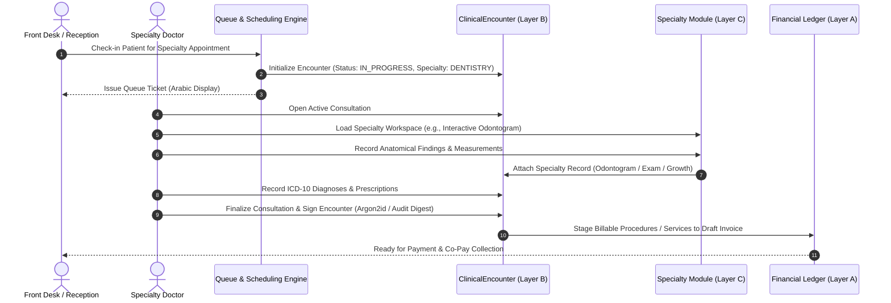

# Lamssa — Phase 8: Advanced Medical Specialty Architecture

**Version:** 1.1.0
**Phase:** Phase 8 — Advanced Medical Specialty Modules
**Step:** Step 8.7 — Final Multi-Specialty Clinical Integrity, Security & Release Acceptance
**Status:** Architecture Completed, Verified & Accepted (Steps 8.1–8.7 Complete)
**Date:** 2026-11-20
**Language:** English (Technical Documentation) with authentic Arabic clinical terminology

---

## 1. Executive Summary & Architectural Mission

Lamssa originated as a high-security, multi-tenant aesthetic clinic management platform. Following the successful completion of Phase 6 (General Medical Core) and Phase 7 (Production Security & Operational Readiness), the platform possesses a battle-tested, modular-monolithic foundation featuring:
- Strict multi-tenancy governed by PostgreSQL `FORCE ROW LEVEL SECURITY` across 154 core clinic tables.
- A central medical specialty registry (`MedicalSpecialty`, `ClinicSpecialty`, `BranchSpecialty`).
- Practitioner credentialing and clinical privilege verification (`PractitionerProfile`, `PractitionerClinicalPrivilege`).
- A specialty-neutral clinical foundation (`ClinicalEncounter`, `ClinicalObservation`, `EncounterDiagnosis`, `PatientAllergy`, `MedicationPrescription`, `ClinicalOrder`, `ClinicalOrderResult`, `ClinicalDocument`, `ClinicalFormDefinition`, `ClinicalFormResponse`).
- Time-bounded, patient-scoped emergency break-glass authorization (`EmergencyBreakGlassAccess`).
- Tamper-evident financial ledger hash chaining (`InvoiceHashChain`, `PaymentHashChain`).
- AES-256-GCM envelope encryption bound to tenant KMS key rings (`KmsKeyRegistry`).

The mission of **Phase 8 (Advanced Medical Specialty Modules)** is to expand Lamssa into seven specialized outpatient clinical disciplines:
1. **Dentistry & Oral Health (`DENTISTRY`)**
2. **Pediatrics & Adolescent Medicine (`PEDIATRICS`)**
3. **Obstetrics & Gynecology (`OB_GYN`)**
4. **Ophthalmology (`OPHTHALMOLOGY`)**
5. **Otolaryngology (`ENT`)**
6. **Orthopedics (`ORTHOPEDICS`)**
7. **Physiotherapy & Rehabilitation (`PHYSIOTHERAPY`)**

### Non-Negotiable Architectural Invariants
1. **Single Patient Identity:** A patient registered in a clinic has exactly one medical record (`Patient`), regardless of how many specialties they visit within that clinic.
2. **Unified Clinical Encounter:** Every clinical interaction, regardless of specialty, is anchored by a `ClinicalEncounter`. Speciality-specific evaluations are extensions of, or attachments to, the active encounter.
3. **No Domain Duplication:** Specialty modules do not create parallel billing systems, duplicate patient directories, or separate scheduling engines. All services resolve through `GeneralClinicalService` or `AestheticProcedureCatalog`, all billing maps to `InvoiceLine`, and all queues map to `QueueTicket`.
4. **Credential & Privilege Gates:** No clinician can document, order, or execute specialty procedures without an active, verified `PractitionerProfile` and explicit `PractitionerClinicalPrivilege` scoped to that specialty.
5. **Multi-Tenant Data Isolation:** Every specialty table must include a non-nullable `clinicId` foreign key and enforce PostgreSQL `FORCE ROW LEVEL SECURITY`.
6. **Clinical Immutability & Provenance:** Finalized clinical findings cannot be overwritten in place. Amendments require attributable revision logs with timestamp, practitioner membership ID, and clinical justification.
7. **Arabic-First RTL User Experience:** Every visual component, anatomical chart, and data entry form must natively support right-to-left layout and display standardized Arabic medical terminology.

---

## 2. Three-Layer Modular Monolith Architecture

Lamssa maintains a clean separation of concerns structured into three distinct conceptual layers:

```mermaid
graph TD
    subgraph LayerA["Layer A: Shared Operational Foundation"]
        Tenant["Clinic & Multi-Branch Hierarchy"]
        Identity["User, Membership & Session Management"]
        PatientCore["Unified Patient Registry & Demographics"]
        Scheduler["Scheduling, Availability & Queue Engine"]
        BillingLedger["Invoicing, Payments & Immutable Ledger"]
        InventoryOps["Lot-Tracked FIFO Inventory & Valuation"]
        AuditKMS["Audit Log & Envelope Encryption KMS"]
    end

    subgraph LayerB["Layer B: Shared Clinical Foundation"]
        Encounter["ClinicalEncounter (Universal Clinical Root)"]
        Vitals["ClinicalObservation (Specialty-Neutral Vitals)"]
        Problems["EncounterDiagnosis & Problem List (ICD-10)"]
        Allergies["PatientAllergy & Pre-Flight Conflict Engine"]
        Prescriptions["MedicationPrescription (SHA-256 Digest)"]
        Orders["ClinicalOrder & Result Workflow (ORD-XXXXXX)"]
        DocRepo["Encrypted Clinical Document Repository"]
        FormEngine["Dynamic JSON Schema Form Engine"]
        Governance["Clinical Governance, Policies & Break-Glass"]
    end

    subgraph LayerC["Layer C: Advanced Specialty Modules"]
        Dentistry["Dentistry: Odontogram, Periodontics & Staging"]
        Pediatrics["Pediatrics: Growth Curves & Dosing Safety"]
        ObGyn["OB/GYN: Pregnancy Episodes & Antenatal Flow"]
        OphthaEnt["Ophtha & ENT: Refraction, IOP, Audiometry"]
        OrthoPhysio["Ortho & Physio: Goniometric ROM & Rehab"]
    end

    LayerA --> LayerB
    LayerB --> LayerC
```

### Layer A — Shared Operational Foundation
- **Clinic & Branch Isolation:** `Clinic`, `ClinicBranch`, `BranchMembership`. Every database entity contains `clinicId` with composite primary/foreign keys.
- **Identity & Access Management:** `User`, `ClinicMembership`, `Session`, `UserMfa`. Strictly isolates system administrators from clinical records.
- **Patient Master Index:** `Patient`, `PatientCounter`. Stores unique patient identities per tenant with encrypted demographic data.
- **Resource Scheduling & Queue:** `Appointment`, `Visit`, `QueueTicket`, `BookableResource`. Provides multi-branch calendar booking, walk-in ticketing, and room allocation.
- **Financial Ledger:** `Invoice`, `InvoiceLine`, `Payment`, `InvoiceHashChain`. Enforces double-entry-style monetary immutability and ZATCA compliance.

### Layer B — Shared Clinical Foundation
- **Universal Encounter Anchor:** `ClinicalEncounter`. Encapsulates patient visit status (`DRAFT`, `IN_PROGRESS`, `SIGNED`, `AMENDED`, `CLOSED`), clinician assignment, and visit linkage.
- **Specialty-Neutral Observations:** `ClinicalObservation`. Standardized tracking of vital signs (blood pressure, heart rate, temperature, weight, height, BMI) with status and provenance.
- **Diagnoses & Problem Lists:** `EncounterDiagnosis`. Encodes provisional and confirmed diagnoses using ICD-10-AM / ICD-10 coding.
- **Allergy Register:** `PatientAllergy`. Active allergen tracking with automated pre-flight conflict alerts during prescribing.
- **Prescription Engine:** `MedicationPrescription`, `MedicationPrescriptionItem`. Outpatient e-prescriptions with tamper-evident SHA-256 signature digests.
- **Orders & Diagnostic Results:** `ClinicalOrder`, `ClinicalOrderResult`. Standard diagnostic ordering workflow (`LABORATORY`, `IMAGING`, `REFERRAL`) with critical-value acknowledgment protocols.
- **Secure Document Repository:** `ClinicalDocument`. AES-256-GCM encrypted document storage with client-side HKDF key derivation.
- **Structured Forms Engine:** `ClinicalFormDefinitionVersion`, `ClinicalFormResponse`. Version-controlled JSON Schema (Draft 2020-12) dynamic questionnaires.
- **Clinical Governance & Safety:** `ClinicalSafetyPolicy`, `ClinicalIncident`, `EmergencyBreakGlassAccess`, `PractitionerPrivilegeReview`. Enforces dual-clinician review, safety boundaries, and audit logging.

### Layer C — Advanced Specialty Modules
Layer C introduces domain-specific models that extend Layer B without duplicating its infrastructure:
- Each specialty module connects to `ClinicalEncounter` via composite foreign key `[clinicId, encounterId]`.
- Each module connects to `Patient` via composite foreign key `[clinicId, patientId]`.
- Specialty services are billed via standard `InvoiceLine` referencing `GeneralClinicalService`.
- Specialized imaging and diagnostic files are stored in `ClinicalDocument` with dedicated `documentType` classifications.

---

## 3. Shared Resource Integration Audit

An exhaustive audit of the existing Prisma schema and API implementations identified the following component integration contracts and missing abstractions:

| Shared Model / Service | Current Phase 7 Baseline Capabilities | Phase 8 Specialty Reusability | Missing Abstractions / Enhancements Required in Phase 8 |
| :--- | :--- | :--- | :--- |
| **`MedicalSpecialty`** | 10 seeded specialties (`DENTISTRY`, `PEDIATRICS`, `OB_GYN`, etc.), clinic/branch enablement (`ClinicSpecialty`, `BranchSpecialty`). | Universal catalog for filtering workspaces, forms, services, and privileges. | Need helper scopes for cross-specialty referrals and multidisciplinary encounters. |
| **`PractitionerProfile` & `ClinicalPrivilege`** | Multi-tier credentialing, board certification tracking, granular privileges (`MEDICATION_PRESCRIBE`, etc.). | Controls who can sign specialty records (e.g. dentist vs pediatrician). | Need 14 new granular privilege codes (e.g. `DENTAL_PROCEDURE_PERFORM`, `REFRACTION_MEASURE`). |
| **`Patient`** | Demographic encryption, unique MRN (`PatientCounter`), age calculation, medical history summary. | Single patient anchor across all specialties. | Need pediatric caregiver relationships (`PatientCaregiverRelationship`) and maternal links. |
| **`ClinicalEncounter`** | Encounter lifecycle (`DRAFT` $\to$ `SIGNED`), clinician assignment, visit/appointment links. | Primary parent record for all specialty notes, exams, and measurements. | Need `specialtyId` foreign key on `ClinicalEncounter` to record primary consultation specialty context. |
| **`ClinicalObservation`** | Standard vital signs (BP, HR, RR, Temp, SpO2, Ht, Wt, BMI), provenance, units. | Reused for routine baseline vitals in all specialty encounters. | Needs pediatric growth metric derivations (Z-scores, percentiles) and maternal fundal height. |
| **`EncounterDiagnosis`** | ICD-10 coding, primary/secondary roles, longitudinal problem list. | Shared diagnosis recording for dental caries, pediatric illnesses, obstetrics, etc. | Dental ICD-10 / ICD-DA diagnostic mapping; pediatric developmental problem categories. |
| **`PatientAllergy`** | Allergen categorization, severity, verification status, pre-flight prescription checks. | Immediate safety screening across all specialties (e.g., dental local anesthetic allergies). | Need dental-specific allergen tags (Latex, Lidocaine, Articaine, Epinephrine, Chlorhexidine). |
| **`MedicationPrescription`** | Prescription numbering (`RX-XXXXXX`), dosage, frequency, SHA-256 tamper digest. | Standardized prescribing across all specialties. | Need pediatric weight-based dosing validation (mg/kg/day) and obstetrics pregnancy risk categories (FDA A/B/C/D/X). |
| **`ClinicalOrder` & `Result`** | Diagnostic orders (`ORD-XXXXXX`), lab/imaging workflows, critical-value alerts. | Ordering dental x-rays, antenatal labs, audiograms, orthopedic MRI/CT. | Need DICOM / PACS viewer integration hooks and specialty order panels (e.g., Antenatal Panel). |
| **`ClinicalDocument`** | AES-256-GCM envelope encrypted attachments, quarantine status, legal hold. | Storing OPGs, CBCT scans, audiograms, ultrasound images, refraction printouts. | Add document types: `DENTAL_IMAGING`, `ULTRASOUND_IMAGE`, `AUDIOMETRY_REPORT`, `OPHTHALMIC_IMAGE`. |
| **`ClinicalFormResponse`** | Dynamic JSON Schema forms, version immutability, attributable amendments. | Captures specialty intake forms, questionnaires, and lifestyle evaluations. | Standardized specialty form templates for pediatric intake, OB/GYN history, and ortho intake. |
| **`EmergencyBreakGlassAccess`**| Time-bounded ($\le 120$ min), patient-scoped clinical override with audit justification. | Allows cross-specialty emergency access (e.g. pediatrician reviewing mother's OB records in crisis). | Automated audit triggers for unauthorized cross-specialty browsing. |

---

## 4. Multi-Specialty Domain Architecture

### 4.1 Cross-Cutting Data Flow & Lifecycle

### 4.2 Data Segregation & Cross-Specialty Access Policy
While patient demographics and universal medical alerts (allergies, adverse reactions, critical conditions) are clinic-wide, detailed clinical consultation notes and examination records maintain strict access boundaries:
1. **Universal Shared Data:** Allergies, active problem list, blood type, emergency contact, active medications, and immunization history are visible to any authorized practitioner attending the patient.
2. **Specialty-Restricted Detailed Records:**
   - Detailed psychiatric, psychotherapy, or sensitive OB/GYN examination records can be flagged with `isConfidential = true`.
   - Confidential records require either primary practitioner membership, explicit referral authorization, or an audited `EmergencyBreakGlassAccess` session.
3. **Cross-Specialty Referrals:** A practitioner in one specialty (e.g. General Medicine) can initiate a `ClinicalOrder` of type `REFERRAL` directed to another specialty (e.g. Orthopedics). Upon acceptance, the receiving practitioner gains read-only access to the referring encounter's clinical summary.

---

## 5. Architectural Principles for Specialty Modules

### 5.1 Prevention of Domain Pollution
To prevent specialty-specific quirks from polluting the operational core:
- **No Specialty-Specific Core Fields:** The `Patient` table will not add columns like `toothCount`, `gestationalAge`, or `visualAcuityRightEye`. All specialty attributes reside in dedicated Layer C child tables.
- **Relational Integrity for Anatomical Data:** Highly structured clinical entities (e.g. individual teeth, fetal measurements, joint ROM angles) are modeled with dedicated relational columns and numeric types rather than opaque JSON blobs, ensuring database-level constraints and historical queryability.
- **JSON for Semi-Structured Surveys:** Complex, non-indexed clinical questionnaires (e.g. lifestyle surveys, pre-procedure review of systems) leverage the existing `ClinicalFormResponse` JSON Schema engine.

### 5.2 Deterministic Versioning & Corrections
In healthcare informatics, data is never deleted or silently modified:
- **Status State Machine:** Specialty records follow the universal lifecycle: `DRAFT` $\to$ `FINALIZED` $\to$ `AMENDED` or `ENTERED_IN_ERROR`.
- **Cryptographic Provenance:** Finalized specialty records compute a SHA-256 digest of their canonical content, signed with the practitioner's session context.
- **Attributable Corrections:** Modifying a finalized record generates an immutable amendment log storing the previous state, new state, practitioner membership ID, and mandatory clinical justification ($\ge 20$ characters).

---

## 6. Implementation & Acceptance Verification

All architectural commitments specified in this document have been delivered across additive migrations 041–045 and verified in Step 8.7:
- **`docs/phase-8-specialty-data-contracts.md`:** Exhaustive Prisma schemas, DTOs, and REST API definitions for all seven specialties.
- **`docs/phase-8-specialty-implementation-roadmap.md`:** Step-by-step technical execution plan for Steps 8.2 through 8.7.
- **`docs/phase-8-final-acceptance.md`:** Independent final release acceptance report containing dual verdicts (Verdict A: Ready for Code Merge; Verdict B: Not Ready for Production Deployment).
- **`docs/phase-8-clinical-safety-validation-matrix.md`:** Comprehensive validation matrix of clinical decision support rules across all seven specialties.
- **`docs/phase-8-specialty-licensing-inventory.md`:** Intellectual property and copyright licensing audit for clinical assessment instruments.
