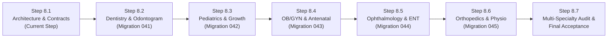

# Lamssa — Phase 8: Specialty Implementation Roadmap & Migration Strategy

**Version:** 1.0.0  
**Phase:** Phase 8 — Advanced Medical Specialty Modules  
**Step:** Step 8.1 — Advanced Specialty Architecture & Clinical Data Contracts  
**Status:** Multi-Step Implementation Roadmap & Regulatory Strategy  
**Date:** 2026-11-18  
**Language:** English (Technical Documentation) with authentic Arabic terminology  

---

## 1. Executive Implementation Strategy

Phase 8 executes the transition of Lamssa into an enterprise-grade, multi-specialty clinical platform. To ensure zero disruption to live aesthetic operations, zero data corruption, and uncompromising clinical safety, Phase 8 is structured into six sequential steps following Step 8.1:



---

## 2. Additive Migration Strategy (Migrations 041–045)

All database schema evolutions in Phase 8 strictly adhere to Lamssa's **Additive Migration Doctrine**:
1. **Preserve Migrations 001–040:** Historical migrations are never altered, re-ordered, or deleted.
2. **Zero Destructive Alterations:** No existing tables, columns, constraints, or enum values will be dropped or renamed.
3. **Tenant Confinement (`clinicId`):** Every new table includes a non-nullable `clinicId UUID` foreign key referencing `public."Clinic"("id")`.
4. **PostgreSQL Row Level Security (`FORCE RLS`):** Every new specialty table executes:
   ```sql
   ALTER TABLE public."DentalOdontogram" ENABLE ROW LEVEL SECURITY;
   ALTER TABLE public."DentalOdontogram" FORCE ROW LEVEL SECURITY;
   CREATE POLICY clinic_isolation ON public."DentalOdontogram"
     USING ("clinicId" = NULLIF(current_setting('app.current_clinic_id', true), '')::uuid);
   ```
5. **No Speculative Schema Alterations:** In accordance with Step 8.1 governance, **no migration files are generated in Step 8.1**. Migrations will be authored and applied sequentially in Steps 8.2 through 8.6.

### Migration Mapping & Growth Projections

| Step | Migration File (Planned) | Models Introduced | Target Specialty | Projected Growth Profile |
| :--- | :--- | :--- | :--- | :--- |
| **8.2** | `041_dentistry_odontogram_staging` | `DentalOdontogram`, `DentalToothFinding`, `DentalPeriodontalRecord`, `DentalTreatmentStage` | `DENTISTRY` | High write volume (up to 32 tooth records per baseline chart). Requires composite index `[clinicId, odontogramId, toothNumberFdi]`. |
| **8.3** | `042_pediatrics_growth_caregivers` | `PediatricBirthHistory`, `PatientCaregiverRelationship`, `PediatricGrowthRecord` | `PEDIATRICS` | Moderate volume; high analytical query frequency. Requires index `[clinicId, patientId, measuredAt]`. |
| **8.4** | `043_obgyn_antenatal_care` | `PregnancyEpisode`, `AntenatalVisitRecord`, `GynecologicalExamination` | `OB_GYN` | Moderate write volume; episodic lifecycle. Requires index `[clinicId, pregnancyEpisodeId, gestationalAgeWeeks]`. |
| **8.5** | `044_ophthalmology_ent_diagnostics` | `OphthalmicRefractionRecord`, `OphthalmicExaminationRecord`, `EntExaminationRecord`, `AudiometryAssessmentRecord` | `OPHTHALMOLOGY`, `ENT` | Moderate volume; numeric and array intensive. Array indexing for audiometry thresholds. |
| **8.6** | `045_orthopedics_physiotherapy` | `MusculoskeletalExamination`, `JointRangeOfMotionRecord`, `PhysiotherapyRehabilitationEpisode`, `PhysiotherapySessionRecord` | `ORTHOPEDICS`, `PHYSIOTHERAPY` | High write frequency for physiotherapy sessions (10–20 sessions per episode). Index on `[clinicId, episodeId, sessionIndex]`. |

---

## 3. Arabic RTL & Specialty UX Architecture

### 3.1 Workspace Navigation & Dynamic Context Switching
When a practitioner opens an active consultation, the clinical workspace dynamically adapts to the encounter's assigned specialty:
- **Unified Header:** Displays patient demographic bar, age/gender, verified allergies badge (with red pulsing alert for active allergies), and active medical alerts.
- **Specialty Mode Selector:** For multidisciplinary clinics, allows switching between the general clinical timeline and specialized charting tools (e.g., Dental Chart vs Medical Notes).
- **RTL Visual Hierarchy:** Primary action triggers (Save Draft, Finalize & Sign, Order Diagnostics) align to the right margin in accordance with authentic Arabic desktop ergonomics.

### 3.2 Interactive Anatomical Diagrams & Accessibility
Interactive visual charts (Odontograms, Body Pain Maps, Joint Goniometers) must strictly adhere to accessibility and auditability standards:
1. **No Opaque Graphical Storage:** An SVG chart is strictly a visual presentation layer. The state of every tooth surface, pain locus, or joint angle is backed by strongly typed database records.
2. **Accessible Keyboard & Text Alternative:** Every interactive element has an accessible HTML/ARIA table alternative. Clinicians can complete examinations entirely via keyboard navigation (Tab / Arrow keys) and screen readers.
3. **Touch-Target Sizing:** On clinical tablet devices (iPad Pro / Android tablets), all touch targets adhere to a minimum bounding box of $44 \times 44\text{px}$ to prevent accidental touch selection in clinical settings.

### 3.3 Authentic Arabic Clinical Lexicon
Phase 8 incorporates standardized Arabic medical terminology approved across GCC and Arab health boards:

| Clinical Concept (English) | Authentic Arabic Term | Clinical Context / Form Label |
| :--- | :--- | :--- |
| **Permanent Dentition** | الأسنان الدائمة | Dental Odontogram Header |
| **Deciduous (Primary) Dentition**| الأسنان اللبنية | Pediatric Odontogram View |
| **Probing Depth (Periodontics)** | عمق الجيب اللثوي | Periodontal Charting Matrix |
| **Bleeding on Probing (BOP)** | النزف عند السبر | Periodontal Risk Indicator |
| **Gestational Age** | العمر الحملي (أسابيع وأيام) | Antenatal Flowsheet Header |
| **Estimated Due Date (EDD)** | التاريخ المتوقع للولادة | Pregnancy Episode Summary |
| **Fundal Height** | ارتفاع قاع الرحم (سم) | Antenatal Physical Examination |
| **Fetal Heart Rate** | نبض الجنين (نبضة/دقيقة) | Fetal Wellbeing Evaluation |
| **Visual Acuity (Uncorrected)** | حدة الإبصار دون تصحيح | Ophthalmic Refraction Sheet |
| **Intraocular Pressure (IOP)** | ضغط العين الداخلي (ملم زئبق) | Tonometry Screening Panel |
| **Range of Motion (Active/Passive)**| المدى الحركي (الإيجابي/السلبي)| Joint Goniometry Matrix |
| **Functional Outcome Score** | مقياس الأداء الوظيفي | Rehabilitation Progress Summary |

---

## 4. Clinical Governance, Safety & Regulatory Boundaries

### 4.1 Automated Decision Support Restrictions
To ensure patient safety and regulatory compliance (Saudi MOH, SCFHS, WHO guidelines):
- **No Automated Diagnostic Generation:** The system will not automatically assign ICD-10 diagnostic codes or high-risk obstetric classifications without explicit clinician confirmation.
- **No Automated Prescription Issuance:** Pediatric dose calculations provide advisory warnings; the prescribing physician remains legally and clinically responsible for signing the prescription.
- **Sedation & Surgical Protocols:** Dental sedation (`SEDATION_ADMINISTER`) and surgical interventions require pre-procedure safety checklists and verified clinical privileges.

### 4.2 Applicable Medical Terminology & Standards
- **Diagnoses:** ICD-10-AM / ICD-10 (WHO) and ICD-DA (Dentistry & Stomatology).
- **Procedures:** CPT-4 (AMA) / ACHI and Saudi MOH Medical Procedure Coding System.
- **Laboratory & Observations:** LOINC (Logical Observation Identifiers Names and Codes).
- **Medications:** Saudi Food & Drug Authority (SFDA) NDC and WHO-ATC Classification.
- **Tooth Identification:** FDI Two-Digit System (ISO 3950).
- **Growth Standards:** WHO Child Growth Standards (2006/2007) and Saudi National Growth Charts.

### 4.3 Data Protection & Privacy Governance (Saudi PDPL)
- **Sensitive Health Data Classification:** OB/GYN records, psychological assessments, and pediatric custody documents are classified as sensitive personal health data under the Saudi Personal Data Protection Law (PDPL).
- **Guardian Consent & Adolescent Privacy:** At age 15 (Saudi legal healthcare consent age for routine outpatient visits), patient portal proxy access by parents can be limited based on clinical policies.
- **Encrypted Media Storage:** Dental CBCT, panoramic x-rays, and obstetric ultrasound media are encrypted client-side using AES-256-GCM envelope encryption before persisting to object storage.

---

## 5. Detailed Implementation Breakdown (Steps 8.2–8.7)

### Step 8.2 — Dentistry & Oral Health Module
- **Scope:** Dental Odontogram (FDI ISO 3950, Universal, Palmer), surface-level caries/restoration tracking, 6-site periodontal probing matrix, dental treatment staging, and IOPA/OPG document integration.
- **Prisma Migration:** `041_dentistry_odontogram_staging` (`DentalOdontogram`, `DentalToothFinding`, `DentalPeriodontalRecord`, `DentalTreatmentStage`).
- **Backend Services:** `DentistryService`, `OdontogramRepository`, DTO validation for tooth ranges and surface combinations.
- **Frontend Workspaces:** Interactive SVG Odontogram component with RTL layout, surface click selectors, periodontal numerical table, and accessible keyboard alternative.
- **Security Gates:** Verification of `DENTAL_EXAMINATION_RECORD` and `DENTAL_PROCEDURE_PERFORM` clinical privileges.
- **Dependencies:** `ClinicalEncounter`, `GeneralClinicalService`, `ClinicalDocument`.

### Step 8.3 — Pediatrics & Growth Analytics Module
- **Scope:** Neonatal birth history, legal caregiver/guardian relationship registry, longitudinal pediatric growth tracking (Height, Weight, Head Circumference, BMI) with WHO/CDC Z-scores and percentiles, and weight-based dosing pre-flight safety checks.
- **Prisma Migration:** `042_pediatrics_growth_caregivers` (`PediatricBirthHistory`, `PatientCaregiverRelationship`, `PediatricGrowthRecord`).
- **Backend Services:** `PediatricsService`, `GrowthCurveService` (lookup tables for WHO LMS parameters), `PediatricDosingValidator`.
- **Frontend Workspaces:** Pediatric patient banner, interactive growth charts (Canvas/SVG Z-score curves) in authentic Arabic, and caregiver management panel.
- **Security Gates:** Verification of `PEDIATRIC_CARE_DOCUMENT` privilege; age validation ($\le 18$ years); parental proxy consent validation.
- **Dependencies:** `Patient`, `ClinicalObservation`, `MedicationPrescription`.

### Step 8.4 — Obstetrics & Gynecology Module
- **Scope:** Antenatal care tracking, pregnancy episodes (GTPAL parity, LMP, ultrasound dating scan reconciliation, reconciled EDD), antenatal visit flowsheets (fundal height, FHR, urine dipstick), and sensitive gynecological examinations.
- **Prisma Migration:** `043_obgyn_antenatal_care` (`PregnancyEpisode`, `AntenatalVisitRecord`, `GynecologicalExamination`).
- **Backend Services:** `ObGynService`, `GestationalAgeCalculator` (reconciliation logic with attributed signoff), sensitive record protection middleware.
- **Frontend Workspaces:** Pregnancy episode timeline, antenatal flowsheet table, trimester milestone tracker, and confidential examination documentation screen.
- **Security Gates:** Verification of `ANTENATAL_CARE_DOCUMENT` and `GYNECOLOGICAL_EXAM_PERFORM` privileges; confidentiality filters.
- **Dependencies:** `ClinicalEncounter`, `ClinicalObservation`, `Patient`.

### Step 8.5 — Ophthalmology & Otolaryngology (ENT) Module
- **Scope:** Ophthalmic refraction sheet (OD/OS/OU Sphere, Cylinder, Axis, Add, PD, visual acuity scales), intraocular pressure tonometry with timestamp and method, slit-lamp/funduscopy findings, ENT examination (otoscopy, rhinoscopy, pharyngoscopy), and pure-tone audiometry hearing assessment.
- **Prisma Migration:** `044_ophthalmology_ent_diagnostics` (`OphthalmicRefractionRecord`, `OphthalmicExaminationRecord`, `EntExaminationRecord`, `AudiometryAssessmentRecord`).
- **Backend Services:** `OphthalmologyService`, `EntService`, audiometry data validators.
- **Frontend Workspaces:** Visual acuity refraction chart, IOP timeline graph, interactive pure-tone audiogram graph (dB HL vs Frequency Hz) with right (red circle) and left (blue cross) standard clinical symbology.
- **Security Gates:** Verification of `REFRACTION_MEASURE`, `OPHTHALMIC_PROCEDURE_PERFORM`, and `ENT_PROCEDURE_PERFORM` privileges.
- **Dependencies:** `ClinicalEncounter`, `ClinicalOrder`, `ClinicalDocument`.

### Step 8.6 — Orthopedics & Physiotherapy Rehabilitation Module
- **Scope:** Musculoskeletal physical examination, goniometric joint range-of-motion (ROM active/passive degrees, pain arc, end-feel), physiotherapy rehabilitation episodes, session-by-session exercise logs, and standardized functional scales (Oswestry, DASH, Lysholm, VAS).
- **Prisma Migration:** `045_orthopedics_physiotherapy` (`MusculoskeletalExamination`, `JointRangeOfMotionRecord`, `PhysiotherapyRehabilitationEpisode`, `PhysiotherapySessionRecord`).
- **Backend Services:** `OrthopedicsService`, `PhysiotherapyService`, functional score aggregators.
- **Frontend Workspaces:** Interactive joint ROM recording panel, rehabilitation episode progress dashboard, and session exercise prescription planner.
- **Security Gates:** Role isolation between Orthopedic Surgeons (`ORTHOPEDIC_EXAM_PERFORM`) and Physiotherapists (`PHYSIOTHERAPY_PLAN_EXECUTE`).
- **Dependencies:** `ClinicalEncounter`, `GeneralClinicalService`, `TreatmentPlan`.

### Step 8.7 — Multi-Specialty Integration, Security Audit & Final Acceptance
- **Scope:** Repository-wide integration testing across all seven specialties, cross-clinic and cross-specialty data isolation verification, PostgreSQL RLS catalog verification, multi-specialty clinical journey validation, performance benchmark under full multi-specialty load, and final acceptance reporting.
- **Prisma Migration:** Final schema hardening (Migration 046 if required).
- **Verification Gates:** 100% pass on boundary checks, unit tests, integration tests, browser smoke checks, and deployment security invariants.
- **Deliverables:** `docs/phase-8-final-acceptance.md`, multi-specialty clinical demonstrations, and conditional merge to `main`.

---

## 6. Comprehensive Validation & Testing Matrix

During Phase 8 development, every step must pass the following multi-tier test matrix:

| Test Domain | Target Invariant | Verification Mechanism |
| :--- | :--- | :--- |
| **Multi-Tenancy** | Clinic A cannot read or mutate Clinic B's specialty records. | PostgreSQL `FORCE RLS` catalog inspection and adversarial integration tests. |
| **Encounter Anchoring** | Specialty records cannot exist without a valid, same-clinic `ClinicalEncounter`. | Composite foreign key constraints `[clinicId, encounterId]`. |
| **Privilege Enforcement** | Clinicians without verified specialty qualifications/privileges receive `403 Forbidden`. | `SpecialtyPrivilegeGuard` automated integration tests. |
| **Specialty Enablement** | Deactivated clinic specialties block procedure creation. | Clinic/Branch specialty status validation. |
| **Record Immutability** | Finalized records cannot be modified via standard `PUT`/`PATCH`. | Database trigger / API guard enforcing amendment workflow. |
| **Anatomical Integrity** | Invalid tooth numbers, negative ROM degrees, or impossible gestational ages fail validation. | Class-validator DTO constraints and database CHECK constraints. |
| **Financial Isolation** | Specialty documentation never mutates financial ledgers directly. | SHA-256 invoice hash chain verification tests. |
| **Aesthetic Regression** | Aesthetic procedures, treatment plans, and consents execute without regression. | Regression suite execution (`npm test`, `npm run test:db`, `npm run test:browser`). |
| **Arabic RTL Ergonomics** | All specialty views render in authentic RTL without visual overlap or layout shifts. | Browser smoke test automation (`scripts/patients-browser-smoke.mjs`). |
