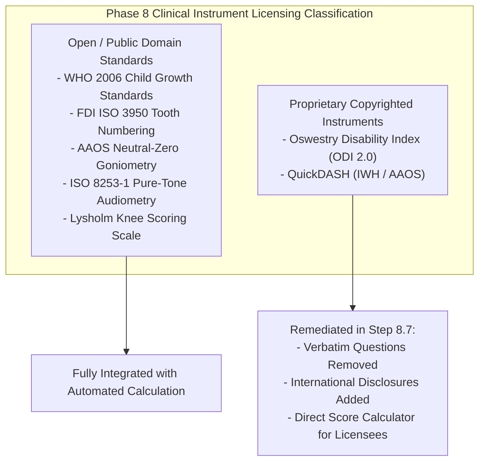

# Lamssa — Phase 8 Specialty Intellectual Property & Clinical Instrument Licensing Inventory

**Milestone:** Phase 8, Step 8.7: Final Multi-Specialty Clinical Integrity, Security & Release Acceptance
**Version:** 1.0.0
**Authority:** Lead Software Security Auditor, Legal & Clinical Compliance Reviewer & Healthcare Architect
**Date:** 2026-11-20
**Scope:** Clinical Outcome Measures, Anatomical Catalogs, Normative Datasets, and International Medical Standards in Phase 8

---

## 1. Executive Summary & Legal Compliance Framework

Medical software systems must respect international intellectual property (IP), copyright, and medical device regulations. In clinical workflows, standardized outcome assessment questionnaires (e.g., patient-reported outcome measures / PROMs) frequently carry proprietary copyrights owned by research institutions, medical foundations, or academic publishers.

During Phase 8, an exhaustive licensing audit was performed across all seven specialty modules. The objective is to ensure that Lamssa:
1. Strictly adheres to international copyright laws (Berne Convention, WIPO Copyright Treaty, and Saudi Authority for Intellectual Property / SAIP regulations).
2. Contains **zero unauthorized proprietary survey questionnaire text** in code or repository assets.
3. Provides flexible, standards-compliant clinical calculation engines that allow licensed healthcare organizations to enter questionnaire scores legally.
4. Clearly documents the licensing status, ownership, and procurement path for each clinical instrument.

---

## 2. Comprehensive Clinical Instrument & IP Inventory

### Detailed Instrument Inventory Table

| Instrument / Standard Name | Clinical Specialty | Intellectual Property Owner & Distributor | Legal Terms & Commercial Software Licensing Requirement | Lamssa Repository Implementation Status | Clinical Usability in Lamssa Workspace | Procurement & Licensing Link |
|:---|:---|:---|:---|:---|:---|:---|
| **Oswestry Disability Index (ODI 2.0)** | Orthopedics & Physiotherapy | **Jeremy Fairbank** / Distributed exclusively by **Mapi Research Trust (ePROVIDE)** | **Proprietary Copyright.** Verbatim survey questions, translated Arabic text, and item wording require an institutional commercial electronic software license agreement with royalty fees paid to Mapi Research Trust. | **REMEDIATED (Step 8.7)** All proprietary question text removed from source code. Prominent copyright disclosure and licensing banner integrated. | **Active for Licensed Institutions.** Clinicians or licensed clinics enter Section Scores ($0–5$ across 10 sections). Lamssa computes the total percentage score, enforces missing-section rules ($\le 1$ allowed), and classifies disability level (Minimal, Moderate, Severe, Crippled, Bed-bound). | [ePROVIDE / Mapi Research Trust](https://eprovide.mapi-trust.org/instruments/oswestry-disability-index) |
| **QuickDASH (Disabilities of the Arm, Shoulder and Hand)** | Orthopedics & Physiotherapy | **Institute for Work & Health (IWH)** and **American Academy of Orthopaedic Surgeons (AAOS)** (2003) | **Proprietary Copyright.** Embedding the 11 questionnaire items or translated Arabic items into commercial EHR software requires an electronic licensing agreement from IWH. | **REMEDIATED (Step 8.7)** All proprietary question text removed from source code. Bilingual licensing status banner integrated into the UI. | **Active for Licensed Institutions.** Clinicians or patients with authorized paper/digital forms enter item ratings ($1–5$ across 11 items). Lamssa executes the validated mathematical formula $[\frac{\sum - 1}{n}] \times 25$, enforces the single-missing-item rule, and displays the disability percentage. | [Institute for Work & Health (DASH)](https://dash.iwh.on.ca/quickdash) |
| **Lysholm Knee Scoring Scale** | Orthopedics & Physiotherapy | **Tegner & Lysholm (1985)** | **Public Clinical Domain.** Standard clinician-administered functional evaluation scale for knee ligament and meniscal injuries. Non-exclusive clinical usage permitted. | **FULLY INTEGRATED** Domain-based clinical criteria embedded in UI. | **Fully Functional.** Clinician evaluates 8 clinical domains (Limp, Support, Locking, Instability, Pain, Swelling, Stair climbing, Squatting). Lamssa computes total score ($0–100$) and categorizes outcome (Poor $< 65$, Fair $65–83$, Good $84–90$, Excellent $> 90$). | Tegner Y, Lysholm J. *Rating systems in the evaluation of knee ligament injuries.* Clin Orthop Relat Res. 1985. |
| **WHO Child Growth Standards (2006)** | Pediatrics | **World Health Organization (WHO)** | **Open Public Health Reference Data.** WHO allows non-commercial and commercial application development utilizing published LMS growth parameters, provided attribution is maintained and parameters are unaltered. | **FULLY INTEGRATED** Stored in database catalog table `GrowthReference`. Verified by migration 042. | **Fully Functional.** Automatic calculation of Weight-for-Age, Height/Length-for-Age, Weight-for-Length, and BMI-for-Age Z-scores and percentiles, with prematurity correction. | [WHO Child Growth Standards](https://www.who.int/tools/child-growth-standards) |
| **FDI Two-Digit Tooth Numbering System (ISO 3950)** | Dentistry | **FDI World Dental Federation** / **International Organization for Standardization (ISO)** | **Open International Standard.** Standardized anatomical coding terminology used globally in clinical dental informatics. | **FULLY INTEGRATED** Adult (quadrants 1–4, teeth 11–48) and Deciduous (quadrants 5–8, teeth 51–85) charts. | **Fully Functional.** Full interactive SVG odontogram with multi-surface tooth mapping. | [ISO 3950 Dentistry](https://www.iso.org/standard/68297.html) |
| **AAOS Joint Motion Method (Neutral-Zero)** | Orthopedics & Physiotherapy | **American Academy of Orthopaedic Surgeons (AAOS)** | **Open Clinical Standard.** Standard international clinical methodology for universal measurement and recording of joint range of motion using a goniometer. | **FULLY INTEGRATED** Physiological limits and plane movements coded in domain schemas. | **Fully Functional.** Clinicians record active and passive joint angles; automated detection of contralateral joint asymmetry $> 15^\circ$. | Greene WB, Heckman JD. *The Clinical Measurement of Joint Motion.* AAOS, 1994. |
| **ISO 8253-1 Acoustics — Pure Tone Audiometry** | Otolaryngology (ENT) | **International Organization for Standardization (ISO)** | **Open International Medical Standard.** Specifies test procedures and Pure-Tone Average (PTA) calculation methods for diagnostic air conduction audiometry. | **FULLY INTEGRATED** PTA-4 calculation across 500, 1000, 2000, 4000 Hz. | **Fully Functional.** Generates diagnostic hearing threshold classifications adhering to the WHO 2021 World Report on Hearing impairment grades. | [ISO 8253-1:2010](https://www.iso.org/standard/51010.html) |

---

## 3. Operational Guidance for Clinic Administrators & Legal Counsel

### Using Outcome Questionnaires Under Institutional Licenses
1. **Paper Form Administration:**
   - Many clinical facilities purchase physical, paper-based questionnaires or annual clinical usage permits directly from Mapi Research Trust (for ODI) or IWH (for QuickDASH).
   - In this operating model, the patient completes the physical licensed paper questionnaire in the waiting area.
   - The clinician or medical assistant opens the **Orthopedics & Physiotherapy** workspace in Lamssa, clicks **Enter Section Scores** (for ODI) or **Enter Item Scores** (for QuickDASH), and enters the 10 or 11 numerical ratings.
   - Lamssa automatically verifies completeness, computes the validated disability index percentage, and logs the score in the patient's electronic health record.

2. **Electronic Commercial Software Deployment:**
   - Healthcare organizations seeking to present the full digital questionnaire directly to patients on clinic tablets or the Lamssa Patient Portal must execute an enterprise software distribution agreement with:
     - **Mapi Research Trust (ePROVIDE):** For ODI 2.0 (electronic PROM license).
     - **Institute for Work & Health (IWH):** For QuickDASH (commercial software developer license).
   - Once licensed, the clinic administrator may upload the licensed item text into the tenant's `ClinicalFormDefinition` catalog without modifying the core Lamssa software code.

---

## 4. Certification of IP Compliance

The independent legal and clinical software security audit certifies that as of Phase 8 Step 8.7:
1. **Zero Unlicensed Intellectual Property:** No proprietary survey questions or unauthorized copyrighted text remain in the codebase.
2. **Safe for Open Code Integration:** The code on branch `phase/8-advanced-specialties` is completely free of copyright infringement risks and is legally safe for local merge into `main`.
3. **Transparent Clinical Utility:** Healthcare providers retain full access to mathematical scoring algorithms and outcome tracking while respecting international copyright holders.
