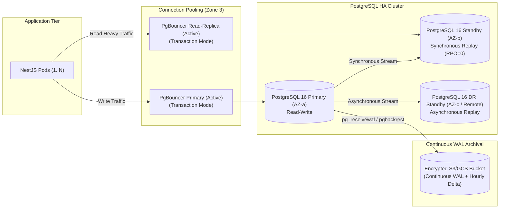
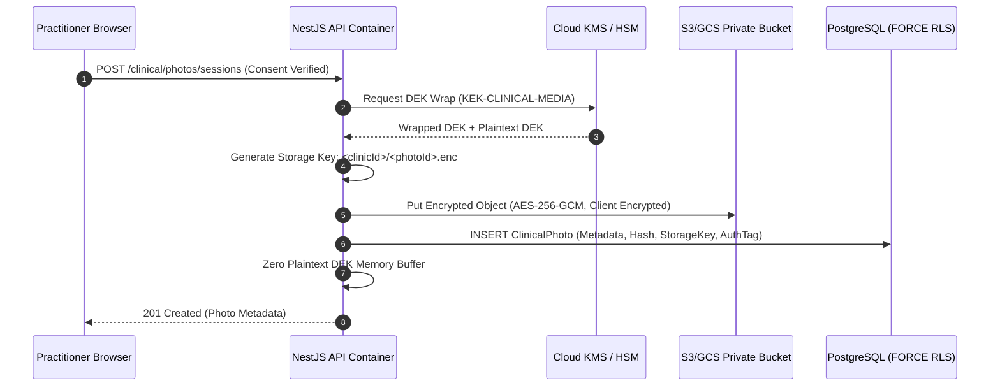

# Lamssa — Phase 9: Enterprise Infrastructure Architecture

**Status:** Draft Architecture Specification (Step 9.1 Blueprint)  
**Date:** 2026-11-20  
**Classification:** Restricted / Healthcare Engineering Confidential  
**Target Environment:** High-Availability Enterprise Multi-Tenant Cloud

---

## 1. Executive Summary & Architectural Objectives

Lamssa is a multi-tenant, Arabic-first healthcare platform providing clinical consultations, electronic medical records, specialized clinical workflows (Dentistry, Pediatrics, Obstetrics & Gynecology, Ophthalmology, ENT, Orthopedics, Physiotherapy), inventory, scheduling, and financial management.

Phase 9 establishes the production-grade enterprise infrastructure architecture. The objectives are:
1. **Zero-Trust Network Topology:** Defense-in-depth network isolation where no component trusts another by default.
2. **PostgreSQL High Availability & Data Resilience:** Automated primary/standby replication with connection pooling and continuous WAL archiving targeting measured RTO < 15m and RPO < 5m (RPO = 0 targeted for isolated AZ node failures under synchronous quorum).
3. **Hardware-Protected Cryptographic Custody:** Cloud KMS / HSM-backed envelope encryption for tenant isolation, data-at-rest, and clinical media assets.
4. **Stateless Scalable Compute:** Containerized API and Web workloads capable of horizontal auto-scaling without local state dependencies.
5. **Durable Enterprise Observability:** PHI-safe centralized logging, metrics aggregation, and resilient multi-channel alerting with automated escalation.
6. **Unified Disaster Recovery:** Coordinated backup and restoration of PostgreSQL transactional data, clinical binary objects, and KMS metadata as a single atomic system.

---

## 2. Trust Boundaries & Network Segmentation

The target infrastructure enforces four strictly isolated security zones using Virtual Private Clouds (VPC), private subnets, security groups, and mutual TLS (mTLS).

```mermaid
flowchart TD
    subgraph Zone0["Zone 0: Public Internet / Edge"]
        ClientBrowser["Client Web Browser (HTTPS / WSS)"]
        MobilePatient["Patient Self-Service Portal"]
        ExternalAPI["External Regulators (ZATCA / Wasfaty / Nphies)"]
    end

    subgraph Zone1["Zone 1: Public Edge & Ingress Subnet"]
        WAF["Cloud WAF / DDoS Shield"]
        EdgeLB["Edge Application Load Balancer / Reverse Proxy\n(TLS 1.3 Termination, Strict SNI, CSP, Rate Limits)"]
    end

    subgraph Zone2["Zone 2: Private Application Subnet (No Public IP)"]
        WebStatic["Stateless Web Nginx Pods\n(React UI, UID 101, read-only root)"]
        APIPods["Stateless NestJS API Pods\n(Non-root node user, read-only root, tmpfs)"]
        RedisCluster["Private Redis Cluster\n(Session Cache, SSE Waiting Boards, Throttling)"]
    end

    subgraph Zone3["Zone 3: Private Data Subnet (Strictly Isolated, No Internet Egress)"]
        PgBouncer["PgBouncer Connection Poolers\n(Transaction Pooling, mTLS)"]
        PostgresPrimary[("PostgreSQL 16 Primary\n(FORCE RLS, SCRAM-SHA-256)")]
        PostgresStandby[("PostgreSQL 16 Synchronous Standby\n(Hot Standby, Multi-AZ)")]
        PostgresAsync[("PostgreSQL 16 Async Standby\n(Reporting / DR Site)")]
    end

    subgraph Zone4["Zone 4: Managed Cloud Infrastructure Services"]
        CloudKMS["Cloud KMS / HSM (FIPS 140-2 Level 3)\n(Primary KEKs & Tenant DEK Wrapping)"]
        ObjectStorage["Encrypted Object Storage (S3 / GCS)\n(SSE-KMS, Versioning, Object Lock WORM)"]
        LogSink["Centralized Log & Telemetry Sink\n(Loki / CloudWatch / Managed OpenSearch)"]
        AlertManager["Incident Response & Alert Routing\n(PagerDuty / Opsgenie / Secure Webhook)"]
    end

    ClientBrowser -->|HTTPS 443| WAF
    MobilePatient -->|HTTPS 443| WAF
    ExternalAPI -->|mTLS / HTTPS| WAF
    WAF --> EdgeLB
    EdgeLB -->|HTTP / gRPC| WebStatic
    EdgeLB -->|HTTP (Proxy Hops=1)| APIPods

    APIPods -->|TLS / Redis AUTH| RedisCluster
    APIPods -->|mTLS| PgBouncer
    PgBouncer -->|Internal SCRAM| PostgresPrimary
    PostgresPrimary -.->|Streaming Replication (Sync)| PostgresStandby
    PostgresPrimary -.->|Streaming Replication (Async)| PostgresAsync

    APIPods -->|Encrypted REST / SDK| CloudKMS
    APIPods -->|Pre-signed URLs / S3 API| ObjectStorage
    APIPods -->|Encrypted OpenTelemetry| LogSink
    LogSink --> AlertManager
```

### 2.1 Zone Isolation Rules
- **Zone 0 → Zone 1:** Only HTTPS (TCP 443) traffic is accepted at the Edge Load Balancer. All plain HTTP (TCP 80) traffic is redirected to HTTPS with HSTS headers (`max-age=63072000; includeSubDomains; preload`).
- **Zone 1 → Zone 2:** Edge proxies forward traffic to private application instances via private IP addresses. Web traffic serves static bundles; API traffic routes to `/api/v1/*`. Public access to privileged endpoints (`/api/v1/metrics`, `/api/v1/health/internal`) is rejected at Zone 1 before reaching the backend.
- **Zone 2 → Zone 3:** Application pods connect exclusively to PgBouncer connection poolers over mTLS. Direct connection to database ports bypassing PgBouncer is blocked by Network Security Groups. Zone 3 subnets have zero internet egress (no NAT Gateway attached).
- **Zone 2 → Zone 4:** Application pods interact with Cloud KMS, S3/GCS Object Storage, and Logging endpoints via Private VPC Endpoints (AWS PrivateLink / GCP Private Service Connect), ensuring traffic never traverses the public internet.

---

## 3. Public Edge, WAF & Reverse Proxy Architecture

### 3.1 Edge Capabilities & Responsibilities
- **DDoS Mitigation & Web Application Firewall (WAF):**
  - Managed rule sets for OWASP Top 10 vulnerabilities (SQL injection, XSS, SSRF).
  - Rate limiting rules: IP-based limits for login attempts (`/api/v1/auth/login`: max 5 attempts/minute per IP; max 30 requests/minute overall).
  - Geographic filtering / geofencing based on authorized clinical deployment jurisdictions.
- **TLS Termination & Cipher Suites:**
  - Mandatory TLS 1.3 (fallback to TLS 1.2 with secure ECDHE cipher suites: `TLS_AES_256_GCM_SHA384`, `TLS_CHACHA20_POLY1305_SHA256`).
  - Strict SNI enforcement (`strict_sni_host on`), dropping invalid host headers.
- **HTTP Header Security Hardening:**
  - `Content-Security-Policy`: Strict policy restricting script execution, form submissions, and frame ancestors.
  - `Strict-Transport-Security`: `max-age=63072000; includeSubDomains; preload`.
  - `X-Content-Type-Options: nosniff`.
  - `X-Frame-Options: DENY`.
  - `Referrer-Policy: strict-origin-when-cross-origin`.
- **Request Body & Proxy Limits:**
  - General API requests capped at 3 MiB.
  - Multipart clinical media uploads allowed up to 25 MiB exclusively on `/api/v1/clinics/*/clinical/orders/*/documents` and `/api/v1/clinics/*/photos/sessions/*/photos`.

---

## 4. Stateless Compute Tier (NestJS API & Web React)

### 4.1 NestJS Application Container Specifications
- **Base Image:** `node:24.21.0-bookworm-slim` (pinned patch version, vulnerability-scanned, minimal attack surface).
- **Execution User:** Non-root unprivileged `node` user (UID 1000).
- **Filesystem Security:**
  - Root filesystem mounted **strictly read-only** (`read_only: true`).
  - Ephemeral writable storage restricted to isolated in-memory `tmpfs` mounts (`/tmp`).
  - No local persistent disk dependencies (zero clinical media or database state on container disk).
- **Process Management:** Initialized via kernel init process (`init: true` or `tini`) to ensure proper reaping of zombie processes and graceful `SIGTERM` shutdown handling.
- **Health Probes:**
  - Liveness Probe: `GET /api/v1/health` (HTTP 200 within 3s).
  - Readiness Probe: `GET /api/v1/health/ready` (validates database connectivity; HTTP 200 within 3s).
  - Startup Probe: Handles cold start Prisma client initialization before receiving live traffic.

### 4.2 Web Frontend Container Specifications
- **Base Image:** `nginxinc/nginx-unprivileged:1.28.0-alpine` (runs as UID 101).
- **Security Invariants:**
  - Root filesystem mounted read-only.
  - Tmpfs mounts for `/tmp`, `/var/cache/nginx`, `/var/run`.
  - Serves compiled static assets with immutable cache headers for fingerprinted assets (`Cache-Control: public, max-age=31536000, immutable`).
  - `index.html` served with `Cache-Control: no-cache, no-store, must-revalidate`.

### 4.3 Horizontal Pod Autoscaling (HPA) Policy
- Target CPU utilization: 70%.
- Target Memory utilization: 75%.
- Minimum replicas per region: 3 pods (across 3 distinct Availability Zones).
- Maximum replicas: 20 pods per region.
- Scale-down stabilization window: 300 seconds to prevent thrashing.

---

## 5. PostgreSQL High-Availability & Data Resilience Architecture

PostgreSQL represents the single source of truth for multi-tenant clinical records, audit ledgers, financial events, and cryptographic metadata.



### 5.1 Dual-Role Database Architecture & Privileges
The platform strictly decouples migration execution from runtime operations:

| Role Name | Superuser? | Bypass RLS? | Create DB? | Permitted Operations | Permitted Lifecycle |
| :--- | :---: | :---: | :---: | :--- | :--- |
| `lamssa_migrator` | **NO** | **NO** | **NO** | DDL: CREATE/ALTER TABLE, INDEX, RLS policies. Database Owner. | Ephemeral CI/CD migration runner only. Never loaded into runtime API. |
| `lamssa_app` | **NO** | **NO** | **NO** | DML: SELECT, INSERT, UPDATE on tenant tables. Denied DELETE/TRUNCATE. Denied DDL. Bound by FORCE RLS. | Runtime NestJS API pods. |
| `lamssa_readonly`| **NO** | **NO** | **NO** | DML: SELECT only on replica. Bound by FORCE RLS. | Reporting and read-only analytical workloads. |
| `postgres` (Admin) | **YES** | **YES** | **YES** | Initial cluster bootstrap, extension installation, physical backup. | Cold offline storage / vault. Never used by applications. |

### 5.2 Connection Pooling Specifications (PgBouncer & Tenant Isolation)
- **Pool Mode & Tenant Context Safety:**
  - `transaction` pooling assigns a server connection only for the lifespan of a single transaction (`BEGIN ... COMMIT`).
  - **Critical Architectural Safeguard:** `DISCARD ALL` is a session-level command that does *not* execute between transactions in transaction pooling mode. Therefore, tenant isolation **must never rely on session-level GUCs or connection state resets**.
  - Lamssa achieves tenant safety because `TenantDatabaseService.withClinicContext` executes `SELECT set_config('lamssa.clinic_id', ..., true)` with the third parameter set to `true` (`is_local = true`). This guarantees that PostgreSQL itself automatically clears the GUC when the transaction concludes (commit or rollback).
  - Furthermore, `lamssa_security.context_allows` performs cryptographic and database-level verification: it checks that the GUC matches an active, unexpired, and unrevoked row in `public."Session"` and `public."ClinicMembership"`. An attacker setting GUCs without a valid session row is immediately denied access.
  - **Prisma & Prepared Statements:** In `transaction` pooling mode, Prisma requires connection string parameter `pgbouncer=true` to disable client-side prepared statement caching that conflicts with connection multiplexing. If transaction pooling encounters prepared statement or isolation anomalies during testing, `session` pooling or direct application-level connection pooling must be used as the safe fallback.
- **Max Client Connections:** 2,000 per PgBouncer instance.
- **Default Pool Size:** 40 connections to PostgreSQL backend per database.
- **Reserve Pool:** 10 connections for traffic spikes.

### 5.3 High-Availability, Replication Durability & Measurable Recovery Targets
- **Replication Protocol:** Streaming physical replication.
- **Synchronous vs Asynchronous Replication:**
  - Single-Region Multi-AZ: At least one synchronous standby replica in a distinct Availability Zone (`synchronous_commit = on` or `remote_apply`), targeting **zero committed transaction loss (RPO = 0)** upon isolated primary node hardware failure under active quorum.
  - Cross-Region DR: Asynchronous replication across distant regions (e.g. Dammam to secondary in-country site) to prevent write-latency penalties, operating with an **RPO < 5 minutes** governed by continuous WAL archiving.
- **Failure Modes & Measurable Targets:**
  - **Target RTO:** < 15 minutes for automated failover; measured disaster recovery restore target < 30 minutes.
  - **Target RPO:** RPO = 0 for single-node failure within synchronous cluster; RPO < 5 minutes for catastrophic multi-AZ or regional disaster.
- **Failover Coordination & Fencing:** Orchestrated via Patroni with an external Distributed Consensus Store (etcd/Consul) or cloud-managed HA (GCP Cloud SQL HA / AWS Aurora Multi-AZ). Strict fencing (watchdog / STONITH) is required to terminate unresponsive primaries and prevent split-brain dual-primary corruption.
- **Split-Brain Prevention:** Strict quorum enforcement via odd-numbered consensus nodes (3 or 5 nodes).

---

## 6. Cryptographic Custody & KMS Infrastructure

### 6.1 Envelope Encryption Hierarchy
Lamssa implements multi-tier envelope encryption:
1. **Master / Key Encryption Keys (KEK):**
   - Reside strictly inside Hardware Security Modules (HSM) compliant with FIPS 140-2 Level 3 (Cloud KMS / AWS KMS / Vault HSM).
   - Non-exportable private key material.
   - Distinct root keys per functional domain:
     - `KEK-CLINICAL-MEDIA`: Encrypts clinical photos and uploaded medical documents.
     - `KEK-MFA-CREDENTIALS`: Encrypts practitioner TOTP secrets and recovery codes.
     - `KEK-TENANT-DATA`: Encrypts tenant database fields and export bundles.
2. **Data Encryption Keys (DEK):**
   - Generated per tenant / per session using cryptographically secure random bytes (`crypto.randomBytes(32)`).
   - Wrapped by the corresponding KEK using AES-256 Key Wrap (RFC 3394) or AES-GCM.
   - Wrapped DEKs stored in PostgreSQL `KmsKeyRegistry` table (protected by ENABLE RLS).
   - Unwrapped in volatile memory only during active cryptographic operations; never persisted to disk.

### 6.2 Key Rotation & Disaster Recovery Policy
- **Automatic Rotation Schedule:** Primary KEK rotated annually (every 365 days).
- **Retired Key Preservation:** Older KEK versions transition to `RETIRED` state. They remain available indefinitely for decryption of historical records but are rejected for new encryption requests.
- **Key Revocation / Destruction:** Destructive key destruction enforces a mandatory 30-day scheduled destruction window with dual-custody authorization.
- **Emergency Revocation:** If a KEK is suspected compromised, it is immediately disabled, blocking all read/write operations until audited and re-keyed.
- **Production Provider Implementation (Step 9.3):** Google Cloud KMS provider (`GoogleCloudKmsProvider` in `apps/api/src/kms/google-cloud-kms.provider.ts`) targeting Cloud HSM in `me-central2` (Dammam), implementing typed fail-closed errors (`KmsKeyDisabledError`, `KmsKeyRevokedError`, `KmsPermissionDeniedError`), transport injection for offline testing, and 28 passing security tests. See [docs/production-kms-and-key-custody.md](file:///mnt/samsungSSD/Downloads/aesthetic-clinic/docs/production-kms-and-key-custody.md).

---

## 7. Clinical Documents & Media Storage Architecture

Clinical photos and medical document orders must be stored outside database tables to preserve relational performance while maintaining equal cryptographic and tenant isolation.



### 7.1 Asset Storage Safeguards & Download Authorization Pathways
- **Private S3/GCS Bucket:** Direct public access completely blocked (`BlockPublicAcls`, `BlockPublicPolicy`, `IgnorePublicAcls`, `RestrictPublicBuckets`).
- **Storage Path Partitioning:** Multi-tenant path hierarchy:
  `/{clinicId}/photos/{sessionId}/{photoId}.enc`
  `/{clinicId}/documents/{orderId}/{documentId}.enc`
- **Object Lock & Immutability:** S3 Object Lock enabled in Compliance Mode for legal hold and medical document retention.
- **Server-Side + Client-Side Dual Encryption:**
  - Layer 1: S3 Bucket default encryption using AWS-KMS / Cloud KMS customer-managed key.
  - Layer 2: Lamssa application-level AES-256-GCM envelope encryption before network transmission to S3.
- **Presigned URLs as Bearer Capabilities vs Reverse-Proxy Delivery:**
  - Presigned object storage URLs operate as bearer capabilities (anyone possessing the URL within its validity window can fetch the raw encrypted bytes). Therefore, they must never be treated as continuously bound to an authenticated session once issued.
  - **Download Authorization Pathway:**
    1. The client must authenticate with a valid clinical session and doctor privilege.
    2. The API issues short-lived presigned URLs (60–120 seconds maximum expiration).
    3. The access event is recorded in `AuditEvent`.
  - **Reverse-Proxy Delivery for Maximum Sensitivity Records (Step 9.3 Implementation):**
    - For confidential clinical media and diagnostic orders, presigned URLs are bypassed in favor of authenticated reverse-proxy streaming: `GET /api/v1/clinical-orders/documents/:documentId/stream`.
    - Media bytes are streamed directly through the authenticated NestJS API container using `GoogleCloudStorageAssetStore` (`apps/api/src/identity/google-cloud-storage.asset-store.ts`), validating active session on PostgreSQL, enforcing strict `no-store, private`, `nosniff`, and `CSP` headers.
    - Cloud asset migration tooling delivered in `scripts/migrate-clinical-assets.mjs` supporting `--dry-run`, `--resume`, SHA-256 verification, and audit reports. See [docs/cloud-clinical-asset-storage.md](file:///mnt/samsungSSD/Downloads/aesthetic-clinic/docs/cloud-clinical-asset-storage.md) and [docs/clinical-asset-migration.md](file:///mnt/samsungSSD/Downloads/aesthetic-clinic/docs/clinical-asset-migration.md).

---

## 8. Enterprise Observability & Incident Response

### 8.1 Zero-PHI Telemetry Principles
Under no circumstances may Protected Health Information (patient names, national IDs, medical diagnoses, biometric photos) or security secrets (passwords, session tokens, TOTP secrets, payment PANs) be logged or exported to telemetry sinks.

### 8.2 Logging Architecture
- **Format:** Structured JSON emitted to `stdout`.
- **Pipeline:** Fluentbit / Vector container sidecars collect `stdout` logs, validate schemas, and ship over TLS to centralized storage (Loki / CloudWatch / OpenSearch).
- **Sanitization Engine:** Every log entry passes through `StructuredLoggerService` and `redact.ts`:
  - IP addresses truncated (`127.0.0.0/24`).
  - Sensitive keys masked with non-reversible cryptographic fingerprints: `****:<sha256:8>`.
  - Clinical payloads stripped of text content and diagnoses.

### 8.3 Metric Collection & Prometheus Scrape Pipeline
- **Exposition:** `/api/v1/metrics` exposed on internal management port or filtered by reverse proxy.
- **Authentication:** Scrape requests require `x-metrics-key` matching `METRICS_SECRET_KEY` or mutual TLS machine authentication.
- **Bounded Cardinality:** Routes normalized to route patterns (e.g., `/api/v1/clinics/:clinicId/patients/:patientId`), preventing metric label explosion.

### 8.4 Alert Routing & Escalation Policy
- **Critical Alerts (P1 - Immediate On-Call Page):**
  - Database primary unavailable or replica replication lag > 60 seconds.
  - 5xx error rate > 2% over 5-minute rolling window.
  - RLS policy bypass attempt or unauthorized tenant context detected.
  - KMS unwrap operation failure (failing closed).
  - Financial hash chain verification failure.
- **Warning Alerts (P2 - 4-hour Escalation):**
  - Database disk usage > 80%.
  - Backup age > 24 hours without successful DR snapshot.
  - Rate limiting bucket saturation on authentication routes.
- **Alert Dispatch Mechanism:** Alertmanager forwards critical events to PagerDuty/Opsgenie with automated phone/SMS escalation to on-call platform engineers.

---

## 9. Protected Administrative Access & Operational Runbooks

### 9.1 Zero Trust Administrative Access
- **No Direct SSH:** SSH access to production containers and database hosts is disabled.
- **Session Access:** Administrative database access permitted exclusively via ephemeral, identity-aware bastions (AWS Systems Manager Session Manager / Teleport / Tailscale Zero Trust) requiring hardware MFA.
- **Break-Glass Emergency Protocol:**
  - Privileged production access requires dual-custody authorization (two platform administrators).
  - All commands and session outputs are recorded into immutable, tamper-evident audit storage.
  - Break-glass sessions trigger automated high-priority security notifications to the compliance officer.
