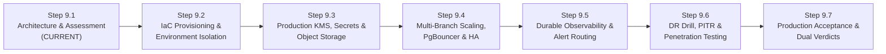

# Lamssa — Phase 9: Enterprise Infrastructure Implementation Roadmap

**Status:** Official Implementation Plan (Steps 9.2 – 9.7)  
**Date:** 2026-11-20  
**Target Branch:** `phase/9-enterprise-infrastructure`  
**Prerequisites:** Step 9.1 Baseline Architecture Approved & Verified

---

## 1. Roadmap Overview & Milestones

Phase 9 transforms Lamssa from a verified local monolithic platform into an enterprise-ready, cloud-native healthcare platform. 

---

## 2. Step-by-Step Work Packages

### Step 9.2: Infrastructure Provisioning & Environment Isolation
- **Scope:** Define and validate OpenTofu/Terraform infrastructure modules for multi-AZ VPC, subnets, Kubernetes clusters, and container registries. Establish automated CI/CD pipeline using GitHub Actions OIDC.
- **Dependencies:** Step 9.1 Architectural Blueprint.
- **Deliverables:**
  - `infra/modules/vpc_networking/` (Multi-AZ VPC, subnets, NAT, VPC Endpoints).
  - `infra/modules/kubernetes_cluster/` (EKS / GKE node groups, least-privilege IAM roles).
  - `.github/workflows/deploy-staging.yml` (OIDC-authenticated staging deployment pipeline).
  - Automated deployment configuration validator updates.
- **Security Controls:** Zero hardcoded credentials; private subnets for all compute; non-root container security contexts; image signing via Sigstore/Cosign.
- **Integration Tests:** IaC linting (`tflint`), security scanning (`tfsec` / `checkov`), and dry-run plan validation (`tofu plan`).
- **Acceptance Criteria:** Reproducible staging environment provisioned with 100% automated IaC; zero manual console interventions.
- **Git Commit Policy:** `feat(infra): provision staging infrastructure and automated CI/CD pipeline`.

---

### Step 9.3: Production KMS, Secret Vault & Object Storage Adapters
- **Scope:** Replace mock external KMS with native Cloud KMS / AWS KMS / Vault HSM integration. Implement production S3/GCS-compatible `AssetStore` and `ClinicalMediaStore` adapters replacing local filesystem storage.
- **Dependencies:** Step 9.2 Network & Cloud IAM.
- **Deliverables:**
  - `apps/api/src/kms/cloud-kms.provider.ts` (Native Cloud KMS / Vault envelope encryption provider).
  - `apps/api/src/identity/s3-asset-store.ts` (S3/GCS object storage adapter for clinic branding assets).
  - `apps/api/src/clinical-photos/s3-clinical-media-store.ts` (Encrypted S3 object storage adapter for clinical media).
  - Dynamic secret injection configuration using External Secrets Operator.
- **Security Controls:** FIPS 140-2 Level 3 HSM master key custody; AES-256-GCM client-side encryption prior to network transmission; private bucket policies; automated key rotation logic.
- **Integration Tests:** KMS wrap/unwrap integration tests; S3 asset put/read/remove lifecycle tests; fail-closed validation when KMS endpoint is unreachable.
- **Acceptance Criteria:** Full cryptographic round-trip tests passing against staging KMS; local disk storage completely removed from production container paths.
- **Git Commit Policy:** `feat(security): implement Cloud KMS provider and S3 object storage adapters`.

---

### Step 9.4: Multi-Branch Scaling, PgBouncer & High Availability
- **Scope:** Deploy PgBouncer connection poolers in transaction mode. Configure PostgreSQL primary/synchronous standby replication. Implement Redis cluster for distributed session caching, rate limiting, and live queue SSE fan-out across multiple clinic branches.
- **Dependencies:** Step 9.2 VPC & Subnets.
- **Deliverables:**
  - `infra/modules/pgbouncer/` (PgBouncer deployment with mTLS and transaction pooling).
  - `apps/api/src/prisma/prisma.service.ts` updates for PgBouncer transaction mode compatibility.
  - Redis cache integration for SSE public queue events and rate limiting.
  - Multi-branch load testing benchmarks simulating 50 concurrent clinics and 200 concurrent staff.
- **Security Controls:** mTLS encryption between NestJS, PgBouncer, and PostgreSQL; session reset (`DISCARD ALL`) on connection check-in; SCRAM-SHA-256 database authentication.
- **Integration Tests:** Concurrency stress tests verifying zero connection leaks, zero deadlocks, and zero cross-tenant contamination under peak load.
- **Acceptance Criteria:** Sub-50ms API response time (p95) under 500 concurrent requests; zero database connection pool saturation.
- **Git Commit Policy:** `feat(database): configure PgBouncer pooling, Redis caching, and PostgreSQL HA replication`.

---

### Step 9.5: Durable Observability, Alert Routing & Centralized Logging
- **Scope:** Replace in-memory `AlertingService` with durable alert dispatch via Alertmanager, PagerDuty, and Opsgenie. Deploy centralized PHI-safe log aggregation (Loki / CloudWatch) and OpenTelemetry distributed tracing.
- **Dependencies:** Step 9.2 Compute Cluster.
- **Deliverables:**
  - `apps/api/src/observability/alert-dispatcher.service.ts` (Multi-channel webhook / PagerDuty integration).
  - Prometheus Alertmanager alerting rules (`alerts.yaml`) for database health, RLS violations, 5xx spikes, and backup age.
  - Grafana dashboard definitions for operational, financial, and clinical system health.
  - Automated DLP log scanning pipeline.
- **Security Controls:** Strict zero-PHI log filtering; metric cardinality bounding; authenticated metrics scraping (`x-metrics-key`); encrypted telemetry transport.
- **Integration Tests:** Alert delivery integration tests firing test P1/P2 alerts and verifying successful webhook/SMS dispatch and acknowledgment.
- **Acceptance Criteria:** Real-time alert delivery verified with PagerDuty; zero PHI detected in automated log scans across 10,000 synthetic patient transactions.
- **Git Commit Policy:** `feat(observability): implement durable alert routing, centralized logging, and dashboards`.

---

### Step 9.6: Disaster Recovery Drill, Automated PITR & Security Penetration Testing
- **Scope:** Execute complete end-to-end disaster recovery drill on isolated staging infrastructure with full database and clinical asset restoration. Configure continuous WAL archiving and automated Point-In-Time Recovery (PITR). Conduct independent security penetration testing.
- **Dependencies:** Step 9.3 KMS/S3 & Step 9.4 PostgreSQL HA.
- **Deliverables:**
  - `scripts/staging-dr-drill.mjs` (Automated DR execution script with dedicated provisioning role).
  - Continuous WAL archiving to S3/GCS with 5-minute PITR window.
  - Formal Disaster Recovery Verification Report with measured RTO and RPO.
  - Independent penetration testing remediation report.
- **Security Controls:** S3 Object Lock (Compliance Mode WORM); isolated disaster recovery cloud account; cryptographic HMAC-SHA256 manifest validation.
- **Integration Tests:** Staging restore drill restoring full database, verifying all 173 FORCE RLS policies, validating financial hash chains, and testing active user logins.
- **Acceptance Criteria:** Measured RTO < 15 minutes; measured RPO < 5 minutes; 100% RLS integrity verified on restored database; all penetration testing findings remediated.
- **Git Commit Policy:** `test(resilience): validate full disaster recovery drill and automated PITR pipeline`.

---

### Step 9.7: Final Production Readiness & Enterprise Operational Acceptance
- **Scope:** Conduct final multi-disciplinary acceptance review across release engineering, platform security, SRE, clinical safety, and regulatory compliance. Deliver independent dual verdicts.
- **Dependencies:** Steps 9.1 – 9.6 Complete.
- **Deliverables:**
  - `docs/phase-9-final-acceptance.md` (Comprehensive acceptance audit).
  - Formal Medical Director signed clearance certificate.
  - Regulatory onboarding clearance certificates (ZATCA, Wasfaty, Nphies).
  - Production Blocker Register final status review.
- **Security Controls:** Final review of production cloud IAM, KMS policies, network ingress boundaries, and audit logging.
- **Integration Tests:** Complete regression test suite execution (Unit, DB, Browser Smoke, Deployment, DR).
- **Acceptance Criteria:** Dual independent verdicts: Code Integration READY for main merge; Production Clinical Deployment status clearly adjudicated against cleared blockers.
- **Git Commit Policy:** `chore(release): finalize Phase 9 enterprise production readiness acceptance`.
