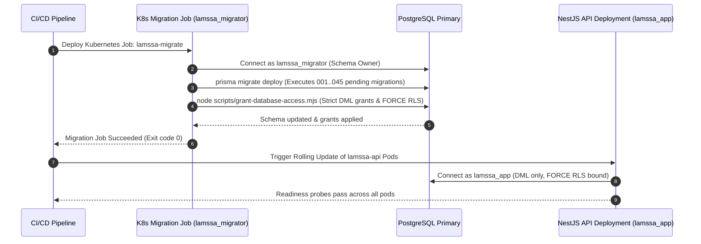
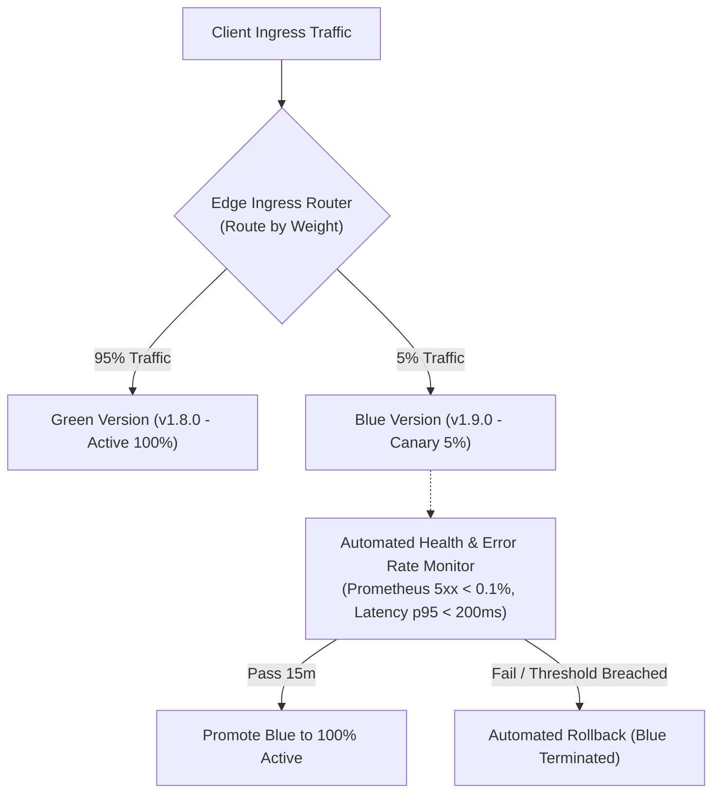

# Lamssa — Phase 9: Production Deployment Blueprint

**Status:** Draft Deployment Blueprint (Step 9.1 Specification)  
**Date:** 2026-11-20  
**Classification:** Restricted / DevOps & Platform Security  
**Target Architecture:** Multi-Region Cloud / Kubernetes / Managed PostgreSQL / S3-Compatible Object Store

---

## 1. Overview & Deployment Principles

The Lamssa Production Deployment Blueprint defines the repeatable, automated, and secure deployment lifecycle for enterprise environments. 

Key principles:
1. **Immutable Infrastructure as Code (IaC):** Every infrastructure component (networks, clusters, databases, IAM, buckets, KMS keys) is declared as version-controlled code. Manual console modifications are strictly forbidden.
2. **Zero-Downtime Rollouts:** Stateless application workloads roll out via Blue/Green or Rolling Canary deployments with automated rollback on health or error rate degradation.
3. **Decoupled Ephemeral Migrations:** Database migrations execute in an isolated, pre-deployment container using the privileged `lamssa_migrator` role before new application pods are permitted to start.
4. **Principle of Least Privilege (PoLP):** Runtime applications run with unprivileged user identities, read-only root filesystems, and zero permissions to alter database schemas or delete financial/audit ledgers.
5. **Hermetic Environment Isolation:** Development, Staging, and Production environments run in completely separate cloud accounts/projects with zero shared credentials, networks, or databases.

---

## 2. Infrastructure as Code (IaC) Architecture

Lamssa standardizes on **OpenTofu / Terraform (v1.8+)** for infrastructure provisioning, paired with **Terragrunt** or modular workspaces for multi-environment orchestration.

```text
infra/
├── modules/
│   ├── vpc_networking/         # Multi-AZ VPC, private/public subnets, NAT, VPC Endpoints
│   ├── security_groups/        # Least-privilege ingress/egress rules between tiers
│   ├── postgres_ha/            # Multi-AZ PostgreSQL primary/standby, parameter groups, SSL
│   ├── pgbouncer/              # Connection pooling instances/containers in transaction mode
│   ├── cloud_kms/              # Customer-managed KEKs, rotation policies, IAM policies
│   ├── object_storage/         # S3/GCS buckets, SSE-KMS, Object Lock, lifecycle rules
│   ├── redis_cache/            # Private Redis cluster for session cache and rate limits
│   ├── kubernetes_cluster/     # Managed EKS / GKE cluster, node groups, OIDC provider
│   └── observability_stack/    # OpenTelemetry collector, Prometheus, Loki, Alertmanager
├── environments/
│   ├── staging/
│   │   ├── main.tf
│   │   ├── variables.tf
│   │   └── terraform.tfvars
│   └── production/
│       ├── main.tf
│       ├── variables.tf
│       └── terraform.tfvars
└── policies/                   # OPA / Conftest security and compliance rules
```

### 2.1 State Management & Locking
- **Remote Backend:** Encrypted S3/GCS bucket with Object Versioning and server-side encryption.
- **State Locking:** DynamoDB table or Cloud Storage object locking to prevent concurrent state modifications.
- **Access Control:** State file access restricted strictly to the automated CI/CD pipeline role; human access denied.

### 2.2 Drift Detection & GitOps Pipeline
- Automated drift detection runs on a daily schedule (`tofu plan -detailed-exitcode`).
- Alerts trigger in Slack/Opsgenie if out-of-band infrastructure changes occur.
- Pull requests require peer review and automated `tofu plan` validation before merge. Production applies require authorized sign-off from Platform Security Lead.

---

## 3. Environment Configuration Matrix

| Configuration Attribute | Development (`dev`) | Staging (`staging`) | Production (`prod`) |
| :--- | :--- | :--- | :--- |
| **Cloud Account** | Shared Dev Account | Isolated Staging Account | Dedicated Production Account |
| **Network Isolation** | Local Docker / Dev VPC | Dedicated Staging VPC | Multi-AZ Dedicated Production VPC |
| **PostgreSQL Nodes** | Single instance (Docker) | 1 Primary + 1 Async Standby | 1 Primary + 1 Sync Standby + 1 Async Standby (Multi-AZ) |
| **Connection Pooling** | Direct connection | PgBouncer (1 instance) | PgBouncer Cluster (2+ instances behind internal NLB) |
| **Compute Sizing** | 1 Container (local) | 2 API Pods, 2 Web Pods | 3–20 API Pods (HPA), 3–10 Web Pods (HPA) |
| **KMS Provider** | `local` (dev fallback) | `external` (staging KMS key) | `external` / Cloud HSM (FIPS 140-2 Level 3) |
| **Asset Storage** | Local filesystem (`var/`) | Private Staging S3/GCS | Private Production S3/GCS with Object Lock WORM |
| **Backups** | Local script snapshot | Daily snapshot + 7-day retention | Hourly WAL + Daily Snapshot + 30-day WORM + Off-site replication |
| **Alerting Delivery** | In-memory logger | Slack Webhook | PagerDuty On-Call + SMS + Slack #ops-critical |

---

## 4. Container Orchestration & Workload Specification

Production workloads are orchestrated using **Kubernetes (EKS / GKE)** or **AWS ECS Fargate**. Below are the Kubernetes deployment specifications reflecting Lamssa security invariants.

### 4.1 NestJS API Deployment Manifest (`api-deployment.yaml`)
```yaml
apiVersion: apps/v1
kind: Deployment
metadata:
  name: lamssa-api
  namespace: lamssa-production
  labels:
    app.kubernetes.io/name: lamssa-api
    app.kubernetes.io/part-of: lamssa-platform
spec:
  replicas: 3
  strategy:
    type: RollingUpdate
    rollingUpdate:
      maxSurge: 1
      maxUnavailable: 0
  selector:
    matchLabels:
      app: lamssa-api
  template:
    metadata:
      labels:
        app: lamssa-api
    spec:
      serviceAccountName: lamssa-api-sa
      securityContext:
        runAsNonRoot: true
        runAsUser: 1000
        runAsGroup: 1000
        fsGroup: 1000
        seccompProfile:
          type: RuntimeDefault
      containers:
        - name: api
          image: registry.lamssa.internal/lamssa-api:20261120-1fd9602
          imagePullPolicy: IfNotPresent
          securityContext:
            allowPrivilegeEscalation: false
            readOnlyRootFilesystem: true
            capabilities:
              drop: ["ALL"]
          resources:
            requests:
              cpu: "500m"
              memory: "1Gi"
            limits:
              cpu: "2000m"
              memory: "2Gi"
          envFrom:
            - secretRef:
                name: lamssa-api-secrets
            - configMapRef:
                name: lamssa-api-config
          volumeMounts:
            - name: tmp-volume
              mountPath: /tmp
          ports:
            - containerPort: 3000
              name: http-api
          livenessProbe:
            httpGet:
              path: /api/v1/health
              port: 3000
              httpHeaders:
                - name: Host
                  value: api
            initialDelaySeconds: 15
            periodSeconds: 10
            timeoutSeconds: 3
            failureThreshold: 3
          readinessProbe:
            httpGet:
              path: /api/v1/health/ready
              port: 3000
              httpHeaders:
                - name: Host
                  value: api
            initialDelaySeconds: 10
            periodSeconds: 5
            timeoutSeconds: 3
            failureThreshold: 2
      volumes:
        - name: tmp-volume
          emptyDir:
            medium: Memory
            sizeLimit: 256Mi
```

---

## 5. Pre-Deployment Database Migration Pipeline

To ensure schema integrity and prevent race conditions during horizontal pod scaling, migrations **never run inside application pods on startup**.



### 5.1 Backward-Compatible Schema Evolution (Expand/Contract)
To support zero-downtime rolling updates where old and new API versions run simultaneously during rollouts, all schema changes must follow the Expand/Contract pattern:
1. **Phase 1 (Expand):** Add nullable columns or new tables. Old application version ignores new columns; new version reads/writes to both.
2. **Phase 2 (Migrate):** Backfill historical data in the background without locking tables.
3. **Phase 3 (Contract):** Mark column `NOT NULL` (if required) or remove deprecated columns in a subsequent deployment milestone.

---

## 6. Secrets Management & Workload Identity

### 6.1 Secret Custody Architecture
- Plaintext secrets are **never stored in Git, Docker images, or CI/CD logs**.
- Production secrets are stored in **AWS Secrets Manager** or **Google Secret Manager** with KMS encryption.
- In Kubernetes, secrets are injected at runtime using the **External Secrets Operator (ESO)** or CSI Secrets Store Driver, syncing secrets directly into memory-backed Kubernetes Secrets without disk persistence.

### 6.2 Required Production Secrets Inventory
- `APP_DATABASE_PASSWORD`: Password for `lamssa_app` runtime role.
- `MIGRATION_DATABASE_PASSWORD`: Password for `lamssa_migrator` DDL role.
- `AUTH_CSRF_SECRET`: High-entropy 48-byte secret for anti-CSRF token signing.
- `MFA_ENCRYPTION_KEY`: 32-byte key for practitioner TOTP secret encryption at rest.
- `CLINICAL_MEDIA_ENCRYPTION_KEY`: 32-byte key for clinical photo and document envelope encryption.
- `METRICS_SECRET_KEY`: High-entropy key for authorized Prometheus metrics scraping.
- `REDIS_PASSWORD`: Authentication token for Redis cluster.

---

## 7. Blue/Green & Canary Deployment Strategy



### 7.1 Automated Rollback Triggers
Canary deployments automatically abort and revert to the previous stable release within 60 seconds if any of the following metrics are breached during the evaluation window:
1. HTTP 5xx error rate exceeds 0.5% of total requests.
2. API latency p95 exceeds 500ms (baseline: 45ms).
3. Database connection pool exhaustion (>90% pool saturation).
4. Unhandled crash restarts on canary pods (restart count > 0).
