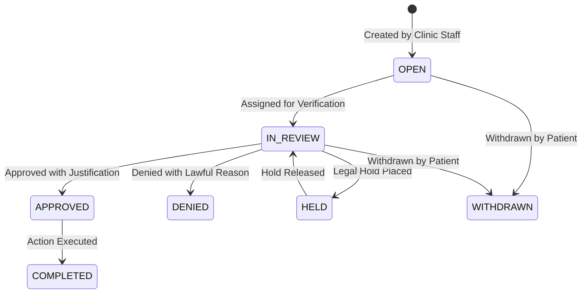

# Phase 2, Step 2.3 — Privacy, Data Retention and Data Governance

## 1. Executive Summary

Lamssa is an Arabic-first, RTL-native, multi-tenant SaaS for aesthetic clinics. This document defines the privacy engineering architecture, data classification, retention framework, rights management lifecycle, export protection, and data governance controls introduced in **Phase 2, Step 2.3**.

---

## 2. Data Inventory and Classification Matrix

All data stored, processed, or transmitted across PostgreSQL, local storage, memory, logs, backups, and external interfaces is inventoried and classified into six security tiers:

| Tier | Classification | Sensitivity & Description | Examples | Storage Location | Retention Dependency | Sharing & Disclosure Boundary |
|---|---|---|---|---|---|---|
| **Tier 1** | `AUTH_SECRET` | Critical cryptographic material, session secrets, credentials | User password hashes (Argon2id), MFA TOTP secrets (AES-256-GCM encrypted), recovery code hashes (SHA-256), session tokens, CSRF HMAC keys | `User`, `MfaRecoveryCode`, `Session`, secure environment variables | Lifespan of user/session; revoked immediately upon compromise or rotation | **Zero external disclosure**. Never sent in API responses or written to audit logs |
| **Tier 2** | `FINANCIAL` | Invoices, receipts, payments, refunds, ledger entries | Invoice lines, payment amounts, refund notes, tax calculations, hash-chained ledger events | `Invoice`, `InvoiceLine`, `Payment`, `FinancialLedgerEvent`, `ClinicBillingProfile` | Statutory retention period based on clinic operating jurisdiction (e.g., 10 years in Saudi Arabia, 5–7 years in other GCC/international jurisdictions; subject to local legal review) | Scoped strictly to clinic owner and accountant; locked at issuance; never cross-clinic |
| **Tier 3** | `SENSITIVE_PERSONAL` | Future clinical/medical notes, diagnostic records | Consultation notes, medical histories, aesthetic procedure photos | Future clinical modules (explicitly separated from current admin data) | Minimum statutory retention for health records (10+ years); requires explicit consent | Strict medical confidentiality; doctor-patient access boundary; patient rights restrictions |
| **Tier 4** | `PERSONAL` | Patient administrative & demographic information | Full name, phone number, national ID/Iqama, date of birth, emergency contact, appointment history | `Patient`, `Appointment`, `Visit`, `QueueTicket`, `PatientExport`, `PrivacyRequest` | Governed by `RetentionPolicy` (minimum 180 days default; subject to legal minimums) | Accessible to reception, doctor, clinic admin/owner within the tenant; strictly isolated by RLS |
| **Tier 5** | `INTERNAL` | Administrative configuration, clinic settings, audit trails | Clinic profile, business hours, services, rooms, audit logs, retention policies | `Clinic`, `Membership`, `AuditEvent`, `RetentionPolicy`, `Resource` | Audit minimum 90 days; clinic config lifetime of subscription | Clinic staff according to RBAC; global platform administrators (read-only); isolated by RLS |
| **Tier 6** | `PUBLIC` | White-label branding, public board displays | Clinic display name, public logo URL, primary/accent colors, anonymous queue ticket numbers | `ClinicBranding`, public queue SSE endpoint | Public cache lifetime | Public internet access via unauthenticated endpoints (no patient identity exposed) |

### Administrative Data vs Future Clinical Data
Current patient profiles are strictly **administrative**: contact details, national ID/passport numbers for billing, appointments, and waiting queue tokens. Future clinical records (aesthetic procedures, clinical charting, dermatological photographs) will reside in segregated clinical schemas with field-level encryption, heightened consent logging, and granular access boundaries.

---

## 3. Data Minimization & Privacy by Design

### Formula Injection (CSV / Excel Injection) Protection
Exported files and spreadsheet integrations are vulnerable to Dynamic Data Exchange (DDE) and formula execution attacks if user input begins with `=`, `+`, `-`, `@`, tab (`\t`), or carriage return (`\r`).
- All exported strings and tabular data pass through `sanitizeFormulaField` and `sanitizeObjectForExport` (`apps/api/src/privacy/privacy.sanitize.ts`).
- Any string starting with an active formula character is prefixed with a single quote (`'`), neutralizing spreadsheet formula execution while preserving visual legibility.

### Public Queue Anonymization
- The public waiting board endpoint (`/api/v1/clinics/:clinicId/queue/public`) and its server-sent events (SSE) feed expose **only** anonymous ticket fingerprints: ticket sequence number, service category, and calling room.
- Patient names, phone numbers, and clinical notes are **never** rendered on public boards or sent over public SSE channels.

### Audit Metadata Sanitization
- `sanitizeAuditMetadata` (`apps/api/src/audit/audit.types.ts`) recursively strips sensitive keys (e.g., `password`, `token`, `secret`, `cookie`, `card`, `cvv`, `pan`, `medicalnotes`, `nationalid`) before appending to `AuditEvent`.
- The audit table is strictly append-only, guarded by PostgreSQL RLS and trigger controls.

---

## 4. Retention Policy Framework & Dry-Run Engine

Each clinic maintains a versioned `RetentionPolicy` record (`apps/api/prisma/schema.prisma`).

### Platform Minimums
To prevent accidental destruction of compliance-critical records, the platform enforces mandatory minimums:
- **Audit Logs (`auditEventDays`)**: Minimum **90 days** (default: 365 days).
- **Backups (`backupRetentionDays`)**: Minimum **30 days** (default: 90 days).
- **Patient Administrative Records (`patientRecordDays`)**: Minimum **180 days** (default: 730 days).
- **Appointment History (`appointmentDays`)**: Minimum **90 days** (default: 365 days).
- **Export Artifacts (`exportRetentionDays`)**: Minimum **1 day** (default: 7 days).

### Dry-Run Only Architecture (No Automated Deletion)
> [!IMPORTANT]
> The `dryRunOnly` flag is permanently enforced (`CHECK (dry_run_only = TRUE)` in PostgreSQL). The platform does **NOT** perform silent, automated, or destructive batch deletion of data.

Retention simulations are executed via the security definer function:
```sql
lamssa_security.retention_dry_run(target_clinic uuid)
```
- Locked search path: `pg_catalog, pg_temp`.
- Scans `Patient`, `Appointment`, `Visit`, `Invoice`, `AuditEvent`, and `PatientExport`.
- Identifies records older than the configured threshold where no legal hold or active dependencies exist.
- Emits a structured report of eligible records without deleting a single row.

---

## 5. Privacy Rights Management (Requests Lifecycle)

The `PrivacyRequest` table tracks patient privacy requests across five types:
1. **ACCESS**: Patient request to view all personal and administrative records.
2. **CORRECTION**: Rectification of inaccurate demographic, contact, or billing data.
3. **RESTRICTION**: Limitation of processing (e.g., during dispute resolution).
4. **EXPORT**: Formal subject access data portability export.
5. **ERASURE**: Request for deletion of personal records.

### Request States & Workflow


### Optimistic Concurrency Control
Every `PrivacyRequest` modification requires matching `expectedVersion`. Concurrent status updates yield `409 Conflict`.

---

## 6. Secure Data Export & Download Protection

Patient data exports (`PatientExport`) generate a comprehensive, tenant-isolated snapshot of patient demographic, appointment, visit, and invoice history:
1. **MFA Step-Up Requirement**: Creating an export requires `@RequireStepUp(15)`, ensuring reauthentication with TOTP or recovery code within the last 15 minutes.
2. **Sanitization**: All string fields are sanitized against formula injection.
3. **Expiring, Single-Use Access**:
   - Downloads require a cryptographically secure 256-bit token (`rawToken`).
   - The database stores only `tokenHash = SHA256(rawToken)`.
   - Single-use/bounded: Max 3 downloads (`maxDownloads = 3`), expires within 24 hours.
   - Files on disk are restricted to `0600` permissions (`/var/exports/`).
4. **Immediate Revocation**: An export can be revoked on-demand, immediately deleting the disk asset and marking the database record `REVOKED`.

### Single-Use vs Bounded Multiple Downloads
- The platform implements **bounded download authorization** (`maxDownloads`, default: 3, configurable to 1 for strict single-use) with a 24-hour time-to-live.
- Each download attempt atomically increments `downloadCount`. Once `downloadCount >= maxDownloads`, status becomes `EXPIRED` and subsequent download requests fail closed with HTTP 403 `Maximum download count exceeded`.
- This ensures resilience against transient network disconnections during download while strictly preventing unrestricted distribution.

---

## 7. Backups, Financial Chains, and Deletion Limits

### Append-Only Financial and Audit Chains
- Under applicable commercial, tax, and healthcare legislation across clinic jurisdictions, issued financial invoices, payments, and credit notes are **legally immutable**.
- Financial transactions are linked via cryptographic hash chains (`FinancialLedgerEvent.currentHash = SHA256(...)`).
- Similarly, security and privacy actions are recorded in the append-only `AuditEvent` log.
- **Erasure Limitation**: An erasure request **cannot** mutate or delete issued invoices, recorded payments, or audit trails without breaking the cryptographic hash chain. Such records are retained under statutory legal exemptions applicable to each jurisdiction.

### Encrypted Backups
- Encrypted database dumps (`.dump.enc`) are point-in-time forensic archives.
- An erasure in production does not rewrite historical encrypted backups. If a disaster recovery restore is executed, privacy erasure registers must be re-applied against the restored environment.

---

## 8. Follow-up MFA Security Review: Recovery Code Alphabet & NIST SP 800-63B

### Recovery Code Charset Analysis
During the Step 2.2 and Step 2.3 security reviews, the recovery code alphabet was evaluated:
- **TOTP Secrets**: Use RFC 4648 Base32 (`ABCDEFGHIJKLMNOPQRSTUVWXYZ234567`).
- **Recovery Codes**: Implemented in `apps/api/src/auth/totp.ts` using an unambiguous 32-character Crockford-like charset:
  ```
  23456789ABCDEFGHJKLMNPQRSTUVWXYZ
  ```
  - Excludes easily confused characters: `0`, `1`, `I`, `O`.
  - Includes digits `2-9` (8 digits) + letters `A-Z` minus `I, O` (24 letters) = **exactly 32 characters**.

### Entropy Calculation
For a 16-character code chosen uniformly from a 32-character alphabet:
$$\text{Entropy} = 16 \times \log_2(32) = 16 \times 5 = 80 \text{ bits of entropy}$$

### NIST SP 800-63B Salt-and-Stretch Migration (§5.1.2 Look-Up Secrets)
- NIST SP 800-63B §5.1.2 specifies that CSP-generated look-up secrets should possess at least 112 bits of entropy when generated, **or** be verified using a salt-and-stretch algorithm (e.g. PBKDF2).
- **Salted Verifier Implementation**:
  - `hashRecoveryCode(code, salt)` now implements **PBKDF2-HMAC-SHA256** with 10,000 iterations and per-MFA salt (`mfa.id`), generating a 32-byte digest (64 hex characters) fitting the existing `CHAR(64)` database column.
  - Verification (`verifyRecoveryCode`) checks the salted PBKDF2 hash first and falls back in constant time to legacy unsalted SHA-256 verifiers.
  - **No Silent Invalidation**: Existing accounts continue to authenticate seamlessly, while newly enrolled or regenerated recovery codes automatically benefit from salted PBKDF2 protection against offline rainbow table attacks.

---

## 9. Verification & Test Evidence

All automated verification gates for Step 2.3 passed cleanly:
- **Boundary Checks**: `npm run check:boundaries` (Passed).
- **Prisma Schema Validation**: `npm run db:validate` (Passed).
- **Monorepo Build**: `npm run build` (Clean compile for `@lamssa/web` and `@lamssa/api`).
- **Unit Tests**: `npm test` (72 tests passing: 16 web + 56 api).
- **Database Integration Tests**: `npm run test:db` (191 tests passing across all 12 test suites).
- **Browser Smoke Suite**: `node scripts/patients-browser-smoke.mjs` (33/33 browser checks passing with 0 runtime errors).
