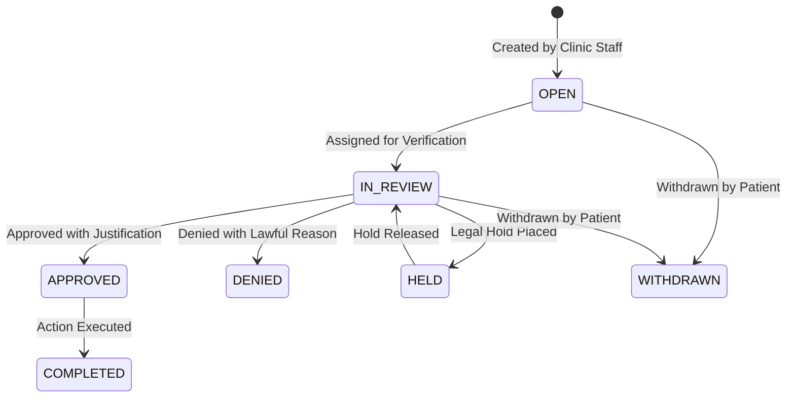

# Phase 2, Step 2.3 — Privacy, Data Retention and Data Governance

## Phase 3.1 clinical data addendum

Clinical encounters, notes, amendments, allergies, medications, assessments, and medical history are `SENSITIVE_PERSONAL`. They are covered by encrypted database backups but deliberately excluded from the current administrative export. Retention remains dry-run only; no clinical row is automatically deleted. Export scope, legal holds, access disclosure, and jurisdiction-specific retention require clinical/legal approval.

## Phase 3.2 treatment plans & procedures addendum

Aesthetic procedure catalog definitions, treatment plans, revisions, plan items, and procedure execution documentation are classified as `SENSITIVE_PERSONAL`.
- They are covered by multi-clinic encrypted database backups (`pg_dump -Fc --enable-row-security`).
- They are strictly excluded from administrative patient exports (`PatientExport`).
- Audit logging records operational metadata (`revisionNumber`, `sessionOrder`, `status`, `targetStatus`, `reason`) while strictly withholding medical content, instructions, observations, and patient identifiers.
- Retention simulation remains dry-run only; clinical rows are never automatically deleted by retention tasks.

## Phase 3.3 informed consent & signature evidence addendum

Informed consent templates, template versions, patient consents, signature evidence, and withdrawal records are classified as `SENSITIVE_PERSONAL`.
- Signature evidence (`ConsentSignatureEvidence`) contains drawn base64 image data or typed confirmation strings alongside signer capacity, relationship, and identity snapshots. It is strictly database-immutable via `consent_signature_evidence_guard`.
- Audit metadata sanitizer recursively redacts `signatureData`, `signerIdentitySnapshot`, and raw consent text bodies from general audit logs.
- Patient consent documents are strictly excluded from administrative patient exports.
- Multi-clinic encrypted database backups capture all 5 consent tables under dedicated non-bypass backup roles and verified by restoration drills.
- Retention simulation remains dry-run only; consent records and legal signature evidence are never automatically pruned.

## Phase 4.4 treatment packages, installment plans & refunds addendum

Aesthetic treatment packages, prepaid session entitlements, redemptions, installment plans, and refund requests are classified as `FINANCIAL` (Tier 2).
- Package definitions, versions, and items are clinic-scoped commercial records.
- Patient packages, session entitlements, and redemptions track clinical procedure session usage against financial transactions.
- Redemptions link to patient identity, procedure executions, and appointment visits without exposing clinical notes or medical diagnoses in billing projections.
- Installment plans and schedule allocations enforce strict financial balance constraints.
- Refund requests require explicit segregation of duties (request vs approval) and MFA step-up verification before settling against immutable payment reversals (`PaymentReversal`).
- All 11 package and installment tables enforce `FORCE ROW LEVEL SECURITY` and restricted runtime database grants.
- Statutory retention applies as with core financial invoices and ledger entries (minimum 10 years in Saudi Arabia / GCC equivalent); automated deletion is strictly prohibited (`dryRunOnly = TRUE`).

## Phase 4.5 practitioner commissions & financial reconciliation addendum

Practitioner commission plans, rules, assignments, accruals, adjustments, and settlements are classified as `FINANCIAL` (Tier 2).
- Commission plans and rules govern provider compensation models and are strictly restricted to clinic administrators and accountants.
- Accruals are derived from clinical procedures and invoices; individual doctors are granted access exclusively to their own statement records (`commissions.accruals.read-own`) without visibility into other practitioners or clinic overhead.
- Adjustments enforce segregation of duties; requesting practitioners cannot approve their own adjustment requests, and administrative settlements require elevated MFA Step-Up authorization.
- Financial reconciliation scans multi-resource transactional balances without leaking clinical diagnoses or confidential patient notes.
- All 7 commission tables enforce `FORCE ROW LEVEL SECURITY` and restricted runtime database grants.
- Statutory retention applies (minimum 10 years for compensation and financial settlement records); automated deletion is strictly prohibited.

## 1. Executive Summary

Lamssa is an Arabic-first, RTL-native, multi-tenant SaaS for aesthetic clinics. This document defines the privacy engineering architecture, data classification, retention framework, rights management lifecycle, export protection, and data governance controls introduced in **Phase 2, Step 2.3**.

---

## 2. Data Inventory and Classification Matrix

All data stored, processed, or transmitted across PostgreSQL, local storage, memory, logs, backups, and external interfaces is inventoried and classified into six security tiers:

| Tier | Classification | Sensitivity & Description | Examples | Storage Location | Retention Dependency | Sharing & Disclosure Boundary |
|---|---|---|---|---|---|---|
| **Tier 1** | `AUTH_SECRET` | Critical cryptographic material, session secrets, credentials | User password hashes (Argon2id), MFA TOTP secrets (AES-256-GCM encrypted), recovery code hashes (SHA-256), session tokens, CSRF HMAC keys | `User`, `MfaRecoveryCode`, `Session`, secure environment variables | Lifespan of user/session; revoked immediately upon compromise or rotation | **Zero external disclosure**. Never sent in API responses or written to audit logs |
| **Tier 2** | `FINANCIAL` | Invoices, receipts, payments, refunds, ledger entries, packages, installments, commissions | Invoice lines, payment amounts, refund notes, tax calculations, hash-chained ledger events, treatment packages, prepaid session redemptions, installment schedules, refund requests, practitioner commission plans, accruals, settlements | `Invoice`, `InvoiceLine`, `Payment`, `FinancialLedgerEvent`, `ClinicBillingProfile`, `TreatmentPackage`, `TreatmentPackageVersion`, `TreatmentPackageItem`, `PatientPackage`, `PatientPackageEntitlement`, `PackageRedemption`, `PackageRedemptionReversal`, `InstallmentPlan`, `InstallmentSchedule`, `InstallmentAllocation`, `RefundRequest`, `PractitionerCommissionPlan`, `PractitionerCommissionRule`, `PractitionerCommissionAssignment`, `CommissionSettlementCounter`, `PractitionerCommissionSettlement`, `PractitionerCommissionAccrual`, `PractitionerCommissionAdjustment` | Statutory retention period based on clinic operating jurisdiction (e.g., 10 years in Saudi Arabia, 5–7 years in other GCC/international jurisdictions; subject to local legal review) | Scoped strictly to clinic owner and accountant; locked at issuance; doctor own statement restricted to personal accruals; never cross-clinic |
| **Tier 3** | `SENSITIVE_PERSONAL` | Clinical/medical notes, histories, consents, photographs, follow-ups, and outcomes | Consultation notes, medical histories, treatment plans, procedure executions, informed consent signatures, encrypted clinical photographs, follow-up assessments, treatment outcomes, and adverse events | `ClinicalEncounter`, `ClinicalNote`, `ClinicalNoteAmendment`, `MedicalHistory`, `TreatmentPlan`, `ProcedureExecution`, `PatientConsent`, `ConsentSignatureEvidence`, `ClinicalPhotoSession`, `ClinicalPhoto`, `PhotoComparisonGroup`, `PhotoAnnotation`, `ClinicalFollowUp`, `FollowUpAssessment`, `FollowUpAssessmentAmendment`, `TreatmentOutcome`, `AdverseEvent` | Jurisdiction-specific duration pending legal review; automatic deletion disabled | Strict clinical confidentiality; assigned-doctor boundary; encrypted at rest via AES-256-GCM for media; digital SHA-256 signatures for assessments; excluded from administrative exports and browser storage |
| **Tier 4** | `PERSONAL` | Patient administrative & demographic information | Full name, phone number, national ID/Iqama, date of birth, emergency contact, appointment history | `Patient`, `Appointment`, `Visit`, `QueueTicket`, `PatientExport`, `PrivacyRequest` | Governed by `RetentionPolicy` (minimum 180 days default; subject to legal minimums) | Accessible to reception, doctor, clinic admin/owner within the tenant; strictly isolated by RLS |
| **Tier 5** | `INTERNAL` | Administrative configuration, inventory operations, purchasing, stock counts, clinic settings, audit trails | Clinic profile, business hours, services, rooms, audit logs, retention policies, product catalog, storage locations, stock ledger, lot registry, batch balances, suppliers, purchase orders, goods receipts, stocktaking sessions, alert acknowledgments | `Clinic`, `Membership`, `AuditEvent`, `RetentionPolicy`, `Resource`, `InventoryProduct`, `InventoryLocation`, `InventoryStockMovement`, `InventoryBalance`, `InventoryBatch`, `InventoryBatchBalance`, `InventorySupplier`, `InventoryPurchaseOrder`, `InventoryPurchaseOrderLine`, `InventoryGoodsReceipt`, `InventoryGoodsReceiptLine`, `InventoryStockCount`, `InventoryStockCountItem`, `InventoryAlertAcknowledgment` | Audit minimum 90 days; inventory movements append-only; clinic config lifetime of subscription | Clinic staff according to RBAC; global platform administrators (read-only); isolated by RLS |
| **Tier 6** | `PUBLIC` | White-label branding, public board displays | Clinic display name, public logo URL, primary/accent colors, anonymous queue ticket numbers | `ClinicBranding`, public queue SSE endpoint | Public cache lifetime | Public internet access via unauthenticated endpoints (no patient identity exposed) |

### Administrative Data vs Clinical & Photography Data
Patient profiles remain strictly **administrative**. Clinical consultations, treatment plans, informed consents, signature evidence, and clinical photographs (`ClinicalPhoto`, `ClinicalPhotoSession`) are stored in separate clinic-owned tables with granular doctor-only permissions, encrypted backups, FORCE RLS, and dedicated AES-256-GCM encryption at rest for media assets. EXIF and GPS metadata are stripped prior to storage. Clinical photography consent (`CLINICAL_PHOTOGRAPHY`) strictly governs medical chart photography and is separate from external marketing consent (`MARKETING_PHOTOGRAPHY`).

### Inventory Clinical Consumption Confidentiality Boundary
`InventoryClinicalConsumption` links physical product lots to `ProcedureExecution`. To protect patient privacy while allowing operational inventory audits:
- Warehouse and inventory administrative personnel can view operational attributes (`quantity`, `wasteQuantity`, `unit`, `batchNumber`, `locationId`, `status`) to track physical inventory and shrinkage.
- Clinical consultation notes, diagnostic findings, and procedure details remain strictly restricted to treating clinicians and are redacted/omitted from inventory reporting projections.

---

## 3. Data Minimization & Privacy by Design

### Formula Injection (CSV / Excel Injection) Protection
Exported files and spreadsheet integrations are vulnerable to Dynamic Data Exchange (DDE) and formula execution attacks if user input begins with `=`, `+`, `-`, `@`, tab (`\t`), or carriage return (`\r`).
- All exported strings and tabular data pass through `sanitizeFormulaField` and `sanitizeObjectForExport` (`apps/api/src/privacy/privacy.sanitize.ts`).
- Any string starting with an active formula character is prefixed with a single quote (`'`), neutralizing spreadsheet formula execution while preserving visual legibility.

### Public Queue Anonymization
- The public waiting board endpoint (`/api/v1/clinics/:clinicId/queue/public`) and its server-sent events (SSE) feed expose **only** anonymous ticket fingerprints: ticket sequence number, service category, and calling room.
- Patient names, phone numbers, and clinical notes are **never** rendered on public boards or sent over public SSE channels.

### Audit Metadata Sanitization
- `sanitizeAuditMetadata` (`apps/api/src/audit/audit.types.ts`) recursively strips sensitive keys (e.g., `password`, `token`, `secret`, `cookie`, `card`, `cvv`, `pan`, `medicalnotes`, `nationalid`) before appending to `AuditEvent`.
- The audit table is strictly append-only, guarded by PostgreSQL RLS and trigger controls.

---

## 4. Retention Policy Framework & Dry-Run Engine

Each clinic maintains a versioned `RetentionPolicy` record (`apps/api/prisma/schema.prisma`).

### Platform Minimums
To prevent accidental destruction of compliance-critical records, the platform enforces mandatory minimums:
- **Audit Logs (`auditEventDays`)**: Minimum **90 days** (default: 365 days).
- **Backups (`backupRetentionDays`)**: Minimum **30 days** (default: 90 days).
- **Patient Administrative Records (`patientRecordDays`)**: Minimum **180 days** (default: 730 days).
- **Appointment History (`appointmentDays`)**: Minimum **90 days** (default: 365 days).
- **Export Artifacts (`exportRetentionDays`)**: Minimum **1 day** (default: 7 days).

### Dry-Run Only Architecture (No Automated Deletion)
> [!IMPORTANT]
> The `dryRunOnly` flag is permanently enforced (`CHECK (dry_run_only = TRUE)` in PostgreSQL). The platform does **NOT** perform silent, automated, or destructive batch deletion of data.

Retention simulations are executed via the security definer function:
```sql
lamssa_security.retention_dry_run(target_clinic uuid)
```
- Locked search path: `pg_catalog, pg_temp`.
- Scans `Patient`, `Appointment`, `Visit`, `Invoice`, `AuditEvent`, and `PatientExport`.
- Identifies records older than the configured threshold where no legal hold or active dependencies exist.
- Emits a structured report of eligible records without deleting a single row.

---

## 5. Privacy Rights Management (Requests Lifecycle)

The `PrivacyRequest` table tracks patient privacy requests across five types:
1. **ACCESS**: Patient request to view all personal and administrative records.
2. **CORRECTION**: Rectification of inaccurate demographic, contact, or billing data.
3. **RESTRICTION**: Limitation of processing (e.g., during dispute resolution).
4. **EXPORT**: Formal subject access data portability export.
5. **ERASURE**: Request for deletion of personal records.

### Request States & Workflow


### Optimistic Concurrency Control
Every `PrivacyRequest` modification requires matching `expectedVersion`. Concurrent status updates yield `409 Conflict`.

---

## 6. Secure Data Export & Download Protection

Patient data exports (`PatientExport`) generate a comprehensive, tenant-isolated snapshot of patient demographic, appointment, visit, and invoice history:
1. **MFA Step-Up Requirement**: Creating an export requires `@RequireStepUp(15)`, ensuring reauthentication with TOTP or recovery code within the last 15 minutes.
2. **Sanitization**: All string fields are sanitized against formula injection.
3. **Expiring, Single-Use Access**:
   - Downloads require a cryptographically secure 256-bit token (`rawToken`).
   - The database stores only `tokenHash = SHA256(rawToken)`.
   - Single-use/bounded: Max 3 downloads (`maxDownloads = 3`), expires within 24 hours.
   - Files on disk are restricted to `0600` permissions (`/var/exports/`).
4. **Immediate Revocation**: An export can be revoked on-demand, immediately deleting the disk asset and marking the database record `REVOKED`.

### Single-Use vs Bounded Multiple Downloads
- The platform implements **bounded download authorization** (`maxDownloads`, default: 3, configurable to 1 for strict single-use) with a 24-hour time-to-live.
- Each download attempt atomically increments `downloadCount`. Once `downloadCount >= maxDownloads`, status becomes `EXPIRED` and subsequent download requests fail closed with HTTP 403 `Maximum download count exceeded`.
- This ensures resilience against transient network disconnections during download while strictly preventing unrestricted distribution.

---

## 7. Backups, Financial Chains, and Deletion Limits

### Append-Only Financial and Audit Chains
- Under applicable commercial, tax, and healthcare legislation across clinic jurisdictions, issued financial invoices, payments, and credit notes are **legally immutable**.
- Financial transactions are linked via cryptographic hash chains (`FinancialLedgerEvent.currentHash = SHA256(...)`).
- Similarly, security and privacy actions are recorded in the append-only `AuditEvent` log.
- **Erasure Limitation**: An erasure request **cannot** mutate or delete issued invoices, recorded payments, or audit trails without breaking the cryptographic hash chain. Such records are retained under statutory legal exemptions applicable to each jurisdiction.

### Encrypted Backups
- Encrypted database dumps (`.dump.enc`) are point-in-time forensic archives.
- An erasure in production does not rewrite historical encrypted backups. If a disaster recovery restore is executed, privacy erasure registers must be re-applied against the restored environment.

---

## 8. Follow-up MFA Security Review: Recovery Code Alphabet & NIST SP 800-63B

### Recovery Code Charset Analysis
During the Step 2.2 and Step 2.3 security reviews, the recovery code alphabet was evaluated:
- **TOTP Secrets**: Use RFC 4648 Base32 (`ABCDEFGHIJKLMNOPQRSTUVWXYZ234567`).
- **Recovery Codes**: Implemented in `apps/api/src/auth/totp.ts` using an unambiguous 32-character Crockford-like charset:
  ```
  23456789ABCDEFGHJKLMNPQRSTUVWXYZ
  ```
  - Excludes easily confused characters: `0`, `1`, `I`, `O`.
  - Includes digits `2-9` (8 digits) + letters `A-Z` minus `I, O` (24 letters) = **exactly 32 characters**.

### Entropy Calculation
For a 16-character code chosen uniformly from a 32-character alphabet:
$$\text{Entropy} = 16 \times \log_2(32) = 16 \times 5 = 80 \text{ bits of entropy}$$

### NIST SP 800-63B Salt-and-Stretch Migration (§5.1.2 Look-Up Secrets)
- NIST SP 800-63B §5.1.2 specifies that CSP-generated look-up secrets should possess at least 112 bits of entropy when generated, **or** be verified using a salt-and-stretch algorithm (e.g. PBKDF2).
- **Salted Verifier Implementation**:
  - `hashRecoveryCode(code, salt)` now implements **PBKDF2-HMAC-SHA256** with 10,000 iterations and per-MFA salt (`mfa.id`), generating a 32-byte digest (64 hex characters) fitting the existing `CHAR(64)` database column.
  - Verification (`verifyRecoveryCode`) checks the salted PBKDF2 hash first and falls back in constant time to legacy unsalted SHA-256 verifiers.
  - **No Silent Invalidation**: Existing accounts continue to authenticate seamlessly, while newly enrolled or regenerated recovery codes automatically benefit from salted PBKDF2 protection against offline rainbow table attacks.

---

## 9. Verification & Test Evidence

All automated verification gates for Step 2.3 passed cleanly:
- **Boundary Checks**: `npm run check:boundaries` (Passed).
- **Prisma Schema Validation**: `npm run db:validate` (Passed).
- **Monorepo Build**: `npm run build` (Clean compile for `@lamssa/web` and `@lamssa/api`).
- **Unit Tests**: `npm test` (72 tests passing: 16 web + 56 api).
- **Database Integration Tests**: `npm run test:db` (191 tests passing across all 12 test suites).
- **Browser Smoke Suite**: `node scripts/patients-browser-smoke.mjs` (33/33 browser checks passing with 0 runtime errors).

---

## 10. Phase 5 Privacy, Consent, Branch Governance, Costing & Payment Security Addendum

### 10.1 Patient Portal Identity & Dual-Session Isolation (Step 5.1 & 5.2)
- **Principal Segregation**: Patient credentials (`PatientAccount`, `PatientSession`) operate in an isolated domain completely decoupled from staff credentials (`User`, `Session`). Staff credentials cannot authenticate patient endpoints, and patient sessions cannot access clinical administration or financial systems.
- **Intra-Clinic Data Isolation**: Hardened PostgreSQL RLS helper `lamssa_security.patient_row_allows(target_clinic, target_patient)` strictly confines patient queries to their authenticated records. Cross-patient and cross-clinic access is denied at the database engine level.
- **PHI Projection Defense**: Patient portal endpoints project strictly filtered demographic, appointment, and consent summaries. Clinicians' private internal notes, staff audit logs, and internal cost layers are inaccessible.
- **Consent Governance & Cryptographic Digests**: Consent forms generate deterministic SHA-256 digests binding the legal text to the patient's signature evidence. Procedure execution is gated fail-closed on verified clinician review (`ConsentEligibilityService`).

### 10.2 Multi-Branch Data Governance (Step 5.3)
- **Branch-Level Access Scoping**: `BranchMembership` constrains operational staff (nurses, receptionists) to their assigned branch. Clinic owners and administrators retain organization-wide oversight.
- **Physical Custody Audit**: Inter-branch stock transfers enforce a two-step custodial trail (`DISPATCHED` ➔ `RECEIVED`) with recorded custody timestamps, tracking discrepancies explicitly.

### 10.3 Inventory Cost Accounting Governance (Step 5.4)
- **Segregation of Duties**: Physical procedure dispensing uses FEFO (`InventoryBatch`) for patient safety, while financial valuation uses FIFO (`InventoryCostLayer`). Clinical dispensed lot tracking remains unmutated by financial cost adjustments.
- **Dual-Control Authorization**: Cost layer revaluations and opening balance verifications require segregated approval permissions (`inventory.costing.approve`).

### 10.4 Payment Integrations & Webhook Ingestion Hardening (Step 5.5 & 5.6)
- **Zero Cardholder Data Storage**: No primary account numbers (PAN), CVVs, or card magnetic track data are received or stored.
- **Secret Encryption at Rest**: External payment provider keys and webhook secrets are encrypted at rest with AES-256-GCM + HKDF-SHA256 key derivation.
- **Elimination of Custom GUC Bypass**: Custom session bypass flags (`lamssa.internal_security_lookup`) were eliminated from all RLS policies and replaced with standard PostgreSQL `maintenance_owner` policies across all 15 integration tables (93 tables total under `FORCE ROW LEVEL SECURITY`).
- **Authenticated Webhook Call Validation**: The `SECURITY DEFINER` function `post_webhook_payment` requires matching session context, active clinic status, payable intent status, and an authentic, fresh (<5 min) `PaymentProviderEvent` in `RECEIVED` status. Replay attacks are permanently blocked by transitioning the event to `PROCESSED`.
