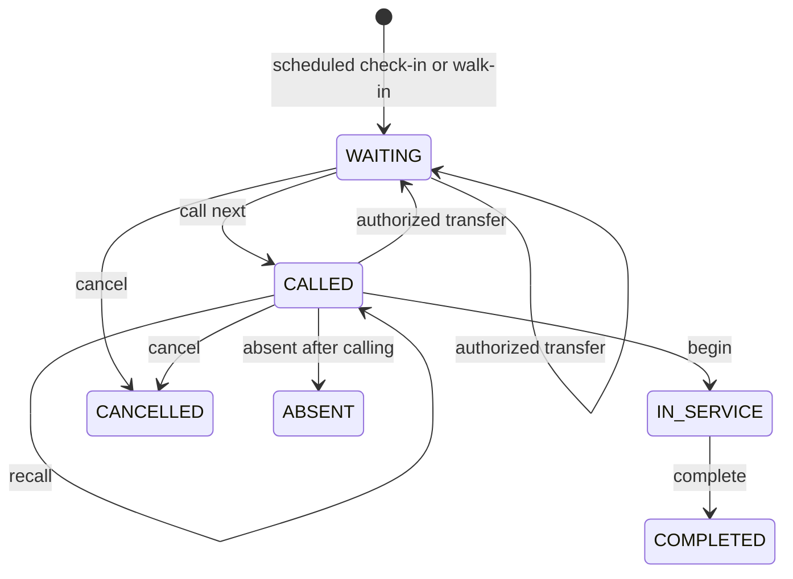

# Visits and live patient queues — Step 1.7

Administrative attendance only. No diagnosis, consultation text, photographs,
treatment records, medical history or billing information is added. Use fictional
data while production privacy and operational controls remain under review.

## Stored records

| Model | Stored purpose and constraints |
| --- | --- |
| Visit | UUID, immutable clinic/patient/source/optional appointment, request key/hash, checked-in/started/ended timestamps, status/version, creation/update timestamps. At most one visit per appointment and one active visit per clinic/patient. |
| QueueTicket | One per visit; immutable clinic, visit, local business date and daily number; membership-linked doctor resource, optional room; status, queue/call timestamps, recall count/version and creation/update timestamps. |
| QueueCounter | Composite primary key `(clinicId, businessDate)` and positive monotonic last number. Never decremented or reused; runtime cannot delete it. |
| QueueConfiguration | Clinic primary key, explicit `publicDisplayEnabled` (false by default), optimistic version and update timestamp. No default public publication. |
| QueueCommand | Immutable UUID, clinic/request-key unique pair, canonical SHA-256 request hash, nullable resulting ticket and creation timestamp. Call-next retries return their original result, including an empty result. No update/delete runtime grant. |

Relations use RESTRICT and same-clinic composite foreign keys. Doctor/room references
also include their fixed resource kind. Doctor identity remains the existing active
clinic membership; a second unrelated user identity is never created by queue actions.
Patient names/contact details are not copied into visits or tickets. Protected response
DTOs join only patient UUID, readable patient number and display name; no phone/email,
birth date, user email, request hashes or session identifiers are returned.

Numbers are `Q-0001` through `Q-999999`, unique per **clinic and local check-in date**,
across all doctor queues. Width grows above 9999. Exhaustion fails rather than wraps.
Transfers retain number/date. Business date uses the clinic's configured IANA timezone;
timestamps remain UTC-compatible timestamptz. DST never makes the instant ambiguous:
queue commands use server instants, not browser wall time. Browser display always uses
clinic time. A number alone is not a globally unique visit/patient identity.

## Lifecycle and concurrency

Visit states are WAITING, IN_SERVICE, COMPLETED, CANCELLED, NO_SHOW. A CALLED ticket
still has a WAITING visit; ABSENT maps to NO_SHOW. Check-in atomically changes an
appointment to ARRIVED and creates its visit/ticket/counter update. Repeated requests
return the same active check-in even with the original appointment version. There is
no duplicate arrival, automatic localStorage import or migration backfill.

An ARRIVED appointment from before this migration requires explicit POST `reconcile`
with its current version. This affects only that selected appointment and is idempotent.
The regular check-in route refuses a legacy ARRIVED row missing its visit. Staff may
explicitly check in early/late; the ticket date reflects attendance, not scheduled date.
Inactive patients cannot start a new visit, but existing attendance can be completed.

Completion requires IN_SERVICE. Cancellation accepts WAITING/CALLED only; absence
requires CALLED. Terminal records cannot reopen or reschedule. These actions update
visit, ticket and any appointment together. Appointment ARRIVED → COMPLETED remains
available only with an IN_SERVICE linked ticket and completion permission; the Arabic
appointment modal directs staff to the queue. Queue cancellation/absence explicitly
extends ARRIVED → CANCELLED/NO_SHOW, preserving scheduling's other terminal guards.

All writes acquire the existing clinic `SchedulingState` row through an upsert inside
the authorized interactive transaction. This serializes arrival, call-next, transfer,
configuration and scheduling writes with a consistent lock order. It is deliberately
coarse; unrelated clinics remain independent. There is no session-global tenant SET.

The counter increment and visit/ticket inserts commit or roll back together. Database
partial unique indexes enforce at most one CALLED/IN_SERVICE ticket per doctor and
per assigned room, **without a business-date qualifier**. Midnight never frees an
unfinished claim. Runtime SQL tests exercise these indexes independently of the
application lock. Deferred invoker constraint triggers verify visit/ticket/appointment
state and patient consistency at transaction commit. Missing visits on untouched old
ARRIVED appointments are allowed until explicit reconciliation.

Call-next orders WAITING rows by `queuedAt, id` across all dates for the requested
doctor. If the first row's room is occupied, return 409; do not silently skip it.
Transfers are permitted only before service, append to the target queue and clear an
old call. Required rooms for scheduled services cannot be removed. Walk-ins may omit
a room. Live attendance does not alter the original appointment's reserved resources
or reserve additional calendar times; scheduling transfer/rescheduling remains a
separate workflow. Closed/time-off schedules govern bookings; an authorized staff
member explicitly manages actual attendance with active resources.

Call-next requires a fresh UUID request key per intentional command. Retry with the
same key and doctor to replay; changing the payload with a key yields 409. A new key
while a doctor/room is occupied also yields 409. Other ticket mutations require
`expectedVersion`; stale changes return 409 and should be refreshed before retrying.

## Permissions and API contracts

All private paths start `/api/v1/clinics/:clinicId/queue`. Verified selected-clinic
membership, active user/clinic and database tenant context are checked again inside
the repository. Doctor requests are limited to their own membership-linked resource,
including read filters and ticket actions. Browser role/clinic/resource claims confer
no authority. PLATFORM_ADMIN has no implicit bypass; accountants have no queue access.

| Capability | Owner | Admin | Doctor | Receptionist | Accountant |
| --- | --- | --- | --- | --- | --- |
| queue.read | Yes | Yes | Own resource | Yes | No |
| queue.manage: call/recall/absent/cancel | Yes | Yes | Own resource | Yes | No |
| queue.checkin: scheduled/walk-in/reconcile | Yes | Yes | No | Yes | No |
| queue.transfer | Yes | Yes | No | Yes | No |
| queue.complete: begin/complete service | Yes | Yes | Own resource | No | No |
| clinic.settings.update: public display setting | Yes | Yes | No | No | No |

Doctor appointment arrival remains supported through `appointments.update` plus
`queue.manage` and a check against their own resource. The dedicated reception
check-in endpoints require `queue.checkin`. No clinical-record or financial permission
is implied by administrative service completion.

| Method / suffix | Required permission / body |
| --- | --- |
| GET `/` | queue.read; scope LIVE (active, including carry-over) or DAY; optional date/doctorResourceId/status/cursor, pageSize 1–100 (default 50) |
| GET `/resources` | queue.read; approved active resources, clinic timezone/today and public-display flag/version; max 200 resources |
| GET `/events` | queue.read; cookie-authenticated SSE invalidations |
| POST `/check-in` | queue.checkin; appointmentId, expectedVersion |
| POST `/reconcile` | queue.checkin; existing ARRIVED appointmentId, expectedVersion |
| POST `/walk-ins` | queue.checkin; patientId, doctorResourceId, optional roomResourceId, requestKey |
| POST `/call-next` | queue.manage; doctorResourceId, requestKey; `{ticket: TicketDto or null}` |
| PATCH `/tickets/:ticketId` | queue.manage; action RECALL/START/COMPLETE/ABSENT/CANCEL, expectedVersion; START/COMPLETE additionally queue.complete |
| PATCH `/tickets/:ticketId/transfer` | queue.transfer; doctorResourceId, optional roomResourceId, expectedVersion |
| PATCH `/configuration` | clinic.settings.update; publicDisplayEnabled, expectedVersion; first creation uses version 1 |

POST returns 201, PATCH/GET 200. Every unsafe request uses the existing cookie,
explicit Origin and CSRF token flow. Validation rejects unknown/oversized/forged
fields. Foreign/missing ticket and resource IDs have safe indistinguishable 404s
within an authorized clinic. Stale state/claim/replay conflicts return safe 409s.
There is no hard-delete API, generic query endpoint, staff CRUD or clinical content.

## RLS and public display boundary

Migration `20261025000200_visits_queue` adds the models, indexes, checks and trigger
functions in a transaction. All five tables ENABLE and FORCE RLS, with separate
SELECT/INSERT/UPDATE/DELETE policies and explicit owner maintenance policies.
Runtime DELETE is denied on all five; QueueCommand UPDATE is also denied.
Other new tables allow only scoped SELECT/INSERT/UPDATE. Runtime roles remain
non-owner, non-superuser and NOBYPASSRLS, cannot modify policies or assume the owner.
`PrismaService.assertRuntimeRole` includes all five objects. No unrestricted feature
repository, raw SQL handle or unverified principal is exposed.

The sole new privileged read path is `lamssa_security.public_queue(text)`: fixed
schema-qualified SQL, fixed `pg_catalog,pg_temp` search path, PUBLIC execution revoked,
explicit runtime execute grant. It checks active clinic and opt-in configuration,
then projects at most 50 CALLED/IN_SERVICE tickets with number/date/status/call/recall
and safe doctor/room labels. No Patient, Visit, Appointment or User joins are present.
The HTTP response adds existing intentionally public clinic branding and timezone.
Disabled/suspended/missing clinics return 404. Public endpoints:

- GET `/api/v1/public/clinics/:slug/queue`
- GET `/api/v1/public/clinics/:slug/queue/events`
- Frontend `/waiting/:slug`, accessible without login.

Publishing requires an explicit owner/admin action and Arabic confirmation that labels
will become public. A slug is public identification, never authorization. Avoid patient
identifiers or inappropriate private text in resource labels. Ticket numbers/date may
still reveal attendance to observers who already know a person's number; use the board
only after the clinic's publication/privacy policy has been reviewed.

## Live updates and frontend behavior

SSE uses the same secure session cookie; there are no URL credentials or browser-stored
bearer tokens. Every two-second private poll opens a short authorized transaction to
check the current session, authorization fingerprint, selected clinic, membership and
revision. Logout, idle/absolute expiry, selection rotation or suspension closes the
stream with `access-ended`; the frontend rechecks via REST and locks on authentication
failure. These poll transactions do not call recordActivity; ordinary authorized HTTP
requests retain the existing session activity semantics.

Streams send `resync` revision invalidations and heartbeats, without patient DTOs.
Reconnect always fetches a current bounded REST snapshot; no Last-Event-ID replay
guarantee is claimed. Public streams hash only the approved public projection, never
the private scheduling revision. Public withdrawal closes the stream and clears the
board. HTTP fallback polls every 15 seconds. Both app and public route cancel scopes
on unmount; clinic selection remounts the authenticated app and closes old streams.
Late snapshots, writes and queued stream events cannot repopulate a switched clinic.
The server day returned by snapshots advances the default date after clinic-local
midnight; historical dates remain selectable.

The Arabic RTL reception screen supports check-in, explicit reconciliation, walk-ins,
doctor filtering, call/recall, transfer/cancel, active carry-over and dated history.
Doctor view shows its own queue with begin/complete controls. Forms allow an explicit appointment date, including historical reconciliation, and bounded
patient/appointment paging, Arabic errors, busy/empty states and focus-trapped dialogs.
Public desktop/mobile board shows no patient identity. The existing localStorage key
and data shape are untouched; the old queue is an explicit demo modal. Invoice and
dashboard demos remain labeled. API identities never enter local/sessionStorage.

## Extension and remaining operational work

When adding tenant models, extend tenant delegates and runtime-role ownership checks,
write ENABLE/FORCE policies and same-clinic FKs, review grants and functions, and test
with actual runtime credentials. Use the clinic writer lock consistently for any
new operation affecting attendance/calendar claims. Never weaken RLS to fix setup.
Keep published projections separate from private repository callbacks. Follow
[development setup and verification](development.md) for safe migration commands.

This is not a production-readiness claim. Clinic-wide serialization limits throughput;
SSE polling is capped in-process at 100 streams / 8 per IP, with 15-minute stream
lifetimes and bounded buffers. Distributed connection/rate controls, reverse-proxy
buffering/timeouts, HTTPS, monitoring/backups, audit/event retention, command-ledger
retention, MFA and clinical/privacy review remain deployment work. History retains
visit/ticket records, not a complete immutable action/transfer audit trail. RLS is
defense against accidental tenant access, not compromised trusted-runtime SQL or owner
credentials. Appointment corrections, clinician notes and production billing are
separate phases. No invoice/payment backend or automatic demo migration is introduced.
