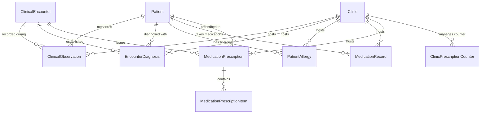
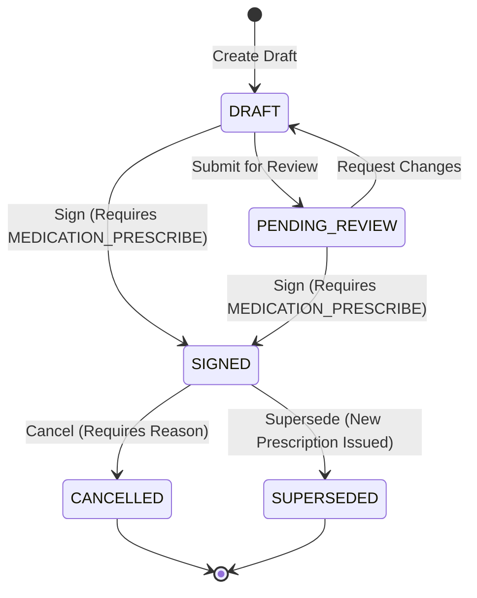

# Lamssa — Shared Clinical Data Foundation

**Version:** 1.0.0 (Phase 6, Step 6.3 Specification)  
**Date:** 2026-11-13  
**Status:** Implemented & Verified  
**Language:** English (Technical Documentation) / Arabic-first RTL (UI Experience)  
**Target Migration:** `20261113000200_shared_clinical_foundation`

---

## 1. Executive Summary & Objectives

In Phase 6, Step 6.3, Lamssa establishes the specialty-neutral, shared clinical data foundation required to support comprehensive medical outpatient care (general medicine, dermatology, pediatrics, obstetrics/gynecology, ophthalmology, ENT, orthopedics, physiotherapy, and aesthetics) without duplicating or fragmenting patient records.

The system delivers:

1. **Structured Observations & Vital Signs (`ClinicalObservation`):** Specialty-neutral physiological measurements with decimal precision (`Numeric(10,3)`), unit validation, reference ranges, deterministic Body Mass Index (BMI) auto-calculation, and physiological safety bounds.
2. **Encounter Diagnoses & Longitudinal Problem Lists (`EncounterDiagnosis`):** Structured diagnostic coding supporting ICD-10 and local vocabularies, strict primary vs. secondary designation per encounter, chronic problem list tracking, and confirmation status workflow.
3. **Patient Allergy & Adverse Drug Reaction Register (`PatientAllergy`):** Comprehensive allergy records categorized by allergen type (drug, food, environment, biological), clinical severity, verification status, and explicit "Known No Allergies" (NKA) declarations.
4. **Prescription Pre-Flight Safety Checks:** Real-time pre-flight conflict detection querying active patient allergies against prescribed medications before signature.
5. **Medication Reconciliation & History (`MedicationRecord`):** Structured medication history capturing chronic and acute regimens, dose, frequency, route, indications, and clinical reconciliation provenance without automated inventory consumption or dispensing.
6. **Controlled Outpatient Prescriptions (`MedicationPrescription` & `MedicationPrescriptionItem`):** Atomic prescription numbering (`RX-000001`), state machine lifecycle (`DRAFT` → `PENDING_REVIEW` → `SIGNED` → `CANCELLED` / `SUPERSEDED`), mandatory `MEDICATION_PRESCRIBE` clinical privilege enforcement, cryptographic SHA-256 tamper-evident digest sealing, and immutable signed records.
7. **Clinical Privacy, Concurrency, and Tenancy Integrity:** Strict row-level security (`FORCE ROW LEVEL SECURITY`), immutable `clinicId` enforcement, optimistic concurrency locking, and zero cross-tenant leakage.
8. **Arabic-First RTL Clinical Interface:** Intuitive, clinician-friendly consultation workspace featuring vital signs recording, ICD-10 diagnosis picker, allergy conflict badges, medication reconciliation tables, and prescription signing dialogs.

---

## 2. Entity Model & Relational Architecture

The clinical data foundation is backed by 7 dedicated relational tables introduced via migration `20261113000200_shared_clinical_foundation`:



### Table Specifications

| Table | Scope | Primary Key / Unique Keys | Security Invariants | Immutability & Concurrency |
| :--- | :--- | :--- | :--- | :--- |
| `ClinicalObservation` | Tenant Scoped | `id` (UUID), `(clinicId, id)` UNIQUE | `FORCE ROW LEVEL SECURITY`; `immutable_clinic` trigger | Optimistic locking via `version`; `clinical_observation_guard()` prevents direct value mutation once `VERIFIED` |
| `EncounterDiagnosis` | Tenant Scoped | `id` (UUID), `(clinicId, id)` UNIQUE, `idx_encounter_primary_diagnosis` partial unique index | `FORCE ROW LEVEL SECURITY`; `immutable_clinic` trigger | Primary diagnosis uniqueness enforced per encounter; auto-demotion of prior primary |
| `PatientAllergy` | Tenant Scoped | `id` (UUID), `(clinicId, id)` UNIQUE | `FORCE ROW LEVEL SECURITY`; `immutable_clinic` trigger | Clinician verification tracking; NKA exclusivity |
| `MedicationRecord` | Tenant Scoped | `id` (UUID), `(clinicId, id)` UNIQUE | `FORCE ROW LEVEL SECURITY`; `immutable_clinic` trigger | Reconciliation provenance; decoupled from physical inventory |
| `MedicationPrescription` | Tenant Scoped | `id` (UUID), `(clinicId, id)` UNIQUE, `(clinicId, prescriptionNumber)` UNIQUE | `FORCE ROW LEVEL SECURITY`; `immutable_clinic` trigger; `MEDICATION_PRESCRIBE` privilege check | `prescription_immutability_guard()` enforces immutable content and metadata once `SIGNED` |
| `MedicationPrescriptionItem` | Tenant Scoped | `id` (UUID), `(clinicId, id)` UNIQUE, `(clinicId, prescriptionId, itemOrder)` INDEX | `FORCE ROW LEVEL SECURITY`; cascade foreign key with prescription | `prescription_item_guard()` blocks inserts, updates, or deletes on signed or closed prescriptions |
| `ClinicPrescriptionCounter` | Tenant Scoped | `clinicId` (UUID PK) | `FORCE ROW LEVEL SECURITY`; restricted runtime access | Atomic increment counter generating sequential prescription numbers (`RX-000001`) |

---

## 3. Vital Signs & Observation Engine

### Physiological Parameters & Units

The observation engine validates input against standard physiological bounds and units:

| Type (`ObservationType`) | Measurement | Standard Units | Physiological Bounds | Reference Range |
| :--- | :--- | :--- | :--- | :--- |
| `BLOOD_PRESSURE_SYSTOLIC` | Systolic arterial pressure | `mmHg` | 40 – 300 | 90 – 120 mmHg |
| `BLOOD_PRESSURE_DIASTOLIC`| Diastolic arterial pressure | `mmHg` | 20 – 200 | 60 – 80 mmHg |
| `HEART_RATE` | Cardiac pulse | `bpm` | 20 – 300 | 60 – 100 bpm |
| `RESPIRATORY_RATE` | Ventilation rate | `breaths/min` | 4 – 80 | 12 – 20 breaths/min |
| `BODY_TEMPERATURE` | Core body temperature | `°C`, `°F` | 30.0 – 45.0 °C (86.0 – 113.0 °F) | 36.5 – 37.5 °C |
| `OXYGEN_SATURATION` | Peripheral capillary $SpO_2$ | `%` | 50 – 100 | 95 – 100% |
| `BODY_HEIGHT` | Stature | `cm`, `m`, `in` | 20 – 260 cm | Dependent on age/gender |
| `BODY_WEIGHT` | Mass | `kg`, `lb` | 0.5 – 500.0 kg | Dependent on stature |
| `BODY_MASS_INDEX` | Quetelet index | `kg/m²` | 5.0 – 100.0 | 18.5 – 24.9 kg/m² |
| `BLOOD_GLUCOSE` | Serum/capillary glucose | `mg/dL`, `mmol/L` | 10 – 1500 mg/dL | 70 – 140 mg/dL |
| `PAIN_SCALE` | Numeric Rating Scale (NRS) | `score` | 0 – 10 | 0 (no pain) |
| `HEAD_CIRCUMFERENCE` | Pediatric cranial perimeter | `cm`, `in` | 20 – 70 cm | Pediatric percentile curve |

### BMI Deterministic Calculation

When both `BODY_HEIGHT` (in cm) and `BODY_WEIGHT` (in kg) are recorded for a patient, the system deterministically calculates the Body Mass Index:

$$\text{BMI} = \frac{\text{weight in kg}}{(\text{height in meters})^2} = \frac{\text{weight in kg}}{(\text{height in cm} / 100)^2}$$

The value is rounded to 2 decimal places and automatically recorded under observation type `BODY_MASS_INDEX` with standard unit `kg/m²`.

---

## 4. Encounter Diagnoses & Longitudinal Problem Lists

### Primary vs. Secondary Diagnoses
- Every encounter can have at most one **Primary Diagnosis** (`isPrimary = true`).
- Enforced at the database layer via partial unique index:
  ```sql
  CREATE UNIQUE INDEX idx_encounter_primary_diagnosis
    ON public."EncounterDiagnosis"("clinicId", "encounterId")
    WHERE "isPrimary" = true;
  ```
- When a clinician marks a new diagnosis as primary for an encounter, any existing primary diagnosis for that encounter is transactionally updated to secondary (`isPrimary = false`).

### Longitudinal Problem List
- Chronic or active conditions requiring longitudinal management across visits are marked `isProblemList = true`.
- Clinicians can filter the patient's record to display active ongoing medical conditions separate from acute episodic encounter findings.
- Diagnosis lifecycle: `SUSPECTED` → `PROVISIONAL` → `CONFIRMED` → `REFUTED` / `RESOLVED`.

---

## 5. Patient Allergy Register & Pre-Flight Prescription Warnings

### Allergy Classification & Safety
- **Allergen Types (`AllergenType`):** `DRUG`, `FOOD`, `ENVIRONMENTAL`, `BIOLOGICAL`, `OTHER`.
- **Severity (`AllergySeverity`):** `MILD`, `MODERATE`, `SEVERE`, `LIFE_THREATENING`.
- **Verification (`AllergyVerificationStatus`):** `SUSPECTED`, `PATIENT_REPORTED`, `CONFIRMED`, `REFUTED`, `RESOLVED`.
- **Known No Allergies (NKA):** Explicitly declared via `allergenType = 'DRUG'` with allergen name `"NO_KNOWN_ALLERGIES"` or flag, ensuring active documentation rather than assumption of absence.

### Pre-Flight Safety Conflict Checker
When a clinician drafts or signs a prescription, the backend queries the patient's active allergies (`status = 'CONFIRMED'` or `'PATIENT_REPORTED'`):
1. Normalizes medication names and active ingredients (case-insensitive substring and exact matches).
2. If a conflict is detected, the API generates a high-severity warning list detailing the conflicting medication, allergen name, severity, and manifestation.
3. The clinician must explicitly acknowledge the clinical allergy warning with documented rationale before proceeding with the signature.

---

## 6. Controlled Outpatient Prescriptions

### Sequential Numbering
Prescription identifiers follow an atomic sequential pattern scoped to the clinic: `RX-000001`, `RX-000002`, etc. This is generated via the dedicated counter table `ClinicPrescriptionCounter` with row-level locks preventing gaps or duplicates.

### Prescription Lifecycle State Machine


### Cryptographic Tamper-Evident Digest
Upon signature, the system compiles a deterministic canonical JSON payload of the prescription:
```json
{
  "prescriptionNumber": "RX-000001",
  "clinicId": "...",
  "patientId": "...",
  "encounterId": "...",
  "prescriberMembershipId": "...",
  "signedAt": "2026-11-13T03:00:00.000Z",
  "items": [
    {
      "itemOrder": 1,
      "medicationName": "Amoxicillin",
      "dosage": "500mg",
      "frequency": "Three times daily",
      "route": "ORAL",
      "durationDays": 7,
      "quantity": 21
    }
  ]
}
```
The canonical payload is hashed using SHA-256 (`hex`), and the resulting digest is stored permanently in `signatureDigest`.

### Database Immutability Enforcers
- **`prescription_immutability_guard()`:** Fires `BEFORE UPDATE` on `MedicationPrescription`. Forbids any content or metadata mutation on signed prescriptions; allows only status transition to `CANCELLED` or `SUPERSEDED`.
- **`prescription_item_guard()`:** Fires `BEFORE INSERT OR UPDATE OR DELETE` on `MedicationPrescriptionItem`. Raises an exception if an attempt is made to insert, alter, or remove an item on a signed or closed prescription.

---

## 7. Decoupled Medication Reconciliation

Lamssa strictly decouples medication histories and outpatient prescriptions from internal inventory dispensing:
- Recording home medications or outpatient prescriptions does **not** decrement internal inventory balances.
- In-clinic aesthetic/medical consumptions continue to follow the dedicated `InventoryClinicalConsumption` workflow with FIFO costing and lot-level traceability established in Phase 4 and Step 5.4.
- This boundary ensures that non-dispensing clinics or clinics relying on external retail pharmacies can safely issue prescriptions without disrupting internal stock ledger balances.

---

## 8. Role-Based Permissions & Privilege Enforcement

### Granular Clinical Permissions
The following granular permissions are introduced under `ClinicPermission` and assigned strictly to the `DOCTOR` role:

- `clinical.observation.read`, `clinical.observation.create`, `clinical.observation.verify`, `clinical.observation.amend`
- `clinical.diagnosis.read`, `clinical.diagnosis.create`, `clinical.diagnosis.update`, `clinical.diagnosis.confirm`
- `clinical.allergy.read`, `clinical.allergy.create`, `clinical.allergy.verify`, `clinical.allergy.resolve`
- `clinical.medication.read`, `clinical.medication.reconcile`
- `clinical.prescription.read`, `clinical.prescription.draft`, `clinical.prescription.review`, `clinical.prescription.sign`, `clinical.prescription.cancel`
- `clinical.summary.read`

### Active Privilege Requirement
Signing an outpatient prescription (`signPrescription`) enforces that the acting clinician holds an active, approved `MEDICATION_PRESCRIBE` clinical privilege verified through the Clinical Privilege Engine introduced in Step 6.2. If the clinician lacks this active privilege, the transaction fails closed with `403 Forbidden`.

---

## 9. Verification & Quality Assurance Evidence

The clinical data foundation implementation has been verified across all testing layers:

| Layer | Suites / Tests | Status | Key Coverage |
| :--- | :--- | :--- | :--- |
| **Unit Policy Tests** | 12 tests | **PASS (100%)** | Class-validator bounds, BMI calculations, role isolation, and SHA-256 digest determinism. |
| **Integration Tests** | 7 tests | **PASS (100%)** | End-to-end database transactions, vitals recording, diagnosis primary demotion, allergy pre-flight checks, prescription lifecycle, and tamper triggers. |
| **Row-Level Security** | 19 tests | **PASS (100%)** | 105 FORCE RLS tables, 90 locked `lamssa_security` functions (`search_path = pg_catalog, pg_temp`), cross-clinic denial. |
| **Browser Smoke Tests** | 43 checks | **PASS (100%)** | RTL patient directory, booking, queue management, billing, clinical workspace, and inventory valuation. |
| **Architectural Boundaries**| Automated script | **PASS** | Strict module boundary checks and schema verification. |
